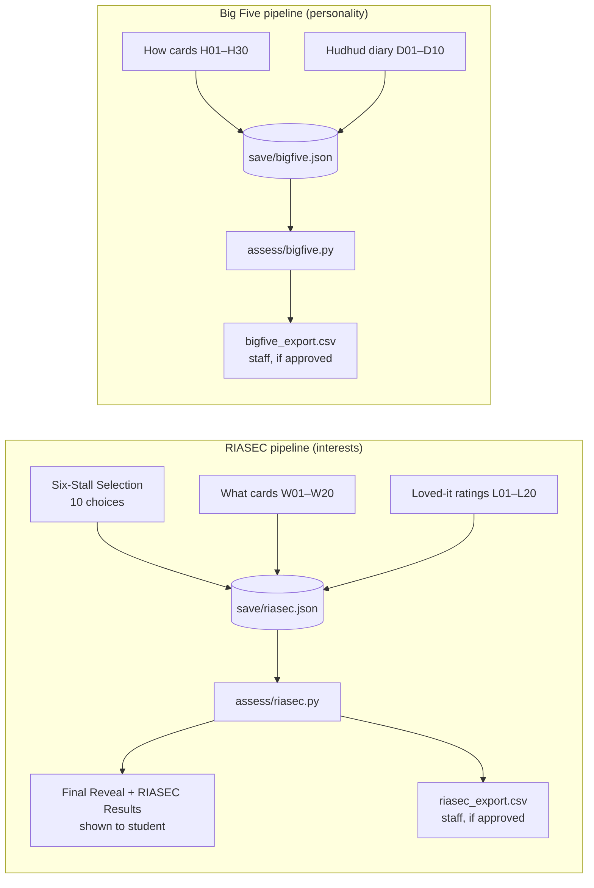

# APNA MELA — Assessment Design

| | |
|---|---|
| **Document** | ASSESSMENT_DESIGN.md · v1.0 (pre-production) |
| **Status** | **Structure: proposed.** **Item wording: draft and not validated.** Diary items: **must be supplied** from the approved instrument. |
| **Owner sign-off required** | The assessment methodology owner, a school counsellor or psychologist, and the Urdu language reviewer |

> **Important scope statement.** This document sets out **where** and **how** items are presented and recorded in the game. It does **not** add, change or claim any psychometric parameters: no norms, weights, cut-offs, reliability figures or validity claims. Wherever the game needs a parameter, this document marks it as **[METHOD OWNER]**, and that value must come from the approved methodology. All What and How card wording below is a **draft for expert review and piloting**. It is not a validated instrument.

---

## 1. Two models, two pipelines



**Separation rules (these may not be broken):**
1. The two pipelines use separate item IDs, separate save files, separate scoring modules, separate export files and separate screens.
2. Neither module imports the other or reads the other's file. A unit test enforces this.
3. No combined score, chart, label, narrative or "profile" ever mixes the two.
4. Big Five domain codes are always written with the `B-` prefix (`B-O, B-C, B-E, B-A, B-N`) so they can never be confused with RIASEC `C` and `E`.
5. Items from one model never mention the other's content. How cards describe behaviour in a situation and never name jobs or stall types. What cards name activities and never ask how the player would behave.
6. Neither model's results are used to adapt, select or reword items in the other.

---

## 2. Safeguards against game-induced bias

| Risk | Safeguard |
|---|---|
| Rewards steer choices | Every option earns the same lights, animation, sound and reaction. Rewards come only from completing an item. |
| Collecting steers stall choice | No stall stamps, achievements or "visit all" goals. Stalls are equally attractive, in a fixed order, and never highlighted. |
| Characters steer choices | Buddies belong to days, not stalls. They never recommend stalls or praise particular choices. Their reactions are random neutral lines. |
| Position bias | What option order and How left/right sides are randomised per player. The order shown is stored with each response. |
| Visual bias | Job illustrations are neutral (no stall colours or icons). All three cards are the same size and design, and none is pre-selected. |
| Stall context leaking into What cards | Kaam Boards list jobs from the whole mela, so the card sequence is fixed **regardless of stall**. |
| Social desirability | Both How options are written to be acceptable. The prompt is "most like you", the reminder says "no wrong answers", and the diary is "just between us". |
| Fatigue | 90 decisions spread over 5 short days, with free pausing. Day balance means any completed day gives an evenly balanced sample. |
| Gaming the results | Answers lock on confirm, days can't be replayed, and the student never sees a running score. |
| Speeding / low engagement | Response time is recorded per item. **[METHOD OWNER]** decides any data-quality flag. It is never shown to the student. |

---

## 3. RIASEC design

### 3.1 Data sources (kept as three separate sub-records)

| Source | Items | Response | What it represents (design intent) |
|---|---|---|---|
| **Stall choice** | 10 (2 per day) | Choice of 1 of the remaining stalls | Which *setting* attracts the player |
| **What cards** | W01–W20 | Choice of 1 of 3 jobs (each a different type) | Which *activity* is preferred when types compete directly |
| **Loved-it ratings** | L01–L20 (one after each What card) | 1–5 hearts | How much the player *enjoys* the activity type they chose |

### 3.2 What-card balance (structure)

- 20 cards = **all C(6,3) = 20 combinations** of three RIASEC types.
- Each type appears in **10 cards**. Each pair of types appears together in **4 cards**.
- Each type has **10 different activities**, each used exactly once (60 activities in total).
- **Daily groups** were found by exhaustive search so that **each type appears exactly twice per day**:

| Day | Cards (type triples) | R | I | A | S | E | C |
|---|---|---|---|---|---|---|---|
| 1 | W01 RIA, W02 RIS, W03 AEC, W04 SEC | 2 | 2 | 2 | 2 | 2 | 2 |
| 2 | W05 RIE, W06 RIC, W07 ASE, W08 ASC | 2 | 2 | 2 | 2 | 2 | 2 |
| 3 | W09 RAS, W10 RAE, W11 ISC, W12 IEC | 2 | 2 | 2 | 2 | 2 | 2 |
| 4 | W13 RAC, W14 RSE, W15 IAC, W16 ISE | 2 | 2 | 2 | 2 | 2 | 2 |
| 5 | W17 RSC, W18 REC, W19 IAS, W20 IAE | 2 | 2 | 2 | 2 | 2 | 2 |
| **Total** | 20 cards | 10 | 10 | 10 | 10 | 10 | 10 |

> Note for the method owner: forced choice between types produces **ipsative** pick counts (they always total 20). These are suitable for ranking types **within** one player. Whether and how they are combined with Loved-it ratings or used for comparisons between players is **[METHOD OWNER]**.

### 3.3 What cards (DRAFT wording)

Card order is fixed (W01→W20). The **option order is randomised** on screen. Types are shown here for reference only and never appear in the game.

| ID | Day | Visit·step | Option (type) | Option (type) | Option (type) |
|---|---|---|---|---|---|
| W01 | 1 | V1·S1 | Fix the wobbly stall table (R) | Test which kite shape flies highest (I) | Paint the big welcome banner (A) |
| W02 | 1 | V1·S3 | Build a kite frame from bamboo sticks (R) | Find out why the lights keep flickering (I) | Help lost children find their families (S) |
| W03 | 1 | V2·S1 | Write a short poem for the opening ceremony (A) | Persuade the principal to keep the mela open later (E) | Make a neat price chart for the stall (C) |
| W04 | 1 | V2·S3 | Help two classmates sort out a disagreement (S) | Start a mini business selling bookmarks (E) | File the permission slips in order (C) |
| W05 | 2 | V1·S1 | Hang up the string lights safely (R) | Test which cup keeps chai hot longest (I) | Convince visitors to try the chaat (E) |
| W06 | 2 | V1·S3 | Oil the creaky wheels of the jhoola (R) | Figure out why one cooler melts ice faster (I) | Count and record the ticket money (C) |
| W07 | 2 | V2·S1 | Paint faces for the little kids (A) | Help a new student make friends (S) | Host the closing ceremony (E) |
| W08 | 2 | V2·S3 | Arrange flowers and lights into a display (A) | Guide a visitor in a wheelchair around the mela (S) | Type up the list of prize winners (C) |
| W09 | 3 | V1·S1 | Hammer together the ticket booth (R) | Make up a catchy jingle for the mela (A) | Teach younger students a new game (S) |
| W10 | 3 | V1·S3 | Plant marigolds along the entrance path (R) | Design the mela's logo (A) | Lead the team that sets up the stage (E) |
| W11 | 3 | V2·S1 | Solve the mystery of the missing raffle tickets (I) | Explain the science show to little kids (S) | Check every stall against the supplies list (C) |
| W12 | 3 | V2·S3 | Check the weather data and predict rain (I) | Come up with a plan to sell more tickets (E) | Label and organise the lost-and-found (C) |
| W13 | 4 | V1·S1 | Put up the tent poles and ropes (R) | Decorate the stall in truck-art style (A) | Make a duty schedule for all volunteers (C) |
| W14 | 4 | V1·S3 | Fix a flat tyre at the bicycle stand (R) | Welcome guests and show them around (S) | Pitch the mela to a local shop for sponsorship (E) |
| W15 | 4 | V2·S1 | Investigate why the plants by the gate are wilting (I) | Take creative photos for the mela board (A) | Fill in the expense sheet carefully (C) |
| W16 | 4 | V2·S3 | Work out how the water filter cleans water (I) | Calm a nervous friend before their stage show (S) | Bargain for a better price on paper plates (E) |
| W17 | 5 | V1·S1 | Set up the speakers and cables (R) | Help an elderly visitor find a seat (S) | Keep the stock list of plates and cups (C) |
| W18 | 5 | V1·S3 | Carve wooden name plates for the stalls (R) | Announce events on the microphone (E) | Sort the raffle tickets by number (C) |
| W19 | 5 | V2·S1 | Run the volcano experiment for the science tent (I) | Write a short funny skit for the stage (A) | Assist the school nurse at the first-aid corner (S) |
| W20 | 5 | V2·S3 | Explain moon craters through the telescope (I) | Play the dhol for the opening (A) | Run the stall and make the big decisions (E) |

Wording criteria used: 4–9 words, written as an action, possible at a school mela, safe for 13–18-year-olds, no gender cues, no implied skill level, roughly equal appeal. **All 60 activities must be reviewed by the method owner for how well each represents its type.**

### 3.4 Loved-it rating

| Field | Value |
|---|---|
| Prompt | "How much did you love doing this?" / «یہ کام آپ کو کتنا اچھا لگا؟» |
| Scale | 5 hearts. End labels are "Not for me" (1) and "Loved it!" (5). Middle points have no labels. |
| Linked to | The RIASEC type of the job chosen on the immediately preceding What card |
| Default | None selected. The confirm button is disabled until a rating is chosen. |

### 3.5 Stall choice

The stall → type mapping is in GAME_DESIGN §7.1. For each visit the game records the stall chosen, which stalls were available (stalls already visited that day are excluded) and the day.

### 3.6 RIASEC scoring structure

```text
For each type T in R, I, A, S, E, C:
  picks[T]      = number of What cards where the chosen option was type T        (0–10)
  loved[T]      = list of Loved-it ratings given after choosing a type-T job     (0–10 values, 1–5 each)
  stall[T]      = number of stall visits to the type-T stall                     (0–10)
```

- **Combination rule, tie-breaking, any weighting and the method for choosing the top 3 types: [METHOD OWNER].**
- *Provisional display rule for prototyping only. It must be replaced or approved:* rank by `picks`; break ties by the mean of `loved`; then by `stall`; any remaining tie is shown as "A/S" in the code.
- **Results display (student):** the 3-letter code, friendly names, and **relative** bars scaled to the player's own highest type. No numbers, percentiles, norms or "strength" wording are shown.
- Career idea lists per type are **[METHOD OWNER / counsellor]**. They should come from an accepted RIASEC occupational classification adapted for Pakistan. The lists in the mockup are placeholders showing the layout.

---

## 4. Big Five design: How cards

### 4.1 Structure

- 30 situational cards, **6 per domain**.
- Each card: one situation + **two responses from the same domain**, one toward the higher end (H) and one toward the lower end (L). Each card therefore measures one domain and never forces a choice between domains.
- The left/right side is randomised. The prompt is "What would you do?" plus "Choose the one that sounds most like you."
- Every day covers all five domains, plus one rotating extra (Day 1 B-O, Day 2 B-C, Day 3 B-E, Day 4 B-A, Day 5 B-N).
- **Neuroticism** is coded `B-N` (higher pole = more emotional reactivity). In staff exports it is labelled "Emotional Stability (reversed)" if the methodology uses that convention. **[METHOD OWNER]**

### 4.2 How cards (DRAFT wording, requires expert review and piloting)

| ID | Day | Domain | Situation | H response (higher pole) | L response (lower pole) |
|---|---|---|---|---|---|
| H01 | 1 | B-E | A big crowd arrives at the stall all at once. | Jump to the front and greet them | Get things ready behind the counter |
| H02 | 1 | B-O | Ustad Karim says you can decorate the stall any way you like. | Try a bold new idea nobody has done before | Use the design that worked well last year |
| H03 | 1 | B-A | Bilal used the paint you were saving. | Let it go, he probably needed it | Tell him he should have asked first |
| H04 | 1 | B-O | A visitor offers you a snack flavour you've never heard of. | Try it right away, just to find out | Stick with a flavour you already like |
| H05 | 1 | B-C | You get a list of ten jobs to finish before lunch. | Plan the order first, then start | Jump in and sort it out as you go |
| H06 | 1 | B-N | The stall plan suddenly changes. | Feel a bit stressed by the change | Just roll with it |
| H07 | 2 | B-E | It's lunch break. | Eat with a big group from other stalls | Eat quietly with one good friend |
| H08 | 2 | B-O | You get a free half hour during setup. | Wander to stalls you know nothing about | Hang out at the stall you already know well |
| H09 | 2 | B-A | The team votes for a plan you don't like. | Go along with it to keep everyone happy | Argue for your plan before agreeing |
| H10 | 2 | B-C | The banner is done, but one corner looks a bit messy. | Fix it until it's neat | It looks fine from far away, so move on |
| H11 | 2 | B-C | Ustad Karim needs the stock count by tomorrow. | Do it today so it's finished | Do it tomorrow morning, there's time |
| H12 | 2 | B-N | Dark clouds are gathering over the mela ground. | Keep checking the sky, a bit worried | Shrug: whatever happens, happens |
| H13 | 3 | B-E | Someone needs to make an announcement on the mic. | Volunteer to do it yourself | Help someone else write it |
| H14 | 3 | B-O | Hira shows you a book of old Pakistani folk art. | Spend time imagining new patterns from it | Pick a pattern that looks good and move on |
| H15 | 3 | B-A | Another stall asks to borrow your extension cord. | Lend it right away | Check that you won't need it first |
| H16 | 3 | B-E | After a long day the team is going out for chai. | Go along, more time together sounds fun | Head home to recharge |
| H17 | 3 | B-C | Your table is covered in paint, tape and paper. | Tidy up before the next job | Keep going and tidy up at the end |
| H18 | 3 | B-N | You make a small mistake in front of everyone. | Keep thinking about it for a while | Laugh it off and move on |
| H19 | 4 | B-E | New volunteers have just joined. | Go and introduce yourself to everyone | Wait until they come over to you |
| H20 | 4 | B-O | The team is choosing a theme for the stage. | Suggest something unusual, like 'a mela on the moon' | Suggest a classic theme everyone will recognise |
| H21 | 4 | B-A | A visitor is rude about your stall. | Stay polite and kind | Tell them firmly that it isn't okay |
| H22 | 4 | B-A | A friend wants the same job you wanted. | Let them have it | Suggest you decide fairly, like taking turns |
| H23 | 4 | B-C | You promised to bring string from home tomorrow. | Set a reminder so you don't forget | Trust yourself to remember in the morning |
| H24 | 4 | B-N | Tomorrow is the big mela day. | You'll probably lie awake thinking about it tonight | You'll sleep easily tonight |
| H25 | 5 | B-E | The stall is quiet for a while. | Call out to passers-by to come and see | Enjoy the calm and tidy up |
| H26 | 5 | B-O | Bilal asks, "Why do people love melas so much?" | Enjoy thinking it through together | Say "for the food!" and get back to work |
| H27 | 5 | B-A | A younger student makes a mistake on the price chart. | Fix it quietly so they don't feel bad | Point it out so they learn for next time |
| H28 | 5 | B-N | The judges arrive an hour early! | Your heart races and you worry it isn't ready | Stay calm, it's ready enough |
| H29 | 5 | B-C | The rule says stalls close at 6 o'clock. | Pack up right on time | Finish what you're doing, even if it runs late |
| H30 | 5 | B-N | Ustad Karim says, "Come and see me later." | Wonder what you did wrong | Assume it's nothing serious |

**How-card domain coverage per day**

| Day | B-O | B-C | B-E | B-A | B-N |
|---|---|---|---|---|---|
| 1 | 2 | 1 | 1 | 1 | 1 |
| 2 | 1 | 2 | 1 | 1 | 1 |
| 3 | 1 | 1 | 2 | 1 | 1 |
| 4 | 1 | 1 | 1 | 2 | 1 |
| 5 | 1 | 1 | 1 | 1 | 2 |
| **Total** | 6 | 6 | 6 | 6 | 6 |

> These are **situational judgement style** items written for the game. They are **not** a validated Big Five measure. Their purpose, their weight relative to the diary, or whether they are used at all in scoring is **[METHOD OWNER]**. Points to check in review: social desirability balance (especially B-A and B-C), reading level, and cultural fit.

### 4.3 How-card scoring structure

```text
For each domain B in B-O, B-C, B-E, B-A, B-N:
  high_choices[B] = number of the domain's 6 cards where the H response was chosen   (0–6)
```

Interpretation, combination with diary scores, and any reporting: **[METHOD OWNER]**.

---

## 5. Big Five design: Hudhud diary (self-report)

### 5.1 Slot structure

The diary has **10 statement slots**, 2 per evening. The game presents them in the **approved instrument's own item order**, unless the instrument's manual says otherwise.

| Slot | Day | Item source | Domain / key | Text |
|---|---|---|---|---|
| D01 | 1 | Approved instrument item 1 | [METHOD OWNER] | [from instrument] |
| D02 | 1 | Item 2 | [METHOD OWNER] | [from instrument] |
| D03 | 2 | Item 3 | [METHOD OWNER] | [from instrument] |
| D04 | 2 | Item 4 | [METHOD OWNER] | [from instrument] |
| D05 | 3 | Item 5 | [METHOD OWNER] | [from instrument] |
| D06 | 3 | Item 6 | [METHOD OWNER] | [from instrument] |
| D07 | 4 | Item 7 | [METHOD OWNER] | [from instrument] |
| D08 | 4 | Item 8 | [METHOD OWNER] | [from instrument] |
| D09 | 5 | Item 9 | [METHOD OWNER] | [from instrument] |
| D10 | 5 | Item 10 | [METHOD OWNER] | [from instrument] |

### 5.2 Requirements for the instrument supplied

- 10 items, 2 per domain (or adjust the slot count and update the diary pacing).
- Suitable for ages 13–18, and licensed for this use, including any translation.
- An **approved Urdu translation** (official, or translated and back-translated under the method owner's process).
- The **response scale and labels** come from the instrument. The mockup's 5 labels ("Not like me at all" … "Very much like me") are placeholders. If the instrument uses a 7-point scale, the diary layout supports up to 7 stamps.
- Reverse keying and scoring are as specified in the instrument manual.

### 5.3 Presentation rules

- One statement per page, no default answer, and a confirm button ("Write it down").
- Statements are shown **exactly as worded** in the instrument (they are not rewritten into game voice). Hudhud's introduction line provides the game framing.
- No feedback after answering apart from a neutral "Noted!" and a page turn.

---

## 6. Data model

```json
// save/riasec.json  (no Big Five data, ever)
{ "schema": "apnamela.riasec.v1", "game_version": "1.0.0",
  "stall_choices": [ {"day":1,"visit":1,"stall":"karigar","type":"R","available":["karigar","jugnu","rangmahal","madad","chatkhara","hisaab"],"t":"2026-11-18T09:12:03","rt_ms":5400} ],
  "what": [ {"id":"W01","day":1,"shown_order":["I","A","R"],"chosen_type":"A","chosen_text_key":"act.A.01","rt_ms":6100} ],
  "loved": [ {"id":"L01","what_id":"W01","type":"A","hearts":4,"rt_ms":2300} ] }

// save/bigfive.json  (no RIASEC data, ever)
{ "schema": "apnamela.bigfive.v1", "game_version": "1.0.0", "instrument_id": "[METHOD OWNER]",
  "how":   [ {"id":"H01","day":1,"domain":"B-E","shown_left":"H","chosen":"L","rt_ms":7200} ],
  "diary": [ {"id":"D01","day":1,"instrument_item":1,"response":4,"scale_points":5,"rt_ms":4100} ] }
```

`profile.json` holds only the nickname, avatar ID, language, settings, progress pointer, lights and a random 6-character **Player Code** (used to match exports, if exports are approved).

---

## 7. Reporting

| Audience | RIASEC | Big Five |
|---|---|---|
| Student (in game) | Final Reveal + Results screen | **Not shown** (default) |
| Counsellor (export, if approved) | `riasec_<code>.csv` | `bigfive_<code>.csv` (separate file) |
| Researcher (if approved) | Anonymised item-level CSV | Anonymised item-level CSV, separate |

---

## 8. Piloting checklist (before release)

1. The method owner reviews all 60 activities and 30 situations, and signs off or replaces each one.
2. The Urdu translation is checked by forward and back translation for the What and How cards. The diary uses the instrument's approved Urdu version.
3. Think-aloud sessions with 6–8 students aged 13–18 (mixed gender, region and language), checking understanding and whether either option is seen as the "right" one.
4. A small pilot with item-level analysis. Which statistics to run and what counts as acceptable is **[METHOD OWNER]**.
5. Confirm there are no side or position effects using the stored option order and side.
