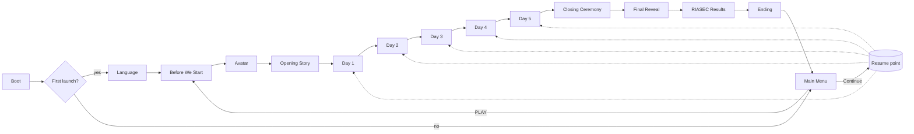
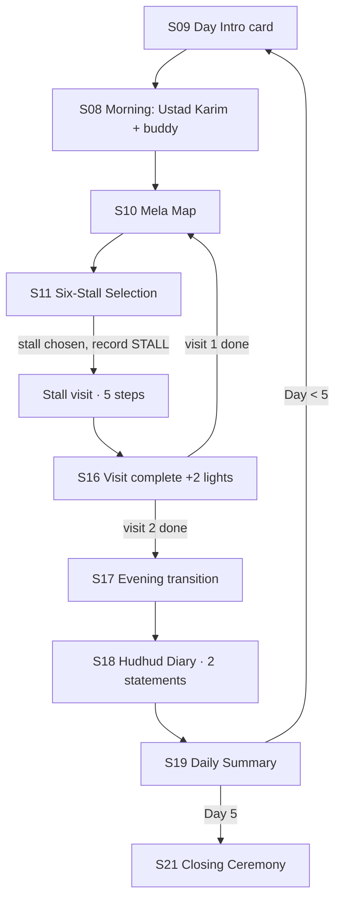
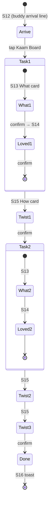
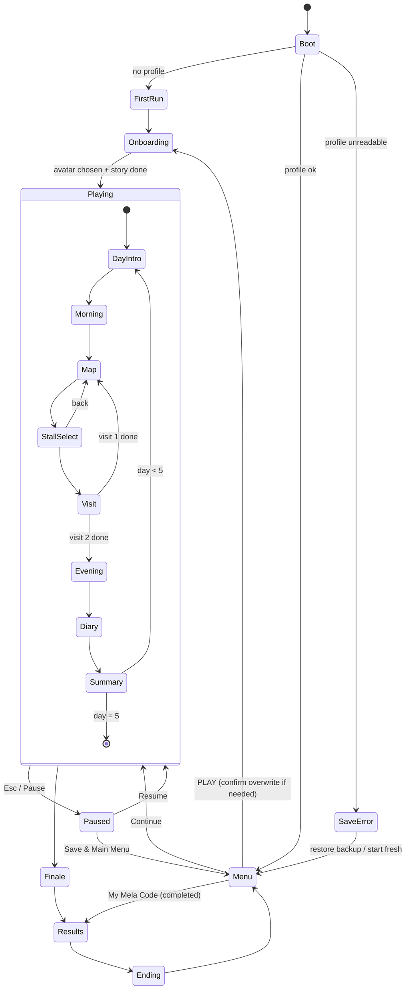

# APNA MELA — Game Flow

| | |
|---|---|
| **Document** | GAME_FLOW.md · v1.0 |
| **Purpose** | The exact order of play, the state machine, save points and timing, for programmers and testers. Screen IDs (S01–S30) refer to SCREEN_SPECIFICATIONS.md. Item IDs refer to ASSESSMENT_DESIGN.md. |

---

## 1. Whole-game flow

## 2. One day

## 3. One stall visit

Every confirm triggers **save** (§6) and **+1 light**. Completing the visit gives **+2 lights**.

## 4. Item schedule

Within each day: **visit 1** uses the day's first 2 What cards and first 3 How cards; **visit 2** uses the next 2 What and next 3 How. The card sequence does **not** depend on which stall is chosen.

| Day | Visit | Step 1 | Step 2 | Step 3 | Step 4 | Step 5 | Evening |
|---|---|---|---|---|---|---|---|
| 1 | 1 | W01 + L01 | H01 | W02 + L02 | H02 | H03 | — |
| 1 | 2 | W03 + L03 | H04 | W04 + L04 | H05 | H06 | D01, D02 |
| 2 | 1 | W05 + L05 | H07 | W06 + L06 | H08 | H09 | — |
| 2 | 2 | W07 + L07 | H10 | W08 + L08 | H11 | H12 | D03, D04 |
| 3 | 1 | W09 + L09 | H13 | W10 + L10 | H14 | H15 | — |
| 3 | 2 | W11 + L11 | H16 | W12 + L12 | H17 | H18 | D05, D06 |
| 4 | 1 | W13 + L13 | H19 | W14 + L14 | H20 | H21 | — |
| 4 | 2 | W15 + L15 | H22 | W16 + L16 | H23 | H24 | D07, D08 |
| 5 | 1 | W17 + L17 | H25 | W18 + L18 | H26 | H27 | — |
| 5 | 2 | W19 + L19 | H28 | W20 + L20 | H29 | H30 | D09, D10 |

(The mockups show Day 2, visit 2 at the Jugnu Science Tent: W07 → L07 → H10.)

## 5. Game state machine (top level)

## 6. Saving & resuming

| Event | What is written | File |
|---|---|---|
| Language, avatar or settings change | profile | `profile.json` |
| Stall chosen (S11 confirm) | stall choice record + `progress.cursor` | `riasec.json` + `profile.json` |
| What / Loved-it confirm | item record + cursor + lights | `riasec.json` + `profile.json` |
| How / Diary confirm | item record + cursor + lights | `bigfive.json` + `profile.json` |
| Visit complete, day complete | cursor + lights + board photos | `profile.json` |

- **How writes are done:** each file is written to a `*.tmp` file, flushed, then renamed over the original (an atomic replace). The previous version is kept as `*.bak`.
- **Order of writes:** the item file is written **before** the cursor. If the game crashes in between, the resume logic checks whether the next item already has a record and skips past it, so no answer is ever duplicated or lost.
- **Cursor format:** `{"day":2,"visit":2,"step":1,"sub":"loved"}`. The resume point is the next screen after the cursor (S12 for a visit start, otherwise the exact card).
- **Pause → Save & Main Menu** never discards an answer that has been confirmed. A card that has been selected but **not confirmed** is not saved, and the card is shown again (with a new random order) on resume.

## 7. Timing budget (target)

| Segment | Time | Count | Total |
|---|---|---|---|
| Onboarding (language, notice, avatar, story) | 3–4 min | 1 | ~4 min |
| Day intro + morning dialogue | 40 s | 5 | ~3.5 min |
| Map + stall choice | 20 s | 10 | ~3.5 min |
| Stall visit (5 steps) | 90–110 s | 10 | ~17 min |
| Diary + summary | 70 s | 5 | ~6 min |
| Finale + results | 3 min | 1 | ~3 min |
| **Total** | | | **~37–45 min** (plus reading time for slower readers, up to ~60 min) |

This fits one double period, or two single periods with a save between them.

## 8. Input map

| Action | Mouse/Touch | Keyboard |
|---|---|---|
| Select / confirm | Tap | Enter / Space |
| Move focus | — | Tab / Shift+Tab, arrow keys |
| Advance dialogue | Tap anywhere | Enter / Space |
| Skip dialogue | Skip pill | Hold Enter 0.6 s |
| Pause | Pause button | Esc |
| Back (in menus) | Back button | Backspace / Esc |

## 9. Day-by-day content beats

| Day | Morning (Karim → buddy) | Map tip | Evening recap (Hudhud) | Teaser |
|---|---|---|---|---|
| 1 | Mela announced, torn banner, "You're a volunteer!" → Zain explains the map and the Kaam Boards (tutorial prompts) | "Pick any stall. There's no wrong one!" | First diary: "This diary is just between us." | Hira's big list |
| 2 | Karim: "Hira has a list." → Hira, clipboard, clouds | "Rain or not, the jobs won't wait!" | Recap of today's stalls | Bilal and the stage |
| 3 | The stage frame arrives → Bilal, jokes, nerves | "The stage needs everyone today." | Recap | Sara's camera |
| 4 | New volunteers join → Sara photographs everything | "Strike a pose at every stall!" | Recap + "tomorrow is the day" | Mela Day! |
| 5 | Gates open, crowds → Karim joins the player | "Families are here, let's go!" | Last diary | → Closing ceremony |
