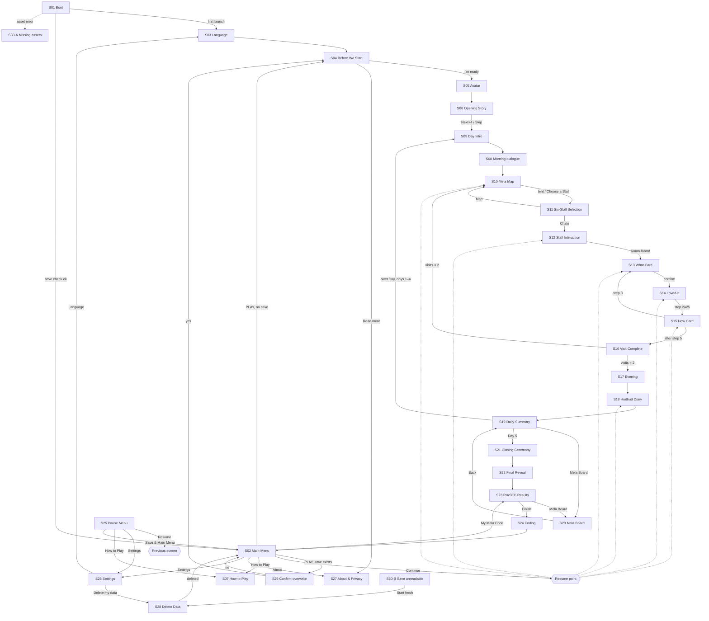

# APNA MELA — Screen Specifications

| | |
|---|---|
| **Document** | SCREEN_SPECIFICATIONS.md · v1.0 |
| **Canvas** | All coordinates are in **logical pixels on the 1920 × 1080 canvas** (see UI_STYLE_GUIDE §9 for scaling). |
| **Mockups** | `mockups/APNA_MELA_MOCKUPS.html` (all screens, live) and `mockups/png/NN_*.png`. Each screen below lists its mockup reference where one exists. |
| **Conventions** | **Btn-P** = primary pink button · **Btn-S** = secondary teal · **Btn-T** = tertiary cream · **IBtn** = 104 px square icon button · **HUD** = the gameplay top bar (§0.2). "→" = navigation destination. |

---

## 0. Shared elements

### 0.1 Screen IDs

| ID | Screen | Type | Mockup |
|---|---|---|---|
| S01 | Boot / Splash | Full screen | — |
| S02 | Main Menu | Full screen | 01 |
| S03 | Language Selection | Full screen | 02 |
| S04 | Before We Start (privacy notice) | Full screen | — (uses the S27 layout) |
| S05 | Avatar Selection | Full screen | 03 |
| S06 | Opening Story | Full screen | 04 |
| S07 | How to Play | Modal overlay | — (card layout as S13) |
| S08 | Character Dialogue | Overlay on scene | 05 |
| S09 | Day Intro Title Card | Full screen, transitional | — |
| S10 | Mela Map | Full screen (hub) | 06 |
| S11 | Six-Stall Selection | Overlay on map | 07 |
| S12 | Stall Interaction | Full screen | 08 |
| S13 | What Decision Card | Overlay on stall | 09 |
| S14 | Loved-It Rating | Overlay on stall | 11 |
| S15 | How Decision Card | Overlay on stall | 10 |
| S16 | Visit Complete Toast | Small overlay | — |
| S17 | Evening Transition | Transitional | — |
| S18 | Hudhud Diary | Full screen | 12 |
| S19 | Daily Summary | Full screen | 13 |
| S20 | Mela Board | Full screen | 14 |
| S21 | Closing Ceremony (Day 5) | Uses S08 on a night scene | — |
| S22 | Final Reveal | Full screen | 15 |
| S23 | RIASEC Results | Full screen | 16 |
| S24 | Ending / Credits | Full screen | — |
| S25 | Pause Menu | Modal overlay | 17 (left) |
| S26 | Settings | Modal overlay / full screen from the menu | 17 (right) |
| S27 | About & Privacy | Full screen | — |
| S28 | Delete Data (2-step confirmation) | Modal | — |
| S29 | Generic Confirm Dialog | Modal | — |
| S30 | Error & Recovery States | Modal / full screen | — |

### 0.2 Gameplay HUD (on S10–S15)

| Element | Position (x, y, w, h) | Behaviour |
|---|---|---|
| Day pill | 48, 36, ~470, 84 | "Day N" + five circles: past days are yellow, today is white, future days are lilac. Not interactive. |
| Lights pill | 560, 36, ~250, 84 | Diya icon + count "/ 100". When a light is earned: +1 pop (scale 1→1.25→1, 240 ms) and a particle flies from the source to the pill. |
| Map IBtn | 1452, 26 | → S10. Disabled during cards (S13–S15) and while answering in S18. |
| Diary IBtn | 1572, 26 | Opens a read-only view of past diary pages (just the statement + "answered", **never the answer value**). |
| Board IBtn | 1692, 26 | → S20 (returns to the same place). |
| Pause IBtn (yellow) | 1800, 26, 92 | → S25. The Esc key does the same. |

### 0.3 Global behaviours
- **Transitions:** a "bunting wipe" between full screens (bunting flags sweep left to right, 450 ms). Overlays fade the background to 55 % ink and the card rises 40 px with `easeOutBack`, 320 ms. With Reduce Motion on, all of these become 200 ms cross-fades.
- **Focus order:** left-to-right, top-to-bottom. The confirm button is always last. The focused element shows a 6 px dashed yellow outline.
- **Urdu mode:** the layout mirrors horizontally (lists, steppers and back/next arrows flip; character placement flips). The HUD keeps the same element order but is anchored from the right.
- **Audio:** each button press plays `sfx_ui_tap`, and each confirm plays `sfx_confirm_stamp`.

---

## S01 · Boot / Splash
- **Purpose:** load assets, check the save file, show the school edition logo.
- **Layout:** cream background with a truck-art border. Centre: APNA MELA logo (720 px wide). Below: a progress bar (600 × 24 px) filling up as assets load. Hudhud flaps in place to the right of the bar.
- **UI elements:** logo, progress bar, "Loading the mela…" caption (EN/UR).
- **Buttons:** none.
- **Navigation:** first launch → S03. Otherwise → S02.
- **Animations:** logo drops in (scale 0.8→1, easeOutBack). Hudhud flap loop (8 frames, 12 fps).
- **Characters:** Hudhud only.
- **Error states:** missing asset → S30-A. Corrupt save → S30-B (after loading finishes).

## S02 · Main Menu *(mockup 01)*
- **Purpose:** the game's front door. Start, continue or reopen results; settings; about.
- **Layout:** dusk mela background (`bg_menu_mela_dusk`). Logo centred at x 410–1510, y 70–510, with Hudhud perched top-right. Buttons stacked in the centre column (x 660–1260). Zain and Hira bottom-left, Bilal and Sara bottom-right (each 430–470 px tall).
- **UI elements:** language pill (48, 40), sound IBtn (1660, 30), settings IBtn (1784, 30), privacy chip (1480, 1010), version label (48, 1024).
- **Buttons:**
  | Button | Style | Size | → |
  |---|---|---|---|
  | PLAY / کھیلیں | Btn-P XL | 600 × 156 | No save → S04. Save exists → S29 "Start a new game? This erases your answers." |
  | Continue · Day N | Btn-S | 500 × 110 | Shown only if an unfinished save exists → resume point (S10/S12/S13…/S18) |
  | My Mela Code | Btn-S | 500 × 110 | Replaces Continue once the game is finished → S23 |
  | How to Play | Btn-T | 290 × 92 | → S07 |
  | About | Btn-T | 290 × 92 | → S27 |
  | Language pill | Toggle | 236 × 84 | Switches EN/UR instantly |
  | Sound | IBtn | 104 | Mute/unmute all audio |
  | Settings | IBtn | 104 | → S26 |
- **Animations:** bunting sways (±3°, 3 s loop), string lights twinkle (random 20 % dim/bright), the Ferris wheel turns slowly (1 rev/40 s), characters breathe/blink in idle, Zain and Sara wave every 6 s. The PLAY button pulses gently (scale 1→1.03, 1.6 s).
- **Characters:** Zain (happy, wave), Hira (smile), Bilal (happy), Sara (smile, wave), Hudhud (happy, perched).
- **Empty/error:** no save → no Continue button (PLAY moves into its space). Save unreadable → Continue is disabled with the tooltip "Save couldn't be read" → S30-B.

## S03 · Language Selection *(mockup 02)*
- **Purpose:** choose English or Urdu (on first launch; also available from Settings).
- **Layout:** soft pattern background with bunting. Hudhud (440, 92) with a bilingual speech bubble (680, 110, 820 × 170). Two language cards 600 × 520 at x 300 and 1020, y 330. A note at y 900, Continue at (740, 960).
- **UI elements:** cards show a large script sample ("Aa" / "اردو"), the language name and a greeting. The selected card gets a yellow 12 px glow, lifts 16 px and shows a green check badge.
- **Buttons:** language cards (select). Continue (Btn-P 440 × 100) → S04 (first launch) or back to S26.
- **Animations:** cards deal in from below (60 ms stagger). On selection, the entire UI text crossfades to the new language (200 ms) and the layout mirrors for Urdu.
- **Characters:** Hudhud (talk; mouth animates while the bubble text types in).
- **Default:** English is pre-selected on first launch (or the OS locale if it is `ur`).

## S04 · Before We Start
- **Purpose:** a plain-language notice to the student about privacy and how the game works. Shown before the first play only.
- **Layout:** the S27 card layout, 1200 × 800 centred, with Hudhud on the left.
- **Content (max 5 bullets):** "There are no right or wrong answers." · "Go with your first honest answer, because you can't change it later." · "Everything stays on this computer." · "Use a nickname, not your full name." · "You can pause any time."
- **Buttons:** "I'm ready!" Btn-P → S05 · "Back" Btn-T → S02 · "Read more" link → S27.
- **Animations:** bullets tick in one by one (120 ms each).
- **Characters:** Hudhud (smile).

## S05 · Avatar Selection *(mockup 03)*
- **Purpose:** choose one of 8 preset volunteers and enter an optional nickname.
- **Layout:** left: podium (150, 760, 640 × 160) with a spotlight and a large avatar preview (≈520 px tall). Right: a 4 × 2 grid of portrait tiles (196 × 220, 24 px gaps) starting at (940, 300). Nickname field (940, 866, 620 × 84) with a privacy note below. Title ribbon at the top.
- **UI elements:** tiles (the selected one is yellow with a glow), a text field (max 12 characters; letters and spaces; English or Urdu keyboard input), caption "First name or a nickname only. It stays on this device."
- **Buttons:** Back (Btn-T) → S04. "That's me! / یہ میں ہوں" (Btn-P 290 × 120) → S06.
- **Animations:** when a tile is chosen, the podium avatar swaps with a pop (scale 0.9→1) and waves. A sparkle appears on the tile.
- **Characters:** the selected avatar (happy, wave).
- **Validation:** an empty nickname is fine (the game calls the player "Volunteer"). Characters outside the allowed set are ignored. The nickname is shown only in-game (dialogue, Ending) and is never included in any export.

## S06 · Opening Story *(mockup 04)*
- **Purpose:** set up the premise in about 40 seconds.
- **Layout:** night-purple storybook background with stars. Three comic panels (560 × 600, slightly rotated) appear one at a time. Caption card (180, 760, 1560 × 200) with Next on the right of the caption. Progress dots at the bottom centre. Skip pill top-right.
- **Panels (4 beats):** ① School gate and banner "5 DAYS TO GO!" ② Ustad Karim holding the torn banner (worried) ③ Hudhud lands on the neem branch; the avatar is amazed ④ (replaces all panels) Hudhud close-up: "Five days, six stalls, one mela…"
- **Buttons:** Next (Btn yellow 210 × 110) → next beat → after beat 4 → S09 (Day 1). Skip → S09.
- **Animations:** panels slide in from the right, rotating into place (400 ms). Caption text types at 40 chars/s (tap shows it all at once). Sparkles twinkle in panel 3.
- **Characters:** Ustad Karim (worried), Hudhud (happy), avatar (wow).

## S07 · How to Play
- **Purpose:** help that can be opened at any time. Six swipeable cards.
- **Layout:** modal card 1200 × 760. Each card has an illustration (520 × 360) on top and two lines of text below. Page dots.
- **Cards:** 1 Map & stalls · 2 Kaam Board jobs · 3 Twists · 4 Hearts · 5 Hudhud's diary · 6 Lights & the Mela Board.
- **Buttons:** ◀ ▶ arrows (IBtn), Close (IBtn ×) → return to the previous screen.
- **Animations:** horizontal slide between cards (240 ms).

## S08 · Character Dialogue *(mockup 05)*
- **Purpose:** every story conversation.
- **Layout:** a blurred scene background (school courtyard, map, stall or night ground). Speaker full body on the left (≈640 px tall, overlapping the box). Listener on the right at 82 % brightness. Dialogue box (150, 740, 1620 × 290, radius 40) with a name tag in the speaker's colour. Continue triangle bottom-right.
- **UI elements:** name tag, text (Body L 40 px, max 3 lines / 160 characters), Log pill, Skip pill, Pause IBtn (top-left during story).
- **Buttons:** tap anywhere / Space / Enter = finish typing, then advance. Log → a scrollable transcript modal. Skip → jump to the end of the scene.
- **Animations:** text types at 40 chars/s. The speaker's mouth alternates between talk and smile at 8 fps while typing. The speaker bobs 6 px on each new line. When the speaker changes, the brightness swaps (150 ms).
- **Characters:** any. Speaker colours: Zain orange, Hira blue, Bilal green, Sara purple, Karim teal, Hudhud yellow (ink text).
- **Rule:** dialogue never contains assessment questions. Optional reply chips (max 2) are purely for flavour, don't change anything, and aren't recorded.

## S09 · Day Intro Title Card
- **Purpose:** mark the start of each day.
- **Layout:** full-bleed sky gradient for the time of day. A large ribbon in the centre: "DAY 2 · The Big List" with the Urdu subtitle. The buddy portrait (300 px circle) below. Five day dots.
- **Buttons:** none (auto-advances after 2.2 s, or tap to skip) → S08 morning scene → S10.
- **Animations:** the ribbon unrolls (scaleX 0→1, 400 ms), the portrait pops, today's dot fills in.

## S10 · Mela Map *(mockup 06)*
- **Purpose:** the daily hub where the player chooses where to go.
- **Layout:** illustrated top-down 3/4 view of the school ground: an oval sand path, the jhoola in the centre, six tents (280 × 250) at fixed positions (Karigar 250,230 · Jugnu 560,110 · Rang Mahal 1110,110 · Madad 1420,230 · Chatkhara 330,540 · Hisaab 1340,540), each with a name pill. The avatar stands on the path with a pink marker. HUD at the top. "Today's plan" card (40, 880, 600 × 170). Buddy portrait + tip bubble (1170, 860). "Choose a Stall" Btn-P (700, 960, 400 × 100).
- **UI elements:** tent hit areas (the tent plus its label). A green check badge on stalls visited today. On Day 5, extra crowd NPC sprites walk the path.
- **Buttons:** tent → S11 with that stall pre-selected. Choose a Stall → S11. HUD buttons.
- **Navigation after 2 visits:** the plan card turns green ("All done for today!") → auto → S17 after 1.2 s.
- **Animations:** the Ferris wheel turns, Hudhud flies a loop over the map, tent flags flutter, the avatar walks to the chosen tent (600 ms path tween) before the screen changes.
- **Characters:** the avatar (small, 190 px), Hudhud (fly), today's buddy portrait (talk).
- **Empty state:** before the first visit of the day, the plan bar shows 0/2 and the buddy tip says "Pick any stall to start!"

## S11 · Six-Stall Selection *(mockup 07)*
- **Purpose:** the stall decision (RIASEC secondary signal).
- **Layout:** map dimmed to 55 %. Title ribbon "Where to next?" Stall cards (500 × 310) in a 3 × 2 grid, x 170 / 710 / 1250, y 230 / 580. **The order is fixed** (Karigar, Jugnu, Rang Mahal / Madad, Chatkhara, Hisaab).
- **Card content:** a coloured header (140 px) with the stall icon disc and a small tent illustration, the English name (H3), the tagline, and the Urdu name.
- **States:** default · focused (dashed outline) · selected (lift 14 px, yellow glow) · **visited today** (70 % grey, "Visited today" chip, not selectable).
- **Buttons:** Map (Btn-T) → S10 (no choice recorded). "Chalo! Let's go" (Btn-P 520 × 116, disabled until a stall is selected) → records the choice → S12.
- **Animations:** cards deal in together (no stagger, so no card appears first). Selecting one lifts it.
- **Note:** no card ever shows a badge, "new", a reward or a recommendation (see ASSESSMENT §2).

## S12 · Stall Interaction *(mockup 08)*
- **Purpose:** arrive at a stall and start the visit.
- **Layout:** stall front scene (`bg_stall_<id>`): an awning in the stall colour, a sign board at the centre top (560, 236, 800 × 110), a counter, and props. HUD + visit stepper (640, 140). Buddy on the left (≈560 px), avatar on the right (≈500 px), speech bubble (420, 390, 390 × 250). **Kaam Board** (1330, 330, 440 × 400) glowing, with a "Tap!" hand hint.
- **UI elements:** stepper (Task · Twist · Task · Twist · Twist), board with 4 pinned notes (decorative).
- **Buttons:** Kaam Board (the main target, also activated by Enter) → S13. HUD buttons.
- **Animations:** the board glow pulses (1.2 s); the hand hint bobs. Stall props have small idle movements (steam from the chaat pot, bubbling flasks, spinning kite, ticket roll) — one loop per stall.
- **Characters:** today's buddy (talk, point) with the arrival line for this stall; avatar (smile).
- **Resume:** if the visit was interrupted, the game opens here with the stepper at the saved step and the board labelled "Continue".

## S13 · What Decision Card *(mockup 09)*
- **Purpose:** RIASEC activity choice.
- **Layout:** the stall scene blurred + 55 % dim. HUD and stepper. Ribbon "What would you like to do?" (500, 250, 920 × 110). Counter pill "Job N of 20". Three option cards (440 × 450) at x 250 / 750 / 1250, y 410, each with a neutral illustration (220 px circle) and the job title (H3, max 2 lines). Hint caption at y 900. Confirm Btn-P "Yeh wala! This one" (710, 950, 500 × 110).
- **States:** cards rest at small rotations (−2°, 0°, 2°) → the selected one straightens, lifts 30 px, gets a yellow glow and a check badge. The confirm button is disabled until a card is selected.
- **Buttons:** cards (select; selecting again confirms) → confirm → S14.
- **Animations:** cards deal in from the bottom (60 ms stagger, in the randomised display order). On confirm, a "PAKKA!" stamp slams onto the chosen card (160 ms), the other cards slide down and fade.
- **Characters:** none on screen (reduces social cues).
- **Data:** stores the display order, the chosen type, and the response time from when the cards finish dealing in.

## S14 · Loved-It Rating *(mockup 11)*
- **Purpose:** rate enjoyment of the chosen job.
- **Layout:** dimmed stall. Card (360, 140, 1200 × 740). The top 300 px is a vignette: the avatar (busy/think pose) + the job illustration + today's buddy watching. Below: "You chose: …" caption, the H2 question, five 150 px hearts with 28 px gaps, and end labels. Confirm Btn-P "Done ✓" (760, 920).
- **States:** hover/focus on heart N previews hearts 1…N filled; clicking sets the rating. Nothing is selected by default.
- **Buttons:** hearts, Done → S15 (if the next step is a Twist).
- **Animations:** the vignette plays 3 s (the avatar does the action loop, sparkles). Hearts pop in sequence when chosen. Light confetti appears (the **same** for every rating).
- **Characters:** avatar (happy, busy pose), buddy (happy).

## S15 · How Decision Card *(mockup 10)*
- **Purpose:** Big Five situational choice.
- **Layout:** dimmed stall. HUD + stepper. Buddy portrait (180, 260, 230 px). A speech bubble with a purple "Twist!" tag (450, 270, 1290 × 170) containing the situation + "What would you do?". Two option cards (720 × 340) at x 210 / 990, y 500, with A/B discs (teal/purple). Caption at y 880, confirm Btn-P "Pakka! ✓" (760, 950).
- **States:** as in S13 (select → lift + glow). Confirm is disabled until a choice is made.
- **Buttons:** options, confirm → next step (S13 for step 3) or S16 after step 5.
- **Animations:** the bubble pops in, then the options slide in from the left and right at the same time. On confirm: a stamp, then a neutral reaction line from the buddy (randomly chosen).
- **Characters:** today's buddy portrait (expression chosen by the **situation**, not by the answer).

## S16 · Visit Complete Toast
- **Purpose:** close the visit and give a small reward.
- **Layout:** a 900 × 300 toast in the centre of the stall scene. A polaroid flies in from the left (Sara's photo), "+2 lights" with the diya, "That's a wrap here!"
- **Buttons:** "Back to the map" Btn-P → S10 (or auto after 2.5 s).
- **Animations:** the camera flash (white 80 ms fade, **disabled with Reduce Motion**), the polaroid drops into place, the light count ticks up.

## S17 · Evening Transition
- **Purpose:** move from day to night.
- **Layout:** the map's sky changes from day to dusk to night (1.6 s), the string lights switch on one by one, and Hudhud flies to the neem tree.
- **Navigation:** auto → S18.

## S18 · Hudhud Diary *(mockup 12)*
- **Purpose:** Big Five self-report (2 statements per evening).
- **Layout:** night mela background. A diary book spread (190, 110, 1540 × 820). **Left page:** "Day N", "Hudhud's Diary / ہدہد کی ڈائری", stall doodles for today's visits, Hudhud's recap line. **Right page:** "Statement k of 2" pill, the statement text (H2, as worded in the instrument), "How much is this like you?", and a response scale of 5 (up to 7) stamp circles with labels underneath. Hudhud perched on the top-right corner. Confirm Btn (purple) "Write it down ✎" (1120, 950).
- **States:** nothing selected by default. The selected stamp fills purple with a yellow ring.
- **Buttons:** stamps, Write it down → page turn → statement 2 → S19.
- **Animations:** the book opens (scaleX on the hinge, 500 ms), the quill writes the recap line, pages turn (300 ms skew), and Hudhud's crest flutters on each answer.
- **Characters:** Hudhud (talk while the recap types; smile afterwards).
- **Privacy cue:** small lock icon + "Just between us" under the title.

## S19 · Daily Summary *(mockup 13)*
- **Purpose:** celebrate finishing the day and preview tomorrow.
- **Layout:** blurred dusk background. Card (240, 110, 1440 × 880). Yellow ribbon "Day N complete!" A summary line (which stalls, with which buddy). Three tiles: stalls visited, jobs done, +20 lights with a progress bar. Today's two polaroids. Tomorrow teaser (dashed card with the next buddy's portrait). Buttons.
- **Buttons:** Mela Board (Btn-S) → S20 → back here. "Next Day" (Btn-P) → save → S09 for the next day. On Day 5 this is replaced by "To the closing ceremony" → S21.
- **Animations:** tiles count up (600 ms), the light bar fills, polaroids drop in with a slight swing.
- **Characters:** next buddy portrait (happy).
- **Content rule:** the summary never mentions which *types* of jobs were chosen, only that they were done.

## S20 · Mela Board *(mockup 14)*
- **Purpose:** a keepsake view of progress.
- **Layout:** a wooden wall with a truck-art frame (80, 60, 1760 × 980) and a corkboard inside. Title ribbon. A string of 20 bulbs (each = 5 lights) with a count. Five day columns (220 + 310·(d−1)), each with a day ribbon and 2 polaroid slots (240 × 276). Empty slots are dashed with a camera icon and "Coming soon". Sara waving in the bottom-right corner.
- **Buttons:** Back (Btn-T) → the screen it was opened from. Tapping a polaroid enlarges it (a modal, 1.6×, with the caption "Day 2 · Jugnu Science Tent with Hira").
- **Animations:** newly lit bulbs glow in sequence, and the newest polaroid wiggles once.
- **Empty state (Day 1, before any visit):** all slots are dashed, with Sara saying "I'll take photos as you go!"

## S21 · Closing Ceremony (Day 5)
- Uses **S08** on the `bg_final_mela_night` scene, with everyone on stage. Ustad Karim speaks 4 lines, the lights cascade on, then → S22.

## S22 · Final Reveal *(mockup 15)*
- **Purpose:** the emotional payoff, revealing the top 3 interest types.
- **Layout:** night mela, fireworks, a radial glow in the centre. Ribbon "Your Mela Code!" Hudhud (840, 150) holding the open diary. Three medallions: #1 at 300 px (centre-left), #2 and #3 at 260 px, each with the stall icon, the letter and a name pill underneath. The four friends cheering along the bottom. Btn yellow "See what it means" (700, 930).
- **Sequence (≈6 s, tap to skip ahead):** the diary glows (0.8 s) → medallion 1 rises with a burst (0.9 s) → medallion 2 → medallion 3 → the friends cheer → the button appears.
- **Ties:** if the scoring rule (ASSESSMENT §3.6) returns a tie for a position, that medallion shows both letters split ("A/S").
- **Animations:** fireworks (2–3 bursts per second at most, no full-screen flash), confetti, characters jump (happy).
- **Navigation:** → S23.

## S23 · RIASEC Results *(mockup 16)*
- **Purpose:** explain the student's interest profile in friendly, non-judgemental language.
- **Layout:** three cards (y 200, height 720): **Your Mela Code** (70, 520 w) with medallions, names and a summary sentence; **All six interest areas** (630, 620 w) with six rows (icon, friendly name + RIASEC term, a relative bar in the type colour); **Careers to explore** (1290, 560 w) with chips for the top 3 types. Footer note with the info icon (70, 950). Buttons bottom-right.
- **Buttons:** Mela Board (Btn-T) → S20. Finish (Btn-P) → S24 (first time) or S02 (when reopened from "My Mela Code").
- **Animations:** bars fill from 0 (staggered 80 ms), chips pop in.
- **Rules:** no numbers, percentages, norms or ranks against other students; no Big Five content.
- **Accessibility:** each bar also shows a text description on focus (e.g. "Creator: your strongest area in this game").

## S24 · Ending / Credits
- **Purpose:** thank the player and close the experience.
- **Layout:** the night mela, everyone waving. "Shabash, Volunteer [nickname]!" A short credits scroll (school, team, fonts and licences).
- **Buttons:** Main Menu (Btn-P) → S02.
- **Animations:** slow credits scroll; Hudhud flies off toward the moon.

## S25 · Pause Menu *(mockup 17, left)*
- **Layout:** the current scene blurred + dimmed. Card (80, 90, 620 × 920) with a yellow "Paused" ribbon, Hudhud portrait, location line ("Day 2 · Jugnu Science Tent").
- **Buttons:** Resume (Btn-P) → previous screen. Settings (Btn-S) → S26. How to Play (Btn-T) → S07. "Save & Main Menu" (Btn-T) → S02 (it always saves first).
- When opened from the menu or story, the right side is empty; when Settings is open it appears beside it (as in the mockup).

## S26 · Settings *(mockup 17, right)*
- **Layout:** card (760, 90, 1080 × 920) with a teal "Settings" ribbon. Rows every 90 px, each with an icon, a label and a control at x 560 inside the card.
- **Controls:**
  | Row | Control | Default |
  |---|---|---|
  | Language | EN / اردو pill | as chosen |
  | Music | slider 0–100 | 60 |
  | Sound effects | slider 0–100 | 80 |
  | Text size | 3 buttons (100 / 125 / 150 %) | 100 % |
  | Read aloud | toggle (disabled + "Needs the voice pack" if not installed) | off |
  | Reduce motion | toggle | off (follows the OS setting if available) |
  | High contrast | toggle | off |
  | Full screen | toggle | on |
  | Delete my data… | danger Btn-T (red outline) → S28 | — |
- **Behaviour:** changes apply instantly and save to `profile.json`. Pressing Esc closes the panel.

## S27 · About & Privacy
- **Layout:** a 1200 × 860 card with tabs: **About** (what the game is, who made it) · **Your privacy** (the data stored, where, who can see it, how to delete) · **Credits & licences**.
- **Buttons:** Close → previous screen.
- **Content:** written at Grade 6 reading level, in EN and UR. It must match GAME_DESIGN §10.2 exactly.

## S28 · Delete Data (2-step)
- **Step 1:** modal 900 × 460. "Delete all your answers and progress?" with buttons Cancel (Btn-T, **focused by default**) / "Yes, delete" (red Btn).
- **Step 2:** "Are you sure? This can't be undone." Cancel / "Delete everything" (red, enabled after a 2 s countdown).
- **Result:** all three save files are removed → toast "Your data was deleted" → S02 in its first-launch state.

## S29 · Generic Confirm Dialog
- 900 × 420 modal: title, one sentence and two buttons (the safe choice is focused by default). Used for "New game overwrites your save", "Quit the game?" and "Leave the stall? Your progress here is saved."

## S30 · Error & Recovery States
| ID | Trigger | Presentation | Actions |
|---|---|---|---|
| S30-A | Required asset missing or corrupt | Full screen: Hudhud (worried) "Some mela pieces are missing!" + the file name in small text | Quit · (the game uses a placeholder for optional assets and logs the problem without stopping) |
| S30-B | Save file unreadable or schema mismatch | Modal: "We couldn't open your saved mela." | "Try again" · "Start fresh" (→ S28 step 2 wording) · the backup `*.bak` is restored automatically if valid |
| S30-C | Disk write failed while auto-saving | Toast (non-blocking, top centre, red outline): "Couldn't save just now, we'll try again." Retries 3× with backoff | If the 3rd retry fails, a modal: "Your progress since Day N may be lost if you quit." with OK |
| S30-D | Window smaller than 1280 × 720 | Letterbox overlay: "Make the window bigger to play" | Resizes automatically when possible |
| S30-E | Urdu font failed to load | Falls back to English with a toast "Urdu text unavailable" | — |

---

## Navigation flow

The Pause Menu (S25) can be opened from S06, S08, S10–S20 and S22 using the Pause button or Esc. The HUD's Map, Diary and Board buttons are available on S10–S12 (Map is disabled while a card is open).
