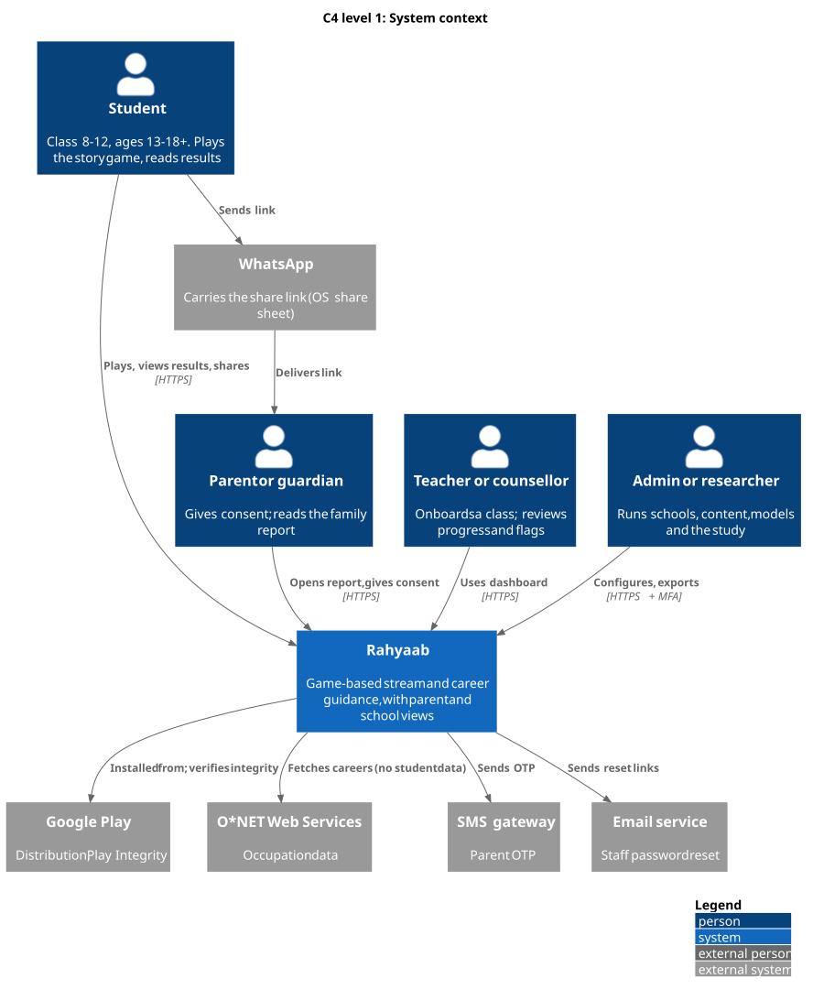
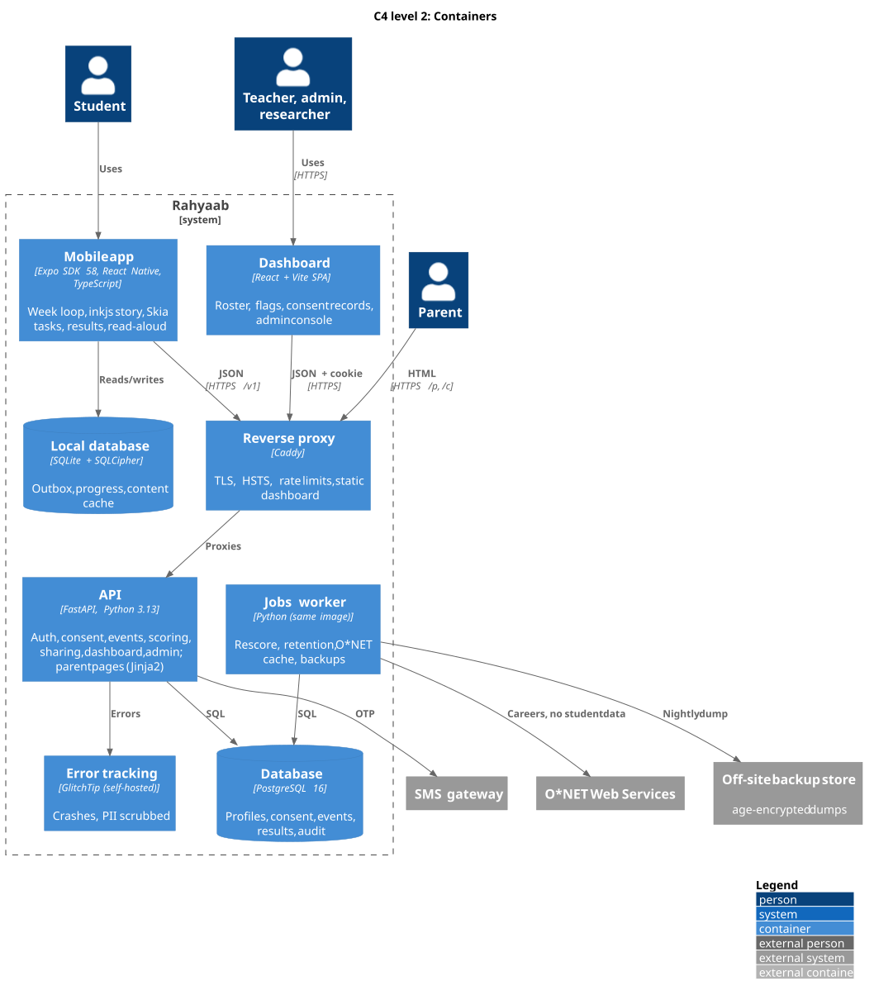
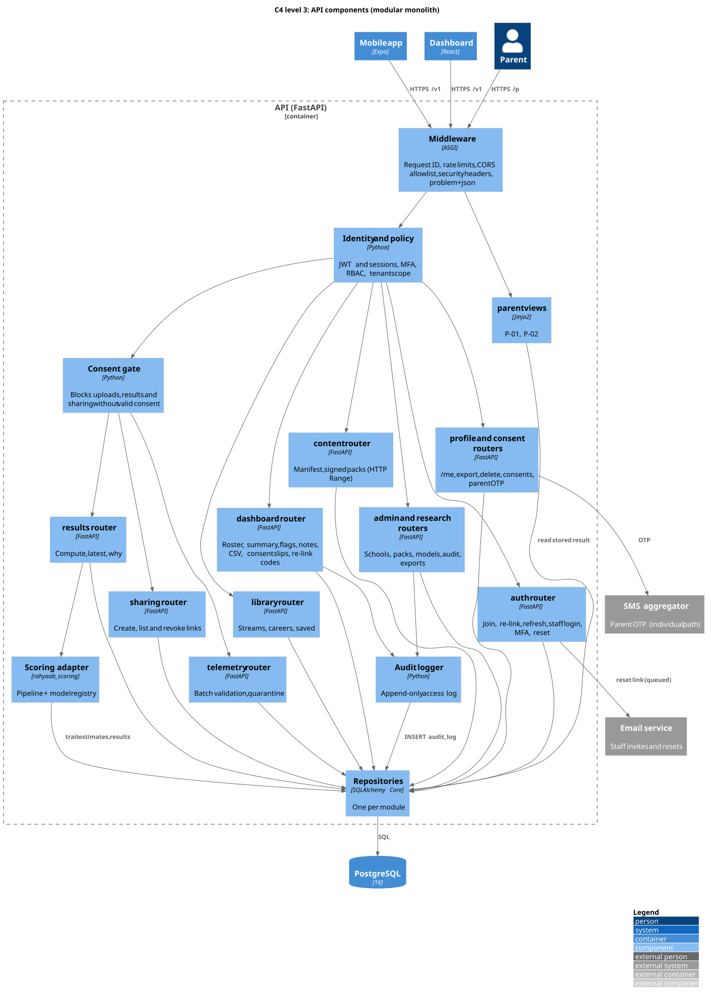
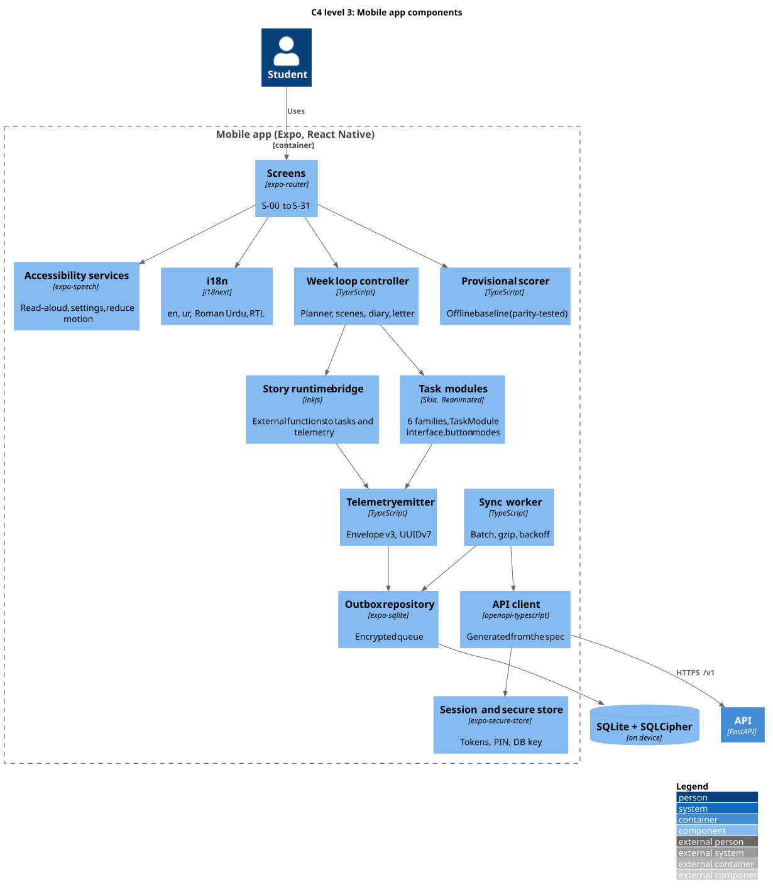
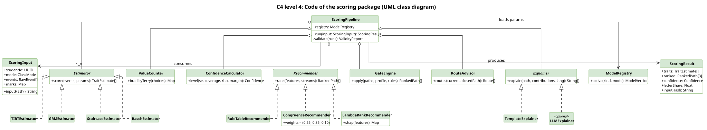
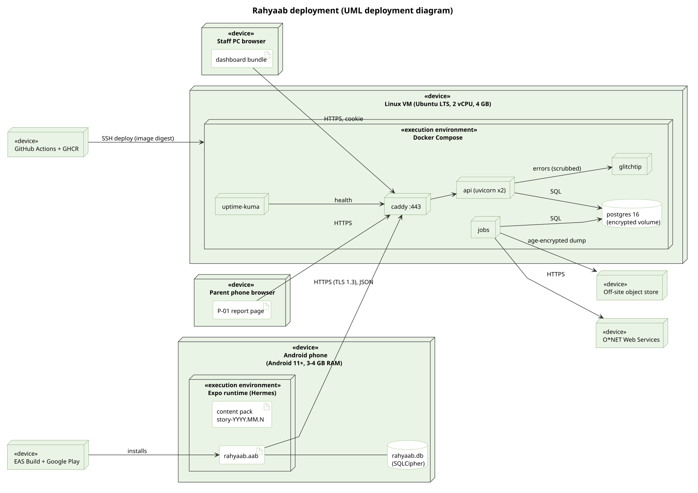
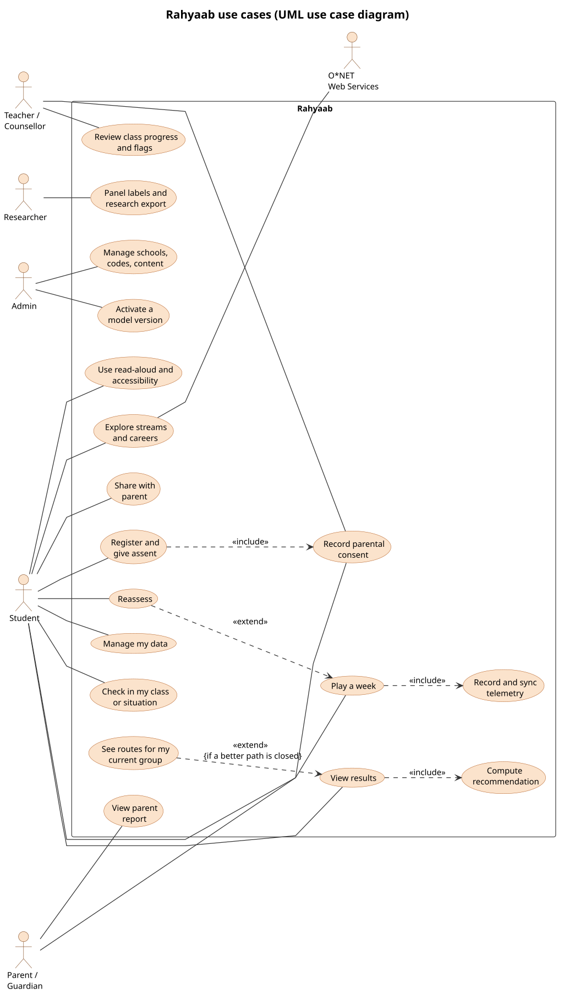

# Rahyaab system design (high-level design)

| | |
|---|---|
| **Version** | 1.0 (4 Nov 2026) |
| **Status** | Baseline for implementation (Sprint 1 onward) |
| **Authors** | Zahid Bashir (backend, data), Hamza Butt (mobile), Daniyal Sarwar (UX, content) |
| **Supervisor** | Zeeshan Ali |
| **Inputs** | SRS (v1.1 when written; current v1.5: `docs/project/SRS.md`), GDD v3 (`design/game/GAME_DESIGN.md`), ADRs (`adr/`), RFCs (`rfc/`), API spec (`docs/api/openapi.yaml`) |

This document shows how Rahyaab is built, in **C4** levels and **UML** views, with data-flow and data-model diagrams.

Every diagram is an editable **PlantUML** source (`.puml`) in [`diagrams/`](diagrams/README.md), drawn in standard UML, C4, DFD and ERD notation, with SVG and PNG exports beside it. The older drawings in the repository's `System Design/` folder describe the superseded Big Five design.

## 1. Goals, constraints and quality attributes

**What the system must do:** let a class 8–12 student play a 4-week story game, offline, on a cheap Android phone. The game turns their choices and everyday tasks into a stream or career recommendation they can understand. The student shares it with their family, and their teacher sees class progress, all without collecting identifying data.

| Driver | Consequence for the design | Where |
|---|---|---|
| 4 GB Android phones, ≤ 35 MB download, offline play | Native Expo app; Skia/Reanimated tasks; encrypted SQLite outbox | ADR-0002, ADR-0010 |
| Minors' data, consent before upload | Pseudonymous identity; consent gate in the API; no third-party SDKs | ADR-0007, ADR-0011, RFC-0002 |
| Reproducible, explainable, versioned scoring | Server-side Python scoring; append-only events; model registry | ADR-0004–0006, RFC-0003 |
| Parents with low-end phones and varied literacy | Server-rendered, Urdu-first parent page with read-aloud | ADR-0008, RFC-0004 |
| Team of 3, one VM, FYP timeline | Modular monolith; Docker Compose; one monorepo | ADR-0003, ADR-0012, ADR-0014 |
| Writers edit the story without code | Ink + inkjs; signed content packs | ADR-0009, RFC-0001 |
| Accessibility (WCAG 2.2 AA) | Native controls; read-aloud; accessible task modes | `design/specs/accessibility.md` |

**Quality targets (ISO/IEC 25010):**

| Area | Target | Requirement |
|---|---|---|
| Cold start | p90 ≤ 3 s | NFR-04 |
| Task frames | ≥ 95% under 16.7 ms | NFR-06 |
| API latency | p95 ≤ 800 ms at 50 virtual users | NFR-09 |
| Result computation | p95 ≤ 2 s | NFR-10 |
| Event loss | 0 in fault tests | NFR-31 |
| Availability | ≥ 99.5% | NFR-33 |
| Security standards | MASVS L1 + PRIVACY, ASVS L2 | NFR-36, NFR-37 |
| Usability | SUS ≥ 70 | NFR-19 |

## 2. C4 level 1: system context

**Users:**
- **Students** play in the app.
- **Parents** get a link through WhatsApp; they need no app and no account.
- **Teachers and admins** use the web dashboard.

**External systems:**
- **O*NET Web Services:** called by the server only, never with student data.
- **SMS gateway:** sends parent OTPs (R2).
- **Email service:** staff invitations and password-reset links (staff email only).
- **WhatsApp:** only the channel the student uses to send a parent link through the phone's share sheet; the server never talks to it.
- **Google Play:** distribution and the Play Integrity check.
- **GlitchTip (self-hosted):** crash reports from the app and the API, with personal data scrubbed (ADR-0007).

## 3. C4 level 2: containers

| Container | Technology | Responsibility |
|---|---|---|
| Mobile app | Expo SDK 58, React Native 0.88, TypeScript, inkjs, Skia, Reanimated, Rive | Game, results, library, sharing, read-aloud; provisional offline result |
| Local database | expo-sqlite + SQLCipher | Event outbox, progress, content cache |
| Reverse proxy | Caddy | TLS, HSTS, rate limits at the edge, serves the dashboard bundle |
| API | FastAPI (Python 3.13), SQLAlchemy Core, Jinja2 | All REST endpoints; consent gate; scoring adapter; parent pages |
| Jobs worker | Same image as the API | Rescore, retention, O*NET cache, backups, flags |
| Database | PostgreSQL 16 | System of record |
| Dashboard | React + Vite SPA | Teacher, counsellor, admin and research screens |
| Error tracking | GlitchTip (self-hosted) | Crashes and errors, with personal data scrubbed |

## 4. C4 level 3: components

**API (modular monolith, ADR-0012).** Each router module owns its tables. Cross-cutting middleware applies identity, RBAC and tenant scope, the consent gate, rate limits, security headers and problem+json errors.

**Mobile app.** The week loop drives the Ink story and the task modules. Every interaction becomes an envelope-v3 event, committed to the outbox before the story moves on. The sync worker uploads it later.

## 5. C4 level 4: code (the scoring package)

The `rahyaab_scoring` pipeline uses strategy interfaces (`Estimator`, `Recommender`, `Explainer`), so models can be swapped through the registry without changing the pipeline (RFC-0003).

## 6. Deployment

One Ubuntu VM runs Docker Compose:
- `caddy`, `api` (two Uvicorn workers), `jobs`, `postgres` (encrypted volume), `glitchtip`, `uptime-kuma`;
- nightly age-encrypted dumps go to an off-site store;
- GitHub Actions deploys by image digest;
- EAS builds the app for Google Play.

Environments and the release process are in `docs/devops/CI_CD.md`.

## 7. UML structural views

| Diagram | What it shows |
|---|---|
| [Class diagram (domain model)](diagrams/uml/class-domain.svg) | The 21 domain classes, with multiplicities and composition. `GuardianContact` is «restricted»; `RawEvent` and `AuditLog` are «append-only»; `Recommendation` is «immutable». |
| [Object diagram](diagrams/uml/object-snapshot.svg) | A snapshot of one student (Ayesha_10, class 9-B) mid-pilot: consent, a week-2 run, one event, one trait estimate, a recommendation, a path card and a share link. |
| [Component diagram](diagrams/uml/component.svg) | Provided and required interfaces: REST /v1, HTML /p /c, IScoring, IOutbox, SQL, O*NET. |
| [Deployment diagram](diagrams/uml/deployment.svg) | Devices, execution environments and artefacts (§6). |
| [Package diagram](diagrams/uml/package.svg) | Monorepo packages and their «import», «use» and «deploy» dependencies (ADR-0014) |
| [Composite structure diagram](diagrams/uml/composite-structure.svg) | The internal parts, ports and connectors of the scoring service (RFC-0003) |
| [Profile diagram](diagrams/uml/profile.svg) | The Rahyaab data-protection profile: «Pseudonymous», «Restricted», «AppendOnly», «Immutable» and «ResearchOnly» stereotypes extending UML metaclasses, applied to the domain packages |

## 8. UML behavioural views

**Use cases.** UC-01 to UC-15 from SRS §11, plus UC-16 for read-aloud and accessibility settings.

**Sequence diagrams:**

| Flow | Diagram | Key points |
|---|---|---|
| Join and consent | [seq-01](diagrams/uml/seq-01-join-consent.svg) | Rate limit; age gate; the consent state decides whether sync is allowed |
| Play a week and sync | [seq-02](diagrams/uml/seq-02-play-sync.svg) | Commit before advancing; batch upload with idempotency; quarantine |
| Compute results | [seq-03](diagrams/uml/seq-03-compute-results.svg) | Evidence rule; active models; immutable stored result; "Why this?" |
| Share with a parent | [seq-04](diagrams/uml/seq-04-share-parent.svg) | Token shown once; hash stored; expiry and revocation |
| Staff login and roster | [seq-05](diagrams/uml/seq-05-staff-login.svg) | argon2id + TOTP; RBAC and tenant scope; every read audited |

**State machines:**

| Object | Diagram | Why it matters |
|---|---|---|
| Consent | [state-consent](diagrams/uml/state-consent.svg) | Pending → Granted → Withdrawn → Deleted; 14-day purge |
| Week run | [state-week-run](diagrams/uml/state-week-run.svg) | Planner → 3 scenes (dialogue, choices, tasks, reaction) → value moment → diary; resume after a pause or kill |
| Outbox event | [state-outbox-event](diagrams/uml/state-outbox-event.svg) | Queued, Held (no consent), Sending, Acked, Rejected, Purged |
| Share link | [state-share-link](diagrams/uml/state-share-link.svg) | Active → Revoked or Expired → Deleted |

**Activity diagrams:**

| Diagram | Flow |
|---|---|
| [activity-onboarding](diagrams/uml/activity-onboarding.svg) | Language → code or individual path → age gate → assent → profile → consent → prologue |
| [activity-play-week](diagrams/uml/activity-play-week.svg) | The full week loop, with commit points |
| [activity-recommendation](diagrams/uml/activity-recommendation.svg) | Evidence → M1, M2 and values in parallel → confidence → recommender → gates → Plan B → explanations → store |

## 9. Data flow diagrams

| Level | Diagram |
|---|---|
| Level 0 (context) | [dfd-0-context](diagrams/dfd/dfd-0-context.svg) |
| Level 1 (8 processes, 8 data stores) | [dfd-1](diagrams/dfd/dfd-1.svg) |
| Level 2 of process 4.0, Score and recommend | [dfd-2-scoring](diagrams/dfd/dfd-2-scoring.svg) |

The data stores D1–D8 map to tables as follows:

| Store | Tables |
|---|---|
| D1 | `school`, `school_class`, `student`, `device`, `refresh_token`, `consent`, `consent_slip`, `guardian_contact`, `otp_challenge`, `relink_code` |
| D2 | `sitting`, `game_run`, `raw_event`, `quarantine` |
| D3 | `content_pack`, `item` |
| D4 | `trait_estimate`, `recommendation` |
| D5 | `share_link`, `saved_item` |
| D6 | `staff_user`, `staff_class`, `staff_session`, `password_reset`, `rate_limit`, `audit_log`, `note`, `flag` |
| D7 | `stream`, `eligibility_rule`, `career`, `stream_career` |
| D8 | `model_version`; research schema: `research_demographics`, `panel_label` |

## 10. Data model

| Diagram | Scope |
|---|---|
| [ERD overview](diagrams/erd/erd-0-overview.svg) | All entities and relationships |
| [Identity and consent](diagrams/erd/erd-1-identity-consent.svg) | School, class, student, guardian contact, consent, device |
| [Gameplay and telemetry](diagrams/erd/erd-2-gameplay-telemetry.svg) | Sitting, game run, raw event, quarantine, item, content pack |
| [Results and library](diagrams/erd/erd-3-results-library.svg) | Trait estimate, recommendation, model version, share link, stream, rule, career, saved item |
| [Staff and operations](diagrams/erd/erd-4-staff-operations.svg) | Staff user, note, flag, audit log, panel label |

**The reviewed DDL is [`database/schema.sql`](../../database/schema.sql)** (PostgreSQL 16; it passes the PostgreSQL parser). Key choices:
- `raw_event` is append-only and partitioned by month on its UUIDv7 key, so `ON CONFLICT (event_id)` deduplication works across partitions.
- `recommendation` is unique on `(student_id, input_hash)` and must hold exactly 3 ranked paths.
- `guardian_contact` is encrypted and reserved for its own database role.

## 11. Cross-cutting concerns

| Concern | Design | Detail |
|---|---|---|
| **Security** | STRIDE threat model; four rules (no backdoors, no secrets in the app, the server decides, collect less) | `docs/security/SECURITY.md` |
| **Privacy and compliance** | Consent gate; minimisation; retention schedule; Play policies; PDP Bill (draft) principles | `docs/security/COMPLIANCE.md`, `DATA_GOVERNANCE.md` |
| **Encryption** | SQLCipher + Keystore on the phone; TLS 1.2+; disk encryption; AES-GCM columns; age backups | `DATA_GOVERNANCE.md` §4 |
| **Accessibility** | Native controls, read-aloud, settings, accessible task modes, contrast tokens | `design/specs/accessibility.md` |
| **Localisation** | i18next (en, ur, Roman Urdu), RTL, Nastaliq-safe layouts, Urdu-script lines for read-aloud | SRS §7.4 |
| **Observability** | GlitchTip, Uptime Kuma, request IDs, logs with no personal data, alerts | `docs/devops/CI_CD.md` §5 |
| **Testing** | Pyramid + parity + security, privacy, a11y and psychometric layers | `docs/testing/TEST_STRATEGY.md` |

## 12. Known risks and technical debt

| Item | Mitigation |
|---|---|
| A single VM is a single point of failure | Restore drill each semester; RTO ≤ 4 h; move to two hosts after the pilot if needed |
| Thurstonian IRT identification with few choices (RK-19) | GRM taps and planner anchors; simulation checks; fallback scoring |
| Ink-to-measurement bridge is custom code | Golden playthroughs and pair-coverage checks in CI (T-PAR-02) |
| Partition maintenance for `raw_event` | The jobs worker creates next month's partition and drops partitions older than 12 months; the default partition is monitored |
