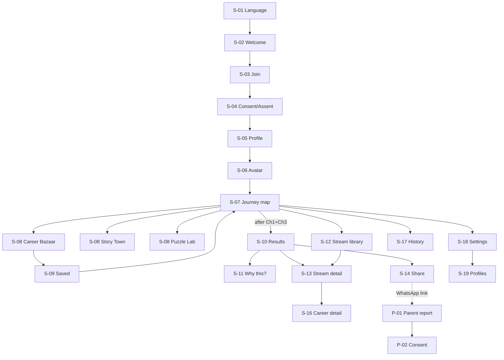
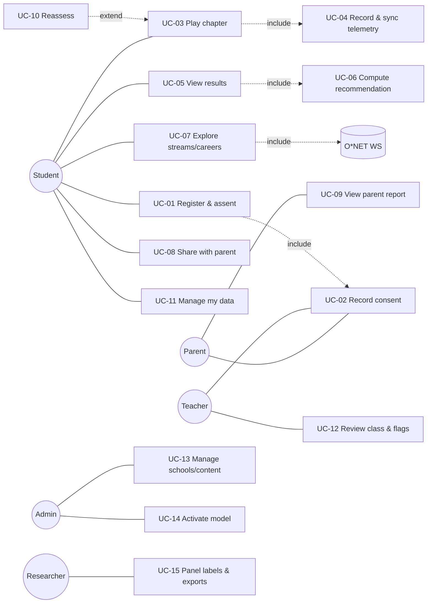

> **Superseded.** Kept for history only. See `design/` and `docs/project/` for current documents.

# Rahyaab — Software Requirements Specification and Design Specification

| Field | Value |
|---|---|
| Project | Rahyaab (راہیاب): game-based stream guidance for Pakistani Grade 9–12 students |
| Programme | BSCS Final Year Project, Riphah International University, Fall 2026 (FYP-1) → Spring 2027 (FYP-2) |
| Team | Zahid Bashir, Hamza Butt, Daniyal Sarwar |
| Supervisor | Zeeshan Ali |
| Document | SRS + design specification (IEEE/ISO/IEC 29148:2018 structure), version 1.0, 31 Oct 2026 |
| Status | Draft for supervisor review. Supersedes the instrument sections of Template-04 v1.4 and the proposal slides |
| Repository location | `docs/SRS.md` (short summary in `docs/PROJECT_BRIEF.md`) |

**How to read this document.** Requirements use IDs (`FR-xx`, `NFR-xx`, `UC-xx`, `US-xx`, `T-…`). Evidence tags in square brackets point to the research sources listed in §1.5, for example `[N6 §1]` = Pakistan mobile-context notes, section 1. **Assumptions** are marked `A-xx` and listed in §1.6. Anything that must be checked before it is relied on is marked **(verify)**.

---

## Contents

1. Introduction
2. Stakeholders, personas and user journeys
3. Problem statement and Complex Computing Problem (CCP) mapping
4. Feature list and MVP scope (MoSCoW)
5. Game Design Document
6. Information architecture and screen inventory
7. UX and HCI guidelines
8. Visual design system
9. Functional requirements
10. Non-functional requirements (ISO/IEC 25010:2023)
11. Use cases and user stories
12. System architecture, data, API, telemetry and ML modules
13. Software process and release plan
14. Verification and validation plan
15. Risk register
16. Requirements traceability matrix
17. Appendix: primary-research instruments and evidence gaps

---

## 1. Introduction

### 1.1 Purpose

This document specifies what Rahyaab must do and how well, and records the design decisions behind it. It is written for:

- the three developers;
- the supervisor and the FYP evaluation committee, who assess LO2 (requirements), LO3 (design), LO4 (algorithms and trade-offs) and LO1 (maths and science);
- the university ethics committee, for the pilot with minors;
- any coding assistant or new developer working in the repository.

It is the single source of truth. When the slides, Template-04 or old code disagree with it, this document wins [REV §3.1].

### 1.2 Product scope

Rahyaab is an **Android-first mobile app** (React Native, Expo SDK 58, TypeScript, expo-router). Pakistani students in Grades 9–12 play short games and receive **explainable stream recommendations**:

- **Matric (SSC) groups:** Science-Biology, Science-Computer, Humanities, Technical where offered.
- **Intermediate (HSSC):** FSc Pre-Medical, FSc Pre-Engineering, ICS (Physics/Statistics/Economics variants), I.Com, FA/Humanities (elective bundles), General Science, DAE.
- **O/A Levels:** A-Level subject bundles mapped onto the same stream families.

Students then explore what each stream leads to: subjects, entry tests, degree families and careers.

**The product is game-based only.** It contains no questionnaire, Likert screen or interview:

- interests (RIASEC) are measured through **choice games**;
- abilities are measured through **puzzles** [GD §1].

Scoring runs **server-side** in a Python engine (derived from the team's `career-game-prototype`) behind **FastAPI + PostgreSQL**. The phone records raw telemetry **offline-first** and syncs when a connection is available.

Two other surfaces complete the product:

- a **lightweight counsellor/teacher web dashboard**, which is committed scope [REV §2];
- a **parent web view** that needs no app.

Benefits and goals:

| Goal | Measure (see §10, §14) |
|---|---|
| G1. A student gets a credible, explained shortlist of streams in under 30 minutes of total play | Median time to profile ≤ 25 min over ≥ 3 sittings; SUS ≥ 70 |
| G2. Parents and teachers can join the decision | ≥ 50% of pilot students share with a parent; teacher dashboard used in the pilot schools |
| G3. Measurement is evidenced, not asserted | Convergent validity against the O*NET Interest Profiler benchmark is reported; reliability and fairness are reported |
| G4. Works on budget Android phones that are offline or shared | Cold start ≤ 3 s on a 4 GB device; zero event loss in fault tests; multi-profile support |

**Out of scope** (see also §4.3): university admissions and search, scholarships, paid counselling or a marketplace, chat or social features, personality (Big Five) scoring for recommendations, video interviews, Unity builds, and users outside Grades 9–12 [REV §3.1; GD header].

### 1.3 Definitions and abbreviations

| Term | Meaning |
|---|---|
| **Stream** | The academic group chosen at SSC (Grade 9) or HSSC (Grade 11), or an A-Level subject bundle |
| **SSC / Matric** | Secondary School Certificate, Grades 9–10. **HSSC / Intermediate** = Grades 11–12 |
| **FSc, ICS, I.Com, FA, DAE** | Pre-Medical/Pre-Engineering Intermediate; Intermediate in Computer Science; Intermediate in Commerce; Intermediate in Arts/Humanities; Diploma of Associate Engineering (3-year technical) |
| **BISE / FBISE / AKU-EB** | Provincial boards / Federal board / Aga Khan University Examination Board |
| **IBCC** | Inter Board Committee of Chairmen (equivalence of O/A Levels) |
| **PMDC / PEC** | Pakistan Medical and Dental Council / Pakistan Engineering Council (degree-entry rules) |
| **MDCAT / ECAT / NET** | Medical entry test / engineering entry test (Punjab) / NUST Entry Test |
| **RIASEC** | Holland's six interest types: Realistic, Investigative, Artistic, Social, Enterprising, Conventional |
| **Choice game** | A game whose moves are choices between activities or actions, each mapped to a RIASEC type. It is the measurement instrument for interests, also called gamified or stealth assessment [GD §1] |
| **Puzzle** | A performance task with correct solutions, used to estimate an ability |
| **IRT, GRM, 2PL, Rasch** | Item response theory; Samejima's graded response model; two-parameter logistic model; one-parameter (Rasch) model |
| **θ (theta), SE** | Latent trait estimate and its standard error |
| **EAP** | Expected a posteriori estimate of θ |
| **CAT** | Computerized adaptive testing (here, adaptive card selection) |
| **Band** | A qualitative level shown instead of a number: interests *Strong / Moderate / Lower*; abilities *Strong / Developing / Emerging*; fit *Strong fit / Good fit / Worth exploring* |
| **Confidence** | High/Medium/Low, derived from SE, evidence coverage and agreement between sources |
| **Gate** | An eligibility rule (board, council or test requirement) |
| **Door** | A downstream route (degree family or career) that a stream keeps *open*, opens *with an extra step*, or *closes* |
| **Plan B** | An alternative route shown with every top recommendation |
| **Chapter / sitting** | A game unit on the journey map / one continuous play session (3–7 min target) |
| **GameShell** | The shared wrapper every game runs inside: Intro → Practice → Play → Recap |
| **Outbox** | The on-device SQLite queue of unsent telemetry events |
| **CCP** | Complex Computing Problem (Seoul Accord) |
| **MASVS / ASVS** | OWASP Mobile / Application Security Verification Standards |
| **TTID / TTFD / ANR** | Time to initial display / time to full display / Application Not Responding |
| **SUS, IMI, CDSE** | System Usability Scale; Intrinsic Motivation Inventory; Career Decision Self-Efficacy |
| **DIF** | Differential item functioning (item bias across groups) |
| **NDCG@3** | Normalised discounted cumulative gain over the top 3 |
| **SHAP** | SHapley Additive exPlanations |

### 1.4 Document conventions

- **Priority (MoSCoW):** M = Must, S = Should, C = Could, W = Won't (this release).
- **Release:** R1 = FYP-1 prototype (Jan 2027 progress presentation); R2 = FYP-2 pilot build (Mar 2027); R3 = FYP-2 final (Jun 2027).
- "Shall" marks a requirement; "should" marks a recommendation.

### 1.5 References

**Project research** (all in the project workspace):

| Tag | Source |
|---|---|
| **[R1]** | Report *"Turning mini-games into trustworthy stream advice"* (`reports/Career guidance games app Pakistan.md`): streams and gates, RIASEC/aptitude core, game designs, recommender, stack, privacy, competitors |
| **[R2]** | Report *"Career games abound, but none validate Pakistani stream choice"* (`reports/Career guidance games literature review.md`): game catalogue, measurement evidence, recommender literature, guidance ingredients, research gap |
| **[N1]** | Research notes, *Teen career app needs and design* / `student_needs.md` |
| **[N2]** | … / `parent_counsellor_school_needs.md` |
| **[N3]** | … / `teen_games_and_competitor_games.md` |
| **[N4]** | … / `hci_accessibility_color.md` |
| **[N5]** | … / `competitor_features_flows.md` |
| **[N6]** | … / `pakistan_mobile_context_nfrs.md` |
| **[REV]** | *Rahyaab FYP review* (29 Oct 2026) |
| **[GD]** | *Rahyaab app and game design* (29 Oct 2026). Supersedes [REV] where they differ |
| **[PROTO]** | Git branch `wip/hamza-career-game-prototype`, folder `career-game-prototype/` (engine modules `power_grid`, `glyph_sequence`, `calibration`, `session_log`, `aggregate`, `stream_transformation_engine`, `telemetry_schema`) |

**Standards and frameworks:**

- ISO/IEC/IEEE 29148:2018 (requirements engineering)
- ISO/IEC 25010:2023 (product quality model)
- W3C WCAG 2.2
- OWASP MASVS v2.1 and Mobile Top 10 2024; OWASP ASVS 5.0
- UK ICO Age Appropriate Design Code (Children's Code)
- Google Play target-API and Families policies
- Seoul Accord graduate attributes (complex computing problems)
- Nielsen's 10 usability heuristics
- O*NET Web Services terms and the O*NET Tools Developer License

Key literature is cited through [R1]/[R2]. Examples: Fadillah et al. 2025 (game-vs-self-report meta-analysis); Georgiou et al. 2019 (gamified SJT); Tokzhigitova et al. 2025 (Kazakhstan GCG); Hassan et al. 2022 (parental influence); Lahoud et al. 2022 (knowledge-based recommender); Song et al. 2022 (ML majority bias); Jones et al. 2014 (Urdu Career Key); Whiston et al. 2003/2017 and Brown & Ryan Krane (guidance ingredients).

### 1.6 Assumptions and dependencies

| ID | Assumption | Consequence if false |
|---|---|---|
| A-01 | Expo SDK 58 / React Native 0.88 / React 19.3 (as in the prototype `package.json`) remain stable for the project's duration | Pin versions; upgrade only between releases |
| A-02 | The OpenPsychometrics/Kaggle RIASEC dataset (~145,828 responses, 48 items) is licensed for research use. Its items are public-domain markers that can be reworded into activity cards **(verify item source and licence)** [GD §6; REV §3.3] | M1 pre-training falls back to pilot-only calibration |
| A-03 | The team's O*NET Web Services account allows (a) occupation content with attribution, and (b) research use of the Interest Profiler (Mini-IP) **unchanged, in English**. An Urdu translation would require the Developer License [R1; REV §3.7] | Benchmark is given in English only; noted as a limitation |
| A-04 | Pilot schools will collect paper or school-mediated parental consent. SMS OTP is a later option (cost) | Individual sign-up stays behind a feature flag |
| A-05 | The FYP-1 progress presentation is in the second half of January 2027, after finals | Shift sprints S4–S5 |
| A-06 | Hosting is one small Linux VM (2 vCPU / 4 GB) in the UAE or Mumbai region, or a Pakistani provider, at about US$10–60/month [N6 §6] (estimate, verify) | Use the university server if available |
| A-07 | Stream and eligibility rules hold as of Oct 2026, including the IBCC Dec 2025 decision allowing Matric-Arts students into any Intermediate group "from the next session" [N1 Q1] **(verify per board)** | Rules are data-driven with effective dates (FR-45) |
| A-08 | Grade 9–12 students are roughly 13–18 years old. Under-13s are rare and are blocked | Neutral age gate (FR-04) |

---

## 2. Stakeholders, personas and user journeys

### 2.1 Stakeholder analysis

| Stakeholder | Interest in Rahyaab | Power over outcome | Quadrant / strategy | Key needs (source) |
|---|---|---|---|---|
| Students, Grades 9–12 | Very high: the decision affects their next 2–6 years | Low on their own; decisions are collective [N1 Q5] | High interest, low power → **involve closely** (co-design, usability tests) | Discover interests, choose a group, wider career awareness, no exam feel, privacy on shared phones [N1 Q1–Q5] |
| Parents/guardians | High | **Very high**: parental influence β = .50; 82.6% of students rely on parents [R1; R2] | High/high → **manage closely** | Urdu report, prospects, cost, entry tests, local options, safe options for daughters, consent [N2] |
| Teachers / school counsellors | Medium–high | Medium: they gatekeep classroom use; teacher bias can steer girls [R2, Carlana] | **Keep involved** | Minutes per class, not per student; roster, flags, one-page summary, export [N2] |
| School principals / chains | Medium | High (access, procurement) | **Keep satisfied** | Data agreement, no ads, offline, branded report, CSV [N2] |
| FYP supervisor and committee | High | Very high (grades) | **Manage closely** | Locked scope, CCP, measurable experiments, Git evidence [REV §1–2] |
| University ethics committee | Medium | Very high (pilot go/no-go) | **Keep satisfied** | Consent/assent, minimisation, retention, risk handling |
| Boards, IBCC, PMDC, PEC | Low (unaware of the app) | High: they set the rules | **Monitor**; cite and date every rule | Correct gates [R1 §1] |
| Govt/NGO channels (PEF, NAVTTC/TEVTA, Teach For Pakistan) | Low now | High for scale-up | **Keep informed** later | Free pilots, Urdu, offline, impact evidence [N2] |
| Data providers (O*NET, dataset owners) | Low | Medium (licences) | **Comply** | Attribution, licence terms [R1] |
| Development team | High | High | — | Clear backlog, CI, fair split of work [REV §8] |

### 2.2 Personas

**P1. Ayesha, 15, Grade 9 (early term), government girls' high school, Sahiwal**

- **Device and access:** uses her mother's Tecno Spark (4 GB RAM, Android 14). The phone is shared with two siblings and full of WhatsApp media. She gets the phone for about 30 minutes in the evening, with 3–4 hours of load-shedding most days [N6 §1–2].
- **Language:** Urdu medium; reads English slowly [N6 §3].
- **Situation:** she likes the computer period and drawing. Her aunt says biology "keeps doctor open". Her father decides with her uncle [N1 Q5; N2].
- **Wants:** to know whether Computer or Biology suits her, and what each one closes.
- **Fears:** someone else seeing her results; looking "wrong".
- **Design implications:** PIN profile; offline play; Urdu-first; results private by default; a shareable Urdu parent view; honest doors (Biology vs CS); female role models in ICS and engineering.

**P2. Rayan, 16, O-Level (Year 11), private chain school, Lahore**

- **Device:** his own Samsung A-series phone.
- **Language:** English-first.
- **Gaming habits:** plays Free Fire and Ludo; impatient with "school-like" apps [N4 §1; N3 §1].
- **Situation:** torn between A-Level Maths/Physics/CS and Economics/Business. Thinks career tests are "random".
- **Wants:** quick, cool games and reasons he can check.
- **Design implications:** no babyish art; fast start; "Why this?" evidence screen; A-Level bundle output with IBCC notes.

**P3. Tariq Mehmood, 47, father, runs a hardware shop, Faisalabad**

- **Language and channels:** reads Urdu; uses WhatsApp daily, mostly voice notes and forwards; no email [N2].
- **Situation:** wants his son in medicine "for respect". He knows MDCAT is hard but not the odds: 140,071 candidates for about 22,000 seats [R1 §1].
- **Wants:** to know what the boy is good at, what each option costs and leads to, and whether it is safe to rely on.
- **Design implications:** a link that opens without installing anything; plain Urdu; honest odds; alternatives with outcomes; a "talk together" checklist; a consent he understands.

**P4. Ms Sadia Rauf, 34, computer teacher and career coordinator, private school campus, Rawalpindi**

- **Workload:** 4 sections of about 35 students each; no training in counselling; at most 15 minutes per class for this work [N2].
- **Wants:** to see who has not finished, who is unsure or mismatched, and to print a one-page summary for the parent–teacher meeting.
- **Design implications:** a class roster with flags; one-click PDF/print; CSV export; nothing that asks her to "interpret psychometrics".

**P5. Bilal, 24, project admin and research assistant** (one of the team, or the school IT coordinator)

- **Manages:** school and class codes, content packs (cards, stories, puzzles, streams, rules), the model versions that are active, and data exports for the pilot.
- **Needs:** audit trails, safe rollback, and de-identified exports.

### 2.3 User journeys

**J1. Ayesha (student, shared phone, five evenings)**

| Step | Day | What happens | Touchpoints | Emotion / risk | Design response |
|---|---|---|---|---|---|
| 1 | Day 0, school | Teacher gives a class code and a consent slip | Paper slip, class code | Curious | Consent collected by the school (A-04) |
| 2 | Day 1 | Chooses Urdu, enters the code, picks a nickname and PIN, builds an avatar (2 min) | S-01–S-05 | Worried it is a test | "No right or wrong answers" framing; ≤ 3 intro screens |
| 3 | Day 1 | Plays Career Bazaar (4 min); power cut at card 30 | S-07, S-08 | Annoyed | Autosave per card; resumes at card 31 |
| 4 | Day 2 | Finishes Bazaar; plays Story Town part 1 | S-08 | Engaged by the story | Story uses her town context |
| 5 | Days 3–4 | Puzzle Lab parts 1–3 (about 4 min each) | Calibration, puzzles | Fear of "maths test" | Untimed, no scores shown, practice round first |
| 6 | Day 4 | Results: (1) ICS-track via Science-Computer, (2) Science-Biology/Pre-Med, (3) FA with Computer elective; confidence Medium | S-10, S-11 | Relief, then a question: "Can I still be a doctor?" | Doors: Biology keeps MBBS open; Computer closes it. Plan B shown |
| 7 | Day 5 | Shares the Urdu parent view with her mother on WhatsApp | S-14, P-01 | Nervous | She previews exactly what the parent will see; the link can be revoked |
| 8 | Week 2 | Teacher prints her summary for the PTM | D-04 | — | One-page summary with "talk together" questions |

**J2. Tariq (parent)**

Opens the WhatsApp link → language auto-detected (Urdu) → sees "what your child enjoyed and was strong at", the top-3 options with doors and odds, Plan B, and five "talk together" questions → optionally confirms consent or asks for deletion → closes the page. No app, account or password.

**J3. Ms Sadia (teacher)**

Logs in (email + one-time code) → selects class 10-B → sees 28/35 complete, 4 flags ("not started" ×3, "low confidence" ×1) → opens the low-confidence student → reads the summary and adds a note → prints 35 summaries before the PTM → exports CSV. Target time: under 15 minutes per class.

**J4. Bilal (admin)**

Uploads `streams.json` v1.3 with an updated IBCC rule → validation report → approves → activates it for new results only (old results keep their version) → audit log entry.

---

## 3. Problem statement and CCP mapping

### 3.1 Problem statement

Pakistani students lock into an academic group at about 14 (the Grade 9 choice between Science-Biology and Science-Computer) and again at about 16 (Intermediate). They get almost no professional guidance:

- 70% of one university sample had never had career counselling [N1 Q1];
- a KP survey found no assessment tools or trained guides in secondary schools [N1 Q1];
- 82.6% rely on parents [R1 §1].

The consequences are measurable:

- 46% of 400 Mardan secondary students chose subjects unrelated to their goals [R2];
- 69.5% of first-year MBBS students at Nishtar cited parental pressure [R1];
- 140,071 candidates sat MDCAT 2025 for about 22,000 seats [R1].

Existing local tools are long questionnaire websites with counsellor upsells, and none are game-based or mobile-first [R1 §5; N5]. No published system infers a validated interest and ability profile from games for Pakistani teenagers, and no convergent-validity coefficient exists for a game-based RIASEC measure in 14–18-year-olds anywhere [R2 §research gap].

**Problem (CCP statement, game-only version, adapted from [REV §4]):**

> Infer a Grade 9–12 student's interests, abilities and constraints from short, noisy, game-only evidence (choice telemetry and puzzle performance captured offline on heterogeneous low-end Android phones), where no ground-truth "correct stream" exists. Then turn that evidence into fair, explainable, eligibility-constrained top-3 stream recommendations with a Plan B. These must balance student interest against board and council rules, admission odds and parental expectations, while protecting minors' privacy and keeping the experience short and not test-like.

### 3.2 CCP mapping (Seoul Accord characteristics)

The table maps the eight Seoul Accord "complex computing problem" characteristics plus the department guide's "level of problem / requirement identification" item, giving nine rows as in [REV §4]. **(verify labels against the Riphah CCP guide)**

| # | Characteristic | How Rahyaab exhibits it | Evidence and where it is handled | Strength |
|---|---|---|---|---|
| 1 | **Depth of knowledge required** | IRT (GRM, 2PL/Rasch), computerized adaptive testing, psychometric validation (MTMM, reliability, DIF), learning-to-rank (LambdaRank), SHAP, fairness metrics, offline-first sync, mobile rendering performance | §12.6 M1–M4; §14.4 | Strong |
| 2 | **Range of conflicting requirements** | Fewer cards (fun, completion) vs measurement precision. Game-like vs reliable [R2: gamified .595 vs full GBA .419]. Speed signals vs fairness on cheap phones (50–200 ms device latency [R1]). Accuracy vs fairness (ML favours majority options [R2, Song]). Personalisation vs minors' privacy. Rich art vs 35 MB app size. Student interest vs parent preference | Trade-off experiments: M1 cards-vs-accuracy curve; M2 latency ablation; M3 accuracy-vs-fairness; NFR-11 size | Strong |
| 3 | **Depth of analysis required** | Latent traits are never observed directly. Choices are noisy and partly state-like [R2, Gfrörer]. The device confound must be separated from ability. Cards are swiped (3 categories) while norms come from 5-point Likert data (a mode effect). There are no labels for "right stream" | M1 recalibration; M2 calibration block; M3 counsellor-panel labels | Strong |
| 4 | **Familiarity of issues** | No validated teen game-based interest measure exists. The Urdu RIASEC adaptation failed the hexagon fit (Jones et al. 2014) [R2]. Pakistani stream rules are undocumented as a machine-readable set | §5, §14.4; rules engine FR-45 | Strong |
| 5 | **Extent of applicable codes / standards** | No enacted Pakistani data protection law, so the project builds to the ICO Children's Code, GDPR-style practice, OWASP MASVS/ASVS, WCAG 2.2, Google Play target API 36 and Families policy, O*NET and dataset licences, and Cloud First Policy data classes for public-school deployment [N6 §4–5] | §7.6, §10 Security/Safety | Strong |
| 6 | **Extent of stakeholder involvement and conflicting requirements** | Students, parents, teachers, schools, the ethics committee, boards and councils with partly opposing goals (prestige vs fit; teacher time vs detail; research data vs minimisation) | §2.1; parent view; dashboard; consent model | Strong |
| 7 | **Consequences** | A wrong stream can cost two years to switch [N1 Q1]; 46% mismatch; 5 in 6 MDCAT candidates miss a seat; a biased tool could steer girls away from STEM [R1; R2] | Safety NFRs (never a single verdict; Plan B; fairness audit) | Very strong |
| 8 | **Interdependence** | Game → telemetry → offline queue → sync → validation → device-latency normalisation → IRT estimation → fusion → eligibility gates → ranking → explanation → parent/teacher reports. A change in one stage (e.g., card wording) propagates to item parameters, norms and recommendations | §12.1 pipeline; versioned models and content | Very strong |
| 9 | **Level of problem / requirement identification** | "Correct stream" is ill-defined; labels must be built (counsellor panel, κ). Validity must be established, not assumed. No existing system to copy for Pakistani streams | §12.6 M3 labels; §14.4 validation study | Strong |

**Not CCP padding:** each conflict above has a measured experiment with a baseline (§12.6), as the CCP guide requires a baseline, an experiment and a quantitative comparison [REV §5].

---

## 4. Feature list and MVP scope

### 4.1 Gameplay-only or more features?

**Decision: games are the measurement layer, not the whole product.** A gameplay-only app would measure students and then leave them with a number. The evidence says that does not help decisions:

- Guidance works when it bundles **three or more critical ingredients**: individualised interpretation, world-of-work information, modelling, and building support in the student's social network. Computer-only guidance underperforms guidance with a counsellor or structured session [R2 §guidance; Whiston].
- Teens using a reflection-only app **asked for concrete recommendations** (FindMyself) [R2].
- YouScience is criticised for having **no action plan** after results [N5].
- Parents are the decisive second user (β = .50) [R2; N2].

So Rahyaab ships five layers. Each layer maps to an ingredient:

| Layer | Ingredient it supplies | MVP? |
|---|---|---|
| Games (choice + puzzle) | Self-exploration and measurement | Yes |
| Explained results (top-3, reasons, confidence, doors, Plan B) | Individualised interpretation and feedback | Yes |
| Stream and career library (O*NET-backed, localised) | World-of-work information | Yes (stream pages); careers Should |
| Role-model stories (incl. female leads in CS/engineering) | Modelling [R2, Sharma 2020] | Should |
| Parent view + teacher dashboard | Support building / human in the loop | Yes (parent); teacher dashboard Should in R1, Must in R2 |

What Rahyaab deliberately does **not** add: social, chat, university search, scholarships, portfolio, payments. These are table stakes only for US multi-year planning platforms. In Pakistan they add privacy risk (PECA, user-generated content) and scope with little evidence of value [N5; R1].

### 4.2 MoSCoW feature list

| # | Feature | Priority | Release | Justification (research) |
|---|---|---|---|---|
| F1 | Bilingual onboarding (Urdu/English), ≤ 3 screens, "no right or wrong answers" | M | R1 | Teen impatience; framing reduces test feel [N4 §1, §5] |
| F2 | School-code sign-up, nickname only, school-mediated consent; individual sign-up with parent OTP | M / S | R1 / R2 | Minors' consent; no phone needed for girls [N1 Q5; N6 §5] |
| F3 | Multi-profile with PIN on a shared device; wipe on sign-out | M | R1 | 28% of women use only someone else's phone [N6 §1] |
| F4 | Journey map with 4 chapters, save/resume, 3–7 min sittings | M | R1 | Session benchmarks 4.5–6 min; GCG completion drop [N3 §3; R2] |
| F5 | GameShell (intro, practice, play, recap) | M | R1 | Pymetrics/Arctic Shores pattern [GD §2] |
| F6 | Career Bazaar (interest swipe deck, adaptive) | M | R1 (fixed order) / R2 (adaptive) | Gamified items keep validity [R2] |
| F7 | Story Town (branching RIASEC story) | S | R2 | Narrative drives satisfaction (β = .40) and gives a second evidence source [N3 §3] |
| F8 | Puzzle Lab: Power Grid, Glyph Sequence, Pattern Gates | M | R1 | Existing engine; spatial/logic predict STEM [R1 §2] |
| F9 | Puzzle Lab: Rotate & Fit, Dukaan Hisaab | S | R2 | Spatial and numerical are the key stream predictors [R1 §2] |
| F10 | Device calibration block | M | R1 | Latency 50–200 ms across phones [R1] |
| F11 | Offline telemetry outbox + idempotent sync | M | R1 | Shutdowns, load-shedding [N6 §2] |
| F12 | Server scoring: baselines (rules, congruence) | M | R1 | Transparent scoring is preferred without outcome data [R2] |
| F13 | Eligibility rules engine (board, council) with doors | M | R1 | PMDC/PEC/IBCC/TEVTA rules [R1 §1] |
| F14 | Results: top-3 cards, sorted bars, bands, confidence, Plan B, "Why this?" | M | R1 | Radar charts mislead; shortlists help [N4 §7; R2, Gati] |
| F15 | Stream library (offline) | M | R1 | Narrow career awareness [N1 Q1] |
| F16 | Career pages from the O*NET API, localised, saved shortlist | S | R2 | Table stakes in mature products [N5] |
| F17 | Parent share link + Urdu/English parent view | M | R1 | Parents decide [R2; N2] |
| F18 | Parent PDF/image for WhatsApp | S | R2 | WhatsApp channel (inferred) [N2] |
| F19 | Counsellor dashboard (roster, flags, summary, notes, CSV) | S → M | R2 | Committed scope; blended guidance works better [REV §2; R2] |
| F20 | Admin: schools/codes, content packs, model registry, audit | M (codes) / S (rest) | R1 / R2 | Versioned scoring [N6 §4] |
| F21 | Adaptive interest estimation (CAT, M1) | S | R2 | Fewer cards at equal precision |
| F22 | Learned ranker with SHAP (M3c) | S (research) | R3 | LO4 experiment; production only if it beats the baselines and passes the fairness audit |
| F23 | Stream Sims (try-a-stream mini-tasks) | C | R3 | World-of-work information; extra interest signal [GD §4] |
| F24 | Avatar, sticker collection, completion badges | S / C | R1 / R2 | Design/Completion motivations across genders [N3 §2] |
| F25 | Reassessment after 90 days with "what changed" | S | R3 | Interests have state components; retakes are valued [R2; N5] |
| F26 | Opt-in notifications (≤ 1/week, decision dates) | C | R3 | Episodic engagement [N5] |
| F27 | Urdu audio narration of instructions | C | R3 | Literacy floor [N6 §3] |
| F28 | LLM rephrasing of explanations (M4) | C (research only) | R3 | Gender-bias risk [R2] |
| F29 | Self-efficacy "I could learn this" stamp on cards | C | R3 | SCCT; separates "not interested" from "not confident" [R1 §2]. Needs supervisor sign-off that it stays within the game-only rule |
| F30 | Chat, social feed, leaderboards, streaks, ads, in-app purchases | W | — | ICO Children's Code; PECA; anxiety [N4 §6; R1] |
| F31 | University search, scholarships, counsellor booking, portfolio | W | — | Low priority for Grade 9–12 MVP [N5] |
| F32 | Big Five / BART / Emotify / Easy-Hard scoring | W | — | No link to stream fit; speed unfairness [GD §4; REV §3.4–3.5] |

### 4.3 Explicitly out of scope

- Questionnaires of any kind in the student app. The O*NET Interest Profiler is administered only as a **research benchmark** in supervised pilot sessions, outside the shipped app build (see §14.4) [GD §1].
- Under-14/18+ tiers, video interviews, Unity, PyTorch/OpenCV, WebSockets [REV §3.1, §7].
- University-career outputs (the old 11-career `FIELDS` list). Careers appear only as "where this stream leads" [REV §3.6].


## 5. Game Design Document

### 5.1 Design pillars

1. **Choices measure interests; puzzles measure abilities.** The two are never mixed. A puzzle score never feeds RIASEC, and a choice never feeds ability [GD §1; R1 §2].
2. **No test feel.** There are no visible timers, scores out of 100, or right/wrong feedback on choice games. Every game has a practice round, and the word "test" is never used [N4 §5].
3. **Short and resumable.** Sittings of 3–7 minutes. A student can stop at any point and keeps their progress [N3 §3; ICO Std 5].
4. **Fair on cheap phones.** Scoring uses accuracy, level reached and first attempt. Time is logged but never scored across devices [R1; REV §3.5].
5. **Local and teen, not childish.** Pakistani settings; a "young adult" tone; no mascots aimed at little kids [N4 §1; N3 §5].

### 5.2 Genres (explicit)

| Game family | Genre | Why this genre |
|---|---|---|
| Interest games | **(a) Swipe-card choice / collection game** (Tinder-style deck that fills a "shop"); **(b) branching interactive narrative** (light visual novel) | Swipe is low-text and touch-native. Narrative quality predicts satisfaction (β = .40). The gamified SJT kept validity (β .45–.57) [R2; N3 §3] |
| Ability games | **Casual logic-puzzle mini-games** (tile/board puzzles in the Ludo, Carrom and Block Blast family) | Puzzle games have the best D7 retention. The tile/board look is familiar to girls, boys and parents [N3 §1, §3] |
| Exploration | **Micro-simulation "day in the life"** (2-minute task sims) | World-of-work information [GD §4] |

**Not used:** action, shooter or battle-royale, racing, physics/arcade reflex games, casino/card/chance games, open-world 3D. They are too long, too data-heavy, too reaction-time-based, gambling-like or unsuitable for the ratings target [N3 §1–2].

### 5.3 Game roster

There are **4 chapters**, **7 scored games** (2 choice + 5 puzzles), **1 calibration block** and **5 optional stream sims**.

| Ch. | Name (EN / UR, UR subject to editor review) | Measures | Scored? | Length | Release |
|---|---|---|---|---|---|
| 1 | **Career Bazaar** / کیریئر بازار | RIASEC interests | Yes | ~4 min, 1 sitting | R1 |
| 2 | **Story Town** / کہانی نگر | RIASEC interests (second source, confidence) | Yes (lower weight) | 5–7 min, 2 sittings | R2 |
| 3 | **Puzzle Lab** / پہیلی لیب, a 20 s calibration block plus 5 puzzles: | Abilities | Yes | ~12 min, 3 sittings of ~4 min | — |
| | 3a **Power Grid** / بجلی گرڈ | Planning / spatial problem solving | Yes | ~2.5 min | R1 |
| | 3b **Glyph Sequence** / نشانوں کی ترتیب | Working memory (sequence span) | Yes | ~2 min | R1 |
| | 3c **Pattern Gates** / پیٹرن دروازے | Fluid/abstract reasoning (matrices) | Yes | ~2.5 min | R1 |
| | 3d **Rotate & Fit** / گھماؤ اور جوڑو | Spatial (mental rotation, folding) | Yes | ~2.5 min | R2 |
| | 3e **Dukaan Hisaab** / دکان کا حساب | Numerical reasoning | Yes | ~2.5 min | R2 |
| 4 | **Stream Sims** / اسٹریم آزمائیں: Clinic Camp (Pre-Med), Bridge Builder (Pre-Eng), Robot Path (ICS), Shop Ledger (I.Com), News Desk (FA) | World-of-work exploration; replay/"would do again" logged | No (logged as low-weight research signal) | 5 × 2 min, optional | R3 |

**Deviation from [GD §4], with reason.** [GD] budgets the Puzzle Lab at about 6 minutes. This spec budgets about **12 minutes over three sittings**. Short forms of 6–12 items reach only about .65–.70 reliability, and roughly 20–30 calibrated items, or adaptive selection, are needed per ability [R2, Shute 2015]. Five abilities in 6 minutes would give scores too noisy to drive recommendations. The **adaptive staircase** (§5.5) and the M2 reliability study quantify this trade-off.

**Session structure.**

- **Onboarding:** about 3 min.
- **Ch1:** 4 min.
- **Ch2:** 2 × 3 min.
- **Ch3:** 3 × 4 min.
- **Total to first profile:** about **25 min over 5–7 sittings**, typically on 3–5 days.
- **Ch4:** about 10 min optional, after results.

This total is below CareerCoachs (~30 min), YouScience (60–90 min) and Mindler (~2.5 h) [N5]. Results unlock after Ch1 and Ch3. Ch2 raises confidence, and the results screen says so if it is skipped.

### 5.4 Shared GameShell (every game)

```
Intro card (1 line + icon + 5 s looping demo) → Practice (unscored, 2–3 items, coached)
→ Play (scored; pause/quit always visible; "?" re-opens instructions)
→ Recap ("what you did", never a score for choice games; for puzzles: "You reached level 6")
↳ telemetry.emit(event) → SQLite outbox → POST /v1/events:batch
```

- **Controls:** every gesture has a **button alternative** (for example, a swipe has Skip / Try / Love buttons). There is no drag-precision requirement and no hover [N4 §1].
- **Targets:** ≥ 48 dp, ≥ 8 dp gaps [N4 §2].
- **Exit copy:** neutral ("Saved. Come back anytime.") with no confirmshaming [N4 §6].

### 5.5 Per-game specifications

#### Ch1 — Career Bazaar (interests)

| Aspect | Specification |
|---|---|
| Purpose / construct | RIASEC interest levels, one latent θ per type |
| Fiction | The student walks a Pakistani bazaar. Each stall shows an illustrated activity card: "Repair a motorbike engine" (R), "Find out why a plant is dying" (I), "Design a shop sign" (A), "Help at a free eye-camp" (S), "Convince people to buy at your stall" (E), "Keep the stall's accounts in order" (C). Cards the student chooses are added to "your shop" (collection) |
| Item bank | 48 core cards (8 per type) rewritten from the public-domain RIASEC marker items (A-02), localised and illustrated, plus 24 reserve cards for CAT exposure control. O*NET occupation task statements suggest the activities [GD §4]. Gender-neutral, with mixed-gender illustrations |
| Mechanic and controls | Swipe right or tap **Try it** (1); swipe left or tap **Skip** (0); swipe up or tap **Love it** (2). Undo the last card. No timer |
| Adaptivity | R1: fixed balanced order (types interleaved, randomised within type). R2: CAT. The next card maximises Fisher information for the scale with the highest current SE, with content balancing (≥ 4 cards per type), randomesque exposure (random pick among the top 3), and a stop at SE ≤ 0.40 on all six scales or 36 cards (§12.6 M1) |
| Telemetry | `item_presented`, `card_swiped {card_id, scale, response 0/1/2, input: swipe/button, undo}`, `dwell_ms` (logged, **not scored**), order index |
| Scoring outline | 3-category GRM per card, EAP θ per scale with an N(0,1) prior, plus SE. Interest bands from normative θ cutpoints (initially θ ≥ +0.5 Strong, −0.5…+0.5 Moderate, < −0.5 Lower; recalibrated on the pilot). A flat profile (all six θ within 0.3) triggers "your interests are broad", not a forced ranking |
| Quality flags | Straight-lining (≥ 90% same response), too-fast swipes (< 400 ms median, device-calibrated). These are flagged for the teacher; never punitive |
| Length | 30–48 cards, about 4 min |
| Art direction | Flat 2D illustration, warm bazaar scenes behind a neutral UI. One activity per card; people with diverse dress (hijab/dupatta optional, shalwar kameez, uniforms); regions represented |
| Accessibility | Buttons for every swipe; TalkBack reads the card title and the three options; no colour coding of choices |

#### Ch2 — Story Town (interests in context)

| Aspect | Specification |
|---|---|
| Purpose | A second, independent interest source, used for consistency and confidence |
| Fiction | Four short episodes in a Pakistani town: flood-relief camp, school science fair, family shop, cricket club. The protagonist is the student's avatar. Female and male side characters appear in counter-stereotypical roles [R2, Sharma 2020] |
| Mechanic | 12–16 decision steps. Each step offers **6 shuffled options, one per RIASEC type** (the `riasec_core.py` fairness rule [GD §4]). For example, at the flood camp: fix the water pump (R), test the water (I), paint signs (A), comfort families (S), organise volunteers (E), log supplies (C). Branches change scenery, not option balance |
| Controls | Tap an option card. "Read again" is available. Optional audio (C) |
| Adaptivity | None (fixed exposure keeps it comparable) |
| Telemetry | `story_node_presented`, `story_choice {node_id, option_type, position}`, `episode_complete` |
| Scoring outline | Proportion of choices per type, p_t = n_t / steps. Agreement with Bazaar is the Spearman ρ between the six Bazaar θ and the six p_t. ρ ≥ .6 → confidence up; ρ < .2 → "mixed signals" note. Low weight in fusion until validated (§12.6 M1) |
| Length | 2 sittings × about 3 min |

#### Ch3 — Puzzle Lab (abilities)

**Common rules for all five puzzles:**

- **First attempt only** counts; replay is allowed for fun and logged as `practice=true` [R1].
- **No timer** is shown. Response time is logged and used only within-device, after calibration.
- **Adaptive 1-up/2-down staircase** over 8–10 difficulty levels (it converges near 70.7% correct). The run ends after 6 reversals or a cap of 14–18 items.
- **Score** = mean level of the last 4 reversals, converted to θ by a Rasch calibration in R2. **Band** from θ: Strong / Developing / Emerging.
- **Recap** shows the level reached ("You reached level 6 of 10"), never a percentage or a comparison with peers.

**Calibration block (start of each Puzzle Lab sitting, about 20 s).** Tap 8 targets on a ring. This is the `calibration.py` design: `TARGET_COUNT=8`, valid gaps 80–4,000 ms, 7 intervals required. It stores the device median inter-tap time, the input type and frame stats. It is used only for M2 latency normalisation [PROTO].

| Puzzle | Construct | Mechanic and controls | Difficulty ladder | Telemetry | Score (no speed) |
|---|---|---|---|---|---|
| **3a Power Grid** (from `power_grid.py`) | Planning / spatial problem solving | Rotate conduit tiles (tap = 90° clockwise) to connect the generator to every house; tap **Switch on** to test | Grid 4×4 → 7×7; 1 → 4 houses; more tees and elbows; no-hint levels | `tile_rotate {x,y,mask}`, `switch_on {connected, houses_lit}`, `level_end` | Solved on first attempt (0/1); path efficiency η = L_min / L_user (moves); level reached |
| **3b Glyph Sequence** (from `glyph_sequence.py`) | Working memory | 5 glyph nodes light up in sequence; the student repeats it by tapping | Span 3 → 9 (prototype starts at 4; R1 starts at 3 for 9th graders); speed of playback fixed | `playback_end`, `node_click {node, correct}`, `round_result` | Longest span correct on first attempt; partial-credit proportion |
| **3c Pattern Gates** | Fluid reasoning | 3×3 matrix with one missing tile; choose from 6 options to "open the gate" | Rule count 1 → 3 (shape, rotation, count, colour+shape); only colour-blind-safe distinctions | `item_presented`, `option_select`, `item_result` | Staircase level → θ |
| **3d Rotate & Fit** | Spatial (2D/3D rotation, folding) | "Which piece fits the slot?" Choose the rotated match among 4; folding items: "which box does this net make?" | 2D 45° steps → mirror distractors → 3D cube nets | as 3c | Staircase level → θ |
| **3e Dukaan Hisaab** | Numerical | Shop tasks: make change, compare price per kg, split a bill, number series on price tags. Answers by choice or a large keypad | Single-step → multi-step → ratio/percentage | as 3c + `keypad_entry` | Staircase level → θ |

**Item banks.** About 30 items per puzzle across levels, generated procedurally where possible (Power Grid, Glyph Sequence, Pattern Gates) to limit art size. Difficulty is calibrated for Pakistani 14–16-year-olds in the pilot, because ICAR items were too hard in a Malaysian sample [R1 §2]. ICAR items are **not** shipped (academic-use licence) [R1].

#### Ch4 — Stream Sims (exploration, R3)

Five 2-minute "day in the life" tasks, unlocked after results: triage at a clinic camp; bridge from limited parts; block-code a robot path; balance a shop ledger; write a headline at a news desk.

- **Logged:** completion, replay, and a "would do again?" thumbs choice.
- **Use:** the data feeds research only (low weight) and are never puzzle-scored.
- **Purpose:** world-of-work information, a critical ingredient [R2].

### 5.6 Meta-game (without dark patterns)

| Element | Design | Ethical guardrail (ICO Std 5/13 [N4 §6]) |
|---|---|---|
| **Journey map** (home) | A road (*rah*) through four stops: Bazaar → Town → Lab → Stream Street. Each stop has a progress ring and a "Continue" button. The student can choose the order of Ch2 and Ch3 (autonomy) | Determinate progress ("2 of 4 stops, about 12 min left"); no locked-timer content |
| **Avatar** | Built from layered vector parts (DiceBear-style; licence per style **(verify)**): skin tones, hair, hijab/dupatta/cap/none, glasses, school uniform options. It appears in Story Town and on the profile | No purchasable items; nothing is unlocked by particular answers |
| **Collection** | Every "Try/Love" card becomes a sticker in "your shop". Completion badges for finishing each stop ("Bazaar explored") | Badges never decay; rewards are for participation, never for answers [R1] |
| **Celebration** | ≤ 1 s confetti at chapter end; skippable; off when reduced motion is on | No variable or random rewards, no loot boxes |
| **Return prompts** | Optional, opt-in notification at most weekly | No streaks, no "don't lose progress", no FOMO, no leaderboards, no social comparison |
| **Break nudge** | After 20 min of continuous play: "Good place to take a break. Your progress is saved." | Pro-wellbeing nudge, which ICO Std 13 explicitly supports |

### 5.7 Age-appropriateness criteria (content checklist, applied to every content pack)

A content item is age-appropriate when **all** of the following hold:

1. No violence, weapons, blood, horror or crime-glamour.
2. No gambling-like mechanics: no chance rewards, wagering, coins as prizes or card draws. Dukaan Hisaab uses money only as arithmetic [N3 §4].
3. No romance, dating or body-image content.
4. No user-generated content, chat or links to social media [R1 §4].
5. No ads and no in-app purchases.
6. Modest clothing in all illustrations; religious and sectarian neutrality; no political symbols. The brand green is not flag green (§8).
7. Text at or below a Grade 6 reading level, in plain Urdu without Persianised vocabulary [N4 §1, §4].
8. Regional and gender balance across Punjab, Sindh, KP, Balochistan, GB/AJK settings, with women shown in engineering, CS and trades and men in nursing and teaching.
9. A teen tone: neither babyish nor exam-like.

The target rating is IARC "Everyone/PEGI 3". The Play target audience is declared as 13–15 and 16–17 [R1 §4].

### 5.8 What the existing prototypes become

| Prototype asset [PROTO; REV §6] | Becomes | What changes |
|---|---|---|
| `power_grid.py` (Power Sector) | **Puzzle 3a Power Grid**, ported to TypeScript + Skia | Keep the puzzle model, 4-bit conduit masks and η = L_min/L_user. **Drop** its mapping to `system_stability`, `trial_and_error`, `ddm_boundary_separation` and `ocean_conscientiousness`, and drop mental-rotation latency as a score. Score = first-attempt solve, η, level |
| `glyph_sequence.py` (Research Sector) | **Puzzle 3b Glyph Sequence** | Keep the radial layout and span logic. **Drop** "panic burst" and deliberation features as trait inputs (still logged). Score = span |
| `calibration.py` | **Calibration block** before Puzzle Lab sittings | Unchanged rules; output is used only for M2 normalisation and the ablation |
| `telemetry_schema.py` (v2.0.0) | Reference validator for the **mobile event envelope v3.0.0** (§12.5) | Adds game/run/item IDs and a device block; keeps monotonic-time and version checks |
| `session_log.py` (JSONL, fsync, fallback folder) | Design reference for the mobile **SQLite outbox** and the server raw-event store | The header/consent/code-version idea is kept; participant-code IDs stay for pilot exports |
| `aggregate.py` | Server **re-scoring job** (`services/scoring/rescore.py`) | Kept rules: rescore from raw events; "not measured" = None, never 0; exclude broken logs with a reason |
| `stream_transformation_engine.py` | Refactored into the **versioned config-driven scorer** (`services/scoring/recommender/`) | The 13-feature matrix (OCEAN, DDM) is replaced by the feature vector of §12.6 (6 RIASEC θ + 5 ability θ + optional marks). Weights move to `content/streams.json`. Temperature softmax is kept only internally; the UI shows bands, not probabilities |
| Expo TS scaffold (`src/app/_layout.tsx`, SDK 58) | Seed of `apps/mobile` | Moves into the monorepo |
| `riasec_career_game` (`riasec_core.py`) | Its "one option per RIASEC type per step" rule becomes **Story Town**; `train_model.py` ideas move to `research/` | The browser game itself is archived |
| Pygame Big Five game (`demos/big-five-game`) | `_archive/` + an optional research note ("can gameplay predict Big Five?") | Not a recommendation input [REV §3.4] |

### 5.9 Old games dropped, and why

| Old game | Decision | Reason |
|---|---|---|
| BART (balloon risk) | Drop from the app (archive) | Risk taking has no evidence link to stream fit; it did not replicate in some adolescent samples; balloon/money tasks read as gambling to parents and schools [R1 §3; N3 §4] |
| Emotify (emotion faces) | Drop | Speed-scored (3 s limit) and unfair across devices; no link to streams [REV §3.5] |
| Easy/Hard task | Drop | Measures effort/ambition for hiring, not stream fit; reward-based framing [N3 §4] |
| Hanoi | Replaced by **Power Grid** (planning) | The "pause before first move" score (45%) rewards waiting; Hanoi looks like a school exercise [REV §3.5] |
| Memory (with maths speed) | Replaced by **Glyph Sequence** + **Dukaan Hisaab** | Speed scoring removed; numeracy separated from memory |
| 24-item RIASEC questionnaire | Removed | Violates the game-only rule; items were self-written and unvalidated [GD header; REV §3.1] |
| Big Five inferred from games (`scoring.js bigFive()`) | Removed from scoring | Invented weights; 30% of the old recommendation depended on it [REV §3.4] |


## 6. Information architecture and screen inventory

### 6.1 Surfaces

| Surface | Platform | Users | Auth |
|---|---|---|---|
| Student app | Android (iOS secondary), Expo | Student | Class code or individual sign-up; device token; optional profile PIN |
| Parent view | Mobile web page (server-rendered, no JS required) | Parent/guardian | Unguessable expiring share token; OTP for consent actions |
| Counsellor/teacher dashboard | Web (React + Vite) | Teacher, counsellor | Email + password + one-time code (MFA) |
| Admin console | Same web app, admin role | Admin, researcher | MFA; role-based access |

### 6.2 Student app screen inventory (expo-router routes)

| ID | Screen | Route | Purpose / key content | Release |
|---|---|---|---|---|
| S-01 | Language | `/(onboarding)/language` | Urdu / English, large tiles; changeable later | R1 |
| S-02 | Welcome (≤ 3 cards) | `/(onboarding)/welcome` | What Rahyaab is; "no right or wrong answers"; "takes about 25 min over a few days"; privacy in one line | R1 |
| S-03 | Join | `/(onboarding)/join` | Class code or "I'm on my own"; grade 9–12 picker; birth year (neutral gate) | R1 |
| S-04 | Consent status / assent | `/(onboarding)/consent` | Student assent in plain words; parent consent status (pending/granted); what is and isn't collected | R1 |
| S-05 | Profile setup | `/(onboarding)/profile` | Nickname, PIN (optional on a personal phone, prompted on a shared one), board, current group (Gr 10–12) or O-Level, district; marks optional ("skip") | R1 |
| S-06 | Avatar builder | `/avatar` | Layered avatar | R1 |
| S-07 | Journey map (home) | `/` | 4 stops, progress rings, Continue, profile switcher, settings | R1 |
| S-08 | Game player (GameShell) | `/play/[gameId]` | Intro → Practice → Play → Recap; pause, "?", exit | R1 |
| S-09 | Sitting summary | `/play/[gameId]/done` | "Saved. X of 4 stops done. Next: …"; break nudge | R1 |
| S-10 | Results (profile) | `/results` | See §6.5 | R1 |
| S-11 | Why this? | `/results/[streamId]/why` | Evidence behind a recommendation: top contributing cards, puzzle bands, rules applied | R1 |
| S-12 | Stream library | `/streams` | Filterable list by level (Matric / Inter / A-Level / Technical) | R1 |
| S-13 | Stream detail | `/streams/[id]` | Subjects per board, duration, entry tests, doors, careers, role-model story, "Try this stream" sim | R1 (sims R3) |
| S-14 | Share with parent | `/share` | Preview of exactly what the parent sees; create, copy or WhatsApp link; revoke; expiry | R1 |
| S-15 | Saved | `/saved` | Shortlisted streams and careers | R2 |
| S-16 | Career detail | `/careers/[code]` | Localised O*NET-based summary, Pakistani route, attribution | R2 |
| S-17 | History / retake | `/history` | Past profiles; "what changed"; retake after 90 days | R3 |
| S-18 | Settings and privacy | `/settings` | Language, reduced motion, text size preview, notifications (off by default), research opt-in (off), download my data, delete my data, sign out (wipes local data) | R1 |
| S-19 | Profile switcher / PIN | `/profiles` | Multiple students on one phone | R1 |
| S-20 | Help | `/help` | How it works, how scoring works (plain language), talk to a teacher | R1 |

### 6.3 Parent view and dashboard inventory

| ID | Screen | Purpose |
|---|---|---|
| P-01 | Parent report (`/p/{token}`) | Child's strengths (bands), top-3 with doors, odds and Plan B; "talk together" checklist; disclaimer; language toggle |
| P-02 | Consent page (`/c/{token}`) | Notice (Urdu/English), grant or withdraw consent by OTP; request deletion |
| P-03 | PDF/image export | WhatsApp-friendly one-page version, greyscale-safe |
| D-01 | Login + MFA | |
| D-02 | Classes overview | Completion %, flags count per class |
| D-03 | Class roster | Students (nicknames + roll codes), status per chapter, confidence, flags; filters |
| D-04 | Student summary | One page: bands, top-3, doors, notes; print / PDF |
| D-05 | Class insights | Distribution of top-1 streams; interest profile averages (min cell size 5, for privacy) |
| D-06 | Notes | Short notes per student (visible only to staff of that school) |
| D-07 | Export | CSV (UTF-8 with BOM) of the roster and bands |
| D-08 | Panel labelling (research mode) | Blinded vignettes for counsellor labels for M3 (§12.6) |
| A-01 | Schools and classes | Create schools and classes, generate and rotate class codes, assign teachers |
| A-02 | Content packs | Upload, validate, diff and activate `cards/stories/puzzles/streams` packs |
| A-03 | Models | Registry of scoring and recommender versions; activate or roll back; evaluation report link |
| A-04 | Audit log | Who accessed what, when |
| A-05 | Data requests | Export and deletion requests and their status; retention job status |

### 6.4 Navigation map



Bottom tabs (4): **Journey** (S-07) · **Results** (S-10; locked with an explanation until unlocked) · **Explore** (S-12) · **Me** (S-18). The game player hides the tabs.

### 6.5 Results screen design (S-10)

Top to bottom, in a single scroll. Card patterns follow ecommerce conventions, which teens handle best [N4 §1].

1. **Header.** "Your Rahyaab profile", the date, and "Based on 3 of 4 stops". A confidence chip (High/Medium/Low with an icon and a word) plus a one-line explanation ("Play Story Town to make this more certain").
2. **Top-3 stream cards** (rank 1 expanded, ranks 2–3 collapsed; never a single verdict):
   - stream name (Urdu + English) and level ("Intermediate");
   - **fit band chip:** Strong fit ●●● / Good fit ●●○ / Worth exploring ●○○. The dots and the words carry the meaning, not colour;
   - **2–3 reasons with icons**, generated from the stored contribution vector: "You often chose *building and fixing* activities (Realistic)", "Your *Rotate & Fit* level was strong";
   - **doors:** ✓ open (e.g., "BS Computer Science"), ↗ with an extra step (e.g., "Engineering: Additional Maths"), ✕ closes (e.g., "MBBS: needs Biology"). Each door has a "why" tooltip naming the rule source;
   - **entry reality** where relevant: "MDCAT 2025: about 140,000 candidates for about 22,000 seats" (dated and sourced) [R1];
   - **Plan B:** a chip row of 2–3 alternatives (e.g., Pre-Med → Pharm-D, DPT, BS Biotech; Additional Maths → Engineering);
   - buttons: **Explore this stream** · **Why this?**
3. **"Your interests"**: a **sorted horizontal bar chart** of the six RIASEC types. Each bar carries the type name, an icon and a band label on the bar end. No numbers, no percentages, no red/green. The order is by strength, and the colours are the data-viz tokens (§8.4).
4. **"Your puzzle strengths"**: sorted bars for up to 5 abilities with bands (Strong / Developing / Emerging). The copy "Bands, not marks" links to Help.
5. **Optional "profile shape"** (Could): a RIASEC hexagon with **fixed theory order** R-I-A-S-E-C, no fill comparison, labelled values [N4 §7].
6. **Eligibility check.** If marks or a current group were given: "You're in Matric Science-Computer: Pre-Medical needs Biology at Matric **(check with your board; rules changed in 2025)**". The engine shows *gate status* and never silently hides a stream.
7. **Next steps row:** Share with parent · Talk to your teacher · Explore streams · Try Stream Sims.
8. **Footer disclaimer:** "These are starting points from today's play, not limits. Talk them over with someone you trust." [N4 §5; R1 AADC].

The parent view (P-01) has the same structure without "Why this?" detail. It adds the "talk together" checklist and the cost/duration ranges.

---

## 7. UX and HCI guidelines

### 7.1 Nielsen's heuristics mapped to screens

| Heuristic | Where | Concrete rule |
|---|---|---|
| 1 Visibility of system status | S-07, S-08, S-09, S-10 | Progress "Stop 2 of 4, about 12 min left"; sync status icon (✓ synced / ⟳ waiting for internet); results "based on 3 of 4 stops" |
| 2 Match with the real world | All | Pakistani terms (Matric, FSc, ICS, BISE, MDCAT); bazaar and town fiction; Pakistani currency in Dukaan Hisaab |
| 3 User control and freedom | S-08, S-14, S-18 | Pause and exit always visible; undo the last card; revoke a share link; delete data |
| 4 Consistency and standards | GameShell | Every game uses the same intro, practice, play and recap; Material-like components; same icon set |
| 5 Error prevention | S-03, S-05, S-08 | Class code is validated on entry; confirm before deleting a profile (not before exiting a game, because progress is saved) |
| 6 Recognition over recall | S-08 | "?" re-opens instructions mid-game; icons with labels; recent profile shown first |
| 7 Flexibility and efficiency | S-07, D-03 | Students choose chapter order; teacher filters and bulk print |
| 8 Aesthetic and minimalist design | All | 1 idea per screen; microcopy ≤ 2 lines [N4 §1] |
| 9 Recognise, diagnose, recover from errors | Sync, join | Plain-language errors with a fix: "That class code didn't work. Check with your teacher." No error codes shown to students |
| 10 Help and documentation | S-20, P-01 | "How does Rahyaab decide?" explained in 5 bullets; teacher quick guide (1 page) |

### 7.2 Teen UX rules [N4 §1; N3 §2]

1. No forced account before value. A demo practice round is playable before the class code; data stays local until consent.
2. Grade 6 reading level or lower; one instruction per screen, with an icon and an example.
3. Never condescending: no "Great job, kiddo!", no mascots for under-10s, no "Kids" labels.
4. Touch first: no hover, no precision drag; buttons alongside gestures.
5. Fast: show the first content within 3 s; skeleton loaders; no autoplay video.
6. Peer realism: real Pakistani student and professional stories (with consent), including women in STEM and trades.
7. No public profile and no comparison with other students.

### 7.3 Accessibility (WCAG 2.2 AA plus Android guidance)

- **Contrast:** text ≥ 4.5:1 (no large-text relaxation for Urdu, because Nastaliq's apparent size varies); non-text UI and chart marks ≥ 3:1 [N4 §2]. The computed values are in §8.
- **Targets:** ≥ 48 × 48 dp, spacing ≥ 8 dp in grids; primary game buttons ≥ 56 dp (exceeds WCAG 2.5.8's 24 px).
- **Never colour only:** choices use a check icon and a label; bands use dots and a word; errors use an icon and text; doors use the ✓/↗/✕ glyphs and words [WCAG 1.4.1].
- **Font scaling:** layouts work at 200% font scale. No fixed heights on text containers, which clip Nastaliq [N4 §4].
- **Screen reader:** every control has an `accessibilityLabel` in the active language describing its purpose. Games expose an accessible mode: button-driven, with announced state (e.g., "Tile at row 2, column 3, elbow, connected").
- **Motion:** respect the OS reduced-motion setting (`AccessibilityInfo.isReduceMotionEnabled`); no flashing more than 3 times per second.
- **Authentication:** no cognitive test without an alternative (WCAG 3.3.8). The PIN is optional on personal phones, and a teacher can reset it.
- **Colour-vision deficiency:** red-green CVD affects roughly 1.4–5.8% of Pakistani males [N4 §2]. The data-viz palette is checked by simulation (§8.4).

### 7.4 Urdu, RTL and typography

- **Fonts:**
  - Urdu: **Noto Nastaliq Urdu** (OFL), with Gulzar as an alternative to user-test.
  - Latin: **Inter** (OFL).
  - Fonts are bundled, subset, and loaded with `expo-font`. Jameel Noori Nastaleeq is not used (licence unclear) [N4 §4].
- **Sizes and line height:** see the type scale in §8.5. Urdu body is 2–3 sp larger than English with **line-height ≈ 1.8** (headings ≥ 1.4). Set `includeFontPadding: false` on Android and test descenders [N4 §4].
- **RTL:** in Urdu the layout mirrors through `I18nManager.forceRTL`, which **needs an app reload** [R1 §4]. The language switch therefore triggers a controlled reload with progress saved. Use `start`/`end` styles, never `left`/`right`.
- **Mirroring rules:**
  - mirror: navigation, back arrows, progress direction, list chevrons;
  - do **not** mirror: numbers, chart axes, puzzle grids (Power Grid logic is orientation-dependent), media controls.
- **Bidi:** English terms and numbers inside Urdu strings are wrapped with Unicode isolates (FSI…PDI) through an i18n helper.
- **Numerals:** Western digits (0–9) in both languages, matching common Pakistani usage for marks and phone numbers. To be user-tested [N4 §4].
- **Language quality:** first Urdu drafts may come from self-hosted machine translation, but **every string is reviewed by a native Urdu editor**. Keys use the `domain.screen.element` pattern. Strings are never concatenated.

### 7.5 Writing and tone guide

| Use (EN) | Avoid (EN) | Use (UR, editor to confirm) | Avoid (UR) |
|---|---|---|---|
| activity, challenge, game, puzzle | test, exam, quiz, assessment | سرگرمی، کھیل، پہیلی | امتحان، ٹیسٹ |
| your profile, what you enjoyed | your score, your result, marks | آپ کی پروفائل، آپ کی دلچسپیاں | نمبر، نتیجہ (board-result connotation) |
| strong / developing / emerging | high/low ability, weak, failed | مضبوط پہلو | کمزور، فیل |
| fits you well, worth exploring | you should become, best career | — | — |
| saved, come back anytime | don't lose your progress! | محفوظ ہو گیا | — |

**Voice.** Warm, direct, respectful, second person, short sentences. Explanations are evidence-first ("You chose…", "You reached…") rather than labels ("You are an artist"). Results are always hedged ("points toward", "starting point"). Wording is gender-neutral, and Urdu verb gender adapts to the profile's chosen form (or uses neutral constructions where possible).

### 7.6 Anxiety-reducing framing and ethical gamification (ICO Children's Code)

| Rule | Source |
|---|---|
| No visible timers or countdowns on any task; time is recorded silently and explained in Help | [N4 §5] |
| No right/wrong feedback on choice games; puzzles show "level reached", never "% correct" or a rank | [N4 §5] |
| Practice round before every game | [GD §2] |
| Pause at any time with no loss of progress; neutral continue/exit options; the student actively chooses to continue | ICO Std 5 [N4 §6] |
| No streaks, loss framing, FOMO pushes, leaderboards, loot boxes, random rewards, countdown offers or confirmshaming | ICO Std 5, 13 [N4 §6] |
| Privacy-protective defaults: research opt-in off, notifications off, parent share created only by the student, results private | ICO Std 13; AADC profiling off by default [R1 §4] |
| No nudges to share more data; age band never pre-selected | ICO Std 13 |
| Profiling (recommendation) is the best-interest purpose and comes with an age-appropriate explanation and an "ask an adult" prompt | AADC [R1 §3] |
| Notifications opt-in, ≤ 1/week, none 21:00–08:00 or during school hours (08:00–14:00 on school days), never revealing results on the lock screen | [N4 §6; N6 §1] |
| Do not claim that games reduce anxiety; measure it (state-anxiety item in the pilot) | [N1 Q4; R2] |

---

## 8. Visual design system

### 8.1 Brand direction

**Green-led but not flag green.** Pakistan's flag green (#01411C) carries national and religious meaning and can read as "official". The primary is a **deep teal-green, #0E6B53**, which is ΔE76 ≈ 20 from flag green (computed). It is paired with a **saffron accent, #F2B33D**, which recalls bazaar warmth, and warm-grey neutrals. Colour is chosen for contrast, CVD safety and cultural fit, not for claimed psychological effects. "Red lowers performance" failed replication [N4 §3].

### 8.2 Light theme tokens and computed WCAG contrast

All ratios were computed with the WCAG 2.x relative-luminance formula (values rounded to 2 dp; reproduce with any WCAG contrast checker or a short Python script, to be committed as `tools/contrast_check.py`).

| Token | HEX | Use |
|---|---|---|
| `bg` | #F7F8F4 | App background |
| `surface` | #FFFFFF | Cards, sheets |
| `ink` | #17211D | Primary text |
| `ink2` | #3E4B45 | Secondary text |
| `muted` | #5F6C66 | Captions, hints |
| `primary` | #0E6B53 | Primary buttons, links, selected state |
| `primaryPressed` | #0A5442 | Pressed state |
| `primaryContainer` | #D3EFE4 | Selected card background, chips |
| `onPrimaryContainer` | #06392C | Text on primaryContainer |
| `accent` | #F2B33D | Highlights, badges (fill only, never text on white) |
| `accentInk` | #7A4A00 | Accent-coloured text |
| `accentContainer` | #FFF0CF | Tip and notice backgrounds |
| `error` | #B3261E | System errors only (with icon + text) |
| `errorContainer` | #FCE4E1 | Error banner background |
| `warning` | #8A5300 | Warning text/icons (e.g., "check with your board") |
| `info` | #1D5FA6 | Info text/icons, links in help |
| `outline` | #76847D | Input borders, dividers that convey state |
| `divider` | #D9DFDB | Decorative dividers only |

| Text / element | Background | Ratio | Requirement | Pass |
|---|---|---|---|---|
| ink #17211D | bg #F7F8F4 | **15.48** | 4.5 | ✓ |
| ink #17211D | surface #FFFFFF | **16.51** | 4.5 | ✓ |
| ink2 #3E4B45 | surface #FFFFFF | **9.14** | 4.5 | ✓ |
| ink2 #3E4B45 | bg #F7F8F4 | **8.57** | 4.5 | ✓ |
| muted #5F6C66 | surface #FFFFFF | **5.49** | 4.5 | ✓ |
| muted #5F6C66 | bg #F7F8F4 | **5.15** | 4.5 | ✓ |
| muted #5F6C66 | primaryContainer #D3EFE4 | **4.51** | 4.5 | ✓ (minimum; avoid for long text) |
| white #FFFFFF | primary #0E6B53 (button) | **6.47** | 4.5 | ✓ |
| white #FFFFFF | primaryPressed #0A5442 | **8.90** | 4.5 | ✓ |
| primary #0E6B53 (link) | surface #FFFFFF | **6.47** | 4.5 | ✓ |
| primary #0E6B53 | bg #F7F8F4 | **6.06** | 4.5 | ✓ |
| primary #0E6B53 | primaryContainer #D3EFE4 | **5.31** | 4.5 | ✓ |
| onPrimaryContainer #06392C | primaryContainer #D3EFE4 | **10.58** | 4.5 | ✓ |
| ink #17211D | accent #F2B33D (badge) | **8.88** | 4.5 | ✓ |
| ink #17211D | accentContainer #FFF0CF | **14.64** | 4.5 | ✓ |
| accentInk #7A4A00 | surface #FFFFFF | **7.48** | 4.5 | ✓ |
| accentInk #7A4A00 | accentContainer #FFF0CF | **6.63** | 4.5 | ✓ |
| error #B3261E | surface #FFFFFF | **6.54** | 4.5 | ✓ |
| error #B3261E | errorContainer #FCE4E1 | **5.39** | 4.5 | ✓ |
| white #FFFFFF | error #B3261E (destructive button) | **6.54** | 4.5 | ✓ |
| warning #8A5300 | surface #FFFFFF | **6.33** | 4.5 | ✓ |
| info #1D5FA6 | surface #FFFFFF | **6.48** | 4.5 | ✓ |
| outline #76847D (input border) | surface #FFFFFF | **3.91** | 3.0 (non-text) | ✓ |
| outline #76847D | bg #F7F8F4 | **3.67** | 3.0 | ✓ |
| accent #F2B33D | surface #FFFFFF | **1.86** | — | ✗ **Rule: accent is never used for text or as the only boundary on white** |

### 8.3 Dark theme tokens and computed contrast

Dark surfaces are dark grey-green, not pure black.

| Token | HEX |
|---|---|
| `bg` | #0F1513 |
| `surface` | #18201D |
| `surface2` | #212B27 |
| `ink` | #E4ECE8 |
| `ink2` | #C2CEC8 |
| `muted` | #9AA8A1 |
| `primary` | #62D2AA |
| `onPrimary` | #00382A |
| `primaryContainer` | #0F4E3D |
| `onPrimaryContainer` | #C9F2E2 |
| `accent` | #F6C667 |
| `error` | #FFB4AB |
| `info` | #9CC8FF |
| `outline` | #6F7D76 |

| Pair | Ratio | Pass (4.5 text / 3.0 non-text) |
|---|---|---|
| ink #E4ECE8 on bg #0F1513 | **15.36** | ✓ |
| ink on surface #18201D | **13.82** | ✓ |
| ink on primaryContainer #0F4E3D | **8.02** | ✓ |
| ink2 #C2CEC8 on surface | **10.26** | ✓ |
| muted #9AA8A1 on surface | **6.72** | ✓ |
| muted on surface2 #212B27 | **5.90** | ✓ |
| onPrimary #00382A on primary #62D2AA (button) | **7.08** | ✓ |
| primary #62D2AA on surface | **8.96** | ✓ |
| primary on bg | **9.95** | ✓ |
| primary on surface2 | **7.86** | ✓ |
| onPrimaryContainer #C9F2E2 on primaryContainer #0F4E3D | **7.94** | ✓ |
| accent #F6C667 on surface | **10.44** | ✓ |
| error #FFB4AB on surface | **9.79** | ✓ |
| info #9CC8FF on surface | **9.59** | ✓ |
| outline #6F7D76 on surface | **3.86** | ✓ (non-text) |

### 8.4 Data-visualisation palette (RIASEC), CVD-checked

This palette was selected by a computed search. Every colour is ≥ 3:1 against its background (WCAG 1.4.11). The **minimum pairwise colour difference** (CIE ΔE76, sRGB→Lab) was evaluated under normal vision and under simulated protanopia, deuteranopia and tritanopia (Machado et al. 2009, severity 1.0). Colour is always **redundant**: bars carry the type name, an icon and a band label.

| Type | Icon (Material Symbols) | Light HEX | vs #FFFFFF | vs bg #F7F8F4 | Dark HEX | vs surface #18201D |
|---|---|---|---|---|---|---|
| R Realistic | `build` (wrench) | #E8590C | 3.58 | 3.36 | #FF8A50 | 7.13 |
| I Investigative | `science` (flask) | #1E40AF | 8.72 | 8.18 | #5C9DFF | 6.11 |
| A Artistic | `palette` | #A62B83 | 6.37 | 5.98 | #FF8FC8 | 7.93 |
| S Social | `diversity_3` (people) | #047857 | 5.48 | 5.14 | #3DDBA0 | 9.37 |
| E Enterprising | `campaign` (megaphone) | #5C4600 | 9.01 | 8.45 | #E0B000 | 8.22 |
| C Conventional | `inventory` (ledger) | #8B7BE0 | 3.50 | 3.28 | #C3B5FF | 9.00 |

| Palette | Min ΔE76: normal | protan | deutan | tritan |
|---|---|---|---|---|
| Light | 28.3 | 24.3 | 23.1 | 23.0 |
| Dark | 26.2 | 17.7 | 19.5 | 17.2 |

**Rules:**

- Bar labels are drawn in `ink` **outside or next to** the bar, never white text inside R or C. White on R is 3.58 and on C is 3.50, which is below 4.5.
- S (#047857) is close in hue to the brand primary, so bars never use primary for anything else on the chart.
- **Bands** are rendered as chips, not colour fills:
  - *Strong*: primary fill + white text (6.47) + ●●●;
  - *Moderate/Good*: primaryContainer + onPrimaryContainer (10.58) + ●●○;
  - *Lower/Worth exploring*: surface + outline border (3.91) + ink2 text + ●○○.
- Abilities use one neutral sequential hue (primary) with band chips, so abilities are not confused with RIASEC types.

### 8.5 Type scale

| Role | English (Inter) size/line (sp) | Urdu (Noto Nastaliq Urdu) size/line (sp) | Weight |
|---|---|---|---|
| Display (results header) | 30/38 | 32/54 | Bold |
| H1 | 24/32 | 26/44 | Bold |
| H2 | 20/28 | 22/38 | SemiBold |
| Title (card) | 18/26 | 20/36 | SemiBold |
| Body | 16/24 | 19/34 (≈1.8) | Regular |
| Body small | 14/20 | 17/30 | Regular |
| Label / button | 15/20 | 17/30 | SemiBold |
| Caption (non-essential only) | 12/16 | 15/27 | Regular |

The minimum Urdu size anywhere is 15 sp. Containers are never fixed-height; buttons are `minHeight: 48` with vertical padding of 12 [N4 §4]. Urdu sizes are practice-based and must be validated in usability round 1.

### 8.6 Spacing, shape and elevation

- **Spacing scale (dp):** 4 · 8 · 12 · 16 · 24 · 32 · 48 · 64. Screen gutter 16; card padding 16; gap between cards 12; game grid gap ≥ 8.
- **Radius:** 8 (inputs, chips), 12 (buttons), 16 (cards), 24 (bottom sheets).
- **Elevation:** use tonal surfaces (surface/surface2) rather than heavy shadows, which are cheaper on low-end GPUs; at most one shadow level for floating buttons.

### 8.7 Iconography and illustration

- **Icons:** Material Symbols Rounded (Apache-2.0), 24 dp outline; filled variant for the selected state; always paired with a text label in navigation and results.
- **Illustrations:**
  - Pakistani scenes are drawn in-house as flat vectors (SVG/Skia paths) to keep APK size small.
  - OpenMoji (CC BY-SA 4.0: the share-alike obligations must be checked before mixing) and unDraw (own licence) are used only after a per-asset licence check [GD §7].
  - Avatars: layered SVG parts.
  - No photos of real minors.

### 8.8 Motion rules

- **Durations:** 100 ms (press feedback), 200 ms (card swipe/transition), 300 ms (screen transitions). Standard easing (`Easing.bezier(0.2, 0, 0, 1)`).
- **Engine:** animations run on the UI thread through Reanimated worklets; Skia for game canvases. No Lottie or particle systems in game loops [R1 §4; N4 §8].
- **Reduced motion:** cross-fades only; confetti off; swipe without fling.
- **Feedback:** light haptics on selection (opt-out in settings). No sound by default; optional sound effects.


## 9. Functional requirements

Columns: **P** = MoSCoW priority; **Rel** = first release; **AC** = acceptance criteria (Given/When/Then for key requirements); **Src** = source or rationale.

### 9.1 Accounts, consent and profile

| ID | Requirement (the system shall…) | P | Rel | Acceptance criteria | Src |
|---|---|---|---|---|---|
| FR-01 | Ask for Urdu or English on first launch, and let the language be changed at any time in Settings | M | R1 | Language persists across restarts. Switching reloads the app in the correct direction (RTL/LTR) without losing progress | [N6 §3; N4 §4] |
| FR-02 | Show ≤ 3 onboarding cards stating that there are no right or wrong answers, the expected time, and the privacy summary | M | R1 | Onboarding is skippable; median completion ≤ 60 s in usability tests | [N4 §1, §5] |
| FR-03 | Let a student join with a **class code** (school path) or as an individual, using a **nickname only**. Email, phone number, CNIC or B-Form are not requested from students | M (code) / S (individual) | R1 / R2 | No form field for name, phone, email or ID exists on student screens (UI audit) | [N1 Q5; N6 §5] |
| FR-04 | Apply a neutral age gate (grade 9–12 + birth year, with no pre-selected value). Users under 13 or outside Grades 9–12 receive a neutral "Rahyaab is for Grades 9–12" message and no data is stored | M | R1 | **Given** birth year implies age < 13, **when** the student continues, **then** onboarding stops, nothing is written to the device DB or server, and no hint to change the answer is shown | ICO Std 13 [N4 §6] |
| FR-05 | Record **verifiable parental consent** before any data leaves the device. Methods: (a) a school-collected consent linked to a class roster code; (b) a parent OTP link (SMS) for individual sign-ups. Each consent record stores the notice version, method, timestamp and scope | M | R1 (a) / R2 (b) | **Given** consent is pending, **when** the student plays, **then** events stay in the local outbox (sync blocked). **When** consent is recorded, **then** queued events sync. **If** consent is not obtained within 14 days, **then** local data is purged after an on-screen warning | [N2; N6 §5; R1 §4] |
| FR-06 | Show a student **assent** screen in plain language (what is collected, why, who sees it, how to delete), with an explicit "I agree" | M | R1 | Readability ≤ Grade 6 (EN); Urdu reviewed; assent is stored with its version | Ethics; ICO Std 4 |
| FR-07 | Support **multiple student profiles on one device**, each optionally PIN-protected, with a profile switcher. Signing out wipes that profile's local data after a successful sync | M | R1 | **Given** two profiles A and B, **when** B is active, **then** none of A's results, nickname or progress is visible without A's PIN. Sign-out leaves no rows for A in local SQLite | [N6 §1; N1 Q5] |
| FR-08 | Collect profile data: grade, board (FBISE / Punjab BISE / Sindh / KP / Balochistan / AKU-EB / Cambridge), current group (Grades 10–12) or O/A-Level, and district. Optional Matric/9th marks per subject, which can be skipped | M (optional marks: S) | R1 | Every field except grade and board can be skipped; marks validated 0–100% or grade letters | [GD §3] |
| FR-09 | Keep **research participation** as a separate opt-in, off by default, with separate parental consent | M | R1 | Default state is off; research exports include only opted-in records | AADC [R1 §4] |
| FR-10 | Provide **download my data** (JSON + readable summary) and **delete my data** from Settings. Delete completes server-side within 30 days and removes the profile locally at once | M | R2 | Deletion removes the profile, events, estimates and share links; the audit entry keeps only a pseudonymous ID and a timestamp | [N6 §5] |
| FR-11 | Show a bilingual privacy notice at ≤ Grade 6 reading level, with a version number | M | R1 | Notice is reachable from S-02, S-04 and S-18 | [N6 §5] |
| FR-12 | Allow profile recovery on a new device through a teacher-issued re-link code (school path) or a parent OTP (individual path) | S | R2 | The re-linked profile restores server-side results; local unsynced data from the old device is not recoverable (stated) | — |

### 9.2 Game shell and games

| ID | Requirement | P | Rel | Acceptance criteria | Src |
|---|---|---|---|---|---|
| FR-13 | Show a **journey map** home with 4 stops, per-stop progress, an estimated time remaining, and a single Continue action | M | R1 | Progress matches the server/local state; the estimate is correct to ±2 min in tests | [GD §3; N4 §5] |
| FR-14 | Run every game inside **GameShell**: Intro → Practice (unscored) → Play → Recap | M | R1 | Each game config declares intro, practice items and recap; practice events are tagged `practice=true` and excluded from scoring | [GD §2, §7] |
| FR-15 | Allow **pause and exit at any time**, with autosave after every item and neutral exit copy | M | R1 | **Given** a student is on card 30, **when** the app is killed, **then** on relaunch Continue resumes at card 31 with all 30 responses retained | ICO Std 5 [N4 §6] |
| FR-16 | Provide a "?" control in every game that re-opens the instructions without losing state | M | R1 | Opening and closing "?" does not alter item order or timing logs, apart from logging the `help_opened` event | [N4 §2] |
| FR-17 | Show **no visible timer** in any game and **no correct/incorrect feedback** in choice games | M | R1 | UI audit; automated snapshot test of all game screens | [N4 §5] |
| FR-18 | Implement **Career Bazaar**: activity cards with Skip / Try it / Love it via swipe or buttons, plus undo of the last card | M | R1 | All three responses work with gestures and with buttons; TalkBack can complete the deck | [GD §4; R1 §3] |
| FR-19 | Select Bazaar cards **adaptively (CAT)** using server-delivered item parameters, with content balancing and exposure control, falling back to a fixed balanced order when no parameters are cached | S | R2 | In simulation, CAT reaches SE ≤ 0.40 on all scales with ≤ 36 cards for ≥ 80% of simulees (M1); the offline fallback is identical to the R1 order | §12.6 M1 |
| FR-20 | Implement **Story Town**: 12–16 decision steps, each presenting 6 shuffled options with exactly one per RIASEC type | S | R2 | A content validator rejects any node without exactly one option per type; option position is randomised and logged | [GD §4; riasec_core] |
| FR-21 | Run a 20 s **device calibration block** at the start of each Puzzle Lab sitting and store the median inter-tap interval, valid sample count, input type and frame statistics | M | R1 | Calibration needs 7 valid intervals (80–4,000 ms); if it fails, the session is flagged `calibrated=false` and still scored on accuracy | [PROTO calibration.py] |
| FR-22 | Implement **Pattern Gates** (matrix reasoning, 6 options, 8–10 levels) | M | R1 | Item bank ≥ 30 items; no item depends on colour alone | [GD §4] |
| FR-23 | Implement **Rotate & Fit** (2D/3D rotation and folding) | S | R2 | Item bank ≥ 30 items | [R1 §2] |
| FR-24 | Implement **Dukaan Hisaab** (numerical shop tasks) with a choice or large keypad | S | R2 | Item bank ≥ 30 items; amounts in PKR; no chance or reward elements | [GD §4; N3 §4] |
| FR-25 | Implement **Glyph Sequence** ported from `glyph_sequence.py` (span 3 → 9) | M | R1 | Parity test: identical span outcome to the Python engine on golden event logs (T-PAR-02) | [PROTO] |
| FR-26 | Implement **Power Grid** ported from `power_grid.py` (grid 4×4 → 7×7, tap to rotate, Switch on) | M | R1 | Parity test: identical solved/η/level to Python on golden logs (T-PAR-01) | [PROTO] |
| FR-27 | Score puzzles on the **first attempt only**; replays are allowed but tagged `practice=true` | M | R1 | **Given** a student replays Power Grid, **when** results are computed, **then** only the first run's items contribute | [R1 §3] |
| FR-28 | Adapt puzzle difficulty with a **1-up/2-down staircase** that stops after 6 reversals or the item cap | M | R1 | Unit tests on the staircase state machine; convergence ≈ 70.7% in simulation | §5.5 |
| FR-29 | Provide **Stream Sims** (5 × 2 min), unlocked after results | C | R3 | Sims emit `sim_complete` and `would_do_again`; these never change the ranking in R3 | [GD §4] |
| FR-30 | Provide an **avatar builder** with modest dress options (hijab/dupatta/cap/none), skin tones and hair | S | R1 | All options are available from the start (no unlocks) | [N3 §5] |
| FR-31 | Provide a **sticker collection** of chosen cards and **completion badges** that never decay | C | R2 | No badge depends on a particular answer | [N4 §6] |
| FR-32 | Offer optional **Urdu audio narration** for game instructions | C | R3 | Audio for 100% of instruction strings; captions on | [N6 §3] |
| FR-33 | Load all game content (cards, stories, puzzle banks) from versioned **content packs** (`content/*.json`) | M | R1 | Changing a card's text needs no code change; the pack version is logged in every event | [GD §7] |

### 9.3 Telemetry and offline sync

| ID | Requirement | P | Rel | Acceptance criteria | Src |
|---|---|---|---|---|---|
| FR-34 | Emit every game interaction as an event in the **envelope schema v3** (§12.5), with a monotonic timestamp, a UUIDv7 `event_id` and a sequence number | M | R1 | Schema validation passes for 100% of events in E2E runs | [PROTO telemetry_schema] |
| FR-35 | **Write each event to SQLite** (WAL mode) before the UI advances, so a crash, kill or power loss loses at most the event being written | M | R1 | Fault-injection test: 100 forced kills → 0 lost committed events (T-REL-01) | [N6 §2; PROTO session_log] |
| FR-36 | Sync the outbox in batches (≤ 500 events, gzip) with **idempotent** upload (the server deduplicates on `event_id`), exponential backoff (1 s → 15 min, with jitter), and sync on app open or resume when online | M | R1 | **Given** a batch is sent twice, **when** the server processes it, **then** stored event count = unique events; the client marks events acknowledged only after a 2xx with the accepted IDs | [N6 §2] |
| FR-37 | Record coarse **device metadata** per session: model, OS version, RAM class, screen size and density, refresh rate, app version. No advertising ID, IMEI or precise location | M | R1 | The manifest requests only the INTERNET and VIBRATE permissions | [R1 §3; N4 §6] |
| FR-38 | Record a per-run **frame-timing summary** (dropped-frame ratio) and flag runs with > 10% janky frames | S | R2 | Flag visible in research exports | [N6 §4] |
| FR-39 | Validate incoming events server-side (schema version, monotonic order, known IDs) and **quarantine** invalid sessions with a reason instead of failing the batch | M | R1 | Invalid events are stored in `quarantine` with a reason code; valid ones are accepted | [PROTO aggregate] |
| FR-40 | Keep raw events **append-only** so any session can be **re-scored** with a newer engine version | M | R1 | The rescore CLI reproduces stored results bit-for-bit with the same model version (T-PAR-04) | [R1 §4; PROTO] |

### 9.4 Scoring and recommendation

| ID | Requirement | P | Rel | Acceptance criteria | Src |
|---|---|---|---|---|---|
| FR-41 | Estimate a θ and SE per RIASEC type from Bazaar responses (GRM/EAP, §12.6 M1). R1 may use a provisional sum-score model with documented cutpoints | M | R1 | Unit tests against reference values computed with `girth`/`mirt` on fixtures | [GD §6] |
| FR-42 | Estimate an ability level/θ and band for each completed puzzle | M | R1 | Bands follow the cutpoints in `content/scoring.json` | §5.5 |
| FR-43 | Compute **consistency/confidence** from SE, evidence coverage and Bazaar–Story agreement (Spearman ρ) | S | R2 | Confidence = High/Medium/Low per the rules in §12.6 M3; unit-tested | [GD §4] |
| FR-44 | Rank streams with a **versioned, config-driven model**. R1 baselines: (a) counsellor rule table; (b) Holland congruence + ability support + optional marks. The active model is set by the admin | M | R1 | Each result stores `model_version` and `content_version`; changing the active model affects only new results | [R2; GD §5] |
| FR-45 | Apply **eligibility rules** from `streams.json` (board, current group, marks, effective date). Each rule has a source and a last-verified date. Rules set door status (open / extra step / closed) rather than silently removing options | M | R1 | **Given** a Grade 10 student in Matric Science-Computer, **when** results compute, **then** Pre-Medical shows "MBBS door: needs Biology" with the rule source. **Given** the IBCC 2025 open-entry rule is active for the board, **then** Matric-Arts students are not blocked from Intermediate science groups | [R1 §1; N1 Q1] |
| FR-46 | Output a **top-3** ranked list, each with a fit band, 2–3 reasons, confidence, doors and a **Plan B**. Never output a single recommendation | M | R1 | API contract test: `recommendations.length == 3` and each has `plan_b.length ≥ 1` | [R1; N5; R2 Gati] |
| FR-47 | Store, with every recommendation, the **feature vector, per-feature contribution vector, rules applied, model/content versions and an input hash** | M | R1 | Audit endpoint returns them; the explanation text is regenerated identically | [R1 §3] |
| FR-48 | **Exclude gender** (and city, school type, device) from recommender inputs. Gender is collected only in the research pilot, stored separately and used only for audits | M | R1 | Static check: the feature schema contains no protected fields; T-FAIR-02 counterfactual test | [R2 §fairness] |
| FR-49 | Show a **provisional on-device result** when offline (same baseline model compiled to TS), labelled "provisional", and replace it with the server result after sync | S | R2 | The provisional and server top-3 agree on golden profiles (T-PAR-03) | [N6 §2] |
| FR-50 | Use **grade-specific output modes**: Grade 9 → Matric group (with Intermediate preview); Grade 10 → Intermediate stream; Grades 11–12 → "fit check" of the current stream + degree families + Plan B; O-Level → A-Level bundle | M (9–10) / S (11–12, O-Level) | R1 / R2 | Golden-profile tests per mode | [R1 §1; REV §3.6] |
| FR-51 | When evidence is insufficient (coverage < 80%, or interest SE > 0.6 on ≥ 3 scales), say "We need a bit more play" and do not rank | M | R1 | Shown instead of results; links to the missing stop | Safety |

### 9.5 Results and explanations

| ID | Requirement | P | Rel | Acceptance criteria | Src |
|---|---|---|---|---|---|
| FR-52 | Unlock results after Ch1 and Ch3. The header states which stops were used | M | R1 | Results are locked with an explanation before then | [GD §3] |
| FR-53 | Display the top-3 **stream cards** as specified in §6.5 (band chips with dots and words, reasons, confidence, doors, entry reality, Plan B) | M | R1 | Snapshot and accessibility tests; no meaning carried by colour alone | [N4 §7] |
| FR-54 | Display **sorted horizontal bar charts** for interests and abilities with band labels, without numeric scores | M | R1 | Bars are sorted descending; labels are readable at 200% font | [N4 §7] |
| FR-55 | Offer an optional RIASEC hexagon in fixed R-I-A-S-E-C order | C | R2 | Axis order is fixed; not the default view | [N4 §7] |
| FR-56 | Provide **"Why this?"** for each stream, listing the top contributing cards and puzzles and the rules applied, from the stored contribution vector | M | R1 | Every reason shown is traceable to a non-zero contribution | [R2 Yu 2021] |
| FR-57 | Show next steps (share, talk to a teacher, explore, Stream Sims) and the disclaimer on every results view | M | R1 | Present in S-10 and P-01 | [N5; R1] |
| FR-58 | Generate explanations from **bilingual templates** (no LLM in production R1–R2) | M | R1 | All template slots are filled; readability ≤ Grade 6 | [R2] |
| FR-59 | (Research) Generate an LLM-rephrased explanation offline on de-identified, synthetic or opted-in profiles, gated by the M4 audit | C | R3 | Only after passing T-FAIR-04; never in the student app before approval | §12.6 M4 |

### 9.6 Stream and career library

| ID | Requirement | P | Rel | Acceptance criteria | Src |
|---|---|---|---|---|---|
| FR-60 | Provide **stream pages** for all supported streams: subjects per board, duration, entry tests (MDCAT/ECAT/NET etc.), doors, typical cost range (labelled as an estimate), Plan B routes, sources and last-verified date | M | R1 | All streams in §1.2 are present; each fact has a source | [R1 §1; N1 Q1] |
| FR-61 | Provide **career pages** from O*NET Web Services occupation data, fetched and cached **server-side**, localised (Urdu summary, Pakistani route via stream and degree, local entry tests). US wages and outlook are excluded. The required O*NET attribution is shown | S | R2 | The app never calls O*NET directly; attribution appears on every career page **(verify wording on onetcenter.org)** | [GD §3, §7; A-03] |
| FR-62 | Let students **save/shortlist** streams and careers | S | R2 | Saved items sync and appear in S-15 | [N5] |
| FR-63 | Include **role-model stories** (text + illustration, with consent) for each stream, including women in engineering/CS and men in nursing/teaching | S | R2 | ≥ 1 counter-stereotypical story per stream | [R2 Sharma; R1] |
| FR-64 | Include a short "how jobs are changing (AI and automation)" note per stream | C | R3 | Reviewed by the supervisor | [N1 Q4] |
| FR-65 | Make stream pages **available offline** after the first content sync | M | R1 | Airplane-mode E2E test | [N6 §2] |

### 9.7 Parent sharing

| ID | Requirement | P | Rel | Acceptance criteria | Src |
|---|---|---|---|---|---|
| FR-66 | Let the student create a **share link** (random token ≥ 128 bits, expiry 30 days by default, revocable) after previewing exactly what the parent will see | M | R1 | **Given** a revoked link, **when** opened, **then** the page shows "This link is no longer active" and no data | ICO Std 13 [N4 §6] |
| FR-67 | Render the **parent report** (P-01) as a lightweight bilingual web page that needs no app or login | M | R1 | Page weight ≤ 150 KB without fonts; works on Android Go browsers | [N2] |
| FR-68 | Include a **talk-together checklist**, honest entry odds (dated), cost/duration ranges and alternatives | M | R1 | Content review sign-off | [R1 §3; N2] |
| FR-69 | Export the parent report as a **one-page image/PDF** for WhatsApp, readable in greyscale | S | R2 | ≤ 500 KB; legible when printed in greyscale | [N2; N4 §7] |
| FR-70 | Let parents **grant or withdraw consent and request deletion** via OTP (P-02) | S | R2 | Withdrawal stops sync and triggers the deletion flow | [N6 §5] |

### 9.8 Counsellor / teacher dashboard

| ID | Requirement | P | Rel | Acceptance criteria | Src |
|---|---|---|---|---|---|
| FR-71 | Staff log in with email + password + one-time code (TOTP or email OTP) | M | R2 | No access without the second factor | ASVS L2 |
| FR-72 | Show a **class roster** with per-chapter completion status | M | R2 | Status updates within 5 minutes of student sync | [N2] |
| FR-73 | Show **automatic flags**: not started (> 7 days after joining), incomplete, low confidence, large interest–ability mismatch, rushed or straight-lined play, flat profile | S | R2 | Flag rules are configurable; each flag has a plain explanation and a suggested action | [N2] |
| FR-74 | Generate a **one-page printable student summary** | S | R2 | Prints on A4 portrait; bilingual toggle | [N2; YouScience] |
| FR-75 | Show **class-level distributions**, suppressing any cell with fewer than 5 students | S | R2 | k-anonymity rule unit-tested | Privacy |
| FR-76 | Let staff add short **notes** per student, visible only to staff of the same school | C | R2 | RBAC test | [N2] |
| FR-77 | Export the roster and bands as **CSV** (UTF-8 BOM) | S | R2 | Opens correctly in Excel with Urdu nicknames | [N2] |
| FR-78 | Restrict staff to **students of their own classes** whose consent covers teacher visibility | M | R2 | Authorisation tests T-SEC-05 | ASVS L2 |
| FR-79 | Provide a **blinded labelling tool** for the counsellor panel (M3 labels): vignettes without names or gender, collecting a ranked top-3 from each rater | S | R2 | Inter-rater κ is computed automatically | §12.6 M3 |

### 9.9 Admin and content

| ID | Requirement | P | Rel | Acceptance criteria | Src |
|---|---|---|---|---|---|
| FR-80 | Manage schools, classes, teachers and class codes (create, rotate, expire) | M | R1 | Rotating a code does not affect already-joined students | — |
| FR-81 | Upload, validate, diff and activate **content packs** (cards, stories, puzzles, streams/rules) with a review status | S | R2 | The validator checks schemas, RIASEC balance, missing translations and rule sources; R1 manages packs via Git + CI | [N6 §4] |
| FR-82 | Keep a **model registry**: register, activate or roll back scoring/recommender versions, linked to an evaluation report | S | R2 | Rollback takes ≤ 1 minute; old results keep their version | [N6 §4] |
| FR-83 | Write an **audit log** of staff and admin data access and configuration changes | M | R2 | Append-only; retained 12 months | ASVS L2 |
| FR-84 | Run **retention jobs**: aggregate or delete raw telemetry after 12 months; delete expired share links; purge unconsented local data (client) | M | R2 | Job reports are visible in A-05 | [N6 §5] |
| FR-85 | Provide research exports that are de-identified, opted-in only, and keyed by participant code | S | R2 | No direct identifiers in exports (T-PRIV-02) | [PROTO aggregate] |

### 9.10 Notifications

| ID | Requirement | P | Rel | Acceptance criteria | Src |
|---|---|---|---|---|---|
| FR-86 | Send **local** reminders only after opt-in, at most 1 per week, never 21:00–08:00 or 08:00–14:00 on school days, with neutral text and no results on the lock screen | C | R3 | Scheduler unit tests; copy review | [N4 §6] |
| FR-87 | Offer opt-in **decision-date reminders** (Matric results, admission windows) from a curated calendar | C | R3 | Calendar has sources | [N5] |

### 9.11 Reassessment

| ID | Requirement | P | Rel | Acceptance criteria | Src |
|---|---|---|---|---|---|
| FR-88 | Allow a full replay after ≥ 90 days (earlier with teacher approval), creating a new profile version | S | R3 | Old results remain viewable | [N5; R2 Gfrörer] |
| FR-89 | Show **"what changed"** between profile versions (bands and top-3), with the caution that interests can shift | S | R3 | Change summary is unit-tested | [N1 Q3] |
| FR-90 | Allow replaying only the interest chapters | C | R3 | — | — |

**Totals:** 90 FRs.

| Priority | Count |
|---|---|
| Must | 56 |
| Should | 24 |
| Could | 10 |

Requirements with split priorities are counted under their R1 priority.


## 10. Non-functional requirements (ISO/IEC 25010:2023)

The NFRs are organised by the nine 25010:2023 characteristics. The 2023 edition adds **Safety**, renames Usability to **Interaction capability** and renames Portability to **Flexibility** [N6 §4].

- **Reference low-end device (RLD):** a 4 GB RAM Transsion phone (Tecno Spark 40C/50 or Infinix Hot class), Android 14–15, 720p, 60–90 Hz [N6 §1].
- **Degraded network profile:** 1 Mbps, 300 ms RTT, 2% packet loss.

### 10.1 Functional suitability

| ID | Requirement | Target | Verification |
|---|---|---|---|
| NFR-01 | Puzzle and scoring logic in TypeScript matches the Python reference engine | 100% of golden logs identical (floating point within 1e-9) | T-PAR-01/02 in CI |
| NFR-02 | Recommendations are deterministic for identical inputs and versions | 100% identical across 1,000 replayed profiles | T-PAR-04 |
| NFR-03 | Every eligibility rule has a test case, a source and a last-verified date ≤ 12 months old | 100% of rules | Content validator in CI |

### 10.2 Performance efficiency

| ID | Requirement | Target | Verification |
|---|---|---|---|
| NFR-04 | Cold start, time to initial display (TTID) on the RLD | p90 ≤ 3.0 s; TTFD ≤ 5 s (Play "excessive" threshold is ≥ 5 s cold [N6 §4]) | `adb shell am start -W` × 20; Play vitals after release |
| NFR-05 | Warm start | p90 ≤ 1.5 s (Play threshold ≥ 2 s) | Same |
| NFR-06 | Game rendering on the RLD | ≥ 95% of frames < 16.7 ms; median ≥ 55 fps during puzzles and swipes | Flashlight/Perfetto traces (T-PERF-02) |
| NFR-07 | Memory during games | PSS ≤ 300 MB | `dumpsys meminfo` |
| NFR-08 | Touch to visual feedback | ≤ 100 ms | High-speed video or trace on the RLD |
| NFR-09 | API latency at 50 concurrent virtual users | `/events:batch` and `/results` p95 ≤ 800 ms, p99 ≤ 2 s (server-side) | Locust load test (T-PERF-03) |
| NFR-10 | Result computation | p95 ≤ 2 s from request to stored recommendation | Load test |
| NFR-11 | App size | Play download ≤ 35 MB per ABI (AAB); installed ≤ 120 MB; installs with 150 MB free | `bundletool get-size`; CI size budget check |
| NFR-12 | Data use | First content sync ≤ 1 MB (excluding optional audio pack); telemetry ≤ 200 KB compressed per sitting; whole assessment ≤ 3 MB | Network trace in E2E |
| NFR-13 | Battery | ≤ 5% per 20-minute session on a 5,000 mAh RLD | Battery historian, 3 runs |

### 10.3 Compatibility

| ID | Requirement | Target | Verification |
|---|---|---|---|
| NFR-14 | Android versions | targetSdk 36 (Play requirement since 31 Aug 2026 [N6 §4]); minSdk = Expo SDK 58 floor (≥ API 24, verify); tested on Android 11, 13, 14/15 and 16 | Device matrix T-DEV |
| NFR-15 | Screens | 5.5″–6.8″, 720p–1080p, mdpi–xxhdpi, portrait; usable at 200% font scale | Device matrix + screenshot tests |
| NFR-16 | iOS | Builds and runs on the current iOS − 1 (secondary; not in the pilot matrix) | Simulator smoke test |
| NFR-17 | Dashboard browsers | Last 2 versions of Chrome, Edge and Firefox; 1366×768 and 10″ tablet | Playwright smoke tests |
| NFR-18 | Interoperability | OpenAPI 3.1 published; CSV exports in UTF-8 with BOM | Contract tests; Excel open test |

### 10.4 Interaction capability (usability, accessibility, engagement)

| ID | Requirement | Target | Verification |
|---|---|---|---|
| NFR-19 | Perceived usability | Mean SUS ≥ 70 (stretch 75; Kazakhstan GCG reached 76 [R2]) | T-USAB rounds, n ≥ 8 teens |
| NFR-20 | Learnability | ≥ 90% unaided completion of core tasks (join, play a chapter, read results, share) | Think-aloud [N6 §3] |
| NFR-21 | Time to first game | Median ≤ 3 min from first launch | Usability timing |
| NFR-22 | WCAG 2.2 AA (app + parent view + dashboard) | 0 critical issues; text ≥ 4.5:1; non-text ≥ 3:1 | Accessibility Scanner, axe-core, manual audit (T-A11Y) |
| NFR-23 | Touch targets | ≥ 48 × 48 dp; ≥ 8 dp gaps in game grids; primary game buttons ≥ 56 dp | Lint rule + Accessibility Scanner |
| NFR-24 | No colour-only meaning | 0 occurrences | Grey-scale and CVD-simulated screenshot review |
| NFR-25 | Screen reader | 100% of interactive elements labelled in both languages; every game completable in accessible mode | TalkBack walkthrough |
| NFR-26 | Readability | English student strings Flesch-Kincaid ≤ Grade 6; ≤ 2 lines per message; Urdu editor sign-off | Script in CI + review |
| NFR-27 | Localization completeness | 100% keys in `ur` and `en`; no hard-coded strings; correct RTL mirroring | i18n lint; RTL screenshot tests |
| NFR-28 | Reduced motion respected | 100% of animations obey the OS setting | Manual test |
| NFR-29 | Engagement (completion funnel) | ≥ 70% of starters complete Ch1 + Ch3 within 14 days in the pilot (cf. GCG 57% → 41% across levels [R2]) | Pilot analytics |

### 10.5 Reliability

| ID | Requirement | Target | Verification |
|---|---|---|---|
| NFR-30 | Stability | Crash-free users ≥ 99.5% (Play bad-behaviour threshold 1.09%); ANR ≤ 0.2%; no device model > 2% | Crash reports; Play vitals [N6 §4] |
| NFR-31 | Fault tolerance | 0 committed events lost across 100 forced kills, airplane-mode toggles and battery-pull simulations | T-REL-01 |
| NFR-32 | Offline operation | All chapters playable offline after the first content sync; the outbox holds ≥ 14 days of events (≥ 50k events) | E2E in airplane mode |
| NFR-33 | Backend availability | ≥ 99.5% monthly; maintenance outside 08:00–15:00 PKT on school days | Uptime monitor |
| NFR-34 | Recoverability | RPO ≤ 24 h (nightly encrypted dump + WAL archiving where possible); RTO ≤ 4 h; one restore drill per semester | Drill report |
| NFR-35 | Sync idempotency | Duplicate submissions create 0 duplicate rows | T-INT-03 |

### 10.6 Security (including privacy)

| ID | Requirement | Target | Verification |
|---|---|---|---|
| NFR-36 | Mobile app security | OWASP MASVS v2.1 **L1** in all groups + **MASVS-PRIVACY** controls | MASTG checklist (T-SEC-01) |
| NFR-37 | Backend security | OWASP ASVS 5.0 **L2** | ASVS checklist; OWASP ZAP baseline scan in CI (T-SEC-02) |
| NFR-38 | Transport | TLS 1.2+ only; HSTS; Android `cleartextTrafficPermitted=false` | testssl.sh; config review |
| NFR-39 | Secrets and local storage | Tokens in Android Keystore via `expo-secure-store`; local DB encrypted (SQLCipher-enabled expo-sqlite) with a key in the Keystore; no secrets in the JS bundle | Static scan + MASTG storage tests |
| NFR-40 | Authentication hardening | Staff passwords hashed with argon2id; MFA for staff and admin; OTP and login rate-limited (5 per 15 min per identity); lockout with backoff | Unit + integration tests |
| NFR-41 | Supply chain | `pnpm audit` and `pip-audit` in CI with 0 critical/high at release; SBOM (CycloneDX) per release; dependencies pinned | CI artefacts (Mobile Top 10 M2) |
| NFR-42 | Authorisation | Tenancy by school; staff see only consented students in their classes; parents see only the shared report | Authorisation test matrix T-SEC-05 |
| NFR-43 | Auditability | All staff data reads and admin changes are logged with actor, time and object | Log review |
| NFR-44 | Data minimisation | No CNIC/B-Form, student phone or email, precise location, contacts, photos or advertising ID; permissions INTERNET (+ VIBRATE) only | Manifest and data-inventory audit (T-PRIV-01) |
| NFR-45 | Consent integrity | 0 events synced without a valid consent record; consent records are versioned | Integration test + DB constraint |
| NFR-46 | Retention | Raw telemetry aggregated/deleted ≤ 12 months; deletion requests completed ≤ 30 days; share links expire ≤ 30 days | Retention job tests |
| NFR-47 | No third-party student-data processors | No ads or third-party analytics SDKs; crash reporting self-hosted (GlitchTip) with PII scrubbing; O*NET called server-side only, without student data | Dependency review; network trace |
| NFR-48 | Data residency readiness | Deployable on any Linux host with Docker + PostgreSQL (no proprietary managed lock-in), so it can move to an MoITT-accredited Pakistani cloud for public-school use [N6 §5–6] | Clean-host deploy test |
| NFR-49 | Incident response | Breach notification to schools and parents ≤ 72 h; documented runbook | Tabletop exercise |

### 10.7 Maintainability

| ID | Requirement | Target | Verification |
|---|---|---|---|
| NFR-50 | Test coverage | Scoring (Python) ≥ 85% lines; API ≥ 70%; mobile domain logic (scoring ports, outbox, staircase) ≥ 70% | Coverage gates in CI |
| NFR-51 | Static quality | TypeScript `strict`; ESLint; ruff + mypy (strict on `services/scoring`); 0 errors on `main` | CI |
| NFR-52 | Modularity | A new puzzle is added by implementing the `GameModule` interface + a content pack, with **no change** to GameShell or the outbox | Code review checklist; demonstrated with Rotate & Fit in R2 |
| NFR-53 | Configurability | Weights, cutpoints, rules and flag thresholds live in versioned config, not code | Review; change test |
| NFR-54 | Hot-fixability | JS-only fixes shipped through EAS Update within 24 h; native fixes via a new build | Release runbook |
| NFR-55 | Documentation | ADR for every major decision; OpenAPI; README per package; event schema reference | DoD checklist |

### 10.8 Flexibility

| ID | Requirement | Target | Verification |
|---|---|---|---|
| NFR-56 | Language extensibility | A new language (e.g., Sindhi, Pashto) can be added with string files + font only | Pseudo-locale test |
| NFR-57 | Scalability | 5,000 students / 50 schools on one 2 vCPU / 4 GB VM; stateless API containers can scale horizontally | Load test at 5× pilot volume |
| NFR-58 | Installability | Full backend starts with `docker compose up` on a clean Linux host in ≤ 15 min | Deploy test |

### 10.9 Safety (new in 25010:2023)

| ID | Requirement | Target | Verification |
|---|---|---|---|
| NFR-59 | No single verdict (hazard mitigation) | 100% of results show 3 options + Plan B + disclaimer | Contract test + UI test |
| NFR-60 | Uncertainty disclosure | 100% of Low-confidence results carry an explanation and an "ask an adult" prompt | UI test |
| NFR-61 | Content safety | 100% of content packs pass the §5.7 age-appropriateness checklist, reviewed by 2 people | Content review record |
| NFR-62 | LLM safety (if M4 is used) | Mentions only the given streams; 0 contradictions with computed reasons; gender-swap STEM-mention gap ≤ 5 pp; template fallback | T-FAIR-04 |
| NFR-63 | Wellbeing | No streaks, leaderboards or loss framing; break nudge after 20 min of continuous play | Design review against §7.6 |

**Totals:** 63 NFRs.

---

## 11. Use cases and user stories

### 11.1 Use case diagram (description)

**Actors:**

- **Student** (primary)
- **Parent/Guardian**
- **Teacher/Counsellor**
- **Admin**
- **Researcher** (a role of the admin)
- External systems: **Scoring Service** (internal subsystem treated as an actor in sequence views), **O*NET Web Services**, **SMS gateway** (R2), **WhatsApp** (used only through the OS share sheet; no API)

**Use cases and relationships:**

- Student → UC-01 Register and give assent («include» UC-02 Record parental consent), UC-03 Play chapter («include» UC-04 Record and sync telemetry), UC-05 View results («include» UC-06 Compute recommendation), UC-07 Explore streams and careers, UC-08 Share with parent, UC-11 Manage my data, UC-10 Reassess («extend» UC-03).
- Parent → UC-09 View parent report; UC-02 Record parental consent.
- Teacher → UC-12 Review class progress and flags («extend»: print summary, export CSV); UC-02 (school-mediated consent entry).
- Admin → UC-13 Manage schools, codes and content; UC-14 Activate a model version.
- Researcher → UC-15 Label vignettes (panel) and export research data.
- UC-07 «include» Fetch career content (O*NET, server-side cache).



### 11.2 Fully dressed use cases

**UC-01 Register and give assent (school path)**

| Field | Content |
|---|---|
| Primary actor | Student |
| Stakeholders | Parent (consent), teacher (class code), ethics committee |
| Preconditions | App installed; the teacher has given a class code; the school has recorded parental consent for the roster code |
| Trigger | First launch |
| Main success scenario | 1. Student chooses a language (FR-01). 2. Reads ≤ 3 welcome cards (FR-02). 3. Enters the class code; the system validates it online, or caches it for later validation if offline (FR-03). 4. Picks grade and birth year; the system checks the age gate (FR-04). 5. Reads the assent screen and taps "I agree" (FR-06). 6. Sets a nickname and an optional PIN, board, group and district (FR-07, FR-08). 7. Builds an avatar (FR-30). 8. The system creates a pseudonymous profile, links it to the class and checks the consent status → "granted" (FR-05). 9. The journey map is shown |
| Extensions | 3a. Invalid code → plain error with a fix; retry. 3b. Offline → the profile is created locally with sync blocked until validation. 4a. Age < 13 or not Grade 9–12 → neutral stop, nothing stored. 8a. Consent pending → banner "Waiting for your parent's OK"; play is allowed locally; purge after 14 days (FR-05). 6a. Shared phone → PIN is required when a second profile exists |
| Postconditions | Profile exists; assent version stored; consent state known |
| NFRs | NFR-21 (≤ 3 min to first game), NFR-44, NFR-45 |

**UC-03 Play a chapter**

| Field | Content |
|---|---|
| Primary actor | Student |
| Preconditions | Profile exists; the content pack is cached |
| Trigger | Tap Continue or a stop on the journey map |
| Main success scenario | 1. GameShell shows the intro (1 line + demo). 2. Practice round (2–3 unscored items). 3. For Puzzle Lab: calibration block (FR-21). 4. Play: the system presents items (fixed or adaptive), records each response as an event, and writes it to SQLite before advancing (FR-34, FR-35). 5. The student completes the run. 6. Recap ("You reached level 6" / "You filled your shop with 18 activities"). 7. The sitting summary shows next steps. 8. The outbox syncs when online (UC-04) |
| Extensions | 4a. Pause → resume later at the same item (FR-15). 4b. App killed or power loss → resume from the last committed event. 4c. "?" opens instructions (FR-16). 4d. Calibration fails → `calibrated=false` flag; continue. 5a. Replay → tagged practice (FR-27). 4e. 20 min continuous play → break nudge (NFR-63) |
| Postconditions | Run stored locally with complete events; the stop's progress is updated |
| NFRs | NFR-06, NFR-08, NFR-31, NFR-32 |

**UC-05 View results**

| Field | Content |
|---|---|
| Primary actor | Student |
| Preconditions | Ch1 and Ch3 complete; events synced (or a provisional result available) |
| Trigger | The Results tab unlocks, or a notification on the sitting summary |
| Main success scenario | 1. The app requests `/v1/results/compute`. 2. The scoring service validates and (re)scores runs, estimates θ/bands (UC-06), applies rules, ranks and stores the recommendation with its contributions. 3. The app shows the header with coverage and confidence, the top-3 cards, sorted bars, the eligibility check, next steps and the disclaimer (§6.5). 4. The student opens "Why this?" for a card (FR-56). 5. The student taps "Explore this stream" (UC-07) or "Share" (UC-08) |
| Extensions | 1a. Offline → provisional result labelled (FR-49). 2a. Insufficient evidence → "need more play" (FR-51). 3a. Low confidence → explanation + ask-an-adult prompt (NFR-60). 3b. Current group closes a door → door shown with its rule source |
| Postconditions | Recommendation stored with `model_version`, `content_version` and `input_hash` |
| NFRs | NFR-10, NFR-59, NFR-24 |

**UC-08 Share with parent**

| Field | Content |
|---|---|
| Primary actor | Student; secondary: Parent |
| Preconditions | A result exists |
| Main success scenario | 1. Student taps Share. 2. The system shows a preview of the parent report in the chosen language. 3. Student taps "Create link". 4. The system creates a token (expires in 30 days) and opens the OS share sheet with a short bilingual message. 5. Student picks WhatsApp and a contact. 6. Parent opens the link and sees P-01 (UC-09). 7. The student sees the "Shared on [date]" status and can revoke |
| Extensions | 2a. Student edits nothing (results are not editable), but can choose to hide ability bands from the parent view (S). 4a. Offline → link creation is queued and the student is told. 7a. Revoke → the link is dead immediately |
| Postconditions | Share link stored with scope and expiry |
| NFRs | NFR-42, NFR-46; FR-67 page weight |

### 11.3 Other key use cases (brief)

| ID | Name | Actor | Summary |
|---|---|---|---|
| UC-02 | Record parental consent | Parent / teacher | School path: the teacher marks roster consent from paper forms (D-03). Individual path: the parent completes OTP on P-02. Stores version, method, time and scope |
| UC-04 | Record and sync telemetry | System | Events → SQLite outbox → batched idempotent POST → server validation/quarantine → ack → local mark synced |
| UC-06 | Compute recommendation | Scoring service | θ estimation → bands → fusion → rules → ranking → Plan B → explanations → store |
| UC-07 | Explore streams and careers | Student | Browse the stream library offline; open career pages from the server cache; save items |
| UC-09 | View parent report | Parent | Open the link; read the bilingual report; download the image/PDF; grant or withdraw consent |
| UC-10 | Reassess | Student | After 90 days, replay; compare versions |
| UC-11 | Manage my data | Student/parent | Download, delete, research opt-in/out, sign out with wipe |
| UC-12 | Review class progress and flags | Teacher | Roster, flags, summary, notes, print, CSV |
| UC-13 | Manage schools, codes, content | Admin | CRUD schools/classes/codes; validate and activate content packs |
| UC-14 | Activate model version | Admin | Register a model with its evaluation report; activate; roll back |
| UC-15 | Panel labelling and research export | Researcher, counsellors | Blinded vignettes → ranked labels → κ; de-identified opted-in exports |

### 11.4 MVP user stories (R1 backlog)

| ID | Story | Acceptance criteria (summary) | FR |
|---|---|---|---|
| US-01 | As a student, I want to pick Urdu or English first, so that I understand everything | Given first launch, when I tap اردو, then all screens are Urdu RTL after reload | FR-01 |
| US-02 | As a student, I want to join my class with a code and a nickname, so that I don't share personal details | No name/phone/email fields; an invalid code shows a fix | FR-03 |
| US-03 | As a student on my mother's phone, I want my own PIN profile, so that my siblings can't see my results | Switching profiles hides the other's data; sign-out wipes local data | FR-07 |
| US-04 | As a student, I want to stop a game and continue later, so that a power cut doesn't waste my time | Kill app at item n → resume at n+1 | FR-15, FR-35 |
| US-05 | As a student, I want a practice round before each game, so that I know what to do | Practice items are unscored and tagged | FR-14 |
| US-06 | As a student, I want to swipe activity cards (or tap buttons), so that choosing feels quick | All 3 responses + undo, by gesture and by button | FR-18 |
| US-07 | As a student, I want to play Power Grid and Glyph Sequence without a timer, so that it doesn't feel like an exam | No timer UI; recap shows the level only | FR-17, FR-25, FR-26 |
| US-08 | As a student, I want to play Pattern Gates, so that my reasoning strengths are shown | 30-item bank; staircase works | FR-22, FR-28 |
| US-09 | As a researcher, I want a calibration block before puzzles, so that device latency can be corrected | 7 valid intervals stored; failure is flagged | FR-21 |
| US-10 | As a student, I want my play saved even offline, so that nothing is lost | Airplane mode for a full chapter → syncs later, 0 loss | FR-35, FR-36 |
| US-11 | As a student, I want my top 3 streams with reasons, so that I can see why | 3 cards, 2–3 reasons each, from contributions | FR-46, FR-53 |
| US-12 | As a student, I want to see which doors each stream opens or closes, so that I don't get trapped | Doors with ✓/↗/✕ + source | FR-45 |
| US-13 | As a student, I want a Plan B for every option, so that I'm not stuck if plan A fails | ≥ 1 Plan B per card | FR-46 |
| US-14 | As a student, I want "Why this?", so that I can check the app isn't random | Lists the top cards and puzzles and the rules applied | FR-56 |
| US-15 | As a student, I want to send my parent a WhatsApp link, so that we can talk about it | Preview → link → share sheet; revoke works | FR-66, FR-67 |
| US-16 | As a parent, I want an Urdu page with odds and alternatives, so that I can make an informed decision with my child | P-01 renders in ≤ 3 s on 3G; checklist present | FR-67, FR-68 |
| US-17 | As a student, I want to read about each stream offline, so that I can explore without data | Stream pages open in airplane mode | FR-60, FR-65 |
| US-18 | As an admin, I want to create class codes, so that teachers can onboard classes | Code CRUD; rotation | FR-80 |
| US-19 | As a developer, I want scoring to be versioned and re-runnable, so that results are reproducible | Rescore reproduces stored results | FR-40, FR-47 |
| US-20 | As a supervisor, I want baseline recommenders (rules, congruence), so that ML can be compared later | Both baselines selectable; contract tests | FR-44 |

Each story follows the Definition of Ready (§13.4), and each acceptance criterion becomes at least one automated test where feasible.


## 12. System architecture, data, API, telemetry and ML modules

### 12.1 Components

```mermaid
flowchart LR
  subgraph Phone [Student phone - Expo SDK 58 / RN 0.88 / TS]
    UI[expo-router screens] --> GS[GameShell + game modules<br/>Reanimated, Gesture Handler, Skia]
    GS --> TEL[telemetry.emit]
    TEL --> DB[(expo-sqlite WAL, encrypted<br/>events outbox, progress, content cache)]
    DB --> SYNC[Sync worker<br/>batch, gzip, backoff]
    UI --> PROV[Provisional scorer TS<br/>baseline only]
    UI --> I18N[i18next ur/en + RTL]
  end
  SYNC -- HTTPS JSON --> API
  subgraph Server [Linux VM - Docker Compose]
    RP[Caddy reverse proxy TLS] --> API[FastAPI API<br/>auth, consent, events, results, share, dashboard]
    API --> PG[(PostgreSQL 16+)]
    API --> SC[rahyaab_scoring package<br/>validation, IRT, staircase, fusion,<br/>rules, ranker, explanations]
    SC --> PG
    JOB[Jobs: rescore, retention, O*NET cache refresh] --> PG
    PV[Parent view, server-rendered Jinja2] --> API
    GT[GlitchTip self-hosted crash/error] 
  end
  DASH[Dashboard SPA React + Vite] -- HTTPS --> RP
  PAR[Parent browser] -- HTTPS --> RP
  JOB -- server-side only --> ONET[(O*NET Web Services)]
  SMS[(SMS gateway, R2)] <-- OTP --- API
```

**Key decisions (ADRs):**

| ADR | Decision | Alternatives considered | Reason |
|---|---|---|---|
| ADR-01 | Games are native screens in one Expo app (Skia + Reanimated), not WebView or Unity | Unity, Phaser in a WebView, jsPsych | Size, memory and input latency on 4 GB phones; Unity/WebView add 20+ MB [R1 §4; REV §7] |
| ADR-02 | FastAPI + PostgreSQL self-hosted (Docker) | Supabase | The proposal committed to FastAPI; Python shares the scoring code; no lock-in (NFR-48); free/open-source preference [GD header]. Supabase stays a fallback [N6 §6] |
| ADR-03 | Scoring runs server-side in Python. A TS port exists only for the provisional baseline and the puzzle logic, and is parity-tested | All on-device | One reference implementation; ML libraries; the model can be updated without an app release |
| ADR-04 | Raw events are append-only; results are derived and versioned | Store only scores | Re-scoring as evidence rules change [R1 §4] |
| ADR-05 | Transparent baselines first; a learned ranker only if it beats them and passes the fairness audit | ML-first | No outcome labels; ML majority bias [R2] |
| ADR-06 | No third-party SDK receives student data | Firebase/PostHog cloud | Minors' privacy; draft PDP Bill bans behavioural monitoring of children [N2] |
| ADR-07 | The parent view is a server-rendered page, not an app | Parent app | No install; works on low-end browsers [N2] |

### 12.2 Deployment

- **Production (pilot):**
  - One VM (2 vCPU / 4 GB / 60 GB SSD), Ubuntu LTS, Docker Compose services: `caddy`, `api` (2 Uvicorn workers), `postgres`, `jobs`, `glitchtip`.
  - Region: UAE or Mumbai, or a Pakistani provider. Measure RTT from Jazz/Zong/Telenor/Ufone before choosing (target p95 RTT ≤ 150 ms) [N6 §6].
  - Nightly `pg_dump`, encrypted (age/GPG) and stored off-site; WAL archiving if the disk allows.
- **Staging:** the same compose file on a second small VM or the university server (A-06).
- **Mobile builds:** EAS Build (free tier) or local `eas build --local` for APK/AAB; EAS Update for JS hot-fixes. Internal testing track on Play, then closed testing for the pilot schools.
- **Dashboard:** static build served by Caddy.

### 12.3 Data flow (assessment to report)

1. A game emits events → the SQLite `events` table (`synced=0`).
2. The sync worker sends batches to `POST /v1/events:batch` (gzip, ≤ 500 events).
3. The API checks the token and consent (NFR-45), validates the schema, and inserts into `raw_events` with `ON CONFLICT (event_id) DO NOTHING`. Invalid events go to `quarantine`. The API returns the accepted IDs.
4. On `POST /v1/results/compute`, the scoring package loads the runs, does validity checks (completion, straight-lining, calibration), and estimates θ and bands → `trait_estimates`.
5. Fusion + ranking + gates + Plan B → `recommendations` (with contributions and versions) → explanation templates → API response.
6. `POST /v1/share-links` creates a token → the parent opens `/p/{token}` → the server renders the view from the stored recommendation (no recomputation).

### 12.4 Data model (main entities)

| Entity | Key fields | Notes |
|---|---|---|
| `school` | id, name, district, type (govt/private/chain), board | |
| `class` | id, school_id, grade, section, code_hash, code_expires_at | |
| `student` | id (UUID), class_id?, nickname, grade, board, current_group, district, created_at | Pseudonymous; no direct identifiers |
| `guardian_contact` | id, student_id, phone_e164_encrypted, relation | **Separate restricted table**, individual path only |
| `consent` | id, student_id, type (parent/assent/research/teacher_visibility), method (school_form/otp), notice_version, granted_at, withdrawn_at | |
| `device` | id, student_id, model, os_version, ram_class, screen, refresh_hz, app_version | Coarse only |
| `session` (sitting) | id, student_id, device_id, started_at, ended_at, calibration_json | |
| `game_run` | id, session_id, game_id, game_version, content_version, practice bool, completed bool, flags | |
| `raw_event` | event_id (PK, UUIDv7), run_id, seq, type, monotonic_ms, received_at, data JSONB | Append-only; partitioned by month |
| `quarantine` | event_id, reason, payload | |
| `item` | id, game_id, scale/ability, content_version, text_keys, params JSONB (IRT a, b_k) | Cards, story nodes, puzzle items |
| `trait_estimate` | id, student_id, construct (R..C, PG, GS, PA, RF, DH), theta, se, band, model_version, computed_at | |
| `recommendation` | id, student_id, mode (matric/inter/fitcheck/alevel), ranked JSONB (stream_id, fit, band, confidence, reasons, doors, plan_b), features JSONB, contributions JSONB, rules_applied, model_version, content_version, input_hash, created_at | Immutable |
| `stream` | id, level, names {ur,en}, riasec_profile[6], ability_weights, subjects_by_board, entry_tests, doors, plan_b, sources, last_verified | From `content/streams.json` |
| `eligibility_rule` | id, board, applies_to, condition (JSON logic), effect (closed/extra_step), source_url, effective_from, effective_to, last_verified | |
| `career` | onet_code, title_en, title_ur, summary_ur, pk_route, stream_links, attribution, fetched_at | Server cache |
| `saved_item` | student_id, kind, ref_id | |
| `share_link` | token_hash, student_id, recommendation_id, scope, expires_at, revoked_at, views | |
| `staff_user` | id, email, password_hash (argon2id), mfa_secret, role (teacher/counsellor/admin/researcher), school_id | |
| `note` | id, student_id, staff_id, text, created_at | |
| `flag` | id, student_id, type, details, created_at, resolved_at | |
| `model_version` | id, kind (irt/ranker/rules), artifact_uri, eval_report_uri, active, created_at | |
| `audit_log` | id, actor, action, object, at, ip_hash | |
| `panel_label` (research) | vignette_id, rater_id, ranked_streams, at | |
| `benchmark_response` (research schema only) | participant_code, instrument (onet_mini_ip), scores, at | **Never** reachable from the student app |

### 12.5 Telemetry event schema reference (envelope v3.0.0)

This extends `telemetry_schema.py` v2.0.0 [PROTO]: the schema version and monotonic-time checks are kept, and run, item and device context are added.

```json
{
  "event_id": "0192f3c8-7a1e-7c3d-9b2a-5f1e2d3c4b5a",
  "schema_version": "3.0.0",
  "session_id": "uuid", "run_id": "uuid", "seq": 41,
  "game_id": "career_bazaar", "game_version": "1.0.0", "content_version": "cards-2026.11.1",
  "event_type": "card_swiped",
  "monotonic_ms": 183422.5, "wall_clock_utc_min": "2026-11-12T15:04Z",
  "input_type": "touch", "practice": false,
  "item_id": "bz_R_03",
  "data": { "response": 2, "via": "swipe", "undo": false, "dwell_ms": 2140 }
}
```

| Event type | Games | Data fields |
|---|---|---|
| `session_start` / `session_end` | all | device block, calibration summary (when present) |
| `intro_viewed`, `practice_start`, `practice_end`, `help_opened`, `pause`, `resume`, `quit` | all | — |
| `item_presented` | all | item_id, level, position |
| `card_swiped` | Bazaar | response 0/1/2, via, undo, dwell_ms (logged only) |
| `story_choice` | Story Town | node_id, option_type, position |
| `calibration_tap` | Puzzle Lab | target_idx, hit, gap_ms |
| `tile_rotate`, `switch_on` | Power Grid | x, y, mask / connected, houses_lit, moves |
| `playback_end`, `node_click` | Glyph Sequence | span / node, correct |
| `option_select`, `keypad_entry` | Pattern Gates, Rotate & Fit, Dukaan Hisaab | option / value |
| `item_result` | puzzles | correct, attempts, level_next |
| `run_complete` | all | items, level_reached, jank_ratio |
| `sim_complete`, `would_do_again` | Stream Sims | sim_id, choice |

**Rules:**

- `monotonic_ms` never decreases within a run.
- Wall-clock time is coarsened to the minute.
- No free text.
- Payloads are ≤ 1 KB per event.

### 12.6 ML and analytics modules

#### M1 — Adaptive interest estimation (IRT + CAT)

- **Model.** A graded response model per RIASEC scale (unidimensional within a scale). For card *j* with categories k ∈ {0,1,2}:
  - P*(X ≥ k | θ) = 1 / (1 + exp(−a_j(θ − b_jk))), with P(X = k) = P*(k) − P*(k+1).
  - Item information is I_j(θ) = Σ_k [P′_k(θ)]² / P_k(θ).
  - The θ estimate is EAP with an N(0,1) prior on 41 quadrature points; SE = posterior SD.
- **Data.**
  - Pre-train parameters on the public RIASEC dataset (~145,828 respondents, 48 items, 5-point; A-02). Collapse 1–2 → 0, 3 → 1, 4–5 → 2 to match the swipe categories.
  - **Recalibrate** on pilot swipes, because swiping is a different response mode (mode effect) and the population differs (Pakistani teens).
  - Fit with `girth` / `py-irt` (Python) and cross-check against R `mirt`.
- **CAT algorithm.**
  - Choose the scale with the largest current SE.
  - Within it, pick at random among the top-3 unexposed items by I_j(θ̂) (randomesque exposure control).
  - Enforce a minimum of 4 items per scale.
  - Stop when all SE ≤ 0.40 or after 36 items.
- **Experiments (on held-out real response vectors, post-hoc simulation):**
  - Conditions: full 48 items (reference), static random-24, static best-24 (highest information), random-order adaptive, CAT.
  - Metrics:
    - Pearson/Spearman r of θ̂ with the full-48 θ;
    - RMSE;
    - top-3 Holland code agreement (exact and set-match);
    - mean items used;
    - **trade-off curve** of items vs r (LO4);
    - DIF by gender (logistic-regression DIF, flagging items with ΔR² ≥ .035);
    - hexagon/circumplex fit check, reported but not relied on, because the Urdu sample misfit [R2].
- **Validity (pilot):** agreement of game θ with the O*NET Interest Profiler benchmark (§14.4).
- **Success criterion:** CAT reaches r ≥ .90 with full-48 θ using ≤ 30 items on average **(hypothesis)**.

#### M2 — Ability estimation + device-latency calibration ablation

- **Model.**
  - R1: staircase level (mean of the last 4 reversals).
  - R2: Rasch/2PL on pilot item responses to place items and students on a θ scale; bands come from θ tertiles of the pilot norms.
- **Latency handling.** Raw RT is never scored. For research features (e.g., planning time), RT is normalised within person: z_RT = (RT − median_cal) / MAD_cal, using the calibration block.
- **Experiments:**
  1. **Reliability:** split-half (odd/even items, Spearman–Brown), target ≥ .70; 2-week test–retest on a subset (n ≥ 30), target ≥ .70.
  2. **Latency ablation:** variance in RT features explained by device tier/model (η²) with vs without calibration normalisation. Hypothesis: correction reduces η² by ≥ 50%. Also show its effect on any downstream RT-based feature.
  3. **Discriminant check:** |r| between ability θ and RIASEC θ expected < .30, because puzzles should not measure interests [REV §5].
  4. **Floor/ceiling:** proportion at the lowest and highest level < 15% per puzzle [R2, Quiroga].
- **Synthetic data:** the prototype bots and generators test the pipeline only and are labelled "pipeline test, not evidence".

#### M3 — Stream recommender with baselines, fairness and SHAP

- **Features:** 6 RIASEC θ; up to 5 ability θ; optional subject marks (z-scored per board); grade mode. Excluded: gender, district, school type and device (audit only; FR-48).
- **Candidates:**
  - **(a) Counsellor rule table:** weights elicited from 3–5 teachers/counsellors through AHP pairwise comparisons [R2, Lusdoc].
  - **(b) Congruence:** fit_s = w_I · cos(θ⁺_RIASEC, p_s) + w_A · Σ_k α_sk · z_k + w_M · m_s, where θ⁺ is the profile shifted to be non-negative, p_s is the stream's RIASEC profile vector (from [R1 §4]: Pre-Med I+S, Pre-Eng I+R, ICS I+C, I.Com C+E, FA A/S/E, DAE R, General Science I+C), α_sk are the ability-support weights, and m_s is marks support. Initial w = (0.55, 0.35, 0.10), renormalised when marks are absent. These are heuristics to be replaced by AHP values (cf. Career Compass 40/35/25 [R1 §4]).
  - **(c) Learned ranker:** LightGBM LambdaRank with SHAP explanations.
- **Labels (no ground truth):**
  - 120–200 **vignettes** built from real RIASEC vectors (145k dataset) combined with sampled ability bands and grade/board, plus 30–60 consented pilot profiles.
  - Each is labelled by a blinded panel of 3 counsellors/teachers with a ranked top-3 (FR-79).
  - Inter-rater agreement (Fleiss' κ on top-1; Kendall's W on rankings) is reported first. Labels with κ < .40 are treated as weak.
  - Pre-training option: if the dataset contains a field-of-study column **(verify)**, map majors to stream families and pre-train (c).
- **Metrics:** top-3 hit rate (panel top-1 ∈ model top-3), NDCG@3, Cohen's κ (model top-1 vs panel consensus), Spearman ρ, with 5-fold grouped cross-validation and bootstrap 95% CIs.
- **Ablation:** interest-games-only vs puzzles-only vs combined (the game-only replacement for Template-04's questionnaire-vs-game comparison) [GD §6].
- **Fairness** (pilot, gender self-reported and stored separately):
  - demographic parity difference in the STEM-stream top-1 rate;
  - equal-opportunity difference against panel labels;
  - **matched-score audit:** recommendation rates by gender at matched θ (should be ≈ equal);
  - proxy check: correlation of features with gender;
  - flag |difference| > .10 [R2].
- **Explainability:** for (b), exact contributions; for (c), SHAP values. **Fidelity** = rank correlation between SHAP-attributed and perturbation-measured importance. Students see reasons only from the model actually used.
- **Decision rule:** (c) is promoted to production only if it improves NDCG@3 over (b) by ≥ .05 with a CI excluding 0 **and** passes the fairness thresholds. Otherwise (b) stays (ADR-05).
- **Confidence rule:**
  - **High** = all interest SE ≤ .35, coverage = 100%, Bazaar–Story ρ ≥ .6, and top-1/top-4 fit margin ≥ δ.
  - **Low** = any key SE > .5, or coverage < 80%, or ρ < .2.
  - **Medium** otherwise.
  - δ is set on the pilot.

#### M4 (optional, research only) — LLM explanation with gender-swap audit

- **Input:** the de-identified computed result only (stream IDs, bands, top contributions). Output: a 2–3 sentence Urdu/English rephrasing.
- **Model:** an open-weights instruction model run **self-hosted/offline** on research compute (Riphah GPU portal if needed). No third-party API receives minors' data [GD §7].
- **Audit:**
  - counterfactual gender swap on 200 synthetic profiles: STEM-mention rate gap ≤ 5 pp (a GPT-4o-mini pilot showed 93% vs 27% [R2]);
  - factual consistency: automatic check that every stream and reason named ⊆ the input, 0 contradictions;
  - readability ≤ Grade 6;
  - human rating of Urdu fluency (2 raters).
- **Baseline:** the bilingual templates (FR-58).
- **Rule:** the LLM never ranks. It ships only if it beats the templates on human preference without failing any audit.

### 12.7 API outline (REST, JSON, `/v1`, OpenAPI 3.1)

| Method & path | Purpose | Auth |
|---|---|---|
| `POST /auth/student/join` | Class code + profile → device token pair | none (code) |
| `POST /auth/student/individual` | Individual sign-up (R2) | none |
| `POST /auth/refresh` | Rotate tokens | refresh token |
| `POST /auth/staff/login`, `POST /auth/staff/mfa` | Staff login | password + OTP |
| `GET/POST /consents` ; `POST /consents/otp/verify` | Consent records, parent OTP | student / parent token |
| `GET/PATCH /me/profile` | Profile | student |
| `GET /content/manifest` ; `GET /content/packs/{id}` | Content versions and packs (ETag) | student |
| `POST /events:batch` | Idempotent telemetry upload → `{accepted:[ids], rejected:[{id,reason}]}` | student + consent |
| `POST /results/compute` ; `GET /results/latest` ; `GET /results/{id}/why` | Recommendation and evidence | student |
| `GET /streams`, `GET /streams/{id}`, `GET /careers?stream=`, `GET /careers/{code}` | Library | student |
| `POST/GET/DELETE /saved` | Shortlist | student |
| `POST /share-links` ; `DELETE /share-links/{id}` | Create/revoke | student |
| `GET /p/{token}` ; `GET /p/{token}.pdf` ; `GET/POST /c/{token}` | Parent report and consent (HTML) | token |
| `GET /me/export` ; `DELETE /me` | Data rights | student |
| `GET /dash/classes`, `/dash/classes/{id}/roster`, `/dash/students/{id}/summary`, `/dash/flags`, `POST /dash/notes`, `GET /dash/classes/{id}/export.csv` | Dashboard | staff (RBAC) |
| `POST /admin/schools`, `/admin/classes`, `/admin/codes:rotate`, `/admin/content-packs`, `/admin/models/{id}:activate`, `GET /admin/audit` | Admin | admin + MFA |
| `GET /research/vignettes`, `POST /research/labels`, `GET /research/export` | Research | researcher |

Errors use RFC 9457 problem+json. All list endpoints are paginated.

---

## 13. Software process

### 13.1 Method

- **Scrum** with 2-week sprints.
- Product Owner proxy: the team lead, who takes priorities from the supervisor. The Scrum Master role rotates per sprint.
- Ceremonies (online-friendly):
  - planning (Mon, 1 h);
  - stand-up (async, daily in a team chat thread: done / next / blocked);
  - review with a supervisor demo every 2 weeks;
  - retrospective (30 min).
- **Tools (free/open-source):** GitHub Issues + Projects board (backlog, sprint, WBS A1–A12 as milestones), GitHub Actions, draw.io/Mermaid for diagrams, Figma free tier or Penpot for UI.

### 13.2 Roles (proposed; team to confirm)

| Member | Primary ownership | Secondary | Report chapters (lead) |
|---|---|---|---|
| **Hamza Butt** | Mobile app: GameShell, game modules (port Power Grid/Glyph from his `career-game-prototype`, Pattern Gates, Rotate & Fit), telemetry outbox, performance on low-end devices | Parity tests TS↔Python | Implementation (mobile) |
| **Zahid Bashir** | Backend: FastAPI, PostgreSQL, auth/consent, events API, scoring service (`rahyaab_scoring`), M1/M3 notebooks, CI/CD, deployment | Security (ASVS/MASVS checklists) | Design (architecture, data), Algorithms/experiments |
| **Daniyal Sarwar** | UX/UI design system, content (cards, stories, streams.json, Urdu with editor), results and parent view, counsellor dashboard (React + Vite), usability studies and research instruments | Accessibility testing, documentation | Introduction, literature/market survey, SRS |

Everyone writes tests for their own code and reviews at least one PR from each teammate per sprint. This produces balanced, per-person Git evidence for LO6 [REV §8].

### 13.3 Git workflow and CI

- **Branches:** one per issue, `feat/<issue#>-short-name`, `fix/…`, `docs/…`, `chore/…`. `main` is protected: a PR is required, ≥ 1 approving review from another member, CI green, no force-push.
- **Merging:** **merge commits** (not squash), so that each member's individual commits remain attributable.
- **Conventional Commits:** `feat(bazaar): add undo for last card (#42)`, `fix(sync): dedupe on event_id`, `test(scoring): GRM EAP fixtures`.
- **Identity:** one consistent name/email per member (`.mailmap` for old history).
- **Hygiene:** no generated files, `__pycache__`, `.env`, real session data or credentials in the repo (fix the existing `.pyc`, `tmp_check.js` and session JSON files) [REV §8]. Secret scanning and Dependabot are on.
- **Templates:** PR template with linked issue, screenshots (EN + UR), test evidence, checklist (a11y, i18n, telemetry documented). Issue templates: story, bug, experiment.
- **CI (GitHub Actions):**
  - `mobile`: pnpm install → `tsc --noEmit` → ESLint → Jest (unit, parity) → bundle size check.
  - `api`/`scoring`: ruff → mypy → pytest with coverage gates (NFR-50) → pip-audit.
  - `content`: JSON schema + RIASEC balance + translation completeness + rule-source validator.
  - `dashboard`: build + Playwright smoke.
  - `security`: ZAP baseline against staging (nightly).
  - Release tags trigger an EAS build.

### 13.4 Definition of Ready / Definition of Done

**Ready:**

- user story with acceptance criteria;
- linked FR/NFR IDs;
- screen reference (S-/D-/P-) or API contract;
- telemetry events listed (if a game);
- Urdu/English strings identified;
- estimate ≤ 3 days, otherwise split;
- dependencies resolved.

**Done:**

- code merged via a reviewed PR; CI green;
- unit tests (and parity tests for scoring); acceptance criteria demonstrated;
- works in Urdu RTL and English; accessibility checks (labels, targets, contrast tokens only);
- runs on the RLD or an emulator profile;
- no new lint warnings; docs/ADR/OpenAPI updated;
- demoed in sprint review; issue closed with a link to the PR.

### 13.5 Release plan

Dates assume A-05. Sprints start on Mondays.

| Sprint | Dates | Goal / main deliverables |
|---|---|---|
| S0 | 29 Oct – 1 Nov 2026 | Lock scope (this SRS); update Template-04 to v1.5 (game-only, CCP table, streams, gates, datasets) and present to the supervisor; restructure the repo into the monorepo (archive old games) |
| S1 | 2 – 13 Nov | Expo shell: onboarding (S-01–S-05), i18n + RTL, design tokens; FastAPI skeleton, Postgres schema v1, class-code join; CI pipelines. **Submit the ethics application** (consent/assent templates, §17) |
| S2 | 16 – 27 Nov | GameShell + outbox + sync; Career Bazaar (fixed order, 48 cards EN + draft UR); `/events:batch`; M1 notebook part 1 (fit GRM on the 145k dataset) |
| S3 | 30 Nov – 11 Dec | Puzzle Lab: calibration block, Power Grid + Glyph Sequence ports with parity tests, Pattern Gates; scoring baselines (a) rules + (b) congruence; streams.json v1 + rules engine |
| S4 | 14 – 25 Dec (reduced capacity, exam preparation) | Results screen v1, Why this?, stream library offline, parent share link + P-01 v1; M1 CAT simulation results; report chapters 1–3 drafts |
| — | ~late Dec – early Jan | Finals (assumed): documentation only |
| S5 | 4 – 15 Jan 2027 | Hardening on the RLD (cold start, fps), bug-fix, demo data, report chapters 4–5, slides |
| **FYP-1 milestone** | ~2nd half of Jan 2027 | **Progress presentation:** Template-05 chapters 1–5 (Introduction; Literature & market survey; SRS; Design; Implementation to date) + working prototype (R1) + active GitHub history + M1 results |

**FYP-2 milestones (Feb – Jun 2027):**

| Milestone | Target | Content |
|---|---|---|
| M-A (S6–S7) | end of Feb | Story Town, Rotate & Fit, Dukaan Hisaab; full Urdu with editor review; CAT on device (FR-19); usability round 1 (5–8 teens) |
| M-B (S8) | mid-Mar | Counsellor dashboard + admin console; individual sign-up with OTP; R2 pilot build in the Play closed track; ethics approval in hand |
| M-C (S9–S10) | Apr | **Pilot** in 3–4 schools (validation study §14.4); counsellor panel labelling; usability round 2 |
| M-D (S11–S12) | May | M2 reliability and latency ablation; M3 ranker vs baselines, fairness, SHAP; M4 (optional); Stream Sims; reassessment |
| M-E (S13–S14) | Jun | Final report, performance/security test reports, final demo and open house |

### 13.6 Evidence plan per FYP rubric learning outcome

| LO (marks) | Evidence produced |
|---|---|
| LO1 Maths/science (10) | GRM/EAP, information functions, CAT, staircase convergence, cosine congruence, LambdaRank/NDCG, Fisher-z CIs (§12.6, §14.4) |
| LO2 Requirements (15) | This SRS: stakeholders, personas, 90 FRs, 63 NFRs, use cases, RTM, primary-research instruments |
| LO3 Design/implementation (20) | Architecture, ADRs, data model, API, design system, working app + backend + dashboard |
| LO4 Algorithms and trade-offs (20) | M1 items-vs-accuracy curve; M2 latency ablation; M3 baselines vs ranker, accuracy vs fairness; M4 audit |
| LO5 Modern tools (10) | Expo/Skia/Reanimated, FastAPI, PostgreSQL, Docker, GitHub Actions, girth/mirt, LightGBM/SHAP, Locust, Maestro |
| LO6 Git teamwork (15) | Issues per WBS item, branch-per-issue, reviewed PRs, balanced commits per member |
| LO7 Communication (10) | Report chapters, bilingual UI copy, demo, presentation, user-study reports |


## 14. Verification and validation plan

### 14.1 Test levels and IDs

| ID prefix | Level | Scope | Tools | When |
|---|---|---|---|---|
| T-UNIT | Unit | Staircase, GRM/EAP, congruence, rules engine, outbox, i18n helpers, bands, flags | Jest (TS), pytest (Python) | Every PR |
| T-PAR | Parity / replay | **T-PAR-01** Power Grid TS vs `power_grid.py`; **T-PAR-02** Glyph Sequence TS vs `glyph_sequence.py`; **T-PAR-03** provisional TS baseline vs server baseline on 200 golden profiles; **T-PAR-04** rescore reproducibility (same version → bit-identical) | Golden JSONL logs generated by the Python engine and its bots [PROTO]; shared fixtures in `content/fixtures/` | Every PR touching games/scoring |
| T-INT | Integration | API + DB: join, consent gate (**T-INT-01**), events batch (**T-INT-02**), idempotency (**T-INT-03**), results compute, share tokens, RBAC | pytest + httpx + a Postgres test container | Every PR |
| T-E2E | End-to-end | Onboarding → chapter → offline → sync → results → share, in Urdu and English | **Maestro** flows on an Android emulator + 1 real device | Nightly, release |
| T-REL | Fault injection | **T-REL-01** 100 forced kills / airplane toggles / low-storage runs; 0 loss | adb scripts + Maestro | Release |
| T-DEV | Device matrix | RLD (Tecno/Infinix 4 GB, Android 14–15), Samsung Galaxy A0x/A1x, Redmi A-series, an Android 11 device, a 5.5″ small screen; font 200%; dark mode | Manual checklist + screenshots | Each release |
| T-PERF | Performance | **T-PERF-01** cold/warm start; **T-PERF-02** fps/jank (Flashlight, Perfetto); **T-PERF-03** API load (Locust, 50–250 VUs); size budget; battery | — | Release |
| T-SEC | Security | **T-SEC-01** MASVS L1 + PRIVACY checklist; **T-SEC-02** ASVS L2 + ZAP; **T-SEC-03** secret scan; **T-SEC-04** dependency audit; **T-SEC-05** authorisation matrix | MASTG, ZAP, gitleaks, pip-audit, pnpm audit | CI + pre-pilot |
| T-PRIV | Privacy | **T-PRIV-01** data inventory vs manifest/network trace; **T-PRIV-02** export de-identification; **T-PRIV-03** retention and deletion jobs | Scripts + review | Pre-pilot |
| T-A11Y | Accessibility | WCAG 2.2 AA checks, TalkBack walkthrough, CVD simulation, 200% font | Accessibility Scanner, axe, manual | Release |
| T-L10N | Localisation | Missing keys, RTL screenshots, bidi isolation, Urdu editor sign-off | i18n lint, screenshot diff | Release |
| T-CONT | Content | RIASEC balance, age-appropriateness checklist (§5.7), rule sources, readability | Validator + 2-person review | Every content pack |
| T-USAB | Usability | Think-aloud + SUS | §14.3 | M-A, M-C |
| T-PSY | Psychometric | Validation study | §14.4 | M-C/M-D |
| T-FAIR | Fairness | **T-FAIR-01** DIF; **T-FAIR-02** counterfactual/protected-field exclusion; **T-FAIR-03** matched-score gender audit; **T-FAIR-04** LLM gender-swap audit | §12.6 | M-D |

### 14.2 Low-end device testing

Run every release on the RLD with these profiles:

- **Clean:** fresh install.
- **Stressed:** storage ≥ 90% full, 20 background apps, battery saver on.
- **Network:** offline; 1 Mbps / 300 ms; flapping connectivity.

Record TTID/TTFD, fps, memory, battery and crash/ANR. Any regression greater than 10% against the last release blocks the release.

### 14.3 Usability testing

- **Participants per round:** 5–8 Grade 9–12 students. Each round includes ≥ 50% girls, ≥ 2 government/Urdu-medium students and ≥ 1 O-Level student. Parents (3–4) and teachers (2–3) are tested on P-01 and the dashboard.
- **Rounds:** Round 1 at M-A on the R1 prototype; Round 2 at M-C on the pilot build.
- **Method:**
  - consented, moderated think-aloud on the student's own or a provided budget phone;
  - tasks: join, play Bazaar, play one puzzle, resume after a forced exit, read results and explain one reason back in your own words, share with a parent;
  - measures: task success, time, errors, SUS (Urdu/English versions), a single state-anxiety item ("How tense did you feel?" on a 1–5 scale), and three comprehension questions on the results.
- **Acceptance:** NFR-19 (SUS ≥ 70), NFR-20 (≥ 90% task success). At least 80% correctly explain why their top stream was suggested and that it is "not final".

### 14.4 Psychometric validation study (pilot, M-C)

This is the core validity experiment. It closes the gap that no adolescent game-based RIASEC convergent-validity coefficient is published [R2].

- **Design:** a cross-sectional multitrait-multimethod design with a retest subset. Requires university ethics approval and school permission first.
- **Sample:** target N = 150 (minimum 100) Grade 9–12 students from 3–4 schools, ≥ 40% girls, including at least one government/Urdu-medium school. The literature suggests 300–600 for full invariance testing [R2]. That larger sample is a stretch goal and is reported as a limitation if not reached.
- **Precision (computed):** with N = 100, a Fisher-z 95% CI around r = .50 spans about .34–.63; with N = 150, about .37–.61.
- **Benchmark:** the **O*NET Interest Profiler (Mini-IP, 30 items) via O*NET Web Services**, administered **once, unchanged, in English**, in a supervised research session outside the student app (A-03). Order is counterbalanced with the games. The benchmark is a research instrument, not part of the product [GD §1]. A researcher may read items aloud for Urdu-medium students (record this as a covariate).
- **Analyses:**
  1. Convergent validity: r(game θ_type, O*NET type score) per scale with 95% CIs. Literature benchmarks between established inventories are .31–.80 [R2]. Hypothesis: r ≥ .50 for at least 4 of 6 scales.
  2. Discriminant validity: MTMM. Same-type correlations should exceed different-type correlations.
  3. Top-3 Holland code agreement (exact and set overlap).
  4. Bazaar vs Story Town agreement (between two game methods).
  5. Reliability: interest scales (marginal reliability from IRT); puzzles (M2).
  6. Two-week test–retest on n ≥ 40.
  7. Measurement invariance / DIF by gender and medium where n allows.
  8. Device-tier effects (M2).
  9. Engagement: completion funnel, IMI short form and SUS, **reported separately from validity** (engagement is not evidence of validity [R2, like2be]).
- **Recommendation validation:** a counsellor panel of 3 labels 30–60 pilot profiles plus 120–200 vignettes (M3).

### 14.5 Fairness audit

Run on the pilot data and the vignettes (M3, T-FAIR):

- DIF of cards by gender;
- STEM top-1 rate by gender at matched θ;
- demographic parity and equal-opportunity differences;
- checks by medium and school type;
- correlation of features with gender (proxy check);
- results on Low/Medium/High-tier devices.

Any |difference| > .10, or any flagged DIF item, triggers a review: the item is rewritten or removed, or the weights are recalibrated. Every audit run is recorded in the model registry.

### 14.6 Acceptance metrics summary

| Area | Metric | Target |
|---|---|---|
| Usability | SUS mean; task success | ≥ 70; ≥ 90% |
| Engagement | Ch1 + Ch3 completion within 14 days | ≥ 70% of starters |
| Measurement | Convergent r with O*NET IP | ≥ .50 on ≥ 4/6 scales (hypothesis, reported regardless) |
| Measurement | Puzzle split-half / retest | ≥ .70 |
| Efficiency | CAT items for r ≥ .90 with full-48 | ≤ 30 on average (simulation) |
| Recommender | Top-3 hit vs panel; NDCG@3 | Reported for (a), (b), (c); (c) adopted only if +.05 NDCG and fair |
| Fairness | DP/EO differences; matched-score gap | ≤ .10 |
| Performance | Cold start p90; jank; crash-free | ≤ 3 s; ≥ 95% frames OK; ≥ 99.5% |
| Reliability | Event loss in fault tests | 0 |
| Security | MASVS L1 + PRIVACY; ASVS L2 | 100% applicable controls pass or have a documented exception |

---

## 15. Risk register

Likelihood (L) and impact (I) are rated 1–5. Score = L × I.

| ID | Risk | L | I | Score | Mitigation | Owner |
|---|---|---|---|---|---|---|
| RK-01 | Ethics approval is delayed and the pilot slips past April | 3 | 5 | 15 | Submit in S1 (Nov); use templates from §17; build all experiments to run on public data and simulation first (M1, M3 vignettes) so LO4 evidence exists without the pilot | Daniyal |
| RK-02 | Breach or misuse of minors' data | 2 | 5 | 10 | Minimisation (NFR-44); pseudonymous IDs; encryption; RBAC; audit log; no third-party SDKs; incident runbook (NFR-49) | Zahid |
| RK-03 | Low validity (game θ vs O*NET r < .30) | 3 | 4 | 12 | Recalibrate items on the pilot; report honestly as a finding (publishable either way); keep recommendations "starting points"; confidence labels | Zahid |
| RK-04 | RIASEC structure does not hold in Pakistani teens (hexagon misfit [R2]) | 3 | 3 | 9 | Score the six scales independently; no hexagon-based consistency index | Zahid |
| RK-05 | Scope creep (sims, dashboard, LLM, extra puzzles) | 4 | 4 | 16 | MoSCoW is enforced; Could items only after Must items are Done; supervisor approves scope changes; WBS milestones | Team |
| RK-06 | Games perform poorly on low-end phones (jank, size) | 3 | 4 | 12 | Skia + worklets; procedural items; size budget in CI; profile on the RLD from S2 | Hamza |
| RK-07 | Team capacity drops during finals / an uneven Git history | 4 | 3 | 12 | Light sprint S4; documentation during finals; issue-based task split; per-member PR targets | Team |
| RK-08 | School access is refused or limited | 3 | 4 | 12 | Approach 6 schools for 3–4; offer free use and a teacher report; use the supervisor's and university's networks | Daniyal |
| RK-09 | Parental-consent friction lowers participation | 4 | 3 | 12 | School-mediated paper consent in Urdu; short notice; teacher explains; expect 40–60% return and over-recruit | Daniyal |
| RK-10 | Licence issues (O*NET IP modification, dataset item licence, OpenMoji share-alike, DiceBear styles) | 3 | 3 | 9 | Use the IP unchanged in English; verify dataset and asset licences in S1; keep a licence register | Daniyal |
| RK-11 | Eligibility rules change (e.g., IBCC 2025 open entry) or are wrong per board | 4 | 4 | 16 | Data-driven rules with effective dates and sources; "check with your board" notice; teacher review of streams.json each term | Daniyal |
| RK-12 | Mode effect: swipe responses do not fit Likert-trained parameters | 4 | 3 | 12 | Treat 145k parameters as priors only; recalibrate on the pilot; compare fixed vs CAT | Zahid |
| RK-13 | Recommender or teachers reinforce gender stereotypes | 3 | 5 | 15 | Gender excluded from features; fairness audit; counter-stereotypical role models; teacher guide warning about bias [R2, Carlana] | Team |
| RK-14 | Hosting cost or free-tier limits (EAS, VM) | 2 | 2 | 4 | Local EAS builds; a single VM; university server fallback (A-06) | Zahid |
| RK-15 | Expo SDK 58 / RN 0.88 breaking changes or immature libraries | 3 | 3 | 9 | Pin versions; upgrade only between releases; avoid unmaintained libraries | Hamza |
| RK-16 | Urdu quality or RTL bugs damage trust | 3 | 3 | 9 | Native editor review; RTL screenshot tests; early usability round with Urdu-medium students | Daniyal |
| RK-17 | Students misread results as a verdict and families over-rely on them | 3 | 4 | 12 | Top-3 + Plan B + disclaimers + confidence; parent checklist; comprehension check in usability tests | Team |

---

## 16. Requirements traceability matrix

Legend:

- Sources as in §1.5.
- Design elements reference sections, screens (S-/P-/D-/A-), components, or ML modules.
- Tests reference §14.1 IDs; "UT" = T-UNIT, "IT" = T-INT, "E2E" = T-E2E.

| Req | Short name | Source | Design element | Verification |
|---|---|---|---|---|
| FR-01 | Language choice | N6 §3, N4 §4 | S-01, §7.4 i18n/RTL | E2E, T-L10N |
| FR-02 | Onboarding framing | N4 §1, §5 | S-02, §7.5 | T-USAB |
| FR-03 | Code/nickname join | N1 Q5, N6 §5 | S-03, `POST /auth/student/join` | IT, T-PRIV-01 |
| FR-04 | Neutral age gate | ICO Std 13 | S-03 | UT, E2E |
| FR-05 | Parental consent gate | N2, N6 §5, R1 §4 | S-04, P-02, `consent` table | T-INT-01 |
| FR-06 | Student assent | Ethics | S-04 | Review, T-USAB |
| FR-07 | Multi-profile PIN | N6 §1, N1 Q5 | S-19, encrypted SQLite | E2E, T-SEC-01 |
| FR-08 | Profile fields | GD §3 | S-05, `student` | UT, IT |
| FR-09 | Research opt-in | R1 §4 | S-18, `consent.type=research` | IT, T-PRIV-02 |
| FR-10 | Export/delete | N6 §5 | S-18, `/me/export`, `DELETE /me` | IT, T-PRIV-03 |
| FR-11 | Privacy notice | N6 §5 | S-02/S-04/S-18 | T-CONT |
| FR-12 | Recovery | — | `/auth/*` re-link | IT |
| FR-13 | Journey map | GD §3 | S-07, §5.6 | E2E |
| FR-14 | GameShell | GD §2, §7 | §5.4 | UT, E2E |
| FR-15 | Pause/autosave | ICO Std 5 | GameShell, outbox | T-REL-01 |
| FR-16 | In-game help | N4 §2 | GameShell "?" | E2E |
| FR-17 | No timers / no right-wrong | N4 §5 | §5.1, §7.6 | Snapshot UT, review |
| FR-18 | Career Bazaar | GD §4, R1 §3 | §5.5 Ch1 | UT, E2E, T-A11Y |
| FR-19 | CAT selection | §12.6 M1 | M1, `item.params` | Simulation, UT |
| FR-20 | Story Town | GD §4 | §5.5 Ch2 | T-CONT, E2E |
| FR-21 | Calibration block | PROTO | §5.5 Ch3 | T-PAR, UT |
| FR-22 | Pattern Gates | GD §4 | §5.5 3c | UT, T-PSY |
| FR-23 | Rotate & Fit | R1 §2 | §5.5 3d | UT, T-PSY |
| FR-24 | Dukaan Hisaab | GD §4 | §5.5 3e | UT, T-CONT |
| FR-25 | Glyph Sequence | PROTO | §5.5 3b | T-PAR-02 |
| FR-26 | Power Grid | PROTO | §5.5 3a | T-PAR-01 |
| FR-27 | First attempt only | R1 §3 | scoring validity checks | UT |
| FR-28 | Staircase | §5.5 | puzzle module | UT (simulation) |
| FR-29 | Stream Sims | GD §4 | §5.5 Ch4 | E2E |
| FR-30 | Avatar | N3 §5 | S-06 | T-USAB |
| FR-31 | Collection/badges | N4 §6 | §5.6 | Review vs §7.6 |
| FR-32 | Audio narration | N6 §3 | content audio pack | T-L10N |
| FR-33 | Content packs | GD §7 | `content/*.json` | T-CONT |
| FR-34 | Event envelope v3 | PROTO | §12.5 | UT, E2E |
| FR-35 | Durable writes | N6 §2 | SQLite WAL outbox | T-REL-01 |
| FR-36 | Idempotent sync | N6 §2 | sync worker, `/events:batch` | T-INT-03 |
| FR-37 | Device metadata | R1 §3 | `device` | T-PRIV-01 |
| FR-38 | Jank summary | N6 §4 | `run_complete.jank_ratio` | T-PERF-02 |
| FR-39 | Validation/quarantine | PROTO | API validator, `quarantine` | T-INT-02 |
| FR-40 | Append-only + rescore | R1 §4 | ADR-04, rescore job | T-PAR-04 |
| FR-41 | RIASEC θ | GD §6 | M1 | UT (reference fixtures) |
| FR-42 | Ability bands | §5.5 | M2 | UT |
| FR-43 | Confidence | GD §4 | M3 confidence rule | UT |
| FR-44 | Versioned baselines | R2 | M3 (a)(b), `model_version` | UT, IT |
| FR-45 | Eligibility rules | R1 §1, N1 Q1 | `eligibility_rule`, doors | UT (golden), T-CONT |
| FR-46 | Top-3 + Plan B | R1, N5, R2 | S-10 | Contract IT |
| FR-47 | Contribution storage | R1 §3 | `recommendation` | IT |
| FR-48 | Protected fields excluded | R2 | M3 features | T-FAIR-02 |
| FR-49 | Provisional result | N6 §2 | TS baseline | T-PAR-03 |
| FR-50 | Grade modes | R1 §1, REV §3.6 | M3 modes | UT (golden) |
| FR-51 | Insufficient evidence | Safety | S-10 state | UT, E2E |
| FR-52 | Results unlock | GD §3 | S-07/S-10 | E2E |
| FR-53 | Stream cards | N4 §7 | §6.5 | Snapshot, T-A11Y |
| FR-54 | Sorted bars | N4 §7 | §6.5, §8.4 | T-A11Y |
| FR-55 | Hexagon option | N4 §7 | §6.5 item 5 | UT |
| FR-56 | Why this? | R2 | S-11 | IT, T-USAB |
| FR-57 | Next steps + disclaimer | N5, R1 | S-10, P-01 | UI test |
| FR-58 | Template explanations | R2 | `explanations/` templates | UT, readability script |
| FR-59 | LLM research mode | R2 | M4 | T-FAIR-04 |
| FR-60 | Stream pages | R1 §1, N1 Q1 | S-12/S-13, `stream` | T-CONT |
| FR-61 | O*NET careers | GD §3, A-03 | S-16, `career`, jobs | IT, licence review |
| FR-62 | Save/shortlist | N5 | S-15 | E2E |
| FR-63 | Role models | R2, R1 | S-13 | T-CONT |
| FR-64 | AI/jobs note | N1 Q4 | S-13 | Review |
| FR-65 | Offline library | N6 §2 | content cache | E2E (airplane) |
| FR-66 | Share link | ICO Std 13 | S-14, `share_link` | IT, T-SEC-05 |
| FR-67 | Parent web view | N2 | P-01 | T-PERF, T-A11Y |
| FR-68 | Talk-together/odds | R1 §3, N2 | P-01 | T-CONT, T-USAB |
| FR-69 | PDF/image | N2, N4 §7 | P-03 | UT (size), print test |
| FR-70 | Parent consent actions | N6 §5 | P-02 | IT |
| FR-71 | Staff MFA | ASVS L2 | D-01 | T-SEC-02 |
| FR-72 | Roster | N2 | D-03 | IT, Playwright |
| FR-73 | Flags | N2 | D-03, `flag` | UT |
| FR-74 | One-page summary | N2 | D-04 | Print test |
| FR-75 | Class insights (k ≥ 5) | Privacy | D-05 | UT |
| FR-76 | Notes | N2 | D-06 | T-SEC-05 |
| FR-77 | CSV export | N2 | D-07 | IT (Excel) |
| FR-78 | Staff scope | ASVS L2 | RBAC | T-SEC-05 |
| FR-79 | Panel labelling | §12.6 M3 | D-08, `panel_label` | IT, κ script |
| FR-80 | Codes admin | — | A-01 | IT |
| FR-81 | Content packs admin | N6 §4 | A-02, validator | T-CONT |
| FR-82 | Model registry | N6 §4 | A-03 | IT |
| FR-83 | Audit log | ASVS L2 | `audit_log` | T-SEC-02 |
| FR-84 | Retention jobs | N6 §5 | jobs | T-PRIV-03 |
| FR-85 | Research export | PROTO | `/research/export` | T-PRIV-02 |
| FR-86 | Notifications | N4 §6 | local scheduler | UT |
| FR-87 | Decision dates | N5 | calendar content | T-CONT |
| FR-88 | Reassess | N5, R2 | S-17 | E2E |
| FR-89 | What changed | N1 Q3 | S-17 | UT |
| FR-90 | Interest-only replay | — | S-17 | E2E |
| NFR-01–03 | Correctness/determinism/rules | PROTO, R1 | ADR-03/04 | T-PAR, validator |
| NFR-04–05 | Startup | N6 §4 | Hermes, lazy routes, subset fonts | T-PERF-01 |
| NFR-06–08 | Frames/memory/latency | N6 §4, R1 §4 | Skia + worklets (ADR-01) | T-PERF-02 |
| NFR-09–10 | API/compute latency | N6 §2 | FastAPI, indexes | T-PERF-03 |
| NFR-11–13 | Size/data/battery | N6 §2 | AAB, procedural items | Size check, trace |
| NFR-14–18 | Compatibility | N6 §1, §4 | Expo SDK 58, targetSdk 36, OpenAPI | T-DEV |
| NFR-19–21 | SUS/learnability | N4 §1, R2 | §7 | T-USAB |
| NFR-22–28 | Accessibility/i18n | N4 §2, §4 | §7.3–7.4, §8 | T-A11Y, T-L10N |
| NFR-29 | Completion funnel | R2 (GCG) | §5.3 session plan | Pilot analytics |
| NFR-30–35 | Reliability | N6 §2, §4, §6 | outbox, backups | T-REL, drills |
| NFR-36–43 | Security | N6 §4 | §12.1, RBAC, Keystore | T-SEC |
| NFR-44–49 | Privacy/residency | N2, N6 §5 | ADR-06, data model | T-PRIV |
| NFR-50–55 | Maintainability | N6 §4 | CI, `GameModule` interface | CI gates |
| NFR-56–58 | Flexibility | N6 §3, §6 | i18n keys, Docker | Pseudo-locale, deploy test |
| NFR-59–63 | Safety | R1, R2, N4 §6 | §6.5, §7.6, M4 | UI tests, T-FAIR-04, review |

---

## 17. Appendix: primary-research instruments

These instruments are for **requirements elicitation and evaluation research**. They are not part of the product (the product contains no questionnaires).

- **Approvals:** every instrument needs ethics approval; minors need parental consent and their own assent.
- **Translation protocol:**
  - forward translation to Urdu by a native speaker;
  - independent back-translation;
  - reconciliation;
  - cognitive pre-test with 3 students.
- **Wording rules:** items are short, idiom-free, and use Western digits.
- **Mode:** paper or a supervised Google/Kobo form (a KoboToolbox self-host is preferred for privacy).

### 17.1 Student survey (18 items, about 8 minutes)

Unless stated otherwise, items use a 5-point scale: 1 = Strongly disagree … 5 = Strongly agree.

| # | Item | Type | Gap closed |
|---|---|---|---|
| 1 | Your grade (9 / 10 / 11 / 12 / O-Level / A-Level) | Choice | Context |
| 2 | Your current or planned group | Choice | Context |
| 3 | Which phone do you use most? (own / shared with family / borrowed / none) | Choice | G1 |
| 4 | About how many minutes a day can you use a phone? (< 15 / 15–30 / 30–60 / > 60) | Choice | G1 |
| 5 | Have you ever received career or subject-choice guidance at school? (Yes / No / Not sure) | Choice | G2 |
| 6 | Who will mostly decide your next group? (Me / Parents / Both / Other relative / Teacher) | Choice | G3 |
| 7 | I know what subjects and careers each Intermediate group leads to | Scale | G2 |
| 8 | Name up to 5 careers you know about | Open (count only) | G2 (career awareness) |
| 9 | I feel confident about choosing my next group | Scale | Baseline for CDSE |
| 10 | I would rather play short games than fill a long form to learn about my interests | Scale | G4 |
| 11 | Tests about "what suits me" make me nervous | Scale | G4 |
| 12 | Which games do you play most? (Ludo / Carrom / PUBG / Free Fire / Candy Crush-type puzzles / word games / none / other) | Multi-select | G5 |
| 13 | I'd prefer the app in: Urdu / English / both / Roman Urdu | Choice | G6 |
| 14 | I would share my results with: parents / one parent / sibling / teacher / no one | Multi-select | G3, G7 |
| 15 | It would worry me if someone else using my phone could see my results | Scale | G1 |
| 16 | What would you most want to know about a stream? (rank: jobs, salary, cost, entry tests, local colleges, what you study) | Rank | G8 |
| 17 | I would trust an app's suggestion more if it explained *why* | Scale | G9 |
| 18 | How often is your internet or electricity unavailable when you want to use your phone? (Never / Sometimes / Often / Daily) | Choice | G10 |

### 17.2 Parent survey (12 items, about 6 minutes; Urdu first; can be read aloud)

| # | Item | Type | Gap |
|---|---|---|---|
| 1 | Relationship to the student | Choice | Context |
| 2 | Highest education in the household | Choice | Context |
| 3 | How do you mostly receive school information? (WhatsApp / SMS / call / PTM / paper) | Choice | G11 |
| 4 | Would you open a link sent on WhatsApp about your child's interests? | Yes/No/Maybe | G11 |
| 5 | Which information matters most when choosing a group? (rank: job prospects, cost, entry tests, near home, safety/respectability, child's interest) | Rank | G8 |
| 6 | I am comfortable with an app collecting game data about my child if it is only used for guidance | 5-point scale | G12 |
| 7 | What would make you trust such an app? (school recommends / explanations / teacher involved / university-backed) | Multi-select | G9 |
| 8 | Have you discussed group choice with your child's teacher? | Yes/No | G2 |
| 9 | Would a short "how to talk with your child" guide help? | 5-point scale | G3 |
| 10 | Preferred language and format (Urdu text / English / voice note / printed page) | Choice | G6, G11 |
| 11 | Would you pay for a detailed report or counsellor session? If yes, up to how much (PKR 0 / ≤ 500 / ≤ 1,000 / ≤ 2,000 / more)? | Choice | G13 |
| 12 | Any concern about a game or app giving career advice? | Open | G12 |

### 17.3 Teacher / counsellor interview guide (10 questions, 30–40 minutes)

1. How are students currently helped to choose their Matric or Intermediate group at your school? Who is involved, and when?
2. How much time per class or per student can you realistically give to this each term?
3. What information do you wish you had about students when advising them?
4. Which students worry you most at decision time (undecided, pressured, mismatched)? How do you notice them today?
5. Walk me through how you would use a class dashboard. What should it show first? (Show the D-03 mock-up.)
6. Which "flags" would be useful, and which would feel intrusive or unfair?
7. How do parent–teacher meetings handle career topics? Would a printed one-page summary help, and what must it contain?
8. What eligibility rules or board changes (e.g., IBCC 2025 open entry) do students and parents misunderstand most?
9. How do you see gender expectations affecting girls' and boys' group choices at your school?
10. What would make your school allow, or refuse, a pilot of such an app (consent, data, devices, time)?

### 17.4 Consent and assent template outline

**Parent/guardian information and consent** (Urdu + English, ≤ 2 pages, Grade 6 reading level):

1. Who we are: project, university, supervisor, contact; ethics approval number.
2. Purpose: helping students explore streams through games; research on how well the games work.
3. What your child will do: play about 25 minutes of games over a few days; optionally a 10-minute research activity (the O*NET interest list) and a 15-minute feedback session.
4. Data collected and **not** collected: nickname, grade, board, district, optional marks, game choices and puzzle answers, coarse device type. **Not** collected: name, CNIC/B-Form, phone, photos, location.
5. Who can see results: your child; you, if your child shares; their teacher, if you allow; the research team (pseudonymous).
6. Storage, security, retention (12 months for raw data) and deletion on request.
7. Risks: minimal (possible worry about results), with mitigations. Benefits: guidance; no payment.
8. Voluntary participation: withdraw at any time without consequence for your child's schooling.
9. Separate tick-boxes: (a) use of the app for guidance; (b) teacher visibility; (c) research use of de-identified data; (d) research session with the benchmark questionnaire.
10. Signature or thumbprint, date, and the student's roster code.

**Student assent** (≤ 1 page, illustrated):

- what you'll do;
- "there are no right or wrong answers";
- you can stop at any time;
- who sees your results;
- you can ask us to delete them;
- tick or sign.

### 17.5 Open evidence gaps these instruments close

| Gap | Why it matters | Closed by |
|---|---|---|
| G1. Teen device access and sharing (GSMA data covers adults 18+ [N6 §1]) | Shared-phone and PIN design; session length | Student Q3, Q4, Q15 |
| G2. Actual availability of school guidance and career awareness for Grades 9–12 (regional data only [N1 Q1]) | Problem statement baseline | Student Q5, Q7, Q8; Parent Q8; Teacher Q1 |
| G3. Who decides, and willingness to share with parents (no Pakistani survey [N1 Q1; N2]) | Parent view design | Student Q6, Q14; Parent Q9 |
| G4. Game vs form preference and test anxiety in Pakistani teens (no data [N1 Q4]) | "No test feel" claim | Student Q10, Q11; pilot anxiety item |
| G5. Pakistani teen game preferences by gender (no representative data [N3 §1]) | Art and genre direction | Student Q12 |
| G6. Urdu / English / Roman-Urdu preference | Localisation priorities | Student Q13; Parent Q10 |
| G7. Privacy expectations on shared phones | Defaults | Student Q14, Q15 |
| G8. Information families need about streams [N2] | Stream page and parent report content | Student Q16; Parent Q5 |
| G9. What builds trust in algorithmic advice (no Pakistani data [N1 Q4]) | Explanations | Student Q17; Parent Q7 |
| G10. Connectivity and power interruptions at the user level | Offline NFRs | Student Q18 |
| G11. Parent communication channel (WhatsApp evidence is Gulf-based [N2]) | Share channel | Parent Q3, Q4, Q10 |
| G12. Parent concerns about minors' data [N2 gaps] | Consent wording | Parent Q6, Q12 |
| G13. Willingness to pay in PKR (no data [N2]) | Future business model (outside FYP scope) | Parent Q11 |
| G14. Teacher workflow and useful flags (no observation study [N2]) | Dashboard | Teacher Q2–Q7 |
| G15. Board-specific rule confusion | Eligibility engine content | Teacher Q8 |

### 17.6 Open questions for the supervisor

1. Does a card-level "I could learn this" self-efficacy stamp (F29) stay within the "game-only" rule?
2. Can the O*NET Mini-IP benchmark be given in English only, with read-aloud support, for Urdu-medium pilot students? Or should the team apply for the Developer License to validate an Urdu version?
3. Does the department's CCP guide use the nine-row list in §3.2 or the eight Seoul Accord characteristics? The labels should be confirmed.
4. Is a university-hosted server available for staging and the pilot (A-06)?
5. Which schools can be approached for the pilot, and can the supervisor support the ethics application timeline (submission in November)?
6. Confirm the per-board effect of the IBCC Dec 2025 open-entry rule on gate G1 (Matric Computer → Pre-Medical).

