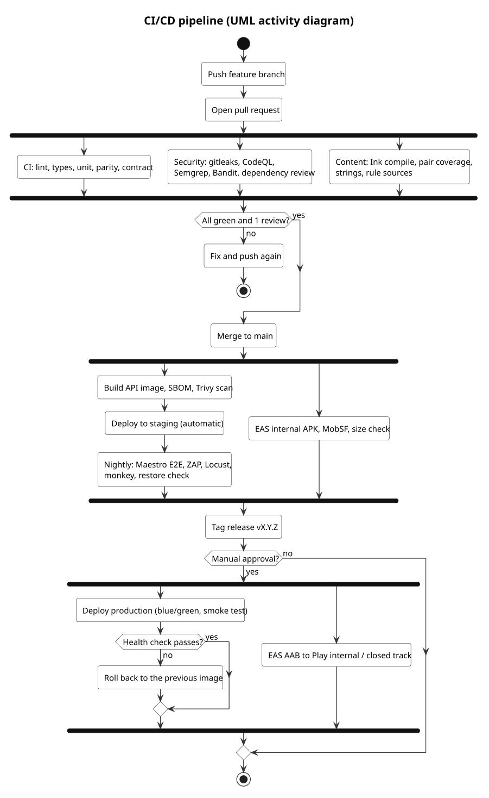

# CI/CD pipeline design

How Rahyaab's code is checked, built, released and run. The pipeline runs on **GitHub Actions**. Mobile builds use **EAS Build**, or `eas build --local` to stay within the free tier.

**Status (4 Nov 2026):** this is the design. The workflow files under `.github/workflows/` are not in the repository yet. Adding them is a Sprint 1 task, and the repository owner does it (see §7).

**Requirements:** NFR-41, NFR-50–55, NFR-66, NFR-71; SRS §13.3; ADR-0003, ADR-0014. The diagram is `docs/architecture/diagrams/devops/pipeline` (`.puml` / `.svg`).

## 1. Pipeline at a glance



## 2. Workflows

**In the repository now (9 Nov 2026):** `.github/workflows/ci.yml`, `security.yml`, `release.yml` (images for the API, dashboard and backup, then deploy to staging on `main` or production on a `v*` tag, by Docker Compose over SSH or by kubectl, chosen with the `DEPLOY_TARGET` environment variable) and `mobile-build.yml` (EAS, manual), plus `.github/dependabot.yml`. Every action is pinned to a commit SHA. The workflows marked *later* below are added when there is code for them to test: `content.yml` (when the Ink story starts), `nightly.yml` and `resilience.yml` (after the first staging deploy).


| Workflow | Trigger | Jobs, each a required check | Blocks merge when |
|---|---|---|---|
| `ci.yml` | PR, push to `main` | Only the jobs whose paths changed run:<br>• **mobile:** `pnpm install --frozen-lockfile`, `tsc --noEmit`, ESLint (with the a11y plugin), Jest + React Native Testing Library, the bundle-size budget<br>• **api:** ruff, mypy `--strict`, pytest against a PostgreSQL 16 service container, coverage ≥ 70% (NFR-50), import-linter module boundaries (ADR-0012), OpenAPI drift check<br>• **scoring:** ruff, mypy `--strict`, pytest, coverage ≥ 85% (NFR-50), golden fixtures (T-PAR-03/04)<br>• **dashboard:** build, Vitest, Playwright smoke + axe<br>• **parity:** the TS and Python baselines match on 200 golden profiles | Any job fails, coverage drops, or the API surface changes without a matching spec change |
| `content.yml` (*later*) | PR touching `content/` or `design/game/frameworks/` | • inklecate compile<br>• `pairs.json` coverage<br>• JSON Schema validation<br>• translation completeness (en/ur/roman)<br>• readability ≤ Grade 6<br>• every rule has `source_url` and `last_verified`<br>• pack signature dry-run | Any check fails (RFC-0001) |
| `security.yml` | PR, push to `main`, weekly | • gitleaks: changed commits on every PR, the full history weekly, with a reviewed baseline file (`.gitleaks-baseline.json`) for findings already fixed; a new exception needs a second reviewer<br>• compose lint: no `:latest` or unpinned image tags<br>• `git ls-files -ci --exclude-standard` must be empty (no tracked file that `.gitignore` now ignores)<br>• CodeQL (JS/TS, Python)<br>• Semgrep (OWASP rules)<br>• Bandit<br>• `pnpm audit` and `pip-audit`<br>• dependency review<br>• backdoor sweep: no `__DEV__`-only routes, test logins or debug flags in release config | Any critical or high finding (NFR-41, NFR-66, NFR-71) |
| `release.yml` (was `release-api.yml`) | push to `main`; tag `v*` | • build the Docker image<br>• CycloneDX SBOM<br>• Trivy image scan<br>• push to GHCR<br>• deploy to staging (main) or production (tag, needs approval)<br>• run migrations (Alembic)<br>• smoke test | Image scan high/critical, migration failure, smoke failure (auto rollback) |
| `mobile-build.yml` (was `release-mobile.yml`) | tag `v*`, or manual | • EAS build: an APK on the `preview` profile, or an AAB on `production`<br>• MobSF static scan<br>• size check (≤ 35 MB download)<br>• upload to the Play internal track | MobSF high finding, or the size budget is exceeded |
| `nightly.yml` (*later*) | 02:00 PKT | • Maestro E2E on an Android emulator (EN + UR)<br>• OWASP ZAP baseline against staging<br>• Locust smoke (50 virtual users, NFR-09)<br>• monkey test, 10k events (TC-MONKEY-01)<br>• Schemathesis fuzzing, 1,000 examples per operation<br>• restore-from-backup check: the newest off-site dump restored into a throwaway PostgreSQL container, verified, then deleted (TC-OPS-01) | Opens an issue on failure |
| `resilience.yml` (*later*) | Weekly (Sat 22:00 PKT) and before each milestone | • soak, 8 h (TC-PERF-06)<br>• spike (TC-PERF-05)<br>• break-point run (TC-PERF-07)<br>• chaos scripts on staging (TC-CHAOS-01, 02, 04, 05)<br>• monthly: full restore drill (TC-CHAOS-07) | Report saved as an artifact; a regression of more than 10% opens an issue |
| Dependabot | weekly | npm, pip and GitHub Actions updates. Expo and React Native packages are excluded; upgrade those together with `npx expo install --fix`. | — |

**Hardening rules for the workflows themselves (NFR-71):**
- Pin every action by commit SHA.
- Default to `permissions: contents: read`; widen it per job only where needed.
- Store secrets only in GitHub environments (`staging`, `production`); the production environment requires a reviewer.
- Never run workflows from forks with secrets (`pull_request`, never `pull_request_target`).
- Keep build logs free of personal data.

## 3. Environments

| Environment | Where | Data | Deployed by | Access |
|---|---|---|---|---|
| **Local** | Developer machine: `docker compose up` (API, Postgres, GlitchTip) plus Expo Go or a dev build | Synthetic fixtures only | Developer | Developer |
| **Staging** | Small VM or the university server (A-06), same compose file | Synthetic, plus team test accounts | Automatically from `main` | Team; staff MFA |
| **Production (pilot)** | One VM: 4 vCPU, 8 GB, 80 GB SSD, Ubuntu LTS. Region chosen by measured round-trip time (p95 ≤ 150 ms from Pakistani carriers) | Real, consented student data | A version tag, after manual approval | Two named admins (each with their own key and account); SSH by key only, through a WireGuard VPN on the VM (so dynamic home and mobile IPs are not a problem); break-glass: the hosting provider's web console, used only with a logged reason and a post-incident note |

**Configuration:**
- Everything comes from environment variables (twelve-factor).
- Committed `.env.example` files list every variable, with no values.
- **Feature flags** live in the database, are changed only by admins, and are audited. Flags never bypass authentication or consent.

## 4. Release and versioning

- **Version scheme:**
  - App and API: SemVer (`vMAJOR.MINOR.PATCH`).
  - Content packs: CalVer (`story-YYYY.MM.N`).
  - Models: `m<k>-<name>-YYYY.MM.N`.
- **Mobile:** an EAS build goes to the internal track (team), then the closed track (pilot schools), then production.
  - **EAS Update** (JS-only hot fixes) is allowed for bug fixes, with a staged rollout to 10%, then 50%, then 100%.
  - Content changes use content packs, never EAS Update (RFC-0001).
- **API:**
  - Database migrations must be backward-compatible (expand → migrate → contract), so the previous app version keeps working.
  - Blue/green on one host: start the new container, run the health check, switch Caddy, keep the old container for 24 hours.
- **Rollback:**
  - **API:** redeploy the previous image tag (target ≤ 10 minutes). Migrations include a down step, or a forward fix.
  - **Mobile:** halt the staged rollout, and roll back the EAS Update channel.
  - **Models and content:** re-activate the previous version (RFC-0001, RFC-0003).
- **Release checklist:**
  - all required checks green;
  - CHANGELOG updated;
  - OpenAPI and ADRs updated;
  - accessibility checks (T-A11Y) and the device matrix (T-DEV) done for user-facing changes;
  - security exceptions approved by the supervisor.

## 5. Operations

| Concern | Design |
|---|---|
| **Monitoring** | Self-hosted **GlitchTip** for errors (PII scrubbing on); **Uptime Kuma** for `/health` checks and the TLS expiry date; Caddy access logs with IPs truncated to /24. |
| **Alerts** | Error-rate spike, 5xx above 1% over 5 minutes, failed logins above 20 per 10 minutes, disk above 80%, backup failure. Alerts go by email to the two admins. |
| **Backups** | Nightly `pg_dump`, encrypted with `age`, copied off-site and kept for 30 days. Weekly restore test in the nightly job. Full restore drill each semester. |
| **Patching** | Unattended security upgrades on the VM; base images rebuilt weekly by Dependabot. |
| **Capacity** | Pilot target is 1,000 students and 250 concurrent (Locust). Scale up by resizing the VM before adding hosts. |
| **Incident response** | `docs/security/SECURITY.md` §7. |

## 6. Run the checks locally before you push

```bash
pnpm install
pnpm -r lint
pnpm -r exec tsc --noEmit
pnpm -r test
```

```bash
uv sync
uv run ruff check .
uv run mypy services packages
uv run pytest --cov
```

```bash
docker run --rm -v "$PWD:/repo" zricethezav/gitleaks:latest detect --source /repo
```

## 7. One-time GitHub setup (repository owner)

1. **Protect `main`** with a branch ruleset:
   - require a PR with 1 approval;
   - require the status checks that exist: start with the `ci.yml` lint, typecheck and test jobs in Sprint 1, and add each new workflow's checks to the ruleset in the sprint that adds the workflow (a ruleset cannot require a check that has never run);
   - block force pushes and deletions;
   - linear history: **not** required, because the team merges with **"Create a merge commit"** so each member's commits stay attributed (SRS §13.3; CONTRIBUTING.md).
2. **Code security:** turn on Dependabot alerts and security updates, Secret scanning with push protection, and CodeQL default setup.
3. **Environments:** create `staging` and `production`; add the required reviewer to `production`; add the secrets `EXPO_TOKEN`, `DEPLOY_SSH_KEY`, `GHCR_TOKEN` and `PACK_SIGNING_KEY` to the right environment.
4. **Local mobile builds:** run `npx eas-cli@latest build:configure` once to create `eas.json`.
5. **Remove files that are tracked but now ignored.** The 4 Nov 2026 `.gitignore` covers four files that were committed earlier: a session file, a `.pyc`, `tmp_check.js` and an `AGENTS.md`. Untrack them without deleting them from disk, then commit:

   ```bash
   git rm --cached "RahYaab Application/AGENTS.md" archive/riasec-career-game/sessions/session_f0ad5760e2bd.json "archive/riasec-career-game/tests/__pycache__/test_feature_engineering.cpython-314-pytest-9.0.3.pyc" archive/riasec-career-game/tmp_check.js
   ```

   The session file holds a participant's age band and gender. Because it is already in the Git history, remove it from history before the repository is made public (for example with `git filter-repo`), or confirm that it was a team member's test play.

## 8. Rules the pipeline enforces, and why

- Nothing reaches `main` without review and green checks. That is also the evidence for teamwork and quality (FYP LO6).
- Secrets never enter the repository: gitleaks fails the build, and push protection blocks known token formats.
- Participant data never enters the repository: `pilot_logs/` and `pilot_exports/` are gitignored, and fixtures are synthetic.
- Every release can be traced: image digest, SBOM, Git SHA, content version and model version are recorded with each deployment.
