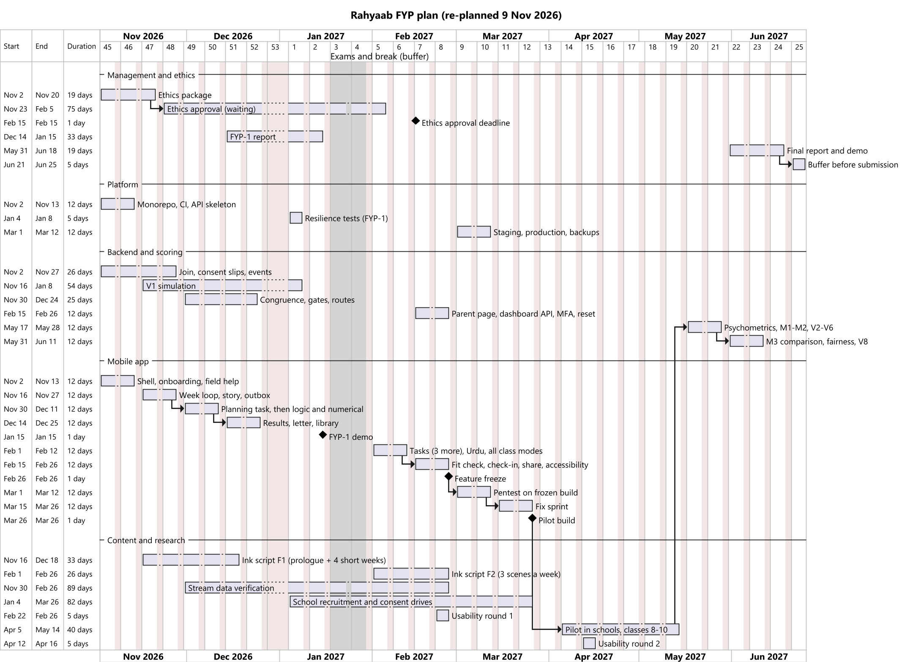

# Project plan: effort, WBS and Gantt chart (re-planned 9 Nov 2026)

The schedule follows `MVP.md` §3. Sprints are 2 weeks long and start on Mondays. This version replaces the plan of 5 Nov 2026 after the cross-model review (`REVIEW_LOG.md`) showed that the work did not fit the team's time.

**Decisions taken on 9 Nov 2026:**
- the team commits about **20 focused hours per person per week**;
- **individual sign-up with parent OTP** moves to post-MVP (the pilot uses the school path only);
- the **pilot runs 5 April – 14 May 2027 with classes 8–10** (6 weeks, finishing before Eid al-Adha and away from the class 11–12 board exams); class 11–12 and O/A-Level modes are rule-checked and usability-tested, not validated.

## 1. Owners and backups

Work is split so that each person carries about the same load (§2), and every critical package has a second person who reviews its code and could take it over.

| Who | Owns | Backup reviewer for |
|---|---|---|
| **ZB** = Zahid Bashir | API (identity, consent, telemetry, results, admin), scoring models M1–M3, security | Platform and CI (HB's) |
| **HB** = Hamza Butt | Mobile app, tasks, performance, **platform, CI and deployment** | API and scoring code (ZB's) |
| **DS** = Daniyal Sarwar | UX, Ink content, stream data, **dashboard (UI and API), parent pages**, ethics, pilot, **validation analysis** and AHP | Mobile UI (HB's) |

The supervisor (Zeeshan Ali) reviews the ethics package and the validation plan. Roles are proposals for the team to confirm in the S1 meeting.

## 2. Effort estimate and capacity

A bottom-up estimate in hours, made on 9 Nov 2026 before any code exists. Coding work is assumed to go about 30% faster with AI assistants. Each GitHub issue gets its own estimate in Sprint 1, and the numbers below are corrected from the planning task's real time in S3.

| Area | Main items | Hours |
|---|---|---|
| Platform and DevOps | Monorepo and CI, Docker and environments, backups, resilience suite, pentest and fixes | 125 |
| Backend | Join, consent slips, re-link, staff login with MFA and reset, telemetry, results, library, share links, parent pages, dashboard API, admin, retention, audit (individual OTP sign-up removed: −30) | 275 |
| Scoring and research | V1 simulation, production M1 scorer, congruence and gates, rules for all class modes, M2, AHP, M3 comparison, fairness, validation analysis | 320 |
| Mobile app | Shell, Urdu RTL, week loop and story, outbox, 6 task families, accessible modes, results, fit check, PIN, share, read-aloud, avatar, provisional result, performance | 485 |
| Content and UX | Ink script, stream and board rules, dashboard UI, usability rounds, Urdu translation and audio (OTP consent page removed: −10) | 250 |
| Pilot and fieldwork | School recruitment, consent drives, running the pilot, counsellor panel | 80 |
| Reports and process | FYP-1 and final reports, ethics package, slides and demos, meetings | 310 |
| **Total** | | **1,845** |
| AI saving on coding (30% of 885 h) | | −265 |
| **Net estimate** | | **≈ 1,580** |
| **Capacity** | 3 people × 20 h × about 27 effective weeks (exam and break weeks at half) | **≈ 1,620** |

**Load per person (net):** ZB ≈ 525 h, HB ≈ 530 h, DS ≈ 525 h, against about 540 h each.

**Slack is only about 3%** (the usual target is 15–25%). This is a deliberate choice to keep every class mode in the MVP. It is managed by the **checkpoints** in `MVP.md` §3: at the FYP-1 demo and at the feature freeze, if the team is more than a week behind, the next item in the cut order (`MVP.md` §4, about 160 hours in total) is cut at once.

## 3. Work breakdown structure (WBS)

| WBS | Work package | Deliverables | Owner | Sprints |
|---|---|---|---|---|
| **1** | **Project management** | | | |
| 1.1 | Scope sign-off | SRS v1.4, MVP, this plan, supervisor approval | DS | S1 |
| 1.2 | Ethics | Application package: consent forms (all Urdu versions reviewed by a native speaker), DPIA reviewed by the ethics office, protocol, school permission letters; submission when complete (S2); **approval needed by 15 Feb 2027** | DS | S1–S2 → approval |
| 1.3 | Reporting | FYP-1 chapters 1–5; final report; slides | All | S4–S5, S14–Final |
| 1.4 | Tracking | Issue estimates, burn-down per sprint, checkpoint reviews | ZB | Every sprint |
| **2** | **Platform and DevOps** | | | |
| 2.1 | Monorepo and CI | Workflows, branch protection, secret scanning | HB | S1 |
| 2.2 | Environments | Docker Compose; staging; production VM; off-site backups; restore test | HB | S1, S8 |
| 2.3 | Resilience tests | Load, spike, soak, chaos and monkey suites | HB, ZB | S5, S8, S13 |
| **3** | **Backend** | | | |
| 3.1 | Identity and consent | Join, consent slips and claim codes, re-link, consent gate, staff login, MFA, reset | ZB | S1–S2, S7 |
| 3.2 | Telemetry | `/events:batch`, validation, quarantine, deferred events | ZB | S2 |
| 3.3 | Library and sharing | Streams, share links, parent page (several children) | ZB (library), DS (parent page) | S4, S7 |
| 3.4 | Dashboard API | Roster, flags, notes, summary, CSV, consent slips, re-link codes, audit | DS | S7 |
| **4** | **Scoring and research** | | | |
| 4.1 | M1 interests | V1 simulation (feasibility), option map, production scorer, pilot recalibration | ZB | S2–S5, S6, S13 |
| 4.2 | M2 abilities | Staircase, then Rasch on the pilot | ZB | S3, S13 |
| 4.3 | M3 recommender | Congruence + gates + routes; AHP weights; rules vs congruence comparison; learned-ranker experiment; fairness | ZB (models), DS (AHP) | S3–S4, S14 |
| 4.4 | Validation study | Mini-IP sessions, reliability, panel labels, V2–V8 analysis | DS (analysis), ZB (scoring) | S10–S14 |
| **5** | **Mobile app** | | | |
| 5.1 | Shell and onboarding | Theme, i18n, S-01–S-06, field help, age rules, claim code | HB | S1 |
| 5.2 | Week loop and story | inkjs bridge, planner, scenes, diary, letter | HB | S2–S4 |
| 5.3 | Tasks | Planning first, then logic and numerical (FYP-1); spatial, abstract, verbal (FYP-2) | HB | S3, S6 |
| 5.4 | Results | Blueprint, Why this?, group fit check, check-in, share | HB | S4, S6–S7 |
| 5.5 | Offline and sync | Outbox, sync worker, fault tests | HB | S2, S5 |
| 5.6 | Accessibility | Read-aloud, settings, accessible modes, high-contrast theme | HB, DS | S4, S7 |
| **6** | **Content and UX** | | | |
| 6.1 | Ink script | F1: prologue + 4 short weeks (S2–S4, done 18 Dec); F2: 3 scenes a week, value moments (S6–S7) | DS | S2–S4, S6–S7 |
| 6.2 | Stream data | `streams.json` verification for every board and path, O*NET profiles, routes | DS | S3–S7 |
| 6.3 | Dashboard UI | D-01–D-11, including the consent-slip screens | DS | S7 |
| 6.4 | Usability | Round 1 (22–26 Feb), round 2 (12–16 Apr) | DS | S7, S10 |
| 6.5 | Urdu audio | Record and review the clip set (fixed text + assembled Blueprint clips) | DS | S6–S7 |
| **7** | **Pilot and release** | | | |
| 7.1 | Freeze and pentest | Feature freeze 26 Feb; pentest on the frozen build (S8); fix sprint (S9); restore drill | ZB, HB | S8–S9 |
| 7.2 | Pilot build | Pilot APK, 26 Mar | HB | S9 |
| 7.3 | School recruitment | Approach 4–5 schools, permission letters (Form D), consent-slip drives, teacher training, recruitment funnel | DS | S5–S9 |
| 7.4 | Pilot | 3–4 schools, classes 8–10, 5 Apr – 14 May | All | S10–S12 |
| 7.5 | Final demo | Committee demo script (`SCIENTIFIC_BASIS.md` §6) | All | Final |

## 4. Gantt chart

The source is `diagrams/gantt.puml` (PlantUML). Bars are linked by dependencies, and the two buffers (the January break and the last June week) are shown.

**Critical path:** ethics package → ethics approval (by 15 Feb) → usability round 1 → feature freeze (26 Feb) → pentest (S8) → fix sprint (S9) → pilot build (26 Mar) → pilot (5 Apr – 14 May) → psychometrics (S13) → final report. A slip anywhere on it moves the pilot, and the pilot cannot move past mid-May because of Eid al-Adha and the end of the semester.

## 5. Milestones

| Milestone | Date | Exit criteria |
|---|---|---|
| Scope sign-off | 13 Nov 2026 | Supervisor approves the SRS, MVP and this plan |
| Ethics application submitted | by 27 Nov 2026 | The complete package, including the Urdu reviews |
| **FYP-1 demo** | Weeks 17–18 (14–25 Dec 2026; exact day set by the department) | The demo slice (`MVP.md` §3, S4) end to end on a budget phone; V1 simulation results; chapters 1–5 in draft. **Checkpoint 1** |
| FYP-1 complete | 15 Jan 2027 | The rest of F1 (`MVP.md` §2) and the final FYP-1 chapters |
| Ethics approval | by 15 Feb 2027 | Approval letter; otherwise the fallback below starts |
| Feature freeze | 26 Feb 2027 | MVP §2 complete; usability round 1 done. **Checkpoint 2** |
| Pilot build | 26 Mar 2027 | Pentest done with no open critical or high findings; restore drill passed |
| Pilot done | 14 May 2027 | Data from ≥ 100 students in classes 8–10; usability round 2; retest sample |
| **Final** | 25 Jun 2027 | Validation results (V2–V8), final report, demo |

## 6. Risks to this plan

| Risk | Trigger | Response |
|---|---|---|
| The work runs late (slack is ~3%) | > 1 week behind at a checkpoint | Cut the next item in `MVP.md` §4 at once |
| Ethics approval is late or refused | No approval by 15 Feb 2027 | Run usability round 1 with adult (18+) students only; shorten the pilot to 4 weeks (12 Apr – 14 May); if approval never comes, run a pilot with university students and report the school pilot as future work |
| Too few students finish | < 150 enrolled by 26 Mar | Recruit a fifth school; the target is ~250 enrolled to reach ≥ 100 finished (about 60% complete) |
| School calendar clashes | A partner school has exams or holidays in the window | Confirm each school's calendar at recruitment (S5–S8) and schedule its 4 play weeks inside its free weeks |
| A key person is unavailable | Illness or exams | The backup reviewer (§1) takes over the package; the next cut-order item is applied if needed |
