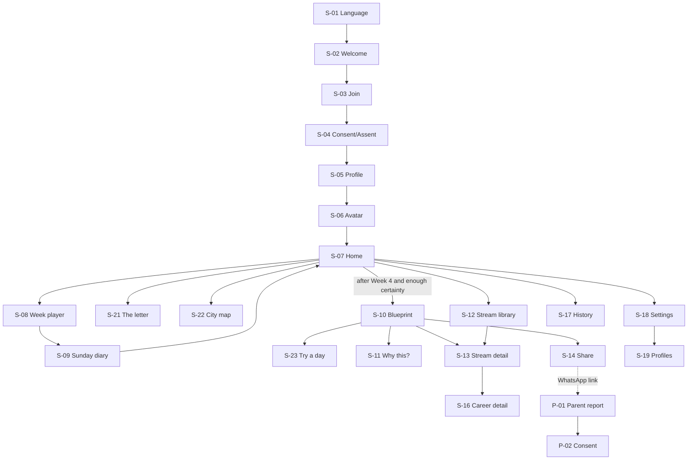
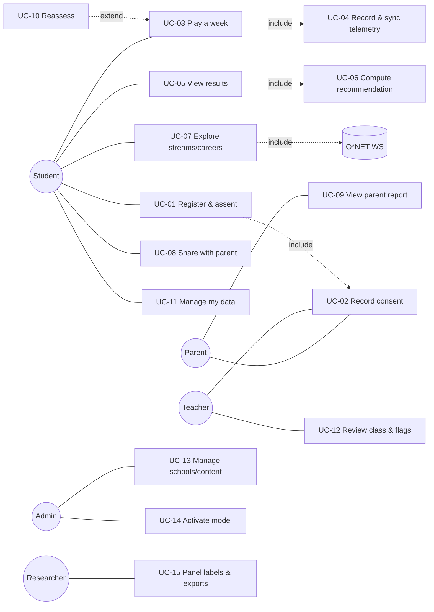

# Rahyaab — Software Requirements Specification and Design Specification

| Field | Value |
|---|---|
| Project | Rahyaab (راہ یاب): game-based stream guidance for Pakistani class 8–12 students (ages about 13–18) |
| Programme | BSCS Final Year Project, Riphah International University, Fall 2026 (FYP-1) → Spring 2027 (FYP-2) |
| Team | Zahid Bashir, Hamza Butt, Daniyal Sarwar |
| Supervisor | Zeeshan Ali |
| Document | SRS + design specification (IEEE/ISO/IEC 29148:2018 structure), version 1.5, 11 Nov 2026 (v1.4: 7 Nov; v1.3: 5 Nov; v1.2 and v1.1: 4–5 Nov 2026; v1.0: 31 Oct 2026) |
| Status | Draft for supervisor review. Supersedes the instrument sections of Template-04 v1.4 and the proposal slides |
| Repository location | `docs/project/SRS.md` (short summary in `docs/project/PROJECT_BRIEF.md`) |

**How to read this document.** Requirements use IDs (`FR-xx`, `NFR-xx`, `UC-xx`, `US-xx`, `T-…`). Evidence tags in square brackets point to the research sources listed in §1.5, for example `[N6 §1]` = Pakistan mobile-context notes, section 1. **Assumptions** are marked `A-xx` and listed in §1.6. Anything that must be checked before it is relied on is marked **(verify)**.

---


> **Change log, v1.1 (4 Nov 2026).** This version folds in the final game design (`design/game/GAME_DESIGN.md` v3, with its data in `design/game/frameworks/`) and the final brand (`design/brand`, `design/tokens`). What changed:
>
> - **Audience:** now class 8–12, ages 14–18. Class 8 chooses a Matric group.
> - **Game:** the four chapters (Career Bazaar, Story Town, Puzzle Lab, Stream Sims) are replaced by one story game, **"Your Year"** (§5): a prologue, 4 weeks, the Blueprint, then "Try a day" job simulations.
> - **Interests (M1):** a Thurstonian IRT model scores the forced-choice story choices, with a graded response model for the "meh / okay / loved it" taps. The 145k RIASEC dataset is used through simulated game choices.
> - **Abilities (M2):** six task families named after their ICAR item types (spatial, abstract, numerical, logic, planning, verbal). Memory (Glyph Sequence) is dropped.
> - **Work values:** O\*NET's six values are added as a secondary construct, used only for explanations and tie-breaks.
> - **The letter from future you** shows M1's real uncertainty (FR-94).
> - **Visual design (§8):** the Branch logo, the Hudhud mascot, terracotta and teal, light and dark.
> - **FRs:** FR-13–33 rewritten for the new game; FR-91–98 added. There are now 98 FRs.
> - **Accessibility, security and store (added the same day):**
>   - FR-96–98 cover read-aloud, accessibility settings and accessible task modes;
>   - NFR-64–72 cover high contrast, alternative input and security hardening;
>   - the details are in `design/specs/accessibility.md`, `docs/security/SECURITY.md` and `docs/project/STORE_AND_SEARCH.md`;
>   - the screens are in `design/screens/` and in Figma. There are now 72 NFRs.
>
> **Change log, v1.2 (5 Nov 2026).**
>
> - **Exceptions and edge cases (FR-99–104):**
>   - a current-group and current-stream fit check, with routes such as re-taking class 9, switching group or adding a subject;
>   - age handling: under 13 stops, 13–17 need parental consent, 18+ give self-consent, and over-age learners get their own routes;
>   - a class check-in for promotion or repeating a class;
>   - guided field help and help everywhere;
>   - non-standard learners.
>
>   The details are in `docs/project/EDGE_CASES.md` and `design/specs/forms-and-errors.md`.
> - **NFR-73–76:** error-message quality, help that doesn't leak, resilience under load (soak, spike, break-point) and recovery from faults (chaos).
> - **MVP:** a combined plan for both semesters in `docs/project/MVP.md`. It decides when each FR ships.
> - **Class modes:** the class 11–12 mode is named `university` everywhere (it was `fitcheck` in §12.4). The fit check itself is FR-99.
> - **Totals:** 104 FRs, 76 NFRs.
>
> **Change log, v1.3 (5 Nov 2026).**
>
> - **Coverage:** technical, vocational, health, professional and uniformed-service paths (`streams.json` 1.2.0).
> - **Requirements:**
>   - FR-105: parents with several children;
>   - FR-106: staff password reset;
>   - NFR-77: CORS policy.
> - **Data:** a research-only gender table (opt-in, `research_demographics`).
> - **MVP:** the O/A-Level mode and individual sign-up with parent OTP are now in the MVP, and adaptive pair selection is a research simulation.
> - **New documents:**
>   - `docs/project/SCIENTIFIC_BASIS.md` (evidence for the committee);
>   - `docs/project/DESIGN_RATIONALE.md`;
>   - `docs/security/DPIA.md`;
>   - `docs/legal/` (privacy policy and terms);
>   - `docs/ethics/CONSENT_FORMS.md`;
>   - `docs/project/PLAN.md` (WBS and Gantt).
> - **Totals:** 106 FRs, 77 NFRs.
>
> When this SRS and the GDD disagree, the GDD wins for game content and this SRS wins for requirements and acceptance criteria.
>
> **Change log, v1.4 (7 Nov 2026), after the cross-model review** (`REVIEW_LOG.md`).
>
> - **Audience wording:** ages about 13–18; class-8 students under 13 cannot sign up.
> - **Honest method wording:** the reaction tap is named as the app's one short self-report item (§1.2, FR-93); the CCP row no longer says all processing runs offline.
> - **Requirements tightened:** FR-04 (birth month and year, no fixed year limit, band re-checked yearly), FR-05 (signed paper slips with one-time claim codes), FR-07 (PIN required with two or more profiles), FR-21 (input baseline, never used to score), FR-45 (no rounding at thresholds), FR-46/FR-51 (no ranking when evidence is thin, at most one extra week), FR-68 (entry odds defined), FR-90 (acceptance criteria), FR-97 (auto-read off with TalkBack), FR-98 (no assistive-technology logging).
> - **NFRs made measurable:** NFR-04 (TTFD method), NFR-33 (99% for a one-server pilot), NFR-34 (no "where possible"), NFR-57 (workload model, 4 vCPU / 8 GB), NFR-75 (soak and break-point definitions).
> - **Models (§12.6):** one joint TIRT + GRM model, the planner as a ranking block, MAP + Laplace instead of a 6-D quadrature grid, the feasibility target r ≥ .80 (stretch .90), Rasch first for abilities, θ⁺ and the support terms defined, rules for weak panel labels and for δ.
> - **Usability:** formative rounds vs the summative pilot measure (§14.3).
> - **Re-plan (9 Nov 2026, `PLAN.md`):** 20 h per person per week; individual sign-up with parent OTP (FR-03 individual, FR-05b, FR-70) moves to post-MVP; the validation pilot runs 5 Apr – 14 May 2027 with classes 8–10, while the class 11–12 and O/A-Level modes are rule-checked and usability-tested.

> **Change log, v1.5 (11 Nov 2026), after the development review.**
>
> - **Age assurance (FR-04, FR-05, FR-100):** the age that decides consent comes from the school's admission register, copied by the teacher when recording a signed form; a self-declared age never grants consent (`docs/security/AGE_ASSURANCE.md`). Adult self-consent is a recorded paper Form C in the school path.
> - **Commercial model:** FR-107 (institution licences with seats; pilot licences) and FR-108 (individual subscriptions, post-MVP), ADR-0015.
> - **Stream data:** gates carry a verification level and an official source; two wrong rules corrected (ICS → engineering, Pre-Medical → engineering); path RIASEC profiles are to be derived from O*NET occupational interest data (`tools/onet_profiles.py`).
> - **Totals:** 108 FRs, 77 NFRs.

## Contents

1. Introduction
2. Stakeholders, personas and user journeys
3. Problem statement and Complex Computing Problem (CCP) mapping
4. Feature list and MVP scope (MoSCoW)
5. Game Design Document
6. Information architecture and screen inventory
7. UX and HCI guidelines
8. Visual design system
9. Functional requirements
10. Non-functional requirements (ISO/IEC 25010:2023)
11. Use cases and user stories
12. System architecture, data, API, telemetry and ML modules
13. Software process and release plan
14. Verification and validation plan
15. Risk register
16. Requirements traceability matrix
17. Appendix: primary-research instruments and evidence gaps

---

## 1. Introduction

### 1.1 Purpose

This document specifies what Rahyaab must do and how well, and records the design decisions behind it. It is written for:

- the three developers;
- the supervisor and the FYP evaluation committee, who assess LO2 (requirements), LO3 (design), LO4 (algorithms and trade-offs) and LO1 (maths and science);
- the university ethics committee, for the pilot with minors;
- any coding assistant or new developer working in the repository.

It is the single source of truth. When the slides, Template-04 or old code disagree with it, this document wins [REV §3.1].

### 1.2 Product scope

Rahyaab is an **Android-first mobile app** (React Native, Expo SDK 58, TypeScript, expo-router). Pakistani students in **class 8–12** play one short story game, **"Your Year"**, and receive **explainable stream recommendations**:

- **Matric (SSC) groups:** Science-Biology, Science-Computer, Humanities, Technical where offered.
- **Intermediate (HSSC):** FSc Pre-Medical, FSc Pre-Engineering, ICS (Physics/Statistics/Economics variants), I.Com, FA/Humanities (elective bundles), General Science, DAE.
- **O/A Levels:** A-Level subject bundles mapped onto the same stream families.

Students then explore what each stream leads to: subjects, entry tests, degree families and careers.

**The product is game-based.** It has no questionnaire screens, rating-scale pages or interviews. Its only self-report element is a skippable one-tap reaction ("meh / okay / loved it") after a scene the student has just played, which M1 uses as a short 3-category rating item (FR-93). Everything else is observed play:

- interests (RIASEC) are measured through **story choices**: the weekly activity planner and the Dil vs Duniya forced-choice moments;
- abilities are measured through **everyday tasks** inside scenes (six ICAR-style families);
- work values (O\*NET's six) are measured through a few **story dilemmas** and are used only for explanations and tie-breaks [GD §11].

Scoring runs **server-side** in a Python engine (derived from the team's `career-game-prototype`) behind **FastAPI + PostgreSQL**. The phone records raw telemetry **offline-first** and syncs when a connection is available.

**Parents' wishes do not enter the ranking.** The recommendation uses only the student's play, eligibility and optional marks. The parent report (P-01) and its talk-together checklist (FR-68) are where a family discusses any difference between the student's paths and the parents' preference; the app never re-ranks to match a parent.

Two other surfaces complete the product:

- a **lightweight counsellor/teacher web dashboard**, which is committed scope [REV §2];
- a **parent web view** that needs no app.

Benefits and goals:

| Goal | Measure (see §10, §14) |
|---|---|
| G1. A student gets a credible, explained shortlist of streams in about 30 minutes of total play | Median time to the Blueprint ≤ 35 min over ≥ 4 sittings; SUS ≥ 70 |
| G2. Parents and teachers can join the decision | ≥ 50% of pilot students share with a parent; teacher dashboard used in the pilot schools |
| G3. Measurement is evidenced, not asserted | Convergent validity against the O*NET Interest Profiler benchmark is reported; reliability and fairness are reported |
| G4. Works on budget Android phones that are offline or shared | Cold start ≤ 3 s on a 4 GB device; zero event loss in fault tests; multi-profile support |

**Out of scope** (see also §4.3): university admissions and search, scholarships, paid counselling or a marketplace, chat or social features, personality (Big Five) scoring for recommendations, video interviews, Unity builds, and users outside class 8–12 [REV §3.1; GD §2].

### 1.3 Definitions and abbreviations

| Term | Meaning |
|---|---|
| **Stream** | The academic group chosen for SSC (decided at the end of class 8) or HSSC (decided in class 10), or an A-Level subject bundle. For class 11–12 the output is a university field |
| **SSC / Matric** | Secondary School Certificate, Grades 9–10. **HSSC / Intermediate** = Grades 11–12 |
| **FSc, ICS, I.Com, FA, DAE** | Pre-Medical/Pre-Engineering Intermediate; Intermediate in Computer Science; Intermediate in Commerce; Intermediate in Arts/Humanities; Diploma of Associate Engineering (3-year technical) |
| **BISE / FBISE / AKU-EB** | Provincial boards / Federal board / Aga Khan University Examination Board |
| **IBCC** | Inter Board Committee of Chairmen (equivalence of O/A Levels) |
| **PMDC / PEC** | Pakistan Medical and Dental Council / Pakistan Engineering Council (degree-entry rules) |
| **MDCAT / ECAT / NET** | Medical entry test / engineering entry test (Punjab) / NUST Entry Test |
| **RIASEC** | Holland's six interest types: Realistic, Investigative, Artistic, Social, Enterprising, Conventional |
| **Story choice** | A choice inside "Your Year" between activities or actions, each tagged with a RIASEC type (gamified or stealth assessment) [GD §8] |
| **Dil / Duniya** | The two inner voices that offer each forced-choice pair of RIASEC types; neither stands for one interest |
| **Task** | An everyday in-story action with a correct solution (pack the car boot, split the bill), used to estimate an ability |
| **Value moment** | A small story dilemma between two O\*NET work values |
| **The letter** | The letter from future you; its readable words track M1's certainty (FR-94) |
| **Blueprint** | The result: the letter opening, top-3 paths, Plan B, family report |
| **Storylet** | A scene with prerequisites and effects, picked from a pool at run time |
| **Ink / inkjs** | The narrative scripting language and its JavaScript runtime |
| **ICAR** | International Cognitive Ability Resource: public-domain ability item families (our tasks follow its types; its items are not shipped) |
| **IRT, TIRT, GRM, 2PL, Rasch** | Item response theory; Thurstonian IRT for forced-choice data (Brown & Maydeu-Olivares 2011); Samejima's graded response model; two-parameter logistic model; one-parameter (Rasch) model |
| **θ (theta), SE** | Latent trait estimate and its standard error |
| **EAP** | Expected a posteriori estimate of θ |
| **CAT** | Computerized adaptive testing (here, adaptive scene and pair selection) |
| **Band** | A qualitative level shown instead of a number: interests *Strong / Moderate / Lower*; abilities *Strong / Developing / Emerging*; fit *Strong fit / Good fit / Worth a look* |
| **Confidence** | High/Medium/Low, derived from SE, evidence coverage and agreement between sources |
| **Gate** | An eligibility rule (board, council or test requirement) |
| **Door** | A downstream route (degree family or career) that a stream keeps *open*, opens *with an extra step*, or *closes* |
| **Plan B** | An alternative route shown with every top recommendation |
| **Week / sitting** | One week of the story (plan → scenes → value moment → beat → diary, about 5 min) / one continuous play session |
| **Week loop** | The shared shell every week runs inside (§5.4) |
| **Outbox** | The on-device SQLite queue of unsent telemetry events |
| **CCP** | Complex Computing Problem (Seoul Accord) |
| **MASVS / ASVS** | OWASP Mobile / Application Security Verification Standards |
| **TTID / TTFD / ANR** | Time to initial display / time to full display / Application Not Responding |
| **SUS, IMI, CDSE** | System Usability Scale; Intrinsic Motivation Inventory; Career Decision Self-Efficacy |
| **DIF** | Differential item functioning (item bias across groups) |
| **NDCG@3** | Normalised discounted cumulative gain over the top 3 |
| **SHAP** | SHapley Additive exPlanations |

### 1.4 Document conventions

- **Priority (MoSCoW):** M = Must, S = Should, C = Could, W = Won't (this release).
- **Release:** R1 = FYP-1 prototype (Jan 2027 progress presentation); R2 = FYP-2 pilot build (Mar 2027); R3 = FYP-2 final (Jun 2027).
- "Shall" marks a requirement; "should" marks a recommendation.

### 1.5 References

**Project research** (all in the project workspace):

| Tag | Source |
|---|---|
| **[R1]** | Report *"Turning mini-games into trustworthy stream advice"* (`docs/research/reports/Career guidance games app Pakistan.md`): streams and gates, RIASEC/aptitude core, game designs, recommender, stack, privacy, competitors |
| **[R2]** | Report *"Career games abound, but none validate Pakistani stream choice"* (`docs/research/reports/Career guidance games literature review.md`): game catalogue, measurement evidence, recommender literature, guidance ingredients, research gap |
| **[N1]** | Research notes, `docs/research/notes/Teen career app needs and design/student_needs.md` |
| **[N2]** | … / `parent_counsellor_school_needs.md` |
| **[N3]** | … / `teen_games_and_competitor_games.md` |
| **[N4]** | … / `hci_accessibility_color.md` |
| **[N5]** | … / `competitor_features_flows.md` |
| **[N6]** | … / `pakistan_mobile_context_nfrs.md` |
| **[REV]** | *Rahyaab FYP review* (29 Oct 2026), `docs/project/FYP_REVIEW.md` |
| **[GD]** | *Rahyaab Game Design Document*, final v3 (`design/game/GAME_DESIGN.md`) and its framework data (`design/game/frameworks/`). Supersedes [REV] and earlier design drafts |
| **[BR]** | Brand and design system: `design/brand/BRAND_GUIDELINES.md`, `design/tokens/` |
| **[PROTO]** | Git branch `wip/hamza-career-game-prototype`, folder `prototypes/career-game-prototype/` (engine modules `power_grid`, `glyph_sequence`, `calibration`, `session_log`, `aggregate`, `stream_transformation_engine`, `telemetry_schema`) |

**Standards and frameworks:**

- ISO/IEC/IEEE 29148:2018 (requirements engineering)
- ISO/IEC 25010:2023 (product quality model)
- W3C WCAG 2.2
- OWASP MASVS v2.1 and Mobile Top 10 2024; OWASP ASVS 5.0
- UK ICO Age Appropriate Design Code (Children's Code)
- Google Play target-API and Families policies
- Seoul Accord graduate attributes (complex computing problems)
- Nielsen's 10 usability heuristics
- O*NET Web Services terms and the O*NET Tools Developer License

Key literature is cited through [R1]/[R2]. Examples: Fadillah et al. 2025 (game-vs-self-report meta-analysis); Georgiou et al. 2019 (gamified SJT); Tokzhigitova et al. 2025 (Kazakhstan GCG); Hassan et al. 2022 (parental influence); Lahoud et al. 2022 (knowledge-based recommender); Song et al. 2022 (ML majority bias); Jones et al. 2014 (Urdu Career Key); Whiston et al. 2003/2017 and Brown & Ryan Krane (guidance ingredients).

### 1.6 Assumptions and dependencies

| ID | Assumption | Consequence if false |
|---|---|---|
| A-01 | Expo SDK 58 / React Native 0.88 / React 19.3 (as in the prototype `package.json`) remain stable for the project's duration | Pin versions; upgrade only between releases |
| A-02 | The OpenPsychometrics/Kaggle RIASEC dataset (~145,828 responses, 48 items) is licensed for research use. Its items are public-domain markers that game options are mapped to for simulated pre-calibration **(verify item source and licence)** [GD §13; REV §3.3] | M1 pre-training falls back to pilot-only calibration |
| A-03 | The team's O*NET Web Services account allows (a) occupation content with attribution, and (b) research use of the Interest Profiler (Mini-IP) **unchanged, in English**. An Urdu translation would require the Developer License [R1; REV §3.7] | Benchmark is given in English only; noted as a limitation |
| A-04 | Pilot schools will collect paper or school-mediated parental consent. SMS OTP is a later option (cost) | Individual sign-up stays behind a feature flag |
| A-05 | The FYP-1 progress presentation is in the second half of January 2027, after finals | Shift sprints S4–S5 |
| A-06 | Hosting is one small Linux VM (2 vCPU / 4 GB) in the UAE or Mumbai region, or a Pakistani provider, at about US$10–60/month [N6 §6] (estimate, verify) | Use the university server if available |
| A-07 | Stream and eligibility rules hold as of Oct 2026, including the IBCC Dec 2025 decision allowing Matric-Arts students into any Intermediate group "from the next session" [N1 Q1] **(verify per board)** | Rules are data-driven with effective dates (FR-45) |
| A-08 | Class 8–12 students are roughly 13–18 years old. Under-13s are blocked | Neutral age gate (FR-04) |

---

## 2. Stakeholders, personas and user journeys

### 2.1 Stakeholder analysis

| Stakeholder | Interest in Rahyaab | Power over outcome | Quadrant / strategy | Key needs (source) |
|---|---|---|---|---|
| Students, class 8–12 | Very high: the decision affects their next 2–6 years | Low on their own; decisions are collective [N1 Q5] | High interest, low power → **involve closely** (co-design, usability tests) | Discover interests, choose a group, wider career awareness, no exam feel, privacy on shared phones [N1 Q1–Q5] |
| Parents/guardians | High | **Very high**: parental influence β = .50; 82.6% of students rely on parents [R1; R2] | High/high → **manage closely** | Urdu report, prospects, cost, entry tests, local options, safe options for daughters, consent [N2] |
| Teachers / school counsellors | Medium–high | Medium: they gatekeep classroom use; teacher bias can steer girls [R2, Carlana] | **Keep involved** | Minutes per class, not per student; roster, flags, one-page summary, export [N2] |
| School principals / chains | Medium | High (access, procurement) | **Keep satisfied** | Data agreement, no ads, offline, branded report, CSV [N2] |
| FYP supervisor and committee | High | Very high (grades) | **Manage closely** | Locked scope, CCP, measurable experiments, Git evidence [REV §1–2] |
| University ethics committee | Medium | Very high (pilot go/no-go) | **Keep satisfied** | Consent/assent, minimisation, retention, risk handling |
| Boards, IBCC, PMDC, PEC | Low (unaware of the app) | High: they set the rules | **Monitor**; cite and date every rule | Correct gates [R1 §1] |
| Govt/NGO channels (PEF, NAVTTC/TEVTA, Teach For Pakistan) | Low now | High for scale-up | **Keep informed** later | Free pilots, Urdu, offline, impact evidence [N2] |
| Data providers (O*NET, dataset owners) | Low | Medium (licences) | **Comply** | Attribution, licence terms [R1] |
| Development team | High | High | — | Clear backlog, CI, fair split of work [REV §8] |

### 2.2 Personas

**P1. Ayesha, 15, Grade 9 (early term), government girls' high school, Sahiwal**

- **Device and access:** uses her mother's Tecno Spark (4 GB RAM, Android 14). The phone is shared with two siblings and full of WhatsApp media. She gets the phone for about 30 minutes in the evening, with 3–4 hours of load-shedding most days [N6 §1–2].
- **Language:** Urdu medium; reads English slowly [N6 §3].
- **Situation:** she likes the computer period and drawing. Her aunt says biology "keeps doctor open". Her father decides with her uncle [N1 Q5; N2].
- **Wants:** to know whether Computer or Biology suits her, and what each one closes.
- **Fears:** someone else seeing her results; looking "wrong".
- **Design implications:** PIN profile; offline play; Urdu-first; results private by default; a shareable Urdu parent view; honest doors (Biology vs CS); female role models in ICS and engineering.

**P2. Rayan, 16, O-Level (Year 11), private chain school, Lahore**

- **Device:** his own Samsung A-series phone.
- **Language:** English-first.
- **Gaming habits:** plays Free Fire and Ludo; impatient with "school-like" apps [N4 §1; N3 §1].
- **Situation:** torn between A-Level Maths/Physics/CS and Economics/Business. Thinks career tests are "random".
- **Wants:** quick, cool games and reasons he can check.
- **Design implications:** no babyish art; fast start; "Why this?" evidence screen; A-Level bundle output with IBCC notes.

**P3. Tariq Mehmood, 47, father, runs a hardware shop, Faisalabad**

- **Language and channels:** reads Urdu; uses WhatsApp daily, mostly voice notes and forwards; no email [N2].
- **Situation:** wants his son in medicine "for respect". He knows MDCAT is hard but not the odds: 140,071 candidates for about 22,000 seats [R1 §1].
- **Wants:** to know what the boy is good at, what each option costs and leads to, and whether it is safe to rely on.
- **Design implications:** a link that opens without installing anything; plain Urdu; honest odds; alternatives with outcomes; a "talk together" checklist; a consent he understands.

**P4. Ms Sadia Rauf, 34, computer teacher and career coordinator, private school campus, Rawalpindi**

- **Workload:** 4 sections of about 35 students each; no training in counselling; at most 15 minutes per class for this work [N2].
- **Wants:** to see who has not finished, who is unsure or mismatched, and to print a one-page summary for the parent–teacher meeting.
- **Design implications:** a class roster with flags; one-click PDF/print; CSV export; nothing that asks her to "interpret psychometrics".

**P5. Bilal, 24, project admin and research assistant** (one of the team, or the school IT coordinator)

- **Manages:** school and class codes, content packs (story script, task banks, streams, rules), the model versions that are active, and data exports for the pilot.
- **Needs:** audit trails, safe rollback, and de-identified exports.

### 2.3 User journeys

**J1. Ayesha (student, shared phone, five evenings)**

| Step | Day | What happens | Touchpoints | Emotion / risk | Design response |
|---|---|---|---|---|---|
| 1 | Day 0, school | Teacher gives a class code and a consent slip | Paper slip, class code | Curious | Consent collected by the school (A-04) |
| 2 | Day 1 | Chooses Urdu, enters the code, picks a nickname and PIN, builds an avatar (2 min) | S-01–S-05 | Worried it is a test | "No right or wrong answers" framing; ≤ 3 intro screens |
| 3 | Day 1 | Plays the prologue: Hudhud brings the letter; then Week 1. Power cut in the second scene | S-07, S-08 | Curious, then annoyed | Autosave after every choice; resumes at the same moment |
| 4 | Day 2 | Week 2: plans the code jam, the clinic and the stall; packs the car boot for Nani's trip (spatial task) | S-08 | Engaged by the story | Story uses familiar places; untimed tasks with no score shown |
| 5 | Days 3–4 | Weeks 3–4; the letter gets more readable each Sunday | S-09, S-21 | Wants to see the letter | The letter shows real certainty, and says so when it is unsure |
| 6 | Day 4 | Blueprint: (1) Science-Computer → ICS, (2) Science-Biology → Pre-Med, (3) Humanities with Computer elective; confidence Medium | S-10, S-11 | Relief, then a question: "Can I still be a doctor?" | Doors: Biology keeps MBBS open; Computer closes it. Plan B shown |
| 7 | Day 5 | Shares the Urdu parent view with her mother on WhatsApp | S-14, P-01 | Nervous | She previews exactly what the parent will see; the link can be revoked |
| 8 | Week 2 | Teacher prints her summary for the PTM | D-04 | — | One-page summary with "talk together" questions |

**J2. Tariq (parent)**

Opens the WhatsApp link → language auto-detected (Urdu) → sees "what your child enjoyed and was strong at", the top-3 options with doors and odds, Plan B, and five "talk together" questions → optionally confirms consent or asks for deletion → closes the page. No app, account or password.

**J3. Ms Sadia (teacher)**

Logs in (email + one-time code) → selects class 10-B → sees 28/35 complete, 4 flags ("not started" ×3, "low confidence" ×1) → opens the low-confidence student → reads the summary and adds a note → prints 35 summaries before the PTM → exports CSV. Target time: under 15 minutes per class.

**J4. Bilal (admin)**

Uploads `streams.json` v1.3 with an updated IBCC rule → validation report → approves → activates it for new results only (old results keep their version) → audit log entry.

---

## 3. Problem statement and CCP mapping

### 3.1 Problem statement

Pakistani students lock into an academic group at about 14 (the choice made at the end of class 8 between Science-Biology, Science-Computer and Humanities) and again at about 16 (Intermediate). They get almost no professional guidance:

- 70% of one university sample had never had career counselling [N1 Q1];
- a KP survey found no assessment tools or trained guides in secondary schools [N1 Q1];
- 82.6% rely on parents [R1 §1].

The consequences are measurable:

- 46% of 400 Mardan secondary students chose subjects unrelated to their goals [R2];
- 69.5% of first-year MBBS students at Nishtar cited parental pressure [R1];
- 140,071 candidates sat MDCAT 2025 for about 22,000 seats [R1].

Existing local tools are long questionnaire websites with counsellor upsells, and none are game-based or mobile-first [R1 §5; N5]. No published system infers a validated interest and ability profile from games for Pakistani teenagers, and no convergent-validity coefficient exists for a game-based RIASEC measure in 14–18-year-olds anywhere [R2 §research gap].

**Problem (CCP statement, game-only version, adapted from [REV §4]):**

> Infer a class 8–12 student's interests, abilities, values and constraints from short, noisy, game-only evidence (story choices and task performance captured offline on heterogeneous low-end Android phones), where no ground-truth "correct stream" exists. Then turn that evidence into fair, explainable, eligibility-constrained top-3 stream recommendations with a Plan B. These must balance student interest against board and council rules, admission odds and parental expectations, while protecting minors' privacy and keeping the experience short and not test-like.

### 3.2 CCP mapping (Seoul Accord characteristics)

The table maps the **nine CCP characteristics in the Riphah guide** ("Complex Computing Problems for Final Year Projects", based on the Seoul Accord), using its exact labels; they were checked against the guide on 7 Nov 2026. The guide asks for a strong mapping to at least 4–5 of them, and Rahyaab maps strongly to all nine. The guide's claim-and-evidence table is answered in `docs/project/COMMITTEE_QA.md`.

| # | Characteristic | How Rahyaab exhibits it | Evidence and where it is handled | Strength |
|---|---|---|---|---|
| 1 | **Range of conflicting requirements** | Fewer scenes (fun, completion) vs measurement precision. Game-like vs reliable [R2: gamified .595 vs full GBA .419]. Speed signals vs fairness on cheap phones (50–200 ms device latency [R1]). Accuracy vs fairness (ML favours majority options [R2, Song]). Personalisation vs minors' privacy. Rich art vs 35 MB app size. Student interest vs parent preference | Trade-off experiments: M1 choices-vs-accuracy curve; M2 latency ablation; M3 accuracy-vs-fairness; NFR-11 size | Strong |
| 2 | **Depth of analysis required** | Latent traits are never observed directly. Choices are noisy and partly state-like [R2, Gfrörer]. The device confound must be separated from ability. Choices are forced-choice pairs inside a story, while the pre-training data are 5-point Likert ratings (a mode effect). There are no labels for "right stream" | M1 recalibration; M2 calibration block; M3 counsellor-panel labels | Strong |
| 3 | **Depth of knowledge required** | IRT (Thurstonian forced-choice IRT, GRM, 2PL/Rasch), adaptive scene selection, psychometric validation (MTMM, reliability, DIF), learning-to-rank (LambdaRank), SHAP, fairness metrics, offline-first sync, mobile rendering performance | §12.6 M1–M4; §14.4 | Strong |
| 4 | **Familiarity of issues** | No validated teen game-based interest measure exists. The Urdu RIASEC adaptation failed the hexagon fit (Jones et al. 2014) [R2]. Pakistani stream rules are undocumented as a machine-readable set | §5, §14.4; rules engine FR-45 | Strong |
| 5 | **Level of problem** | Goes well beyond routine app development. There is no standard way to turn story choices into validated interest scores: we embed a forced-choice psychometric model (Thurstonian IRT) inside a branching narrative, calibrate it from a different response mode (Likert ratings) by simulation, and add adaptive scene selection. The game, its tasks and data capture run offline on budget phones; the authoritative scoring runs on the server after sync (a provisional on-device result is a Should, FR-49). It also has to meet many standards at once with no enacted Pakistani data law to lean on: the ICO Children's Code, OWASP MASVS/ASVS, WCAG 2.2, Google Play policies, and O*NET and dataset licences [N6 §4–5] | §5, §12.6 M1; §7.6, §10; `SCIENTIFIC_BASIS.md` | Strong |
| 6 | **Extent of stakeholder involvement** | Students, parents, teachers, schools, the ethics committee, boards and councils with partly opposing goals (prestige vs fit; teacher time vs detail; research data vs minimisation) | §2.1; parent view; dashboard; consent model | Strong |
| 7 | **Consequences** | A wrong stream can cost two years to switch [N1 Q1]; 46% mismatch; 5 in 6 MDCAT candidates miss a seat; a biased tool could steer girls away from STEM [R1; R2] | Safety NFRs (never a single verdict; Plan B; fairness audit) | Very strong |
| 8 | **Interdependence** | Game → telemetry → offline queue → sync → validation → device-latency normalisation → IRT estimation → fusion → eligibility gates → ranking → explanation → parent/teacher reports. A change in one stage (e.g., a choice's wording) propagates to item parameters, norms and recommendations | §12.1 pipeline; versioned models and content | Very strong |
| 9 | **Requirement identification** | The real requirement ("the right stream for this student") is ill-defined, and there is no ground truth. We must build labels (a blinded counsellor panel with measured agreement, κ), establish validity rather than assume it, encode board rules that are undocumented as data, and discover needs from students, parents and teachers (surveys §17). No existing system for Pakistani streams can be copied | §12.6 M3 labels; §14.4; §17; `EDGE_CASES.md` | Strong |

**Not CCP padding:** each conflict above has a measured experiment with a baseline (§12.6), as the CCP guide requires a baseline, an experiment and a quantitative comparison [REV §5].

---

## 4. Feature list and MVP scope

> **Delivery plan:** the MVP across both semesters (what ships in FYP-1, what ships in FYP-2, and what is post-MVP) is in `docs/project/MVP.md`. It replaces the R-column timing below where the two differ.

### 4.1 Gameplay-only or more features?

**Decision: games are the measurement layer, not the whole product.** A gameplay-only app would measure students and then leave them with a number. The evidence says that does not help decisions:

- Guidance works when it bundles **three or more critical ingredients**: individualised interpretation, world-of-work information, modelling, and building support in the student's social network. Computer-only guidance underperforms guidance with a counsellor or structured session [R2 §guidance; Whiston].
- Teens using a reflection-only app **asked for concrete recommendations** (FindMyself) [R2].
- YouScience is criticised for having **no action plan** after results [N5].
- Parents are the decisive second user (β = .50) [R2; N2].

So Rahyaab ships five layers. Each layer maps to an ingredient:

| Layer | Ingredient it supplies | MVP? |
|---|---|---|
| The story game (choices, tasks, value moments) | Self-exploration and measurement | Yes |
| Explained results (top-3, reasons, confidence, doors, Plan B) | Individualised interpretation and feedback | Yes |
| Stream and career library (O*NET-backed, localised) | World-of-work information | Yes (stream pages); careers Should |
| Role-model stories (incl. female leads in CS/engineering) | Modelling [R2, Sharma 2020] | Should |
| Parent view + teacher dashboard | Support building / human in the loop | Yes (parent); teacher dashboard Should in R1, Must in R2 |

What Rahyaab deliberately does **not** add: social, chat, university search, scholarships, portfolio, payments. These are table stakes only for US multi-year planning platforms. In Pakistan they add privacy risk (PECA, user-generated content) and scope with little evidence of value [N5; R1].

### 4.2 MoSCoW feature list

| # | Feature | Priority | Release | Justification (research) |
|---|---|---|---|---|
| F1 | Bilingual onboarding (Urdu/English), ≤ 3 screens, "no right or wrong answers" | M | R1 | Teen impatience; framing reduces test feel [N4 §1, §5] |
| F2 | School-code sign-up, nickname only, school-mediated consent; individual sign-up with parent OTP | M / S | R1 / R2 | Minors' consent; no phone needed for girls [N1 Q5; N6 §5] |
| F3 | Multi-profile with PIN on a shared device; wipe on sign-out | M | R1 | 28% of women use only someone else's phone [N6 §1] |
| F4 | Home: "Your Year" hub with this week, the letter and your room; save/resume; ~5 min weeks | M | R1 | Session benchmarks 4.5–6 min; GCG completion drop [N3 §3; R2] |
| F5 | Week loop (plan → 3 scenes → value moment → story beat → Sunday diary) | M | R1 | One coherent game, not a test battery [GD §5] |
| F6 | Week planner: pick 3 of 6 activities (interests, revealed preference) | M | R1 | Ranking choices are naturally ipsative and low-text [GD §8.1] |
| F7 | Story scenes with Dil/Duniya forced-choice pairs, written in Ink | M | R1 | Narrative drives satisfaction (β = .40); forced choice limits faking [R2; GD §8.2] |
| F8 | Everyday tasks: abstract, logic, planning | M | R1 | Ability evidence without a test feel [GD §8.3] |
| F9 | Everyday tasks: spatial, numerical, verbal | M | R1 | Spatial and numerical are the key stream predictors [R1 §2] |
| F10 | Device calibration block | M | R1 | Latency 50–200 ms across phones [R1] |
| F11 | Offline telemetry outbox + idempotent sync | M | R1 | Shutdowns, load-shedding [N6 §2] |
| F12 | Server scoring: baselines (rules, congruence) | M | R1 | Transparent scoring is preferred without outcome data [R2] |
| F13 | Eligibility rules engine (board, council) with doors | M | R1 | PMDC/PEC/IBCC/TEVTA rules [R1 §1] |
| F14 | Results: top-3 cards, sorted bars, bands, confidence, Plan B, "Why this?" | M | R1 | Radar charts mislead; shortlists help [N4 §7; R2, Gati] |
| F15 | Stream library (offline) | M | R1 | Narrow career awareness [N1 Q1] |
| F16 | Career pages from the O*NET API, localised, saved shortlist | S | R2 | Table stakes in mature products [N5] |
| F17 | Parent share link + Urdu/English parent view | M | R1 | Parents decide [R2; N2] |
| F18 | Parent PDF/image for WhatsApp | S | R2 | WhatsApp channel (inferred) [N2] |
| F19 | Counsellor dashboard (roster, flags, summary, notes, CSV) | S → M | R2 | Committed scope; blended guidance works better [REV §2; R2] |
| F20 | Admin: schools/codes, content packs, model registry, audit | M (codes) / S (rest) | R1 / R2 | Versioned scoring [N6 §4] |
| F21 | Adaptive scene and pair selection (M1) | S | R2 | Fewer choices at equal precision |
| F22 | Learned ranker with SHAP (M3c) | S (research) | R3 | LO4 experiment; production only if it beats the baselines and passes the fairness audit |
| F23 | "Try a day" job simulations (4 in R2, 8 later) with reflection cards | S | R2 | Cognitive stimulation, not enjoyment alone, raised job knowledge in like2be (n = 809) [GD §2, §8.5] |
| F24 | Avatar, room objects, reputation tags, relationship ranks | S | R1 / R2 | Identification and a world that remembers; no unlocks tied to answers [GD §6.4] |
| F25 | Reassessment after 90 days with "what changed" | S | R3 | Interests have state components; retakes are valued [R2; N5] |
| F26 | Opt-in notifications (≤ 1/week, decision dates) | C | R3 | Episodic engagement [N5] |
| F27 | Urdu audio narration of instructions | C | R3 | Literacy floor [N6 §3] |
| F28 | LLM rephrasing of explanations (M4) | C (research only) | R3 | Gender-bias risk [R2] |
| F29 | Self-efficacy "I could learn this" stamp on activity cards | C | R3 | SCCT; separates "not interested" from "not confident" [R1 §2]. Needs supervisor sign-off that it stays within the game-only rule |
| F30 | Chat, social feed, leaderboards, streaks, ads, in-app purchases | W | — | ICO Children's Code; PECA; anxiety [N4 §6; R1] |
| F31 | University search, scholarships, counsellor booking, portfolio | W | — | Low priority for the class 8–12 MVP [N5] |
| F32 | Big Five / BART / Emotify / Easy-Hard scoring | W | — | No link to stream fit; speed unfairness [GD §11; REV §3.4–3.5] |
| F33 | The letter from future you (honest view of M1 certainty) | M | R1 | "Watching the AI learn" hook; honest uncertainty [GD §6.1] |
| F34 | Work-value moments (O\*NET six) | S | R2 | Explanations and tie-breaks; parents' language for fit [GD §8.4] |

### 4.3 Explicitly out of scope

- Questionnaires of any kind in the student app. The O*NET Interest Profiler is administered only as a **research benchmark** in supervised pilot sessions, outside the shipped app build (see §14.4) [GD §4].
- Under-14/18+ tiers, video interviews, Unity, PyTorch/OpenCV, WebSockets [REV §3.1, §7].
- University-career outputs (the old 11-career `FIELDS` list). Careers appear only as "where this stream leads" [REV §3.6].


## 5. Game Design Document (requirements view)

The full design is in `design/game/GAME_DESIGN.md` (v3) [GD]. Its frameworks are data files in `design/game/frameworks/`: `riasec.json`, `pairs.json`, `abilities.json`, `work_values.json`, `streams.json`, `scoring.json`. This section states what the requirements depend on.

### 5.1 Design pillars

1. **It's my year, not a test.** Every input is an action in a story. No questionnaires, visible timers, scores out of 100, or right/wrong feedback; the word "test" is never used [N4 §5].
2. **Separate evidence.** Story choices measure interests, tasks measure abilities, and dilemmas measure values. A task result never feeds RIASEC, and a choice never feeds ability [R1 §2].
3. **Honest AI.** The letter becomes readable only as fast as M1's real certainty, and it can blur again. Every result says why.
4. **Fair on cheap phones.** Scoring uses choices, accuracy and level on the first attempt. Time is logged but never scored [R1; REV §3.5].
5. **Pakistani, grown-up, family-inclusive.** Local places and pressures, a dry older-cousin tone, loving but anxious parents, nothing childish [N4 §1; N3 §5].

### 5.2 Genre (explicit)

| Element | Genre | Why |
|---|---|---|
| The game | **2D narrative life-sim** with light time management (a weekly calendar and 3 energy) | Fits "who am I becoming?"; Persona/Citizen Sleeper-style weeks give real trade-offs [GD §5] |
| Interest evidence | **Choices inside dialogue** (planner picks, Dil vs Duniya forced-choice pairs) | Low text, touch-native, limits faking toward "doctor/engineer" [R2; GD §8.2] |
| Ability evidence | **Everyday in-world tasks** (Florence/Unpacking-style) | Reads as play, never "wrong" [GD §8.3] |
| Exploration | **"Try a day" job simulations** and a small tappable city map | World-of-work information with cognitive stimulation [R2; GD §8.5] |

**Not used:** action, shooter or battle-royale, racing, reflex games, casino/chance mechanics, 3D or open world. They are too heavy for budget phones, reaction-time-based, gambling-like or unsuitable for the ratings target [N3 §1–2; GD §5].

### 5.3 Structure and session plan

| Part | Content | Time |
|---|---|---|
| Prologue | Hudhud brings the letter; avatar; a practice scene (unscored) | 5 min |
| Weeks 1–4 | Fixed story spine (clubs fair → test pressure and family dinner → competition week → results day), each week a ~5-minute loop | 4 × 5–6 min |
| Blueprint | The letter opens: 7 slides, then the plain report | 3 min |
| Try a day | 3–4 minute job simulations for the top paths (optional, after results) | 4 × 3–4 min |

- **Total to the first result:** about **30 minutes over 5–7 sittings**, typically 3–5 days. That's below CareerCoachs (~30 min of forms), YouScience (60–90 min) and Mindler (~2.5 h) [N5].
- **The year matches the student's class:** class 8 ends with the Matric group choice; class 9–10 with the Intermediate stream; class 11–12 with the university field and entry tests (FR-50).
- **The Blueprint unlocks** after week 4, or later if M1 is still uncertain, and it says so honestly (FR-51, FR-52).

### 5.4 Week loop (shared by every week)

```
Sunday plan (pick 3 of 6) → 3 scenes [2 Dil/Duniya moments each, sometimes a task, then "meh / okay / loved it"]
→ value moment (1 dilemma) → story beat (same for all, 1 choice) → Sunday diary (recap, callback, the letter sharpens)
↳ telemetry.emit(event) → SQLite outbox → POST /v1/events:batch
```

- **Practice:** the prologue scene and the first try of each task type are unscored and tagged `practice=true`.
- **Controls:** tap and drag with a button alternative for every gesture; no hover, no precision drag; targets ≥ 48 dp, gaps ≥ 8 dp [N4 §1–2].
- **Exit copy:** neutral ("Saved. Your year will wait.") with no confirmshaming [N4 §6].

### 5.5 Element specifications

#### Week planner (interests)

| Aspect | Specification |
|---|---|
| Content | 12 activities, 2 per RIASEC type (`frameworks/riasec.json`); 6 shown per week so every type appears, positions randomised |
| Mechanic | Pick 3 (3 energy). Friends' plans show as hints ("Sara is doing the thrift stall") |
| Scoring | The 3 picks vs the 3 not picked give 9 pairwise comparisons per week, scored in M1 |
| Telemetry | `plan_presented {week, options}`, `plan_committed {picked[3]}` |

#### Scenes and Dil/Duniya choices (interests)

| Aspect | Specification |
|---|---|
| Content | 24 activity scenes (2 per activity) and 6 story beats, written in Ink. Each scene has 2 Dil/Duniya moments; each beat has 1 |
| Pairs | Each moment is a forced choice between two RIASEC types. All 15 pairs appear at least twice and each type at least 10 times over 4 weeks (`frameworks/pairs.json`). Sides and voices are counterbalanced; neither voice stands for one interest |
| Adaptivity | The storylet picker fills each moment with the pair that most reduces M1's uncertainty, within the coverage targets (FR-19) |
| Reaction tap | After each scene: meh / okay / loved it (3 categories). This gives M1 an absolute anchor, since forced choice alone is relative |
| Rules | No option glows, is paid, or carries a warning; no rewind on measured choices. Ink tags (`#pair:R-A #left:R #voice:dil`) carry the scoring metadata; a CI check verifies them |
| Telemetry | `scene_start`, `choice_made {scene_id, pair, picked, side, voice}`, `reaction {scene_id, value}` |

#### Everyday tasks (abilities)

**Common rules:** untimed, no score shown, first attempt only, "ask a friend" logged as missing data, and a staircase over 4 levels (2–3 items per level). The story shows the outcome ("Nani is impressed everything fit"), never "correct".

| Family | ICAR item type it follows | In-story task | Prototype reuse |
|---|---|---|---|
| Spatial | 3D rotation | Fit the robot bracket; pack the car boot | — |
| Abstract | Matrix reasoning | Complete the mehndi or tile pattern | Pattern Gates design |
| Numerical | Numerical reasoning | Split the chai bill; price the stall | Dukaan Hisaab design |
| Logic | Letter–number series / deduction | Who took the cricket bat? (clue grid) | — |
| Planning | Executive function | Order the iftar steps; route the class trip | `power_grid.py` model (path efficiency η) |
| Verbal | Verbal reasoning | Pick the message that calms the group-chat fight | — |

- **Calibration block:** a 20 s tap block before the first task of a sitting (`calibration.py`), used only for M2's latency ablation [PROTO].
- **Item banks:** ≥ 12 items per family across the 4 levels, procedurally generated where possible, calibrated on Pakistani 14–16-year-olds in the pilot. ICAR items are **not** shipped [R1 §2].

#### Value moments (work values)

4–6 dilemmas over the 4 weeks, each between two of O\*NET's six values (`frameworks/work_values.json`), scored as Bradley–Terry counts. They are used for explanations and tie-breaks only, never for ranking in v1.

#### The letter and the Blueprint

- **The letter:** the share of readable words = clamp((1 − mean interest SE) / (1 − 0.35), 0, 1). It can go down (`frameworks/scoring.json`).
- **The Blueprint:** seven slides, then the plain report (§6.5): your year in numbers; archetype and three traits; the 3 moments that shaped it; top 3 paths with reasons; uncertainty as frequency ("in 10 versions of you, 6 fit…"); Plan B and doors; share card and Send to family.

#### "Try a day" job simulations (exploration)

Eight 3–4 minute simulations, 4 in R2: triage at the clinic, wire a solar setup, debug a friend's game, run the stall, design the fair poster, build a debate case, fix a motorbike, help a younger kid with fractions. Each ends with two reflection taps ("What surprised you?", "What does this job need?"). The data are logged as research signals and never change the ranking in v1.

#### City map (exploration, R2)

Optional taps on places (dhaba, market, clinic, workshop, library) for short encounters; a weak interest signal reported separately.

### 5.6 Meta-game without dark patterns

| Element | Design | Ethical guardrail (ICO Std 5/13 [N4 §6]) |
|---|---|---|
| Home | This week's slots, the letter, your room, Continue | Determinate progress ("Week 2 of 4, about 10 min left") |
| Avatar | Layered vector parts: skin tones, hair, hijab/dupatta/cap/none, glasses, outfit colours | No purchases; nothing unlocked by particular answers |
| Room objects and reputation tags | Objects and descriptive tags ("the one who fixes things") from the pattern of your actions | Never good or bad; never tied to a "right" choice |
| Relationships | 5 ranks per character, shown as icons; ranks unlock personal scenes | No ranks lost; no guilt prompts |
| Celebration | Hudhud celebrating at the Blueprint only, ≤ 1 s, skippable; off with reduced motion | No variable or random rewards, no loot boxes |
| Return prompts | Optional, opt-in, at most weekly | No streaks, FOMO, leaderboards or social comparison |
| Break nudge | After each week, and after 20 min of continuous play | Pro-wellbeing nudge, which ICO Std 13 supports |

### 5.7 Age-appropriateness criteria (content checklist, applied to every content pack)

A content item is age-appropriate when **all** of the following hold:

1. No violence, weapons, blood, horror or crime-glamour.
2. No gambling-like mechanics: no chance rewards, wagering, coins as prizes or card draws. Money appears only as arithmetic in numerical tasks [N3 §4].
3. No romance, dating or body-image content.
4. No user-generated content, chat or links to social media [R1 §4].
5. No ads and no in-app purchases.
6. Modest clothing in all illustrations; religious and sectarian neutrality; no political symbols or flag colours used as brand colours (§8).
7. Text at or below a Grade 6 reading level, in plain Urdu without Persianised vocabulary; Roman Urdu / English dialogue reviewed by teens for tone [N4 §1, §4].
8. Regional and gender balance, with women shown in engineering, CS and trades and men in nursing and teaching. Parents are loving and anxious, never villains.
9. A teen tone: neither babyish nor exam-like.

The target rating is IARC "Everyone/PEGI 3". The Play target audience is declared as 13–15 and 16–17 [R1 §4].

### 5.8 What the existing prototypes become

| Prototype asset [PROTO; REV §6] | Becomes | What changes |
|---|---|---|
| `power_grid.py` (Power Sector) | The **planning task** model, ported to TypeScript + Skia | Keep the puzzle model and η = L_min/L_user. **Drop** its mapping to `system_stability`, `trial_and_error`, `ddm_boundary_separation` and `ocean_conscientiousness`. Score = first-attempt solve, η, level |
| `glyph_sequence.py` (Research Sector) | Archived | Memory is not one of the six task families in v3 |
| `calibration.py` | Calibration block before the first task of a sitting | Unchanged rules; used only for M2 normalisation and the ablation |
| `telemetry_schema.py` (v2.0.0) | Reference validator for the mobile event envelope v3.0.0 (§12.5) | Adds week/scene/choice IDs and a device block; keeps monotonic-time and version checks |
| `session_log.py` | Design reference for the SQLite outbox and the raw-event store | Header/consent/code-version idea kept |
| `aggregate.py` | Server re-scoring job | Rescore from raw events; "not measured" = None, never 0 |
| `stream_transformation_engine.py` | Refactored into the versioned config-driven scorer | The 13-feature matrix (OCEAN, DDM) is replaced by §12.6's vector (6 RIASEC θ + 6 ability θ + optional marks; values for tie-breaks). Weights live in `frameworks/streams.json` and `scoring.json` |
| `riasec_career_game` (`riasec_core.py`) | Its "balanced options per type" rule becomes the pair-coverage rule (`pairs.json`) | The browser game is archived |
| Pygame Big Five game | `_archive/` | Not a recommendation input [REV §3.4] |

### 5.9 Old games dropped, and why

| Old game | Decision | Reason |
|---|---|---|
| Career Bazaar (swipe deck), Story Town, Puzzle Lab, Stream Sims (v1.0 chapters) | Replaced by **"Your Year"** | A menu of chapters felt like a test battery and lost the story context behind choices; one story with tasks inside gives both [GD §5] |
| BART (balloon risk) | Dropped | No link to stream fit; reads as gambling [R1 §3; N3 §4] |
| Emotify (emotion faces) | Dropped | Speed-scored; unfair across devices [REV §3.5] |
| Easy/Hard task | Dropped | Measures effort for hiring, not stream fit [N3 §4] |
| Hanoi | Replaced by the planning task | The "pause before first move" score rewards waiting [REV §3.5] |
| Memory games (incl. Glyph Sequence) | Dropped | Not one of the six families; speed confounds on cheap phones |
| 24-item RIASEC questionnaire | Removed | Violates the game-only rule [GD §4; REV §3.1] |
| Big Five inferred from games | Removed from scoring | Invented weights [REV §3.4] |

## 6. Information architecture and screen inventory

### 6.1 Surfaces

| Surface | Platform | Users | Auth |
|---|---|---|---|
| Student app | Android (iOS secondary), Expo | Student | Class code or individual sign-up; device token; optional profile PIN |
| Parent view | Mobile web page (server-rendered, no JS required) | Parent/guardian | Unguessable expiring share token; OTP for consent actions |
| Counsellor/teacher dashboard | Web (React + Vite) | Teacher, counsellor | Email + password + one-time code (MFA) |
| Admin console | Same web app, admin role | Admin, researcher | MFA; role-based access |

### 6.2 Student app screen inventory (expo-router routes)

Each screen's contents, flows and the mapping from the retired v1 numbering are in `SCREENS.md` (v2), which uses these same IDs.

| ID | Screen | Route | Purpose / key content | Release |
|---|---|---|---|---|
| S-01 | Language | `/(onboarding)/language` | Urdu / English, large tiles; changeable later | R1 |
| S-02 | Welcome (≤ 3 cards) | `/(onboarding)/welcome` | Hudhud and the letter; "no right or wrong answers"; "about 30 min over a few days"; privacy in one line | R1 |
| S-03 | Join | `/(onboarding)/join` | Class code or "I'm on my own"; class 8–12 picker; birth year (neutral gate) | R1 |
| S-04 | Consent status / assent | `/(onboarding)/consent` | Student assent in plain words; parent consent status (pending/granted); what is and isn't collected | R1 |
| S-05 | Profile setup | `/(onboarding)/profile` | Nickname, PIN (optional on a personal phone, prompted on a shared one), board, current group (class 9–12) or O-Level, district; marks optional ("skip") | R1 |
| S-06 | Avatar builder | `/avatar` | Layered avatar (no photos) | R1 |
| S-07 | Home ("Your Year" hub) | `/` | This week's slots, the letter preview, your room, Continue, profile switcher | R1 |
| S-08 | Week player | `/week/[n]` | Planner → scenes (Dil/Duniya, tasks, reaction) → value moment → story beat; pause, "?", exit | R1 |
| S-09 | Sunday diary | `/week/[n]/diary` | Recap, one callback, the letter sharpens; "Saved. Next: Week n+1"; break nudge | R1 |
| S-10 | Blueprint (results) | `/blueprint` | Seven slides, then the plain report (§6.5) | R1 |
| S-11 | Why this? | `/blueprint/[streamId]/why` | Evidence behind a recommendation: the choices and tasks that contributed most, ability bands, rules applied | R1 |
| S-12 | Stream library | `/streams` | Filterable list by level (Matric / Inter / A-Level / Technical) | R1 |
| S-13 | Stream detail | `/streams/[id]` | Subjects per board, duration, entry tests, doors, careers, role-model story, "Try a day" link | R1 (Try a day R2) |
| S-14 | Share with parent | `/share` | Preview of exactly what the parent sees; create, copy or WhatsApp link; revoke; expiry | R1 |
| S-15 | Saved | `/saved` | Shortlisted streams and careers | R2 |
| S-16 | Career detail | `/careers/[code]` | Localised O*NET-based summary, Pakistani route, attribution | R2 |
| S-17 | History / retake | `/history` | Past profiles; "what changed"; retake after 90 days | R3 |
| S-18 | Settings and privacy | `/settings` | Language, reduced motion, text size preview, notifications (off by default), research opt-in (off), download my data, delete my data, sign out (wipes local data) | R1 |
| S-19 | Profile switcher / PIN | `/profiles` | Multiple students on one phone | R1 |
| S-20 | Help | `/help` | How it works, how scoring works (plain language), talk to a teacher | R1 |
| S-21 | The letter | `/letter` | The letter from future you at its current readability, with a plain line on what certainty means | R1 |
| S-22 | City map | `/map` | Optional places to explore (dhaba, market, clinic, workshop, library) | R2 |
| S-23 | Try a day | `/try/[pathId]` | Job simulation player and reflection cards | R2 |
| S-24 | Your path (steps) | `/streams/[id]/path` | Steps from where you are to a chosen path; tick off steps | R2 |
| S-25 | Family | `/family` | Linked parents, consent status, invite another, what they can see, stop sharing | R1 |
| S-26 | School | `/school` | Join or leave a class with a code | R1 |
| S-27 | Notifications | `/notifications` | Decision-time reminders and family-link status (opt-in, ≤ 1/week) | R3 |
| S-28 | Paused / offline | (state of S-08) | "Saved on your phone. We'll sync when you're online." | R1 |
| S-29 | Re-link profile | `/relink` | Restore on a new phone with a teacher code or the family link (FR-12) | R2 |

### 6.3 Parent view and dashboard inventory

| ID | Screen | Purpose |
|---|---|---|
| P-01 | Parent report (`/p/{token}`) | Child's strengths (bands), top-3 with doors, odds and Plan B; "talk together" checklist; disclaimer; language toggle |
| P-02 | Consent page (`/c/{token}`) | Notice (Urdu/English), grant or withdraw consent by OTP; request deletion |
| P-03 | PDF/image export | WhatsApp-friendly one-page version, greyscale-safe |
| D-01 | Login + MFA | |
| D-02 | Classes overview | Completion %, flags count per class |
| D-03 | Class roster | Students (nicknames + roll codes), status per week, confidence, flags; filters |
| D-04 | Student summary | One page: bands, top-3, doors, notes; print / PDF |
| D-05 | Class insights | Distribution of top-1 streams; interest profile averages (min cell size 5, for privacy) |
| D-06 | Notes | Short notes per student (visible only to staff of that school) |
| D-07 | Export | CSV (UTF-8 with BOM) of the roster and bands |
| D-08 | Panel labelling (research mode) | Blinded vignettes for counsellor labels for M3 (§12.6) |
| D-09 | School setup and teachers | School details; invite/remove teachers; assign classes |
| D-10 | School reports | Participation and path mix across classes (aggregated, min cell size 5) |
| D-11 | Consent records | Which students have family consent, and the method |
| D-12 | Data settings | Retention period, export, delete school data |
| A-01 | Schools and classes | Create schools and classes, generate and rotate class codes, assign teachers |
| A-02 | Content packs | Upload, validate, diff and activate story (compiled Ink), task-bank, framework and stream packs |
| A-03 | Models | Registry of scoring and recommender versions; activate or roll back; evaluation report link |
| A-04 | Audit log | Who accessed what, when |
| A-05 | Data requests | Export and deletion requests and their status; retention job status |

### 6.4 Navigation map



Bottom tabs (4): **Home** (S-07; the Blueprint opens from here once ready) · **Explore** (S-12) · **Family** (S-14 share and parent status) · **You** (S-18). The week player hides the tabs.

### 6.5 Results screen design (S-10)

Top to bottom, in a single scroll. Card patterns follow ecommerce conventions, which teens handle best [N4 §1].

1. **Header.** "Your Blueprint", the date, and "Based on 4 weeks of play". A confidence chip (High/Medium/Low with an icon and a word) plus a one-line explanation ("Play one more week to make this more certain").
2. **Top-3 stream cards** (rank 1 expanded, ranks 2–3 collapsed; never a single verdict):
   - stream name (Urdu + English) and level ("Intermediate");
   - **fit band chip:** Strong fit ●●● / Good fit ●●○ / Worth a look ●○○. The dots and the words carry the meaning, not colour;
   - **2–3 reasons with icons**, generated from the stored contribution vector: "You often chose *building and fixing* activities (Realistic)", "Your *spatial* task level was strong";
   - **doors:** ✓ open (e.g., "BS Computer Science"), ↗ with an extra step (e.g., "Engineering: Additional Maths"), ✕ closes (e.g., "MBBS: needs Biology"). Each door has a "why" tooltip naming the rule source;
   - **entry reality** where relevant: "MDCAT 2025: about 140,000 candidates for about 22,000 seats" (dated and sourced) [R1];
   - **Plan B:** a chip row of 2–3 alternatives (e.g., Pre-Med → Pharm-D, DPT, BS Biotech; Additional Maths → Engineering);
   - buttons: **Explore this stream** · **Why this?**
3. **"Your interests"**: a **sorted horizontal bar chart** of the six RIASEC types. Each bar carries the type name, an icon and a band label on the bar end. No numbers, no percentages, no red/green. The order is by strength, and the colours are the data-viz tokens (§8.4).
4. **"Your task strengths"**: sorted bars for up to 6 abilities with bands (Strong / Developing / Emerging). The copy "Bands, not marks" links to Help.
4a. **"What you value"**: the top two work values in words ("helping people", "working your own way"); no bars or numbers.
5. **Optional "profile shape"** (Could): a RIASEC hexagon with **fixed theory order** R-I-A-S-E-C, no fill comparison, labelled values [N4 §7].
6. **Eligibility check.** If marks or a current group were given: "You're in Matric Science-Computer: Pre-Medical needs Biology at Matric **(check with your board; rules changed in 2025)**". The engine shows *gate status* and never silently hides a stream.
7. **Next steps row:** Share with family · Talk to your teacher · Explore streams · Try a day.
8. **Footer disclaimer:** "These are starting points from today's play, not limits. Talk them over with someone you trust." [N4 §5; R1 AADC].

The parent view (P-01) has the same structure without "Why this?" detail. It adds the "talk together" checklist and the cost/duration ranges.

---

## 7. UX and HCI guidelines

### 7.1 Nielsen's heuristics mapped to screens

| Heuristic | Where | Concrete rule |
|---|---|---|
| 1 Visibility of system status | S-07, S-08, S-09, S-10 | Progress "Week 2 of 4, about 10 min left"; the letter's readability; sync status icon (✓ synced / ⟳ waiting for internet); results "based on 4 weeks" |
| 2 Match with the real world | All | Pakistani terms (Matric, FSc, ICS, BISE, MDCAT); a familiar city, school and family; PKR in numerical tasks |
| 3 User control and freedom | S-08, S-14, S-18 | Pause and exit always visible; change your mind on unmeasured choices (avatar, names); revoke a share link; delete data |
| 4 Consistency and standards | Week loop | Every week follows the same plan → scenes → diary loop; one component set (`design/specs`); one icon set |
| 5 Error prevention | S-03, S-05, S-08 | Class code is validated on entry; confirm before deleting a profile (not before exiting a game, because progress is saved) |
| 6 Recognition over recall | S-08 | "?" re-opens instructions mid-game; icons with labels; recent profile shown first |
| 7 Flexibility and efficiency | S-07, D-03 | Students choose their activities each week; teacher filters and bulk print |
| 8 Aesthetic and minimalist design | All | 1 idea per screen; microcopy ≤ 2 lines [N4 §1] |
| 9 Recognise, diagnose, recover from errors | Sync, join | Plain-language errors with a fix: "That class code didn't work. Check with your teacher." No error codes shown to students |
| 10 Help and documentation | S-20, P-01 | "How does Rahyaab decide?" explained in 5 bullets; teacher quick guide (1 page) |

### 7.2 Teen UX rules [N4 §1; N3 §2]

1. No forced account before value. A demo practice round is playable before the class code; data stays local until consent.
2. Grade 6 reading level or lower; one instruction per screen, with an icon and an example.
3. Never condescending: no "Great job, kiddo!", no "Kids" labels. Hudhud is a calm, witty guide, never a cheerleader.
4. Touch first: no hover, no precision drag; buttons alongside gestures.
5. Fast: show the first content within 3 s; skeleton loaders; no autoplay video.
6. Peer realism: real Pakistani student and professional stories (with consent), including women in STEM and trades.
7. No public profile and no comparison with other students.

### 7.3 Accessibility (WCAG 2.2 AA plus Android guidance)

- **Contrast:** text ≥ 4.5:1 (no large-text relaxation for Urdu, because Nastaliq's apparent size varies); non-text UI and chart marks ≥ 3:1 [N4 §2]. The computed values are in §8.
- **Targets:** ≥ 48 × 48 dp, spacing ≥ 8 dp in grids; primary game buttons ≥ 56 dp (exceeds WCAG 2.5.8's 24 px).
- **Never colour only:** choices use a check icon and a label; bands use dots and a word; errors use an icon and text; doors use the ✓/↗/✕ glyphs and words [WCAG 1.4.1].
- **Font scaling:** layouts work at 200% font scale. No fixed heights on text containers, which clip Nastaliq [N4 §4].
- **Accommodations:** read-aloud, accessibility settings and accessible task modes are FR-96–98. High contrast and alternative input are NFR-64–65. The full specification is `design/specs/accessibility.md`.
- **Screen reader:** every control has an `accessibilityLabel` in the active language describing its purpose. Games expose an accessible mode: button-driven, with announced state (e.g., "Tile at row 2, column 3, elbow, connected").
- **Motion:** respect the OS reduced-motion setting (`AccessibilityInfo.isReduceMotionEnabled`); no flashing more than 3 times per second.
- **Authentication:** no cognitive test without an alternative (WCAG 3.3.8). The PIN is optional on personal phones, and a teacher can reset it.
- **Colour-vision deficiency:** red-green CVD affects roughly 1.4–5.8% of Pakistani males [N4 §2]. The data-viz palette is checked by simulation (§8.4).

### 7.4 Urdu, RTL and typography

- **Fonts:**
  - Urdu: **Gulzar** (OFL), with Noto Nastaliq Urdu as the fallback.
  - Latin: **Bricolage Grotesque** 800 for display and **Plus Jakarta Sans** for interface text (both OFL) [BR].
  - Fonts are bundled, subset, and loaded with `expo-font`. Jameel Noori Nastaleeq is not used (licence unclear) [N4 §4].
- **Sizes and line height:** see the type scale in §8.5. Urdu body is 2–3 sp larger than English with **line-height ≈ 1.8** (headings ≥ 1.4). Set `includeFontPadding: false` on Android and test descenders [N4 §4].
- **RTL:** in Urdu the layout mirrors through `I18nManager.forceRTL`, which **needs an app reload** [R1 §4]. The language switch is offered only between scenes; before the reload the app commits the Ink story state and the outbox (FR-35, FR-95) and afterwards resumes at the same point (tested in TC-OFF). Use `start`/`end` styles, never `left`/`right`.
- **Mirroring rules:**
  - mirror: navigation, back arrows, progress direction, list chevrons;
  - do **not** mirror: numbers, chart axes, task grids (the planning task is orientation-dependent), media controls.
- **Bidi:** English terms and numbers inside Urdu strings are wrapped with Unicode isolates (FSI…PDI) through an i18n helper.
- **Numerals:** Western digits (0–9) in both languages, matching common Pakistani usage for marks and phone numbers. To be user-tested [N4 §4].
- **Language quality:** first Urdu drafts may come from self-hosted machine translation, but **every string is reviewed by a native Urdu editor**. Keys use the `domain.screen.element` pattern. Strings are never concatenated.

### 7.5 Writing and tone guide

| Use (EN) | Avoid (EN) | Use (UR, editor to confirm) | Avoid (UR) |
|---|---|---|---|
| activity, challenge, game, task | test, exam, quiz, assessment | سرگرمی، کھیل، پہیلی | امتحان، ٹیسٹ |
| your profile, what you enjoyed | your score, your result, marks | آپ کی پروفائل، آپ کی دلچسپیاں | نمبر، نتیجہ (board-result connotation) |
| strong / developing / emerging | high/low ability, weak, failed | مضبوط پہلو | کمزور، فیل |
| fits you well, worth exploring | you should become, best career | — | — |
| saved, come back anytime | don't lose your progress! | محفوظ ہو گیا | — |

**Voice.** Warm, direct, respectful, second person, short sentences. Explanations are evidence-first ("You chose…", "You reached…") rather than labels ("You are an artist"). Results are always hedged ("points toward", "starting point"). Wording is gender-neutral, and Urdu verb gender adapts to the profile's chosen form (or uses neutral constructions where possible).

### 7.6 Anxiety-reducing framing and ethical gamification (ICO Children's Code)

| Rule | Source |
|---|---|
| No visible timers or countdowns on any task; time is recorded silently and explained in Help | [N4 §5] |
| No right/wrong feedback on choices; tasks show a story outcome, never "% correct" or a rank | [N4 §5] |
| An unscored practice scene in the prologue and an unscored first try of each task type | [GD §6] |
| Pause at any time with no loss of progress; neutral continue/exit options; the student actively chooses to continue | ICO Std 5 [N4 §6] |
| No streaks, loss framing, FOMO pushes, leaderboards, loot boxes, random rewards, countdown offers or confirmshaming | ICO Std 5, 13 [N4 §6] |
| Privacy-protective defaults: research opt-in off, notifications off, parent share created only by the student, results private | ICO Std 13; AADC profiling off by default [R1 §4] |
| No nudges to share more data; age band never pre-selected | ICO Std 13 |
| Profiling (recommendation) is the best-interest purpose and comes with an age-appropriate explanation and an "ask an adult" prompt | AADC [R1 §3] |
| Notifications opt-in, ≤ 1/week, none 21:00–08:00 or during school hours (08:00–14:00 on school days), never revealing results on the lock screen | [N4 §6; N6 §1] |
| Do not claim that games reduce anxiety; measure it (state-anxiety item in the pilot) | [N1 Q4; R2] |

---

## 8. Visual design system

The source of truth is `design/` [BR]: `design/brand/BRAND_GUIDELINES.md`, `design/tokens/tokens.json` (master), `tokens.css` (web), `theme.ts` (React Native), `tokens.dtcg.json` (Figma / Tokens Studio), and `design/specs/`. This section records the decisions and the computed contrast.

### 8.1 Brand direction

- **Logo: the Branch.** An "r" drawn as a living branch. The dotted line straight up is the expected path; the branch that curves away and grows leaves is the path you choose. Its colours adapt to the ground (light: twig #8A5A3A, leaf #3E8A5A; dark: #FBF3E6 / #6FCF97; on terracotta: #FFFFFF / #FBD9A8).
- **Mascot: Hudhud,** a chubby hoopoe and the messenger who carries the letter. The hoopoe guides the birds in Attar's *Conference of the Birds* and appears in the story of Hazrat Suleman. It never appears on parent, teacher, payment or consent screens.
- **Colour:** terracotta (primary, Dil, mascot body) leads, teal (secondary, Duniya) answers, and saffron is for highlights only. Pakistan's flag green is not a brand colour. Colour is chosen for contrast, CVD safety and cultural fit, not for claimed psychological effects [N4 §3].

### 8.2 Colour tokens, light and dark, with computed WCAG contrast

Ratios use the WCAG 2.x relative-luminance formula.

| Token | Light | Dark | Use | Contrast (light / dark) |
|---|---|---|---|---|
| `bg` | #F6EFE3 | #121B1B | Screen background | — |
| `surface` | #FFFFFF | #1B2626 | Cards, sheets | `text` 15.83 / 13.24 |
| `sunken` | #EDE3D3 | #233131 | Inputs, tracks, chips, Hudhud note | `text` 12.46 / — |
| `border` | #DDD0BC | #2F3E3E | Decorative dividers only | — |
| `text` | #1F2326 | #F3ECE1 | Body and headings | on `bg` 13.85 / 14.93 |
| `muted` | #5A5650 | #A9B3AE | Secondary text; control borders | on `bg` 6.38 / 8.13; on `surface` 7.29 / 7.21 |
| `primary` | #B54A2F | #E07A5C | Primary button, Dil, selected state | `on-primary` 5.27 / 5.93 |
| `on-primary` | #FFFFFF | #121B1B | Text on primary | — |
| `primary-text` | #A2401F | #F0957A | Terracotta text and links | on `bg` 5.59 / 7.75 |
| `secondary` | #1F7A7A | #4FB3AE | Secondary button, Duniya | `on-secondary` 5.09 / 7.00 |
| `on-secondary` | #FFFFFF | #121B1B | Text on secondary | — |
| `secondary-text` | #17696A | #6FCBC5 | Teal text, fit labels | on `bg` 5.63 / 9.20 |
| `accent` | #F2B33D | #F2B33D | Highlights only; never text | `on-accent` 8.51 / 9.42 |
| `success` | #2E7A52 | #6FCF97 | Success text and icons | on `bg` 4.57 / 9.22 |
| `danger` | #B42318 | #FF8A80 | Error text and icons | on `bg` 5.75 / 7.68 |
| `focus` | #1F7A7A | #6FCBC5 | 2 px focus ring | on `bg` 4.46 / 9.20 (≥ 3:1 required) |

**Mascot colours:**
- body #B54A2F (light) / #D9643F (dark, 4.88 on `bg`);
- wing, beak and tail #1F2326;
- bars and belly #F6EFE3.

On dark grounds the bird has a cream die-cut edge drawn as plain shapes, so `react-native-svg` renders it.

**Rules:** saffron is never text; white text never sits on saffron; `border` is decorative (controls use `muted` at 7.29:1).

### 8.3 Dark mode

Dark mode follows the system by default, with an override in You → Look. Use `getColors(scheme)` from `theme.ts`. Swap `branch-light` ↔ `branch-dark` and `hudhud` ↔ `hudhud-dark`. On dark fills (`primary`, `secondary`), text uses the dark `on-` tokens, never light-mode white.

### 8.4 Data-visualisation palette (RIASEC), CVD-checked

This palette is unchanged from v1.0. Every colour is ≥ 3:1 against white and parchment (light) and against the dark surface. The minimum pairwise CIE ΔE76 holds under simulated protanopia, deuteranopia and tritanopia (Machado et al. 2009). Colour is always redundant: bars carry the type name, an icon and a band label.

| Type | Light HEX | vs #FFFFFF | vs `bg` #F6EFE3 | Dark HEX | vs `surface` #1B2626 |
|---|---|---|---|---|---|
| R Realistic | #E8590C | 3.58 | 3.13 | #FF8A50 | 6.66 |
| I Investigative | #1E40AF | 8.72 | 7.63 | #5C9DFF | 5.71 |
| A Artistic | #A62B83 | 6.37 | 5.58 | #FF8FC8 | 7.41 |
| S Social | #047857 | 5.48 | 4.80 | #3DDBA0 | 8.76 |
| E Enterprising | #5C4600 | 9.01 | 7.88 | #E0B000 | 7.68 |
| C Conventional | #8B7BE0 | 3.50 | 3.06 | #C3B5FF | 8.41 |

**Rules:**
- Bar labels are drawn in `text` next to the bar, never inside R or C.
- R is close to the brand terracotta, so charts never use `primary` for anything else.
- **Bands are chips:**
  - *Strong*: `primary` fill + `on-primary` + ●●●;
  - *Good*: `sunken` + `text` + ●●○;
  - *Worth a look*: `surface` + `muted` border + ●○○.

### 8.5 Type scale

| Style | Family | Size / line (px) | Weight | Use |
|---|---|---|---|---|
| `display-xl` | Bricolage Grotesque | 40 / 44 | 800 | Blueprint slides, onboarding hero (one per screen) |
| `display-l` | Bricolage Grotesque | 32 / 36 | 800 | Screen titles |
| `heading` | Bricolage Grotesque | 24 / 30 | 800 | Scene narration, card titles |
| `title` | Plus Jakarta Sans | 18 / 24 | 700 | List and section titles |
| `body-l` | Plus Jakarta Sans | 17 / 26 | 500 | Choices, reading text |
| `body` | Plus Jakarta Sans | 15 / 22 | 500 | Default UI text |
| `label` | Plus Jakarta Sans | 14 / 20 | 700 | Buttons, tabs, chips |
| `caption` | Plus Jakarta Sans | 12 / 16 | 600 | Small caps labels (minimum size) |
| `urdu-body` | Gulzar | 18 / 34 | 400 | All Urdu text |

Fonts are bundled through `@expo-google-fonts`. Containers are never fixed-height, so Nastaliq never clips. Display styles cap OS font scaling at 1.3 (`maxFontSizeMultiplier`); body text scales to 200%.

### 8.6 Spacing, shape, elevation and layout

- **Spacing:** 4 · 8 · 12 · 16 · 24 · 32. Screen gutter 16 (phone), 24 (tablet), 32 (desktop).
- **Radius:** 10 (chips), 14 (buttons, inputs), 20 (cards, choice cards), 28 (sheets, Blueprint slides).
- **Elevation:** flat; light mode may lift a card on `bg` with `shadow-card`; dark mode uses `border`. No 3D button lips, no gradients.
- **Responsive:** size classes compact (< 360), phone (360–599), tablet (600–1023, content ≤ 640 centred), desktop (≥ 1024, teacher dashboard, ≤ 1200) from `getLayout(width)` (`design/specs/responsive.md`).

### 8.7 Iconography and illustration

- **Icons:** **Lucide** (ISC licence; `lucide-react-native` in the app, `lucide-react` on the dashboard): outline, 2 px stroke, 24 px, always paired with a text label in navigation and results; `text` or `muted`, `primary-text` when active.
- **Illustrations:**
  - 2D scenes in the brand palette, 3–4 parallax layers;
  - characters built from simple shapes;
  - Hudhud poses from `design/brand/mascot` (SVG masters, PNG @1x/@2x/@3x);
  - no photos of real minors.

### 8.8 Motion rules

- **Durations:** 100 ms (press), 200 ms (choice/card transitions), 300 ms (screen transitions); standard easing `Easing.bezier(0.2, 0, 0, 1)`.
- **Engine:** Reanimated worklets on the UI thread; Skia for tasks and parallax; **Rive** for Hudhud and character animation (blink, crest, idle). No particle systems in game loops [R1 §4; N4 §8].
- **Reduced motion:** cross-fades only; parallax and celebration off.
- **Feedback:** light haptics on selection (opt-out in settings). No sound by default; optional lo-fi music.

## 9. Functional requirements

Columns: **P** = MoSCoW priority; **Rel** = first release; **AC** = acceptance criteria (Given/When/Then for key requirements); **Src** = source or rationale.

### 9.1 Accounts, consent and profile

| ID | Requirement (the system shall…) | P | Rel | Acceptance criteria | Src |
|---|---|---|---|---|---|
| FR-01 | Ask for Urdu or English on first launch, and let the language be changed at any time in Settings | M | R1 | Language persists across restarts. Switching reloads the app in the correct direction (RTL/LTR) without losing progress | [N6 §3; N4 §4] |
| FR-02 | Show ≤ 3 onboarding cards stating that there are no right or wrong answers, the expected time, and the privacy summary | M | R1 | Onboarding is skippable; median completion ≤ 60 s in usability tests | [N4 §1, §5] |
| FR-03 | Let a student join with a **class code** (school path) or as an individual, using a **nickname only**. Email, phone number, CNIC or B-Form are not requested from students | M (code) / S (individual) | R1 / post-MVP (individual) | No form field for name, phone, email or ID exists on student screens (UI audit) | [N1 Q5; N6 §5] |
| FR-04 | Apply a neutral age gate (class 8–12 + birth month and year, with no pre-selected value). The server computes the age against today's date (no fixed year limits). Users under 13 or outside class 8–12 receive a neutral "Rahyaab is for class 8–12" message and no data is stored. The birth month and year are used only to set the age band and are then discarded; the band is re-checked at the yearly class check-in (FR-101), so a student who turns 18 moves to self-consent | M | R1 | **Given** birth month and year imply age < 13 today, **when** the student continues, **then** onboarding stops, nothing is stored, and the same neutral message and error code are used for every out-of-range case | ICO Std 13 |
| FR-05 | Record **verifiable parental consent** before any data leaves the device. Methods: (a) **school path (preferred):** the teacher prints numbered forms with one-time claim codes (Form A for a parent, Form C for an adult student), records each signed form by its serial **together with the student's age band from the school's admission register**, and the student enters the claim code at join, which binds the consent to the new profile (RFC-0004, `AGE_ASSURANCE.md`); (b) a parent OTP link (SMS) with a guardian attestation for individual sign-ups. Each consent record stores the notice version, method, timestamp, scope and, for (a), the slip and the recording teacher. The method is approved by the ethics office before the pilot | M | R1 (a) / post-MVP (b) | **Given** consent is pending, **when** the student plays, **then** events stay in the local outbox (sync blocked). **When** consent is recorded, **then** queued events sync. **If** consent is not obtained within 14 days, **then** local data is purged after an on-screen warning. A claim code works once; an unrecorded or expired slip does not grant consent | [N2; N6 §5; R1 §4] |
| FR-06 | Show a student **assent** screen in plain language (what is collected, why, who sees it, how to delete), with an explicit "I agree" | M | R1 | Readability ≤ Grade 6 (EN); Urdu reviewed; assent is stored with its version | Ethics; ICO Std 4 |
| FR-07 | Support **multiple student profiles on one device**, with a profile switcher. A 4-digit PIN is optional while a phone has one profile and **required** as soon as it has two or more. Failed PIN tries persist in the encrypted database; after 10 failures the profile reopens only with a re-link code or a parent OTP. Signing out wipes that profile's local data after a successful sync | M | R1 | **Given** two profiles A and B (so both have PINs), **when** B is active, **then** none of A's results, nickname or progress is visible without A's PIN; restarting the app does not reset the failure count | N6 §1 |
| FR-08 | Collect profile data: class (8–12), board (FBISE / Punjab BISE / Sindh / KP / Balochistan / AKU-EB / Cambridge), current group (class 9–12) or O/A-Level, and district. Optional Matric/9th marks per subject, which can be skipped | M (optional marks: S) | R1 | Every field except class and board can be skipped; marks validated 0–100% or grade letters | [GD §2] |
| FR-09 | Keep **research participation** as a separate opt-in, off by default, with separate parental consent | M | R1 | Default state is off; research exports include only opted-in records | AADC [R1 §4] |
| FR-10 | Provide **download my data** (JSON + readable summary) and **delete my data** from Settings. Delete completes server-side within 30 days and removes the profile locally at once | M | R2 | Deletion removes the profile, events, estimates and share links; the audit entry keeps only a pseudonymous ID and a timestamp | [N6 §5] |
| FR-11 | Show a bilingual privacy notice at ≤ Grade 6 reading level, with a version number | M | R1 | Notice is reachable from S-02, S-04 and S-18 | [N6 §5] |
| FR-12 | Allow profile recovery on a new device through a teacher-issued re-link code (school path) or a parent OTP (individual path) | S | R2 | The re-linked profile restores server-side results; local unsynced data from the old device is not recoverable (stated) | — |

### 9.2 The story game ("Your Year")

| ID | Requirement | P | Rel | Acceptance criteria | Src |
|---|---|---|---|---|---|
| FR-13 | Show a **Home** hub with this week's slots, the letter's current readability, the room, an estimated time remaining, and a single Continue action | M | R1 | Progress matches local/server state; the estimate is correct to ±2 min in tests | [GD §6.3] |
| FR-14 | Run every week inside the **week loop**: plan → 3 scenes → value moment → story beat → Sunday diary. The prologue scene and first try of each task type are practice | M | R1 | Week config declares its scenes and beats; practice events are tagged `practice=true` and excluded from scoring | [GD §6.3] |
| FR-15 | Allow **pause and exit at any time**, with autosave after every choice and neutral exit copy | M | R1 | **Given** a student is in the second scene of Week 2, **when** the app is killed, **then** on relaunch Continue resumes at the same moment with every earlier choice retained | ICO Std 5 [N4 §6] |
| FR-16 | Provide a "?" control everywhere in the week player that re-opens instructions without losing state | M | R1 | Opening "?" changes nothing but logs `help_opened` | [N4 §2] |
| FR-17 | Show **no visible timer** anywhere and **no correct/incorrect feedback** on choices or tasks | M | R1 | UI audit; automated snapshot test of all week-player screens | [N4 §5] |
| FR-18 | Implement the **week planner**: 6 of the 12 activities each week (every RIASEC type present, positions randomised); the student picks 3 | M | R1 | Validator: each week's 6 cover all six types; picks are logged with positions | [GD §8.1; `riasec.json`] |
| FR-19 | Select each Dil/Duniya pair **adaptively** (expected information for the least certain types) within the coverage targets of `pairs.json`; fall back to the target schedule when offline or when no parameters are cached | S | R2 | In simulation, adaptive selection reaches the same accuracy as the fixed schedule with ≥ 20% fewer choices; the offline fallback equals `pairs.json` | §12.6 M1 |
| FR-20 | Implement **story scenes** in Ink (inkjs): 2 Dil/Duniya moments per scene, 1 per story beat; every moment is a forced choice between two RIASEC types, with sides and voices counterbalanced | M | R1 | CI check: compiled tags give every pair ≥ 2 and every type ≥ 10 over 4 weeks; no option is styled differently from the other | [GD §8.2; `pairs.json`] |
| FR-21 | Run a 20 s **input baseline block** before the first task of each sitting and store the median inter-tap interval, valid sample count, input type and frame statistics. It measures the phone and the student's tapping together; it is used only to flag implausible timing and to normalise research-only timing features, never to score abilities (RT is never scored, §12.6 M2) | M | R1 | 7 valid intervals (80–4,000 ms) required; if it fails, `calibrated=false` and tasks are still scored on accuracy | [PROTO calibration] |
| FR-22 | Implement the **abstract task** (matrix-reasoning type: complete the pattern) | M | R1 | Bank ≥ 12 items over 4 levels; no item depends on colour alone | [GD §8.3; `abilities.json`] |
| FR-23 | Implement the **spatial task** (3D-rotation type: fit the bracket, pack the boot) | M | R1 | Bank ≥ 12 items over 4 levels | [R1 §2] |
| FR-24 | Implement the **numerical task** (split the bill, price the stall) with choices or a large keypad | M | R1 | Bank ≥ 12 items; amounts in PKR; no chance or reward elements | [GD §8.3; N3 §4] |
| FR-25 | Implement the **logic task** (deduction: who took the cricket bat?) | M | R1 | Bank ≥ 12 items over 4 levels | [GD §8.3] |
| FR-26 | Implement the **planning task** using the model ported from `power_grid.py` (path efficiency η) | M | R1 | Parity test: identical solved/η/level to Python on golden logs (T-PAR-01) | [PROTO] |
| FR-27 | Score tasks on the **first attempt only**; replays are allowed but tagged `practice=true`; "ask a friend" is missing data, not failure | M | R1 | **Given** a student replays a task, **when** results compute, **then** only the first attempt contributes | [R1 §3] |
| FR-28 | Adapt task difficulty with a **staircase over 4 levels** (2–3 items per level) | M | R1 | Unit tests on the staircase state machine; floor and ceiling < 15% in simulation | §5.5 |
| FR-29 | Provide **"Try a day" job simulations** (4 in R2) unlocked after the Blueprint, each ending with two reflection taps | S | R2 | Sims emit `sim_complete`, `reflection`; they never change the ranking in v1 | [GD §8.5] |
| FR-30 | Provide an **avatar builder** with modest dress options (hijab/dupatta/cap/none), skin tones, hair, glasses and outfit colours | S | R1 | All options available from the start (no unlocks); no photos | [N3 §5] |
| FR-31 | Provide **room objects, reputation tags and relationship ranks** that react to the pattern of choices (Ink variables and callbacks) | S | R2 | No tag or object depends on a "right" answer; ranks never decrease | [GD §6.4] |
| FR-32 | Offer optional **Urdu audio narration** for instructions | C | R3 | Audio for 100% of instruction strings; captions on | [N6 §3] |
| FR-33 | Load all game content (compiled Ink story, task banks, `design/game/frameworks/*.json`, streams) from versioned **content packs** | M | R1 | Changing a line of dialogue needs no code change; the pack version is logged in every event | [GD §9] |

### 9.3 Telemetry and offline sync

| ID | Requirement | P | Rel | Acceptance criteria | Src |
|---|---|---|---|---|---|
| FR-34 | Emit every game interaction as an event in the **envelope schema v3** (§12.5), with a monotonic timestamp, a UUIDv7 `event_id` and a sequence number | M | R1 | Schema validation passes for 100% of events in E2E runs | [PROTO telemetry_schema] |
| FR-35 | **Write each event to SQLite** (WAL mode) before the UI advances, so a crash, kill or power loss loses at most the event being written | M | R1 | Fault-injection test: 100 forced kills → 0 lost committed events (T-REL-01) | [N6 §2; PROTO session_log] |
| FR-36 | Sync the outbox in batches (≤ 500 events, gzip) with **idempotent** upload (the server deduplicates on `event_id`), exponential backoff (1 s → 15 min, with jitter), and sync on app open or resume when online | M | R1 | **Given** a batch is sent twice, **when** the server processes it, **then** stored event count = unique events; the client marks events acknowledged only after a 2xx with the accepted IDs | [N6 §2] |
| FR-37 | Record coarse **device metadata** per session: model, OS version, RAM class, screen size and density, refresh rate, app version. No advertising ID, IMEI or precise location | M | R1 | The manifest requests only the INTERNET and VIBRATE permissions | [R1 §3; N4 §6] |
| FR-38 | Record a per-run **frame-timing summary** (dropped-frame ratio) and flag runs with > 10% janky frames | S | R2 | Flag visible in research exports | [N6 §4] |
| FR-39 | Validate incoming events server-side (schema version, monotonic order, known IDs) and **quarantine** invalid sessions with a reason instead of failing the batch | M | R1 | Invalid events are stored in `quarantine` with a reason code; valid ones are accepted | [PROTO aggregate] |
| FR-40 | Keep raw events **append-only** so any session can be **re-scored** with a newer engine version | M | R1 | The rescore CLI reproduces stored results bit-for-bit with the same model version (T-PAR-04) | [R1 §4; PROTO] |

### 9.4 Scoring and recommendation

| ID | Requirement | P | Rel | Acceptance criteria | Src |
|---|---|---|---|---|---|
| FR-41 | Estimate a θ and SE per RIASEC type from planner picks, Dil/Duniya choices (Thurstonian IRT) and reaction taps (GRM), by EAP (§12.6 M1). R1 may use provisional parameters from simulation on the 145k dataset | M | R1 | Unit tests against reference values computed with R `thurstonianIRT`/`mirt` on fixtures | [GD §12] |
| FR-42 | Estimate an ability θ and band for each of the six task families | M | R1 | Bands follow `frameworks/scoring.json` | §5.5 |
| FR-43 | Compute **consistency/confidence** from SE, pair coverage, repeated-pair consistency and planner–scene agreement (Spearman ρ) | S | R2 | Confidence = High/Medium/Low per the rules in §12.6 M3; unit-tested | [GD §12] |
| FR-44 | Rank streams with a **versioned, config-driven model**. R1 baselines: (a) counsellor rule table; (b) Holland congruence + ability support + optional marks. The active model is set by the admin | M | R1 | Each result stores `model_version` and `content_version`; changing the active model affects only new results | [R2; GD §12] |
| FR-45 | Apply **eligibility rules** from `streams.json` (board, current group, marks, effective date). Each rule has a source and a last-verified date. Rules set door status (open / extra step / closed) rather than silently removing options. Marks thresholds compare the exact percentage (obtained ÷ total × 100) with **no rounding**, as boards publish them; a value within 1 percentage point below a threshold shows the door as "extra step: check with the board" rather than closed | M | R1 | **Given** a Grade 10 student in Matric Science-Computer, **when** results are computed, **then** Pre-Medical shows as closed with its source and route (FR-99); boundary tests at 59.9, 60.0 and 60.1 for a 60% rule | [R1 §1; N1 Q1] |
| FR-46 | Output a **top-3** ranked list, each with a fit band, 2–3 reasons, confidence, doors and a **Plan B**. Never output a single recommendation. When evidence is insufficient (FR-51), output no ranking at all | M | R1 | API contract test: when evidence is sufficient, `ranked.length == 3` and each card has `plan_b.length ≥ 1`; when FR-51 applies, `POST /results/compute` returns `409 insufficient_evidence` and the app shows the "one more week" state | [R1; N5; R2 Gati] |
| FR-47 | Store, with every recommendation, the **feature vector, per-feature contribution vector, rules applied, model/content versions and an input hash** | M | R1 | Audit endpoint returns them; the explanation text is regenerated identically | [R1 §3] |
| FR-48 | **Exclude gender** (and city, school type, device) from recommender inputs. Gender is collected only in the research pilot, stored separately and used only for audits | M | R1 | Static check: the feature schema contains no protected fields; T-FAIR-02 counterfactual test | [R2 §fairness] |
| FR-49 | Show a **provisional on-device result** when offline (same baseline model compiled to TS), labelled "provisional", and replace it with the server result after sync | S | R2 | The provisional and server top-3 agree on golden profiles (T-PAR-03) | [N6 §2] |
| FR-50 | Use **class-specific output modes**: class 8 → Matric group (Science-Biology / Science-Computer / Humanities) with an Intermediate preview; class 9–10 → Intermediate stream, plus a fit check of the current Matric group (FR-99); class 11–12 → a fit check of the current stream (FR-99) + university fields and entry tests + Plan B; O-Level → A-Level bundle. Mode IDs: `matric`, `inter`, `university`, `alevel`; the mode follows the latest class check-in (FR-101) | M (all modes; class 9–10 in R1, the rest in R2) | R1 / R2 | Golden-profile tests per mode; paths from `frameworks/streams.json` | [R1 §1; GD §2] |
| FR-51 | When evidence is insufficient (pair coverage < 80%, or interest SE > 0.6 on ≥ 3 scales), say "I'm not sure about you yet. One more week?" and do not rank. This can happen **at most once**: after one extra week (week 5), the Blueprint always opens, with a Low-confidence chip and an honest explanation | M | R1 | Shown instead of the Blueprint after week 4; never shown after week 5 | Safety |

### 9.5 Results and explanations

| ID | Requirement | P | Rel | Acceptance criteria | Src |
|---|---|---|---|---|---|
| FR-52 | Unlock the Blueprint after Week 4 when FR-51's evidence rule is met. The header states how many weeks were used | M | R1 | The Blueprint is locked with an explanation before then | [GD §6.2] |
| FR-53 | Display the top-3 **stream cards** as specified in §6.5 (band chips with dots and words, reasons, confidence, doors, entry reality, Plan B) | M | R1 | Snapshot and accessibility tests; no meaning carried by colour alone | [N4 §7] |
| FR-54 | Display **sorted horizontal bar charts** for interests and abilities with band labels, without numeric scores | M | R1 | Bars are sorted descending; labels are readable at 200% font | [N4 §7] |
| FR-55 | Offer an optional RIASEC hexagon in fixed R-I-A-S-E-C order | C | R2 | Axis order is fixed; not the default view | [N4 §7] |
| FR-56 | Provide **"Why this?"** for each stream, listing the top contributing choices, tasks and rules applied, from the stored contribution vector | M | R1 | Every reason shown is traceable to a non-zero contribution | [R2 Yu 2021] |
| FR-57 | Show next steps (share with family, talk to a teacher, explore, Try a day) and the disclaimer on every results view | M | R1 | Present in S-10 and P-01 | [N5; R1] |
| FR-58 | Generate explanations from **bilingual templates** (no LLM in production R1–R2) | M | R1 | All template slots are filled; readability ≤ Grade 6 | [R2] |
| FR-59 | (Research) Generate an LLM-rephrased explanation offline on de-identified, synthetic or opted-in profiles, gated by the M4 audit | C | R3 | Only after passing T-FAIR-04; never in the student app before approval | §12.6 M4 |

### 9.6 Stream and career library

| ID | Requirement | P | Rel | Acceptance criteria | Src |
|---|---|---|---|---|---|
| FR-60 | Provide **stream pages** for all supported streams: subjects per board, duration, entry tests (MDCAT/ECAT/NET etc.), doors, typical cost range (labelled as an estimate), Plan B routes, sources and last-verified date | M | R1 | All streams in §1.2 are present; each fact has a source | [R1 §1; N1 Q1] |
| FR-61 | Provide **career pages** from O*NET Web Services occupation data, fetched and cached **server-side**, localised (Urdu summary, Pakistani route via stream and degree, local entry tests). US wages and outlook are excluded. The required O*NET attribution is shown | S | R2 | The app never calls O*NET directly; attribution appears on every career page **(verify wording on onetcenter.org)** | [GD §13; A-03] |
| FR-62 | Let students **save/shortlist** streams and careers | S | R2 | Saved items sync and appear in S-15 | [N5] |
| FR-63 | Include **role-model stories** (text + illustration, with consent) for each stream, including women in engineering/CS and men in nursing/teaching | S | R2 | ≥ 1 counter-stereotypical story per stream | [R2 Sharma; R1] |
| FR-64 | Include a short "how jobs are changing (AI and automation)" note per stream | C | R3 | Reviewed by the supervisor | [N1 Q4] |
| FR-65 | Make stream pages **available offline** after the first content sync | M | R1 | Airplane-mode E2E test | [N6 §2] |

### 9.7 Parent sharing

| ID | Requirement | P | Rel | Acceptance criteria | Src |
|---|---|---|---|---|---|
| FR-66 | Let the student create a **share link** (random token ≥ 128 bits, expiry 30 days by default, revocable) after previewing exactly what the parent will see | M | R1 | **Given** a revoked link, **when** opened, **then** the page shows "This link is no longer active" and no data | ICO Std 13 [N4 §6] |
| FR-67 | Render the **parent report** (P-01) as a lightweight bilingual web page that needs no app or login | M | R1 | Page weight ≤ 150 KB without fonts; works on Android Go browsers | [N2] |
| FR-68 | Include a **talk-together checklist**, honest entry odds (dated), cost/duration ranges and alternatives. **Entry odds** are published admission figures, never a personal probability: seats ÷ applicants (or merit-list closing marks) for the latest admission cycle, for a named institution group and region, with the source and year, shown as "about 1 in N applicants got a seat in 2026" | M | R1 | Every figure has a source, a year and a region; content review sign-off; no figure older than 2 admission cycles | [R1 §3; N2] |
| FR-69 | Export the parent report as a **one-page image/PDF** for WhatsApp, readable in greyscale | S | R2 | ≤ 500 KB; legible when printed in greyscale | [N2; N4 §7] |
| FR-70 | Let parents **grant or withdraw consent and request deletion** via OTP (P-02) | S | post-MVP | Withdrawal stops sync and triggers the deletion flow | [N6 §5] |

### 9.8 Counsellor / teacher dashboard

| ID | Requirement | P | Rel | Acceptance criteria | Src |
|---|---|---|---|---|---|
| FR-71 | Staff log in with email + password + one-time code (TOTP or email OTP) | M | R2 | No access without the second factor | ASVS L2 |
| FR-72 | Show a **class roster** with per-week completion status | M | R2 | Status updates within 5 minutes of student sync | [N2] |
| FR-73 | Show **automatic flags**: not started (> 7 days after joining), incomplete, low confidence, large interest–ability mismatch, rushed or straight-lined play, flat profile | S | R2 | Flag rules are configurable; each flag has a plain explanation and a suggested action | [N2] |
| FR-74 | Generate a **one-page printable student summary** | S | R2 | Prints on A4 portrait; bilingual toggle | [N2; YouScience] |
| FR-75 | Show **class-level distributions**, suppressing any cell with fewer than 5 students | S | R2 | k-anonymity rule unit-tested | Privacy |
| FR-76 | Let staff add short **notes** per student, visible only to staff of the same school | C | R2 | RBAC test | [N2] |
| FR-77 | Export the roster and bands as **CSV** (UTF-8 BOM) | S | R2 | Opens correctly in Excel with Urdu nicknames | [N2] |
| FR-78 | Restrict staff to **students of their own classes** whose consent covers teacher visibility | M | R2 | Authorisation tests T-SEC-05 | ASVS L2 |
| FR-79 | Provide a **blinded labelling tool** for the counsellor panel (M3 labels): vignettes without names or gender, collecting a ranked top-3 from each rater | S | R2 | Inter-rater κ is computed automatically | §12.6 M3 |

### 9.9 Admin and content

| ID | Requirement | P | Rel | Acceptance criteria | Src |
|---|---|---|---|---|---|
| FR-80 | Manage schools, classes, teachers and class codes (create, rotate, expire) | M | R1 | Rotating a code does not affect already-joined students | — |
| FR-81 | Upload, validate, diff and activate **content packs** (compiled Ink story, task banks, frameworks, streams/rules) with a review status | S | R2 | The validator checks schemas, pair coverage, missing translations and rule sources; R1 manages packs via Git + CI | [N6 §4] |
| FR-82 | Keep a **model registry**: register, activate or roll back scoring/recommender versions, linked to an evaluation report | S | R2 | Rollback takes ≤ 1 minute; old results keep their version | [N6 §4] |
| FR-83 | Write an **audit log** of staff and admin data access and configuration changes | M | R2 | Append-only; retained 12 months | ASVS L2 |
| FR-84 | Run **retention jobs**: aggregate or delete raw telemetry after 12 months; delete expired share links; purge unconsented local data (client) | M | R2 | Job reports are visible in A-05 | [N6 §5] |
| FR-85 | Provide research exports that are de-identified, opted-in only, and keyed by participant code | S | R2 | No direct identifiers in exports (T-PRIV-02) | [PROTO aggregate] |

### 9.10 Notifications

| ID | Requirement | P | Rel | Acceptance criteria | Src |
|---|---|---|---|---|---|
| FR-86 | Send **local** reminders only after opt-in, at most 1 per week, never 21:00–08:00 or 08:00–14:00 on school days, with neutral text and no results on the lock screen | C | R3 | Scheduler unit tests; copy review | [N4 §6] |
| FR-87 | Offer opt-in **decision-date reminders** (Matric results, admission windows) from a curated calendar | C | R3 | Calendar has sources | [N5] |

### 9.11 Reassessment

| ID | Requirement | P | Rel | Acceptance criteria | Src |
|---|---|---|---|---|---|
| FR-88 | Allow a full replay after ≥ 90 days (earlier with teacher approval), creating a new profile version | S | R3 | Old results remain viewable | [N5; R2 Gfrörer] |
| FR-89 | Show **"what changed"** between profile versions (bands and top-3), with the caution that interests can shift | S | R3 | Change summary is unit-tested | [N1 Q3] |
| FR-90 | Allow a **new term** (4 more weeks with new scenes) to refine interests without replaying tasks | C | R3 | **Given** a student with a stored result, **when** they start a new term, **then** earlier events are kept, new scenes use unseen pairs, ability tasks are not repeated, the new result is stored as a new version that `supersedes` the old one, and both stay visible in history | — |

### 9.12 Additions in v1.1

| ID | Requirement | P | Rel | Acceptance criteria | Src |
|---|---|---|---|---|---|
| FR-91 | Implement the **verbal task** (pick or edit the message that calms the group-chat fight) | M | R1 | Bank ≥ 12 items over 4 levels; Roman Urdu and English versions reviewed | [GD §8.3] |
| FR-92 | Implement **value moments**: 4–6 dilemmas between O\*NET work values, scored as Bradley–Terry counts and used only for explanations and tie-breaks | S | R2 | Each value appears ≥ 2 times; removing values from M3 does not change any top-1 in golden tests | [GD §8.4; `work_values.json`] |
| FR-93 | Show a one-tap **reaction** (meh / okay / loved it) after each scene and simulation. This is the app's only self-report item: a short 3-category rating about something the student has just played | M | R1 | Skippable; logged as 0/1/2; used by M1's GRM component | [GD §11.1] |
| FR-94 | Show **the letter from future you**, whose readable share follows M1's mean SE (`scoring.json` letter_reveal), can go down, and never overstates certainty | M | R1 | **Given** mean SE rises after a surprising week, **when** the diary shows, **then** fewer words are readable and Hudhud says so | [GD §6.1] |
| FR-95 | Run the narrative from **compiled Ink JSON** through inkjs, with external functions to launch tasks, record choices and update the letter; story state saved after every choice | M | R1 | Golden playthroughs produce identical event streams; state restores after a kill | [GD §10] |
| FR-96 | **Read aloud.** A speaker button sits on every story line, choice, task instruction, diary, letter and Blueprint slide. It uses the phone's own text-to-speech (`expo-speech`). In Urdu mode the app reads the Urdu-script line with an `ur-PK` voice; if the phone has none, it falls back to the recorded audio pack (FR-32). The parent page has a "Listen" button (Web Speech API) | M | R1 | **Given** no Urdu voice is installed, **when** Urdu read-aloud is tapped, **then** the recorded clip plays, or a one-time install hint shows for lines without a clip. The current sentence is highlighted; a second tap stops reading. No audio or text leaves the phone | [A11Y §2] |
| FR-97 | **Accessibility settings** (You → Accessibility, S-18): auto-read, reading speed, text size up to 200%, high contrast, easy read, reading font (Atkinson Hyperlegible), reduce motion and haptics | M | R1 | Each setting is saved per profile and applies without a restart. Defaults follow Android: auto-read is **off** when TalkBack is on (TalkBack already speaks; a third voice would overlap), the speaker button stays available, and reduce motion follows the system | [A11Y §1] |
| FR-98 | **Accessible task modes.** Every task family can be played with buttons instead of drag. Vision-dependent tasks (spatial, abstract) are **not measured** under TalkBack unless the student opts in. Only the fact that a task was played in accessible mode (and so not measured) is stored; the app never records which assistive technology is used | M | R1 | Every task can be completed with Switch Access. Unmeasured tasks are stored as missing, and the event data contains no screen-reader or switch identifier | [A11Y §4] |
| FR-99 | **Current-group and current-stream fit check, with routes.** For classes 9–12, show how well the current Matric group or Intermediate stream fits. When a better-fitting path is behind a closed door, list the real routes to it: switch now (inside the board's window), re-take class 9 in another group, add the missing subject, or an alternative route. Each route shows its cost, its rule source and date, and who must agree. "Stay and do well where you are" and the open paths always come first | M | R2 | Shown automatically only if confidence is medium or high, the gap is ≥ δ_route and the window is open; otherwise behind "See other routes". Raises a `route_question` teacher flag (TC-EDGE-01–05) | [EDGE §3] |
| FR-100 | **Age handling.** Under 13: neutral stop, nothing stored. 13–17: parental consent. 18+: self-consent, family sharing optional. **The age band that decides consent is the one the school records from its admission register (FR-05a); the student's own answer only stops under-13s and sets a provisional band, and a self-declared adult gets no self-consent. A mismatch raises an `age_mismatch` flag.** Learners older than usual for their class are allowed and get older-learner routes (private candidate, open schooling, technical). Age is stored as a band only. Unusual class and age combinations get a soft confirmation, never an error. Adults are excluded from research data unless the ethics approval covers them | M | R1 | TC-EDGE-06–09, TC-AGE-01–04 | [EDGE §4; AGE_ASSURANCE] |
| FR-101 | **Class check-in.** Confirm class, board, group and situation at reassessment, 9 months after joining, or when the student edits them. Re-rank for the new mode, reusing estimates that are less than 12 months old. Keep old results as history | S | R2 | TC-EDGE-10, TC-EDGE-11 | [EDGE §2, §5] |
| FR-102 | **Guided field validation.** Every input explains what is wrong, how to fix it and gives an example, in the current language, with read-aloud. Pickers and input masks prevent errors. The server returns field-level `errors[]` as message keys and never echoes input. Nicknames are checked for real names (warning), phone numbers and emails (blocked), offensive words (blocked), and zero-width and bidi characters (stripped) | M | R1 | TC-VAL-01–07, TC-VAL-09 | [FORMS §1–4] |
| FR-103 | **Help everywhere.** A "?" on every screen; empty states that explain the next step; an offline FAQ; a one-tap "Ask your teacher" flag (with consent); a Hudhud tip after 2 failures | S | R2 | TC-VAL-08 | [FORMS §5] |
| FR-104 | **Non-standard learners.** "My situation" options: repeating a class, private candidate, returning learner, changed board, O-Level or A-Level, DAE, madrassa or foreign certificate. Each maps to rules and routes with sources (including IBCC equivalence notes) | S | R2 | Golden profiles per situation | [EDGE §2, §5] |
| FR-105 | **Parents with several children.** Each child's report and consent stay separate. The parent page can save children's report links **on the parent's own phone only** (opt-in, off by default) and switch between them. The server never links siblings | S | R2 | TC-SHARE-08 | [RFC-0004] |
| FR-106 | **Staff password reset.** Enumeration-safe request; single-use 30-minute token stored as a hash; MFA still required at the next login; all sessions revoked; audit entry and notice email; admins can force a reset but never see or set passwords | M | R2 | TC-SEC-10, TC-SEC-11 | [SECURITY §5.2] |
| FR-107 | **Institution licences.** A school (or chain) holds a pilot or paid institution licence with a period and, for paid licences, a number of seats. A class code works only while the school's licence is active, and **a seat is used only when a student's consent is granted** (a recorded slip claimed at join or later), so unconsented joins cannot exhaust a licence; unconsented profiles are deleted after 30 days. Otherwise the join answers "Your school's Rahyaab access isn't active right now". Students who already joined keep their results, library and parent link when a licence lapses. No payment data is stored | M | R1 | TC-LIC-01, TC-LIC-02 | [ADR-0015] |
| FR-108 | **Individual subscriptions.** A family buys a subscription through the app store's billing (the parent's account for a minor); the server checks the store's purchase token and records an `individual` licence; consent follows the parent OTP path (FR-05b). No card data reaches Rahyaab | S | post-MVP | TC-LIC-03 | [ADR-0015] |

**Totals:** 108 FRs (90 in v1.0 plus FR-91–108).
- [A11Y] is `design/specs/accessibility.md`.
- [EDGE] is `docs/project/EDGE_CASES.md`.
- [FORMS] is `design/specs/forms-and-errors.md`.

**When each FR ships:** see `docs/project/MVP.md`.

| Priority | Count |
|---|---|
| Must | 70 |
| Should | 28 |
| Could | 8 |

Requirements with split priorities are counted under their R1 priority.


## 10. Non-functional requirements (ISO/IEC 25010:2023)

The NFRs are organised by the nine 25010:2023 characteristics. The 2023 edition adds **Safety**, renames Usability to **Interaction capability** and renames Portability to **Flexibility** [N6 §4].

- **Reference low-end device (RLD):** a 4 GB RAM Transsion phone (Tecno Spark 40C/50 or Infinix Hot class), Android 14–15, 720p, 60–90 Hz [N6 §1].
- **Degraded network profile:** 1 Mbps, 300 ms RTT, 2% packet loss.

### 10.1 Functional suitability

| ID | Requirement | Target | Verification |
|---|---|---|---|
| NFR-01 | Task and scoring logic in TypeScript matches the Python reference engine | 100% of golden logs identical (floating point within 1e-9) | T-PAR-01/02 in CI |
| NFR-02 | Recommendations are deterministic for identical inputs and versions | 100% identical across 1,000 replayed profiles | T-PAR-04 |
| NFR-03 | Every eligibility rule has a test case, a source and a last-verified date ≤ 12 months old | 100% of rules | Content validator in CI |

### 10.2 Performance efficiency

| ID | Requirement | Target | Verification |
|---|---|---|---|
| NFR-04 | Cold start, time to initial display (TTID) on the RLD | p90 ≤ 3.0 s; TTFD ≤ 5 s (Play "excessive" threshold is ≥ 5 s cold [N6 §4]). The Sprint 1 performance spike measures the real baseline; if it misses, the target is re-set with the supervisor, not silently | TTID: `adb shell am start -W` × 20. TTFD: the app calls `reportFullyDrawn()` when the home screen is interactive, measured by a Macrobenchmark/Maestro run on the RLD in the nightly job; Play vitals after release |
| NFR-05 | Warm start | p90 ≤ 1.5 s (Play threshold ≥ 2 s) | Same |
| NFR-06 | Game rendering on the RLD | ≥ 95% of frames < 16.7 ms; median ≥ 55 fps during tasks, scene transitions and parallax | Flashlight/Perfetto traces (T-PERF-02) |
| NFR-07 | Memory during games | PSS ≤ 300 MB | `dumpsys meminfo` |
| NFR-08 | Touch to visual feedback | ≤ 100 ms | High-speed video or trace on the RLD |
| NFR-09 | API latency at 50 concurrent virtual users | `/events:batch` and `/results` p95 ≤ 800 ms, p99 ≤ 2 s (server-side) | Locust load test (T-PERF-03) |
| NFR-10 | Result computation | p95 ≤ 2 s from request to stored recommendation | Load test |
| NFR-11 | App size | Play download ≤ 35 MB per ABI (AAB); installed ≤ 120 MB; installs with 150 MB free | `bundletool get-size`; CI size budget check |
| NFR-12 | Data use | First content sync ≤ 1 MB (excluding optional audio pack); telemetry ≤ 200 KB compressed per sitting; whole assessment ≤ 3 MB | Network trace in E2E |
| NFR-13 | Battery | ≤ 5% per 20-minute session on a 5,000 mAh RLD | Battery historian, 3 runs |

### 10.3 Compatibility

| ID | Requirement | Target | Verification |
|---|---|---|---|
| NFR-14 | Android versions | targetSdk 36 (Play requirement since 31 Aug 2026 [N6 §4]); minSdk = Expo SDK 58 floor (≥ API 24, verify); tested on Android 11, 13, 14/15 and 16 | Device matrix T-DEV |
| NFR-15 | Screens | 5.5″–6.8″, 720p–1080p, mdpi–xxhdpi, portrait; usable at 200% font scale | Device matrix + screenshot tests |
| NFR-16 | iOS | Builds and runs on the current iOS − 1 (secondary; not in the pilot matrix) | Simulator smoke test |
| NFR-17 | Dashboard browsers | Last 2 versions of Chrome, Edge and Firefox; 1366×768 and 10″ tablet | Playwright smoke tests |
| NFR-18 | Interoperability | OpenAPI 3.1 published; CSV exports in UTF-8 with BOM | Contract tests; Excel open test |

### 10.4 Interaction capability (usability, accessibility, engagement)

| ID | Requirement | Target | Verification |
|---|---|---|---|
| NFR-19 | Perceived usability | Mean SUS ≥ 70 (stretch 75; Kazakhstan GCG reached 76 [R2]) | T-USAB rounds, n ≥ 8 teens |
| NFR-20 | Learnability | ≥ 90% unaided completion of core tasks (join, play a week, read the Blueprint, share) | Think-aloud [N6 §3] |
| NFR-21 | Time to first game | Median ≤ 3 min from first launch | Usability timing |
| NFR-22 | WCAG 2.2 AA (app + parent view + dashboard) | 0 critical issues; text ≥ 4.5:1; non-text ≥ 3:1 | Accessibility Scanner, axe-core, manual audit (T-A11Y) |
| NFR-23 | Touch targets | ≥ 48 × 48 dp; ≥ 8 dp gaps in game grids; primary game buttons ≥ 56 dp | Lint rule + Accessibility Scanner |
| NFR-24 | No colour-only meaning | 0 occurrences | Grey-scale and CVD-simulated screenshot review |
| NFR-25 | Screen reader | 100% of interactive elements labelled in both languages; every game completable in accessible mode | TalkBack walkthrough |
| NFR-26 | Readability | English student strings Flesch-Kincaid ≤ Grade 6; ≤ 2 lines per message; Urdu editor sign-off | Script in CI + review |
| NFR-27 | Localization completeness | 100% keys in `ur` and `en`; no hard-coded strings; correct RTL mirroring | i18n lint; RTL screenshot tests |
| NFR-28 | Reduced motion respected | 100% of animations obey the OS setting | Manual test |
| NFR-29 | Engagement (completion funnel) | ≥ 70% of starters reach the Blueprint (4 weeks) within 14 days in the pilot (cf. GCG 57% → 41% across levels [R2]) | Pilot analytics |

### 10.5 Reliability

| ID | Requirement | Target | Verification |
|---|---|---|---|
| NFR-30 | Stability | Crash-free users ≥ 99.5% (Play bad-behaviour threshold 1.09%); ANR ≤ 0.2%; no device model > 2% | Crash reports; Play vitals [N6 §4] |
| NFR-31 | Fault tolerance | 0 committed events lost across 100 forced kills, airplane-mode toggles and battery-pull simulations | T-REL-01 |
| NFR-32 | Offline operation | All weeks and tasks playable offline after the first content sync; the outbox holds ≥ 14 days of events (≥ 50k events) | E2E in airplane mode |
| NFR-33 | Backend availability | Pilot: ≥ 99% monthly (about 7 h of downtime allowed, consistent with one VM and RTO ≤ 4 h); 99.5% only with a standby server. Maintenance outside 08:00–15:00 PKT on school days. The app works offline, so an outage delays sync but loses no play | External uptime monitor (not on the same VM) |
| NFR-34 | Recoverability | RPO ≤ 24 h from the nightly encrypted `pg_dump`, copied off-site the same night (WAL archiving is not used in the pilot); RTO ≤ 4 h; one restore drill per semester | Nightly automated restore test into a throwaway container; drill report |
| NFR-35 | Sync idempotency | Duplicate submissions create 0 duplicate rows | T-INT-03 |

### 10.6 Security (including privacy)

| ID | Requirement | Target | Verification |
|---|---|---|---|
| NFR-36 | Mobile app security | OWASP MASVS v2.1 **L1** in all groups + **MASVS-PRIVACY** controls | MASTG checklist (T-SEC-01) |
| NFR-37 | Backend security | OWASP ASVS 5.0 **L2** | ASVS checklist; OWASP ZAP baseline scan in CI (T-SEC-02) |
| NFR-38 | Transport | TLS 1.2+ only; HSTS; Android `cleartextTrafficPermitted=false` | testssl.sh; config review |
| NFR-39 | Secrets and local storage | Tokens in Android Keystore via `expo-secure-store`; local DB encrypted (SQLCipher-enabled expo-sqlite) with a key in the Keystore; no secrets in the JS bundle | Static scan + MASTG storage tests |
| NFR-40 | Authentication hardening | Staff passwords hashed with argon2id; MFA for staff and admin; OTP and login rate-limited (5 per 15 min per identity); lockout with backoff | Unit + integration tests |
| NFR-41 | Supply chain | `pnpm audit` and `pip-audit` in CI with 0 critical/high at release; SBOM (CycloneDX) per release; dependencies pinned | CI artefacts (Mobile Top 10 M2) |
| NFR-42 | Authorisation | Tenancy by school; staff see only consented students in their classes; parents see only the shared report | Authorisation test matrix T-SEC-05 |
| NFR-43 | Auditability | All staff data reads and admin changes are logged with actor, time and object | Log review |
| NFR-44 | Data minimisation | No CNIC/B-Form, student phone or email, precise location, contacts, photos or advertising ID; permissions INTERNET (+ VIBRATE) only | Manifest and data-inventory audit (T-PRIV-01) |
| NFR-45 | Consent integrity | 0 events synced without a valid consent record; consent records are versioned | Integration test + DB constraint |
| NFR-46 | Retention | Raw telemetry aggregated/deleted ≤ 12 months; deletion requests completed ≤ 30 days; share links expire ≤ 30 days | Retention job tests |
| NFR-47 | No third-party student-data processors | No ads or third-party analytics SDKs; crash reporting self-hosted (GlitchTip) with PII scrubbing; O*NET called server-side only, without student data | Dependency review; network trace |
| NFR-48 | Data residency readiness | Deployable on any Linux host with Docker + PostgreSQL (no proprietary managed lock-in), so it can move to an MoITT-accredited Pakistani cloud for public-school use [N6 §5–6] | Clean-host deploy test |
| NFR-49 | Incident response | Breach notification to schools and parents ≤ 72 h; documented runbook | Tabletop exercise |

### 10.7 Maintainability

| ID | Requirement | Target | Verification |
|---|---|---|---|
| NFR-50 | Test coverage | Scoring (Python) ≥ 85% lines; API ≥ 70%; mobile domain logic (scoring ports, outbox, staircase) ≥ 70% | Coverage gates in CI |
| NFR-51 | Static quality | TypeScript `strict`; ESLint; ruff + mypy (strict on `services/scoring`); 0 errors on `main` | CI |
| NFR-52 | Modularity | A new task family or storylet is added by implementing the `TaskModule` interface or writing Ink + a content pack, with **no change** to the week loop or the outbox | Code review checklist; demonstrated with the verbal task |
| NFR-53 | Configurability | Weights, cutpoints, rules and flag thresholds live in versioned config, not code | Review; change test |
| NFR-54 | Hot-fixability | JS-only fixes shipped through EAS Update within 24 h; native fixes via a new build | Release runbook |
| NFR-55 | Documentation | ADR for every major decision; OpenAPI; README per package; event schema reference | DoD checklist |

### 10.8 Flexibility

| ID | Requirement | Target | Verification |
|---|---|---|---|
| NFR-56 | Language extensibility | A new language (e.g., Sindhi, Pashto) can be added with string files + font only | Pseudo-locale test |
| NFR-57 | Scalability | 5,000 students / 50 schools on one 4 vCPU / 8 GB VM. Workload model: 20% of students play on a school day; peak hour = 30% of those; 250 concurrent app sessions at peak, each sending one event batch per scene (about every 3 min) plus 1 result compute per week. At that load: p95 ≤ 800 ms for batches, p95 ≤ 2 s for compute, error rate < 0.5%, CPU < 70%, memory < 75%. Stateless API containers can scale horizontally | Locust profile `peak_250` (TEST_STRATEGY §3.1) on staging with 5,000 seeded students |
| NFR-58 | Installability | Full backend starts with `docker compose up` on a clean Linux host in ≤ 15 min | Deploy test |

### 10.9 Safety (new in 25010:2023)

| ID | Requirement | Target | Verification |
|---|---|---|---|
| NFR-59 | No single verdict (hazard mitigation) | 100% of results show 3 options + Plan B + disclaimer | Contract test + UI test |
| NFR-60 | Uncertainty disclosure | 100% of Low-confidence results carry an explanation and an "ask an adult" prompt | UI test |
| NFR-61 | Content safety | 100% of content packs pass the §5.7 age-appropriateness checklist, reviewed by 2 people | Content review record |
| NFR-62 | LLM safety (if M4 is used) | Mentions only the given streams; 0 contradictions with computed reasons; gender-swap STEM-mention gap ≤ 5 pp; template fallback | T-FAIR-04 |
| NFR-63 | Wellbeing | No streaks, leaderboards or loss framing; break nudge after each week and after 20 min of continuous play | Design review against §7.6 |

### 10.10 Additions in v1.1 (accessibility and security)

Details: `design/specs/accessibility.md` and `docs/security/SECURITY.md`.

| ID | Requirement | Target | Verification |
|---|---|---|---|
| NFR-64 | High-contrast theme | Text ≥ 7:1; control borders and focus rings ≥ 3:1 against adjacent colours, in light and dark | Contrast script over the tokens; screenshot review |
| NFR-65 | Alternative input | 100% of flows can be completed with Switch Access, keyboard and D-pad; visible focus; no drag-only, long-press-only or timed interaction | T-A11Y walkthrough |
| NFR-66 | No backdoors or debug paths in release | 0 hidden accounts, master passwords, test routes, debug flags or dev menus in release builds and production; every OpenAPI route matched to the auth matrix | Release backdoor sweep (SECURITY §6); CI check on the release bundle |
| NFR-67 | Abuse and rate limiting | Limits per IP, device and identity on every public endpoint; event batches ≤ 500 events and ≤ 1 MB; class codes expire and are rate-limited | Integration tests; OWASP ZAP |
| NFR-68 | Client integrity (optional) | Play Integrity verdict checked on the server for join and result requests; a failed verdict lowers trust and flags the record, never blocks a student (shared school phones) | Integration test with test verdicts |
| NFR-69 | Web hardening | Strict CSP (no inline scripts), `X-Frame-Options: DENY`, `nosniff`, `Referrer-Policy: no-referrer` on share pages; SameSite=Strict cookies and CSRF tokens on the dashboard | Header scan; ZAP |
| NFR-70 | Pre-pilot penetration test | MASTG + ASVS L2 manual test by someone who did not write the code; 0 open critical or high findings at the pilot | Penetration test report |
| NFR-71 | Secure CI | gitleaks, CodeQL, Semgrep and Bandit, plus dependency review on every PR; GitHub Actions pinned by commit SHA; least-privilege tokens; signing keys only in the CI/EAS secret store | CI configuration review |
| NFR-72 | No personal data in logs or previews | 0 personal data in logs, crash reports, notifications or app-switcher previews; `FLAG_SECURE` on result and share screens; `allowBackup=false` | Log sampling; MobSF; manual test |
| NFR-73 | Error-message quality | 100% of validation messages state the problem, the fix and an example; ≤ Grade 6 (EN); an Urdu version and read-aloud for every key | TC-VAL-10 script |
| NFR-74 | Help that doesn't leak | Auth, code and token errors are identical in message, status and timing (±50 ms) whether the object exists or not; no input echoed; bidi and zero-width characters stripped | TC-VAL-03, TC-VAL-06, TC-VAL-09 |
| NFR-75 | Resilience under load | Spike of 300 joins in 60 s: ≥ 99% success after retries. Soak of 8 h at the `peak_250` load: memory growth ≤ 10%, and p95 in the last hour within 10% of p95 in the first hour (5-minute windows). Break point ≥ 3× the pilot peak (pilot peak = 250 concurrent sessions, NFR-57), with graceful 429/503 and full recovery within 5 minutes after load drops | TC-PERF-05–07 |
| NFR-76 | Fault recovery | Database outage, worker kill, disk full and slow database cause no data loss; the service recovers automatically; alerts fire within 5 min | TC-CHAOS-01–04 |
| NFR-77 | CORS policy | Only the dashboard's exact origin is allowed, with credentials; no wildcard, no reflected or `null` origins; no CORS headers on parent pages or public routes | TC-SEC-09 |

**Totals:** 77 NFRs (63 in v1.0 plus NFR-64–77).

---

## 11. Use cases and user stories

### 11.1 Use case diagram (description)

**Actors:**

- **Student** (primary)
- **Parent/Guardian**
- **Teacher/Counsellor**
- **Admin**
- **Researcher** (a role of the admin)
- External systems: **Scoring Service** (internal subsystem treated as an actor in sequence views), **O*NET Web Services**, **SMS gateway** (R2), **WhatsApp** (used only through the OS share sheet; no API)

**Use cases and relationships:**

- Student → UC-01 Register and give assent («include» UC-02 Record parental consent), UC-03 Play a week («include» UC-04 Record and sync telemetry), UC-05 View results («include» UC-06 Compute recommendation), UC-07 Explore streams and careers, UC-08 Share with parent, UC-11 Manage my data, UC-10 Reassess («extend» UC-03).
- Parent → UC-09 View parent report; UC-02 Record parental consent.
- Teacher → UC-12 Review class progress and flags («extend»: print summary, export CSV); UC-02 (school-mediated consent entry).
- Admin → UC-13 Manage schools, codes and content; UC-14 Activate a model version.
- Researcher → UC-15 Label vignettes (panel) and export research data.
- UC-07 «include» Fetch career content (O*NET, server-side cache).



### 11.2 Fully dressed use cases

**UC-01 Register and give assent (school path)**

| Field | Content |
|---|---|
| Primary actor | Student |
| Stakeholders | Parent (consent), teacher (class code), ethics committee |
| Preconditions | App installed; the teacher has given a class code; the school has recorded parental consent for the roster code |
| Trigger | First launch |
| Main success scenario | 1. Student chooses a language (FR-01). 2. Reads ≤ 3 welcome cards (FR-02). 3. Enters the class code; the system validates it online, or caches it for later validation if offline (FR-03). 4. Picks grade and birth year; the system checks the age gate (FR-04). 5. Reads the assent screen and taps "I agree" (FR-06). 6. Sets a nickname and an optional PIN, board, group and district (FR-07, FR-08). 7. Builds an avatar (FR-30). 8. The system creates a pseudonymous profile, links it to the class and checks the consent status → "granted" (FR-05). 9. The prologue starts: Hudhud brings the letter |
| Extensions | 3a. Invalid code → plain error with a fix; retry. 3b. Offline → the profile is created locally with sync blocked until validation. 4a. Age < 13 or not class 8–12 → neutral stop, nothing stored. 8a. Consent pending → banner "Waiting for your parent's OK"; play is allowed locally; purge after 14 days (FR-05). 6a. Shared phone → PIN is required when a second profile exists |
| Postconditions | Profile exists; assent version stored; consent state known |
| NFRs | NFR-21 (≤ 3 min to first game), NFR-44, NFR-45 |

**UC-03 Play a week**

| Field | Content |
|---|---|
| Primary actor | Student |
| Preconditions | Profile exists; the content pack is cached |
| Trigger | Tap Continue on Home |
| Main success scenario | 1. The planner shows 6 activities; the student picks 3 (FR-18). 2. Scene 1 plays; the student makes 2 Dil/Duniya choices (FR-20) and taps a reaction (FR-93). 3. Before the first task of the sitting, the calibration block runs (FR-21); the task plays inside the scene (FR-22–26, FR-91). 4. Every choice and task step is written to SQLite as an event before the story advances (FR-34, FR-35). 5. Scenes 2–3, the value moment (FR-92) and the story beat play. 6. The Sunday diary shows a recap, a callback and the letter (FR-94). 7. The outbox syncs when online (UC-04) |
| Extensions | 4a. Pause → resume later at the same item (FR-15). 4b. App killed or power loss → resume from the last committed event. 4c. "?" opens instructions (FR-16). 4d. Calibration fails → `calibrated=false` flag; continue. 4e. "Ask a friend" in a task → missing data (FR-27). 5a. 20 min continuous play → break nudge (NFR-63) |
| Postconditions | The week is stored locally with complete events; Home shows the next week |
| NFRs | NFR-06, NFR-08, NFR-31, NFR-32 |

**UC-05 View results**

| Field | Content |
|---|---|
| Primary actor | Student |
| Preconditions | Week 4 complete and FR-51's evidence rule met; events synced (or a provisional result available) |
| Trigger | The letter is ready to open (Home, or the Week 4 diary) |
| Main success scenario | 1. The app requests `/v1/results/compute`. 2. The scoring service validates and (re)scores runs, estimates θ/bands (UC-06), applies rules, ranks and stores the recommendation with its contributions. 3. The app shows the header with coverage and confidence, the top-3 cards, sorted bars, the eligibility check, next steps and the disclaimer (§6.5). 4. The student opens "Why this?" for a card (FR-56). 5. The student taps "Explore this stream" (UC-07) or "Share" (UC-08) |
| Extensions | 1a. Offline → provisional result labelled (FR-49). 2a. Insufficient evidence → "need more play" (FR-51). 3a. Low confidence → explanation + ask-an-adult prompt (NFR-60). 3b. Current group closes a door → door shown with its rule source |
| Postconditions | Recommendation stored with `model_version`, `content_version` and `input_hash` |
| NFRs | NFR-10, NFR-59, NFR-24 |

**UC-08 Share with parent**

| Field | Content |
|---|---|
| Primary actor | Student; secondary: Parent |
| Preconditions | A result exists |
| Main success scenario | 1. Student taps Share. 2. The system shows a preview of the parent report in the chosen language. 3. Student taps "Create link". 4. The system creates a token (expires in 30 days) and opens the OS share sheet with a short bilingual message. 5. Student picks WhatsApp and a contact. 6. Parent opens the link and sees P-01 (UC-09). 7. The student sees the "Shared on [date]" status and can revoke |
| Extensions | 2a. Student edits nothing (results are not editable), but can choose to hide ability bands from the parent view (S). 4a. Offline → link creation is queued and the student is told. 7a. Revoke → the link is dead immediately |
| Postconditions | Share link stored with scope and expiry |
| NFRs | NFR-42, NFR-46; FR-67 page weight |

### 11.3 Other key use cases (brief)

| ID | Name | Actor | Summary |
|---|---|---|---|
| UC-02 | Record parental consent | Parent / teacher | School path: the teacher marks roster consent from paper forms (D-03). Individual path: the parent completes OTP on P-02. Stores version, method, time and scope |
| UC-04 | Record and sync telemetry | System | Events → SQLite outbox → batched idempotent POST → server validation/quarantine → ack → local mark synced |
| UC-06 | Compute recommendation | Scoring service | θ estimation → bands → fusion → rules → ranking → Plan B → explanations → store |
| UC-07 | Explore streams and careers | Student | Browse the stream library offline; open career pages from the server cache; save items |
| UC-09 | View parent report | Parent | Open the link; read the bilingual report; download the image/PDF; grant or withdraw consent |
| UC-10 | Reassess | Student | After 90 days, play a new term; compare versions |
| UC-11 | Manage my data | Student/parent | Download, delete, research opt-in/out, sign out with wipe |
| UC-12 | Review class progress and flags | Teacher | Roster, flags, summary, notes, print, CSV |
| UC-13 | Manage schools, codes, content | Admin | CRUD schools/classes/codes; validate and activate content packs |
| UC-14 | Activate model version | Admin | Register a model with its evaluation report; activate; roll back |
| UC-15 | Panel labelling and research export | Researcher, counsellors | Blinded vignettes → ranked labels → κ; de-identified opted-in exports |

### 11.4 MVP user stories (R1 backlog)

| ID | Story | Acceptance criteria (summary) | FR |
|---|---|---|---|
| US-01 | As a student, I want to pick Urdu or English first, so that I understand everything | Given first launch, when I tap اردو, then all screens are Urdu RTL after reload | FR-01 |
| US-02 | As a student, I want to join my class with a code and a nickname, so that I don't share personal details | No name/phone/email fields; an invalid code shows a fix | FR-03 |
| US-03 | As a student on my mother's phone, I want my own PIN profile, so that my siblings can't see my results | Switching profiles hides the other's data; sign-out wipes local data | FR-07 |
| US-04 | As a student, I want to stop and continue later, so that a power cut doesn't waste my time | Kill the app mid-scene → resume at the same moment | FR-15, FR-35 |
| US-05 | As a student, I want a practice scene first, so that I know how choices and tasks work | Prologue scene and first task tries are unscored and tagged | FR-14 |
| US-06 | As a student, I want to plan my week by picking 3 activities, so that the story follows what I'd actually do | 6 options shown; 3 picked; logged with positions | FR-18 |
| US-07 | As a student, I want Dil and Duniya to argue in scenes, so that choosing feels like me, not a test | 2 choices per scene; no option highlighted; no timer | FR-17, FR-20 |
| US-08 | As a student, I want everyday tasks (pack the boot, split the bill) without a timer, so that my strengths show without exam stress | Untimed; story outcome only; staircase works | FR-22–28, FR-91 |
| US-09 | As a researcher, I want a calibration block before tasks, so that device latency can be corrected | 7 valid intervals stored; failure is flagged | FR-21 |
| US-10 | As a student, I want my play saved even offline, so that nothing is lost | Airplane mode for a full week → syncs later, 0 loss | FR-35, FR-36 |
| US-11 | As a student, I want my top 3 streams with reasons, so that I can see why | 3 cards, 2–3 reasons each, from contributions | FR-46, FR-53 |
| US-12 | As a student, I want to see which doors each stream opens or closes, so that I don't get trapped | Doors with ✓/↗/✕ + source | FR-45 |
| US-13 | As a student, I want a Plan B for every option, so that I'm not stuck if plan A fails | ≥ 1 Plan B per card | FR-46 |
| US-14 | As a student, I want "Why this?", so that I can check the app isn't random | Lists the top choices, tasks and rules applied | FR-56 |
| US-15 | As a student, I want to send my parent a WhatsApp link, so that we can talk about it | Preview → link → share sheet; revoke works | FR-66, FR-67 |
| US-16 | As a parent, I want an Urdu page with odds and alternatives, so that I can make an informed decision with my child | P-01 renders in ≤ 3 s on 3G; checklist present | FR-67, FR-68 |
| US-17 | As a student, I want to read about each stream offline, so that I can explore without data | Stream pages open in airplane mode | FR-60, FR-65 |
| US-18 | As an admin, I want to create class codes, so that teachers can onboard classes | Code CRUD; rotation | FR-80 |
| US-19 | As a developer, I want scoring to be versioned and re-runnable, so that results are reproducible | Rescore reproduces stored results | FR-40, FR-47 |
| US-20 | As a supervisor, I want baseline recommenders (rules, congruence), so that ML can be compared later | Both baselines selectable; contract tests | FR-44 |

Each story follows the Definition of Ready (§13.4), and each acceptance criterion becomes at least one automated test where feasible.


## 12. System architecture, data, API, telemetry and ML modules

This section is the requirements-level summary. The detailed design lives in:
- `docs/architecture/SYSTEM_DESIGN.md` (C4, UML, DFD and ERD);
- `docs/architecture/adr/` (the ADRs, which supersede the table in §12.1);
- `docs/api/openapi.yaml` (the API contract, which supersedes §12.7 where the two differ);
- `database/schema.sql` (the data model).

### 12.1 Components

```mermaid
flowchart LR
  subgraph Phone [Student phone - Expo SDK 58 / RN 0.88 / TS]
    UI[expo-router screens] --> GS[Week loop + inkjs story + task modules<br/>Reanimated, Gesture Handler, Skia, Rive]
    GS --> TEL[telemetry.emit]
    TEL --> DB[(expo-sqlite WAL, encrypted<br/>events outbox, progress, content cache)]
    DB --> SYNC[Sync worker<br/>batch, gzip, backoff]
    UI --> PROV[Provisional scorer TS<br/>baseline only]
    UI --> I18N[i18next ur/en + RTL]
  end
  SYNC -- HTTPS JSON --> API
  subgraph Server [Linux VM - Docker Compose]
    RP[Caddy reverse proxy TLS] --> API[FastAPI API<br/>auth, consent, events, results, share, dashboard]
    API --> PG[(PostgreSQL 16+)]
    API --> SC[rahyaab_scoring package<br/>validation, IRT, staircase, fusion,<br/>rules, ranker, explanations]
    SC --> PG
    JOB[Jobs: rescore, retention, O*NET cache refresh] --> PG
    PV[Parent view, server-rendered Jinja2] --> API
    GT[GlitchTip self-hosted crash/error] 
  end
  DASH[Dashboard SPA React + Vite] -- HTTPS --> RP
  PAR[Parent browser] -- HTTPS --> RP
  JOB -- server-side only --> ONET[(O*NET Web Services)]
  SMS[(SMS gateway, R2)] <-- OTP --- API
```

**Key decisions (ADRs):**

| ADR | Decision | Alternatives considered | Reason |
|---|---|---|---|
| ADR-01 | The game is native screens in one Expo app (inkjs + Skia + Reanimated + Rive), not WebView or Unity | Unity, Phaser in a WebView, jsPsych | Size, memory and input latency on 4 GB phones; Unity/WebView add 20+ MB [R1 §4; REV §7] |
| ADR-02 | FastAPI + PostgreSQL self-hosted (Docker) | Supabase | The proposal committed to FastAPI; Python shares the scoring code; no lock-in (NFR-48); free/open-source preference [GD header]. Supabase stays a fallback [N6 §6] |
| ADR-03 | Scoring runs server-side in Python. A TS port exists only for the provisional baseline and the task logic, and is parity-tested | All on-device | One reference implementation; ML libraries; the model can be updated without an app release |
| ADR-04 | Raw events are append-only; results are derived and versioned | Store only scores | Re-scoring as evidence rules change [R1 §4] |
| ADR-05 | Transparent baselines first; a learned ranker only if it beats them and passes the fairness audit | ML-first | No outcome labels; ML majority bias [R2] |
| ADR-06 | No third-party SDK receives student data | Firebase/PostHog cloud | Minors' privacy; draft PDP Bill bans behavioural monitoring of children [N2] |
| ADR-07 | The parent view is a server-rendered page, not an app | Parent app | No install; works on low-end browsers [N2] |

### 12.2 Deployment

- **Production (pilot):**
  - One VM (2 vCPU / 4 GB / 60 GB SSD), Ubuntu LTS, Docker Compose services: `caddy`, `api` (2 Uvicorn workers), `postgres`, `jobs`, `glitchtip`.
  - Region: UAE or Mumbai, or a Pakistani provider. Measure RTT from Jazz/Zong/Telenor/Ufone before choosing (target p95 RTT ≤ 150 ms) [N6 §6].
  - Nightly `pg_dump`, encrypted (age/GPG) and stored off-site; WAL archiving if the disk allows.
- **Staging:** the same compose file on a second small VM or the university server (A-06).
- **Mobile builds:** EAS Build (free tier) or local `eas build --local` for APK/AAB; EAS Update for JS hot-fixes. Internal testing track on Play, then closed testing for the pilot schools.
- **Dashboard:** static build served by Caddy.

### 12.3 Data flow (assessment to report)

1. A game emits events → the SQLite `events` table (`synced=0`).
2. The sync worker sends batches to `POST /v1/events:batch` (gzip, ≤ 500 events).
3. The API checks the token and consent (NFR-45), validates the schema, and inserts into `raw_events` with `ON CONFLICT (event_id) DO NOTHING`. Invalid events go to `quarantine`. The API returns the accepted IDs.
4. On `POST /v1/results/compute`, the scoring package loads the runs, does validity checks (completion, straight-lining, calibration), and estimates θ and bands → `trait_estimates`.
5. Fusion + ranking + gates + Plan B → `recommendations` (with contributions and versions) → explanation templates → API response.
6. `POST /v1/share-links` creates a token → the parent opens `/p/{token}` → the server renders the view from the stored recommendation (no recomputation).

### 12.4 Data model (main entities)

| Entity | Key fields | Notes |
|---|---|---|
| `school` | id, name, district, type (govt/private/chain), board | |
| `class` | id, school_id, grade, section, code_hash, code_expires_at | |
| `student` | id (UUID), class_id?, nickname, grade, board, current_group, district, created_at | Pseudonymous; no direct identifiers |
| `guardian_contact` | id, student_id, phone_e164_encrypted, relation | **Separate restricted table**, individual path only |
| `consent` | id, student_id, type (parent/assent/research/teacher_visibility/self), method (school_form/otp/in_app/self), notice_version, granted_at, withdrawn_at, recorded_by, slip_id | |
| `consent_slip` | id, class_id, form_serial, claim_code_hash, research_opt_in, recorded_by, recorded_at, claimed_at, expires_at | School-path paper forms (FR-05a) |
| `device` | id, student_id, model, os_version, ram_class, screen, refresh_hz, app_version | Coarse only |
| `session` (sitting) | id, student_id, device_id, started_at, ended_at, calibration_json | |
| `game_run` | id, session_id, week, story_version, content_version, practice bool, completed bool, flags | One row per week played |
| `raw_event` | event_id (PK, UUIDv7), run_id, seq, type, monotonic_ms, received_at, data JSONB | Append-only; partitioned by month |
| `quarantine` | event_id, reason, payload | |
| `item` | id, kind (planner_option / choice / reaction / task_item / value_dilemma), construct, pair, content_version, text_keys, params JSONB (TIRT loadings and thresholds, GRM a, b_k, Rasch b) | Story choices, task items, dilemmas |
| `trait_estimate` | id, student_id, construct (R..C; SPA, ABS, NUM, LOG, PLN, VRB; six work values), theta, se, band, model_version, computed_at | |
| `recommendation` | id, student_id, mode (matric/inter/university/alevel), ranked JSONB (stream_id, fit, band, confidence, reasons, doors, plan_b), features JSONB, contributions JSONB, rules_applied, model_version, content_version, input_hash, created_at | Immutable |
| `stream` | id, level (matric/inter/university/alevel), names {ur,en}, riasec_profile[6], ability_support, subjects_by_board, entry_tests, doors, plan_b, sources, last_verified | From `design/game/frameworks/streams.json` |
| `eligibility_rule` | id, board, applies_to, condition (JSON logic), effect (closed/extra_step), source_url, effective_from, effective_to, last_verified | |
| `career` | onet_code, title_en, title_ur, summary_ur, pk_route, stream_links, attribution, fetched_at | Server cache |
| `saved_item` | student_id, kind, ref_id | |
| `share_link` | token_hash, student_id, recommendation_id, scope, expires_at, revoked_at, views | |
| `staff_user` | id, email, password_hash (argon2id), mfa_secret, role (teacher/counsellor/admin/researcher), school_id | |
| `note` | id, student_id, staff_id, text, created_at | |
| `flag` | id, student_id, type, details, created_at, resolved_at | |
| `model_version` | id, kind (irt/ranker/rules), artifact_uri, eval_report_uri, active, created_at | |
| `audit_log` | id, actor, action, object, at, ip_hash | |
| `panel_label` (research) | vignette_id, rater_id, ranked_streams, at | |
| `benchmark_response` (research schema only) | participant_code, instrument (onet_mini_ip), scores, at | **Never** reachable from the student app |

### 12.5 Telemetry event schema reference (envelope v3.0.0)

This extends `telemetry_schema.py` v2.0.0 [PROTO]: the schema version and monotonic-time checks are kept, and run, item and device context are added.

```json
{
  "event_id": "0192f3c8-7a1e-7c3d-9b2a-5f1e2d3c4b5a",
  "schema_version": "3.0.0",
  "session_id": "uuid", "run_id": "uuid", "seq": 41,
  "week": 2, "story_version": "your-year-1.0.0", "content_version": "story-2026.11.1",
  "event_type": "choice_made",
  "monotonic_ms": 183422.5, "wall_clock_utc_min": "2026-11-12T15:04Z",
  "input_type": "touch", "practice": false,
  "item_id": "w2_robotics_m1",
  "data": { "pair": "R-S", "picked": "R", "side": "left", "voice": "dil", "dwell_ms": 2140 }
}
```

| Event type | Where | Data fields |
|---|---|---|
| `session_start` / `session_end` | all | device block, calibration summary (when present) |
| `help_opened`, `pause`, `resume`, `quit` | all | — |
| `plan_presented`, `plan_committed` | Week planner | options[6] with positions / picked[3] |
| `scene_start`, `choice_made` | Scenes, story beats | scene_id / pair, picked, side, voice |
| `reaction` | After scenes and sims | value 0/1/2 |
| `value_choice` | Value moments | dilemma_id, picked |
| `calibration_tap` | Before the first task of a sitting | target_idx, hit, gap_ms |
| `task_item_presented`, `task_action`, `task_result` | Tasks | family, level / action payload / correct, attempts, level_next, asked_friend |
| `letter_update` | Sunday diary | mean_se, readable_share |
| `week_complete` | all | week, choices, tasks, jank_ratio |
| `sim_complete`, `reflection` | Try a day | sim_id / surprise, needs[3] |

**Rules:**

- `monotonic_ms` never decreases within a run.
- Wall-clock time is coarsened to the minute.
- No free text.
- Payloads are ≤ 1 KB per event.

### 12.6 ML and analytics modules

#### M1 — Adaptive interest estimation (Thurstonian IRT + adaptive scene selection)

- **Model.** Six correlated RIASEC traits θ = (θ_R … θ_C).
  - **Forced-choice data** (Dil/Duniya moments; planner picks expanded into 9 pairwise comparisons per week) use the **Thurstonian IRT** model (Brown & Maydeu-Olivares 2011). Option utility t_i = μ_i + λ_i θ_type(i) + ε_i. For a pair {i, k}: P(i ≻ k | θ) = Φ((−γ_ik + λ_i θ_a − λ_k θ_b) / √(ψ²_i + ψ²_k)).
  - **Reaction taps** (meh / okay / loved it) add a 3-category **graded response model** on the scene's primary type. This anchors absolute level, because forced choice alone is relative.
  - **One joint model.** The forced-choice comparisons (TIRT) and the reaction taps (GRM) load on the **same** six latent traits, so both are estimated together on one scale; the scale is identified by fixing the trait means to 0 and variances to 1 in the calibration sample, with the GRM thresholds giving the absolute anchor.
  - **The planner is a ranking block** (3 picked from 6). Its 9 picked-vs-not-picked outcomes come from one decision, so they are modelled as one block with shared option utilities (Brown & Maydeu-Olivares' treatment of ranking blocks), not as 9 independent answers; the information they add is counted accordingly.
  - θ is estimated by MAP with an N(0, Σ) prior (Σ from the pre-calibration); SE = posterior SD from the Laplace approximation (the inverse Hessian). A full product-rule quadrature grid is **not** used: with 6 traits it would need 41⁶ ≈ 4.75 billion points. Checks against a quasi-Monte-Carlo EAP (2,000 Sobol points) run in the simulation study.
- **Data.**
  - **Pre-calibration** on the public RIASEC dataset (~145,828 respondents, 48 items, 5-point; A-02). Each game option is mapped to marker items (`option_item_map.json`). Each respondent's game choices are *simulated* from their real ratings: the higher-rated option wins, and ties are broken at random. Parameters are then fitted.
  - **Recalibration** on pilot data, because choosing in a story differs from rating items (mode effect) and the population differs (Pakistani teens).
  - Fitted offline with R `thurstonianIRT` (Stan/lavaan) and `mirt`. Parameters are exported as versioned JSON. The production scorer is NumPy in the FastAPI service.
- **Adaptive selection (FR-19).** Before each Dil/Duniya moment, the storylet picker chooses, among the pairs the scene variant allows, the one with the highest expected reduction in posterior variance for the least certain type. It must keep `pairs.json` coverage (each pair ≥ 2, each type ≥ 10).
- **The letter (FR-94).** readable_share = clamp((1 − mean SE) / (1 − 0.35), 0, 1).
- **Experiments (simulation on held-out real response vectors):**
  - Conditions: full 48 items (reference), fixed target schedule, adaptive selection, planner only, scenes only.
  - Metrics:
    - Pearson/Spearman r with full-48 θ;
    - RMSE;
    - top-3 Holland code agreement;
    - choices needed;
    - **trade-off curve** of choices vs r (LO4);
    - repeated-pair consistency;
    - DIF by gender (ΔR² ≥ .035 flagged).
- **Validity (pilot):** agreement with the O*NET Interest Profiler benchmark (§14.4).
- **Success criterion (feasibility hypothesis, not evidence of validity):** mean r ≥ .80 with full-48 θ using ≤ 30 forced choices plus the planner (stretch .90). Because the game choices are simulated from the same respondents' ratings, this shows only that the scoring can recover the traits under the simulation's assumptions. Real validity needs the pilot (V2–V6).
- **Simulation diagnostics:** parameter recovery (bias and RMSE of the fitted item parameters against generating values), identification checks, model fit, and sensitivity to two other choice-generation rules (probabilistic choice from the rating difference, and ties to "no preference"). If recovery or identification fails, the R1 parameters are marked provisional and replaced as soon as pilot data allow.
- **Risk:** Thurstonian IRT can be poorly identified when every pair contains two "positive" options. Mitigation: the GRM taps and the planner's absolute choices anchor the scale. Report identification checks (RK-19).

#### M2 — Ability estimation + device-latency calibration ablation

- **Families:** spatial, abstract, numerical, logic, planning, verbal (`frameworks/abilities.json`), each following an ICAR item type. ICAR's published validation data guide difficulty spread only; ICAR items are not shipped.
- **Model.**
  - R1: staircase level over 4 levels.
  - R2: **Rasch** (1PL) on pilot item responses (target n ≈ 150–300) to place items and students on a θ scale; bands come from θ tertiles of the pilot norms. Each family needs ≥ 12 items across the 4 levels. The 2PL is fitted only as a comparison, and used only if n ≥ 300 for that family and item fit and parameter stability favour it.
- **Latency handling.** Raw RT is never scored. For research features (e.g., planning time), RT is normalised within person: z_RT = (RT − median_cal) / MAD_cal, using the calibration block.
- **Experiments:**
  1. **Reliability:** split-half (odd/even items, Spearman–Brown), target ≥ .70; 2-week test–retest on a subset (n ≥ 30), target ≥ .70.
  2. **Latency ablation:** variance in RT features explained by device tier/model (η²) with vs without calibration normalisation. Hypothesis: correction reduces η² by ≥ 50%. Also show its effect on any downstream RT-based feature.
  3. **Discriminant check:** |r| between ability θ and RIASEC θ expected < .30, because tasks should not measure interests [REV §5].
  4. **Floor/ceiling:** proportion at the lowest and highest level < 15% per family [R2, Quiroga].
- **Synthetic data:** the prototype bots and generators test the pipeline only and are labelled "pipeline test, not evidence".

#### M3 — Stream recommender with baselines, fairness and SHAP

- **Features:** 6 RIASEC θ; 6 ability θ; optional subject marks (z-scored per board); class mode. Work values (FR-92) are used only to break ties between paths within δ and to word explanations. Excluded: gender, district, school type and device (audit only; FR-48).
- **Candidates:**
  - **(a) Counsellor rule table:** weights elicited from 3–5 teachers/counsellors through AHP pairwise comparisons [R2, Lusdoc].
  - **(b) Congruence:** fit_s = w_I · (r(θ⁺_RIASEC, p_s) + 1)/2 + w_A · Σ_k α_sk · z_k + w_M · m_s, where θ⁺_k = Φ(θ_k) (the normal CDF, so every value is between 0 and 1 and keeps the student's order), p_s is the path's RIASEC profile vector (`frameworks/streams.json`, initially from [R1 §4]: Pre-Med I+S, Pre-Eng I+R, ICS I+C, I.Com C+E, FA A/S/E, DAE R, General Science I+C; to be replaced by O\*NET-derived profiles), α_sk are the ability-support weights (equal weights over the families the path lists, summing to 1; unmeasured families are dropped and the rest renormalised), z_k = Φ(θ_k) for each ability, and m_s is marks support: the mean of the path's relevant subject percentages ÷ 100 (subjects listed per path in `streams.json`). Initial w = (0.55, 0.35, 0.10), renormalised when marks are absent. All terms lie in [0, 1]. A sensitivity check reports how often the top-3 changes if cos is replaced by Pearson r (profile shape only); exact definitions are in `frameworks/scoring.json`. These are heuristics to be replaced by AHP values (cf. Career Compass 40/35/25 [R1 §4]). Here r(·,·) is the Pearson correlation of the two profiles (shape, not level); if the student's differentiation (highest minus lowest θ⁺) is below 0.15 (provisional, calibrated in V1), the interest term is dropped and the app says there is no clear interest pattern yet (FR-51).
  - **(c) Learned ranker:** LightGBM LambdaRank with SHAP explanations.
- **Labels (no ground truth):**
  - 120–200 **vignettes** built from real RIASEC vectors (145k dataset) combined with sampled ability bands and grade/board, plus 30–60 consented pilot profiles.
  - Each is labelled by a blinded panel of 3 counsellors/teachers with a ranked top-3 (FR-79).
  - Inter-rater agreement (Fleiss' κ on top-1; Kendall's W on rankings) is reported first. Labels with κ < .40 are treated as weak and excluded from model comparison. If fewer than 80 labelled cases remain, the learned ranker (c) is not trained, the comparison is reported as rules (a) vs congruence (b) only, and (b) stays in production.
  - The learned ranker is **exploratory**: 120–200 vignettes are few for LambdaRank. Data are split by vignette (never by rater), and only out-of-sample results count.
  - Pre-training option: if the dataset contains a field-of-study column **(verify)**, map majors to stream families and pre-train (c).
- **Metrics:** top-3 hit rate (panel top-1 ∈ model top-3), NDCG@3, Cohen's κ (model top-1 vs panel consensus), Spearman ρ, with 5-fold grouped cross-validation and bootstrap 95% CIs.
- **Ablation:** choices-only vs tasks-only vs combined (the game-only replacement for Template-04's questionnaire-vs-game comparison) [GD §12].
- **Fairness** (pilot, gender self-reported and stored separately):
  - demographic parity difference in the STEM-stream top-1 rate;
  - equal-opportunity difference against panel labels;
  - **matched-score audit:** recommendation rates by gender at matched θ (should be ≈ equal);
  - proxy check: correlation of features with gender;
  - flag |difference| > .10 [R2].
- **Explainability:** for (b), exact contributions; for (c), SHAP values. **Fidelity** = rank correlation between SHAP-attributed and perturbation-measured importance. Students see reasons only from the model actually used.
- **Decision rule:** (c) is promoted to production only if it improves NDCG@3 over (b) by ≥ .05 with a CI excluding 0 **and** passes the fairness thresholds. Otherwise (b) stays (ADR-05).
- **Confidence rule:**
  - **High** = all interest SE ≤ .35, pair coverage = 100%, planner–scene ρ ≥ .6, and top-1/top-4 fit margin ≥ δ.
  - **Low** = any key SE > .5, or coverage < 80%, or ρ < .2.
  - **Medium** otherwise.
  - δ is set on the pilot: the smallest margin at which the top-1 path stays top-1 in ≥ 90% of 200 bootstrap resamples of the student's own choices. The bands are labels of stability, never probabilities of being "right".

#### M4 (optional, research only) — LLM explanation with gender-swap audit

- **Input:** the de-identified computed result only (stream IDs, bands, top contributions). Output: a 2–3 sentence Urdu/English rephrasing.
- **Model:** a small open-weights multilingual instruction model (7–8B class, e.g. a Llama-3.1-8B base with Urdu adaptation such as UrduLLaMA, or Qwen2.5-7B; licences checked), run **self-hosted/offline** on research compute (Riphah GPU portal if needed), with **LoRA/QLoRA** adapters fine-tuned on 500–1,000 team-written explanation pairs. No third-party API receives minors' data [GD §12].
- **Audit:**
  - counterfactual gender swap on 200 synthetic profiles: STEM-mention rate gap ≤ 5 pp (a GPT-4o-mini pilot showed 93% vs 27% [R2]);
  - factual consistency: automatic check that every stream and reason named ⊆ the input, 0 contradictions;
  - readability ≤ Grade 6;
  - human rating of Urdu fluency (2 raters).
- **Baseline:** the bilingual templates (FR-58).
- **Rule:** the LLM never ranks. It ships only if it beats the templates on human preference without failing any audit.

### 12.7 API outline (REST, JSON, `/v1`, OpenAPI 3.1)

| Method & path | Purpose | Auth |
|---|---|---|
| `POST /auth/student/join` | Class code + profile → device token pair | none (code) |
| `POST /auth/student/individual` | Individual sign-up (R2) | none |
| `POST /auth/refresh` | Rotate tokens | refresh token |
| `POST /auth/staff/login`, `POST /auth/staff/mfa` | Staff login | password + OTP |
| `GET/POST /consents` ; `POST /c/{token}/otp`, `POST /c/{token}/otp/verify` | Consent records, parent OTP | student / parent link token |
| `GET/PATCH /me/profile` | Profile | student |
| `GET /content/manifest` ; `GET /content/packs/{id}` | Content versions and packs (ETag) | student |
| `POST /events:batch` | Idempotent telemetry upload → `{accepted:[ids], rejected:[{id,reason}]}` | student + consent |
| `POST /results/compute` ; `GET /results/latest` ; `GET /results/{id}/why` | Recommendation and evidence | student |
| `GET /streams`, `GET /streams/{id}`, `GET /careers?stream=`, `GET /careers/{code}` | Library | student |
| `POST/GET/DELETE /saved` | Shortlist | student |
| `POST /share-links` ; `DELETE /share-links/{id}` | Create/revoke | student |
| `GET /p/{token}` ; `GET /p/{token}.pdf` ; `GET/POST /c/{token}` | Parent report and consent (HTML) | token |
| `GET /me/export` ; `DELETE /me` | Data rights | student |
| `GET /dash/classes`, `/dash/classes/{id}/roster`, `/dash/students/{id}/summary`, `/dash/flags`, `POST /dash/notes`, `GET /dash/classes/{id}/export.csv` | Dashboard | staff (RBAC) |
| `POST /admin/schools`, `/admin/classes`, `/admin/codes:rotate`, `/admin/content-packs`, `/admin/models/{id}:activate`, `GET /admin/audit` | Admin | admin + MFA |
| `GET /research/vignettes`, `POST /research/labels`, `GET /research/export` | Research | researcher |

Errors use RFC 9457 problem+json. All list endpoints are paginated.

---

## 13. Software process

### 13.1 Method

- **Scrum** with 2-week sprints.
- Product Owner proxy: the team lead, who takes priorities from the supervisor. The Scrum Master role rotates per sprint.
- Ceremonies (online-friendly):
  - planning (Mon, 1 h);
  - stand-up (async, daily in a team chat thread: done / next / blocked);
  - review with a supervisor demo every 2 weeks;
  - retrospective (30 min).
- **Tools (free/open-source):** GitHub Issues + Projects board (backlog, sprint, WBS A1–A12 as milestones), GitHub Actions, draw.io/Mermaid for diagrams, Figma free tier or Penpot for UI.

### 13.2 Roles (proposed; team to confirm)

| Member | Primary ownership | Secondary | Report chapters (lead) |
|---|---|---|---|
| **Hamza Butt** | Mobile app: week loop, inkjs integration, task modules (port the planning model from his `career-game-prototype`; abstract, spatial, numerical, logic, verbal), Rive animation, telemetry outbox, performance on low-end devices | Parity tests TS↔Python | Implementation (mobile) |
| **Zahid Bashir** | Backend: FastAPI, PostgreSQL, auth/consent, events API, scoring service (`rahyaab_scoring`), M1/M3 notebooks, CI/CD, deployment | Security (ASVS/MASVS checklists) | Design (architecture, data), Algorithms/experiments |
| **Daniyal Sarwar** | UX/UI design system, content (Ink story, task banks, frameworks and streams, Urdu with editor), Blueprint and parent view, counsellor dashboard (React + Vite), usability studies and research instruments | Accessibility testing, documentation | Introduction, literature/market survey, SRS |

Everyone writes tests for their own code and reviews at least one PR from each teammate per sprint. This produces balanced, per-person Git evidence for LO6 [REV §8].

### 13.3 Git workflow and CI

- **Branches:** one per issue, `feat/<issue#>-short-name`, `fix/…`, `docs/…`, `chore/…`. `main` is protected: a PR is required, ≥ 1 approving review from another member, CI green, no force-push.
- **Merging:** **merge commits** (not squash), so that each member's individual commits remain attributable.
- **Conventional Commits:** `feat(planner): randomise option positions (#42)`, `fix(sync): dedupe on event_id`, `test(scoring): TIRT EAP fixtures`.
- **Identity:** one consistent name/email per member (`.mailmap` for old history).
- **Hygiene:** no generated files, `__pycache__`, `.env`, real session data or credentials in the repo (fix the existing `.pyc`, `tmp_check.js` and session JSON files) [REV §8]. Secret scanning and Dependabot are on.
- **Templates:** PR template with linked issue, screenshots (EN + UR), test evidence, checklist (a11y, i18n, telemetry documented). Issue templates: story, bug, experiment.
- **CI (GitHub Actions):**
  - `mobile`: pnpm install → `tsc --noEmit` → ESLint → Jest (unit, parity) → bundle size check.
  - `api`/`scoring`: ruff → mypy → pytest with coverage gates (NFR-50) → pip-audit.
  - `content`: Ink compile + pair-coverage check against `pairs.json` + JSON schema + translation completeness + rule-source validator.
  - `dashboard`: build + Playwright smoke.
  - `security`: ZAP baseline against staging (nightly).
  - Release tags trigger an EAS build.

### 13.4 Definition of Ready / Definition of Done

**Ready:**

- user story with acceptance criteria;
- linked FR/NFR IDs;
- screen reference (S-/D-/P-) or API contract;
- telemetry events listed (if it touches the game);
- Urdu/English strings identified;
- estimate ≤ 3 days, otherwise split;
- dependencies resolved.

**Done:**

- code merged via a reviewed PR; CI green;
- unit tests (and parity tests for scoring); acceptance criteria demonstrated;
- works in Urdu RTL and English; accessibility checks (labels, targets, contrast tokens only);
- runs on the RLD or an emulator profile;
- no new lint warnings; docs/ADR/OpenAPI updated;
- demoed in sprint review; issue closed with a link to the PR.

### 13.5 Release plan

Dates assume A-05. Sprints start on Mondays.

| Sprint | Dates | Goal / main deliverables |
|---|---|---|
| S0 | 29 Oct – 1 Nov 2026 | Lock scope (this SRS); update Template-04 to v1.5 (game-only, CCP table, streams, gates, datasets) and present to the supervisor; restructure the repo into the monorepo (archive old games) |
| S1 | 2 – 13 Nov | Expo shell: onboarding (S-01–S-05), i18n + RTL, design tokens from `design/tokens/theme.ts`; FastAPI skeleton, Postgres schema v1, class-code join; CI pipelines. **Submit the ethics application** (consent/assent templates, §17) |
| S2 | 16 – 27 Nov | Week loop + inkjs + outbox + sync; prologue + Week 1 vertical slice (planner, 3 scenes, fixed pair schedule); `/events:batch`; M1 notebook part 1 (simulate game choices from the 145k dataset, fit TIRT) |
| S3 | 30 Nov – 11 Dec | Tasks: calibration block, planning (ported, parity-tested), abstract, logic; vertical-slice playtest (10–15 teens); scoring baselines (a) rules + (b) congruence; `streams.json` v1 + rules engine |
| S4 | 14 – 25 Dec (reduced capacity, exam preparation) | Weeks 2–4 scripts; spatial, numerical, verbal tasks; the letter; Blueprint v1, Why this?, stream library offline, parent share link + P-01 v1; M1 simulation results; report chapters 1–3 drafts |
| — | ~late Dec – early Jan | Finals (assumed): documentation only |
| S5 | 4 – 15 Jan 2027 | Hardening on the RLD (cold start, fps), bug-fix, demo data, report chapters 4–5, slides |
| **FYP-1 milestone** | ~2nd half of Jan 2027 | **Progress presentation:** Template-05 chapters 1–5 (Introduction; Literature & market survey; SRS; Design; Implementation to date) + working prototype (R1) + active GitHub history + M1 results |

**FYP-2 milestones (Feb – Jun 2027):**

| Milestone | Target | Content |
|---|---|---|
| M-A (S6–S7) | end of Feb | Value moments, room/reputation, city map; full Urdu with editor review; adaptive pair selection on device (FR-19); usability round 1 (5–8 teens) |
| M-B (S8) | mid-Mar | Counsellor dashboard + admin console; individual sign-up with OTP; R2 pilot build in the Play closed track; ethics approval in hand |
| M-C (S9–S10) | Apr | **Pilot** in 3–4 schools (validation study §14.4); counsellor panel labelling; usability round 2 |
| M-D (S11–S12) | May | M2 reliability and latency ablation; M3 ranker vs baselines, fairness, SHAP; M4 (optional); 4 Try-a-day simulations; reassessment |
| M-E (S13–S14) | Jun | Final report, performance/security test reports, final demo and open house |

### 13.6 Evidence plan per FYP rubric learning outcome

| LO (marks) | Evidence produced |
|---|---|
| LO1 Maths/science (10) | Thurstonian IRT and GRM with EAP, expected-information selection, staircase convergence, Bradley–Terry, profile-correlation congruence with Holland's differentiation, LambdaRank/NDCG, Fisher-z CIs (§12.6, §14.4) |
| LO2 Requirements (15) | This SRS: stakeholders, personas, 108 FRs, 77 NFRs, use cases, RTM, primary-research instruments |
| LO3 Design/implementation (20) | Architecture, ADRs, data model, API, design system, working app + backend + dashboard |
| LO4 Algorithms and trade-offs (20) | M1 choices-vs-accuracy curve; M2 latency ablation; M3 baselines vs ranker, accuracy vs fairness; M4 audit |
| LO5 Modern tools (10) | Expo/Skia/Reanimated/Rive, Ink/inkjs, FastAPI, PostgreSQL, Docker, GitHub Actions, R thurstonianIRT/mirt, LightGBM/SHAP, Locust, Maestro |
| LO6 Git teamwork (15) | Issues per WBS item, branch-per-issue, reviewed PRs, balanced commits per member |
| LO7 Communication (10) | Report chapters, bilingual UI copy, demo, presentation, user-study reports |


## 14. Verification and validation plan

### 14.1 Test levels and IDs

| ID prefix | Level | Scope | Tools | When |
|---|---|---|---|---|
| T-UNIT | Unit | Staircase, TIRT/GRM EAP, letter reveal, congruence, rules engine, outbox, i18n helpers, bands, flags | Jest (TS), pytest (Python) | Every PR |
| T-PAR | Parity / replay | **T-PAR-01** planning task TS vs `power_grid.py`; **T-PAR-02** compiled Ink tags vs `pairs.json` coverage and golden playthrough event streams; **T-PAR-03** provisional TS baseline vs server baseline on 200 golden profiles; **T-PAR-04** rescore reproducibility (same version → bit-identical) | Golden JSONL logs generated by the Python engine and its bots [PROTO]; shared fixtures in `content/fixtures/` | Every PR touching games/scoring |
| T-INT | Integration | API + DB: join, consent gate (**T-INT-01**), events batch (**T-INT-02**), idempotency (**T-INT-03**), results compute, share tokens, RBAC | pytest + httpx + a Postgres test container | Every PR |
| T-E2E | End-to-end | Onboarding → prologue → a week → offline → sync → Blueprint → share, in Urdu and English | **Maestro** flows on an Android emulator + 1 real device | Nightly, release |
| T-REL | Fault injection | **T-REL-01** 100 forced kills / airplane toggles / low-storage runs; 0 loss | adb scripts + Maestro | Release |
| T-DEV | Device matrix | RLD (Tecno/Infinix 4 GB, Android 14–15), Samsung Galaxy A0x/A1x, Redmi A-series, an Android 11 device, a 5.5″ small screen; font 200%; dark mode | Manual checklist + screenshots | Each release |
| T-PERF | Performance | **T-PERF-01** cold/warm start; **T-PERF-02** fps/jank (Flashlight, Perfetto); **T-PERF-03** API load (Locust, 50–250 VUs); size budget; battery | — | Release |
| T-SEC | Security | **T-SEC-01** MASVS L1 + PRIVACY checklist; **T-SEC-02** ASVS L2 + ZAP; **T-SEC-03** secret scan; **T-SEC-04** dependency audit; **T-SEC-05** authorisation matrix | MASTG, ZAP, gitleaks, pip-audit, pnpm audit | CI + pre-pilot |
| T-PRIV | Privacy | **T-PRIV-01** data inventory vs manifest/network trace; **T-PRIV-02** export de-identification; **T-PRIV-03** retention and deletion jobs | Scripts + review | Pre-pilot |
| T-A11Y | Accessibility | WCAG 2.2 AA checks, TalkBack walkthrough, CVD simulation, 200% font | Accessibility Scanner, axe, manual | Release |
| T-L10N | Localisation | Missing keys, RTL screenshots, bidi isolation, Urdu editor sign-off | i18n lint, screenshot diff | Release |
| T-CONT | Content | Pair coverage, age-appropriateness checklist (§5.7), teen "cringe check", rule sources, readability | Validator + 2-person review | Every content pack |
| T-USAB | Usability | Think-aloud + SUS | §14.3 | M-A, M-C |
| T-PSY | Psychometric | Validation study | §14.4 | M-C/M-D |
| T-FAIR | Fairness | **T-FAIR-01** DIF; **T-FAIR-02** counterfactual/protected-field exclusion; **T-FAIR-03** matched-score gender audit; **T-FAIR-04** LLM gender-swap audit | §12.6 | M-D |

### 14.2 Low-end device testing

Run every release on the RLD with these profiles:

- **Clean:** fresh install.
- **Stressed:** storage ≥ 90% full, 20 background apps, battery saver on.
- **Network:** offline; 1 Mbps / 300 ms; flapping connectivity.

Record TTID/TTFD, fps, memory, battery and crash/ANR. Any regression greater than 10% against the last release blocks the release.

### 14.3 Usability testing

- **Two kinds of round.** Rounds 1–2 are **formative**: 5–8 students each, used to find and fix problems; their SUS and task success are reported per round as indicators only, never as proof that NFR-19/20 are met. The **summative** measure is taken in the pilot: SUS from all pilot students who reach the Blueprint (target ≥ 100), reported as the mean with a 95% CI; task success = completed tasks ÷ attempted tasks across the scripted tasks.
- **Participants per round:** 5–8 class 8–12 students. Each round includes ≥ 50% girls, ≥ 2 government/Urdu-medium students and ≥ 1 O-Level student. Parents (3–4) and teachers (2–3) are tested on P-01 and the dashboard.
- **Rounds:** Round 1 at M-A on the R1 prototype; Round 2 at M-C on the pilot build.
- **Method:**
  - consented, moderated think-aloud on the student's own or a provided budget phone;
  - tasks: join, play the prologue and Week 1 (including one task), resume after a forced exit, read the Blueprint and explain one reason back in your own words, share with a parent;
  - measures: task success, time, errors, SUS (Urdu/English versions), a single state-anxiety item ("How tense did you feel?" on a 1–5 scale), and three comprehension questions on the results.
- **Acceptance (summative, pilot):** NFR-19 (SUS ≥ 70), NFR-20 (≥ 90% task success). At least 80% correctly explain why their top stream was suggested and that it is "not final".

### 14.4 Psychometric validation study (pilot, M-C)

This is the core validity experiment. It closes the gap that no adolescent game-based RIASEC convergent-validity coefficient is published [R2].

- **Design:** a cross-sectional multitrait-multimethod design with a retest subset. Requires university ethics approval and school permission first.
- **Sample:** target N = 150 (minimum 100) class 8–12 students from 3–4 schools, ≥ 40% girls, including at least one government/Urdu-medium school. The literature suggests 300–600 for full invariance testing [R2]. That larger sample is a stretch goal and is reported as a limitation if not reached.
- **Precision (computed):** with N = 100, a Fisher-z 95% CI around r = .50 spans about .34–.63; with N = 150, about .37–.61.
- **Benchmark:** the **O*NET Interest Profiler (Mini-IP, 30 items) via O*NET Web Services**, administered **once, unchanged, in English**, in a supervised research session outside the student app (A-03). Order is counterbalanced with the games. The benchmark is a research instrument, not part of the product [GD §4]. A researcher may read items aloud for Urdu-medium students (record this as a covariate).
- **Analyses:**
  1. Convergent validity: r(game θ_type, O*NET type score) per scale with 95% CIs. Literature benchmarks between established inventories are .31–.80 [R2]. Hypothesis: r ≥ .50 for at least 4 of 6 scales.
  2. Discriminant validity: MTMM. Same-type correlations should exceed different-type correlations.
  3. Top-3 Holland code agreement (exact and set overlap).
  4. Planner vs scene-choice agreement (two methods inside the game).
  5. Reliability: interest scales (marginal reliability from IRT); tasks (M2).
  6. Two-week test–retest on n ≥ 40.
  7. Measurement invariance / DIF by gender and medium where n allows.
  8. Device-tier effects (M2).
  9. Engagement: completion funnel, IMI short form and SUS, **reported separately from validity** (engagement is not evidence of validity [R2, like2be]).
- **Recommendation validation:** a counsellor panel of 3 labels 30–60 pilot profiles plus 120–200 vignettes (M3).

### 14.5 Fairness audit

Run on the pilot data and the vignettes (M3, T-FAIR):

- DIF of choices and task items by gender;
- STEM top-1 rate by gender at matched θ;
- demographic parity and equal-opportunity differences;
- checks by medium and school type;
- correlation of features with gender (proxy check);
- results on Low/Medium/High-tier devices.

Any |difference| > .10, or any flagged DIF item, triggers a review: the item is rewritten or removed, or the weights are recalibrated. Every audit run is recorded in the model registry.

### 14.6 Acceptance metrics summary

| Area | Metric | Target |
|---|---|---|
| Usability | SUS mean; task success | ≥ 70; ≥ 90% |
| Engagement | Blueprint reached within 14 days | ≥ 70% of starters |
| Measurement | Convergent r with O*NET IP | ≥ .50 on ≥ 4/6 scales (hypothesis, reported regardless) |
| Measurement | Task split-half / retest | ≥ .70 |
| Efficiency (feasibility) | Forced choices for mean r ≥ .80 with full-48 (stretch .90) | ≤ 30 on average, plus the planner (simulation) |
| Recommender | Top-3 hit vs panel; NDCG@3 | Reported for (a), (b), (c); (c) adopted only if +.05 NDCG and fair |
| Fairness | DP/EO differences; matched-score gap | ≤ .10 |
| Performance | Cold start p90; jank; crash-free | ≤ 3 s; ≥ 95% frames OK; ≥ 99.5% |
| Reliability | Event loss in fault tests | 0 |
| Security | MASVS L1 + PRIVACY; ASVS L2 | 100% applicable controls pass or have a documented exception |

---

## 15. Risk register

Likelihood (L) and impact (I) are rated 1–5. Score = L × I.

| ID | Risk | L | I | Score | Mitigation | Owner |
|---|---|---|---|---|---|---|
| RK-01 | Ethics approval is delayed and the pilot slips past April | 3 | 5 | 15 | Submit in S1 (Nov); use templates from §17; build all experiments to run on public data and simulation first (M1, M3 vignettes) so LO4 evidence exists without the pilot | Daniyal |
| RK-02 | Breach or misuse of minors' data | 2 | 5 | 10 | Minimisation (NFR-44); pseudonymous IDs; encryption; RBAC; audit log; no third-party SDKs; incident runbook (NFR-49) | Zahid |
| RK-03 | Low validity (game θ vs O*NET r < .30) | 3 | 4 | 12 | Recalibrate items on the pilot; report honestly as a finding (publishable either way); keep recommendations "starting points"; confidence labels | Zahid |
| RK-04 | RIASEC structure does not hold in Pakistani teens (hexagon misfit [R2]) | 3 | 3 | 9 | Score the six scales independently; no hexagon-based consistency index | Zahid |
| RK-05 | Scope creep (simulations, dashboard, LLM, extra weeks or tasks) | 4 | 4 | 16 | MoSCoW is enforced; Could items only after Must items are Done; supervisor approves scope changes; WBS milestones | Team |
| RK-06 | Games perform poorly on low-end phones (jank, size) | 3 | 4 | 12 | Skia + worklets; procedural items; size budget in CI; profile on the RLD from S2 | Hamza |
| RK-07 | Team capacity drops during finals / an uneven Git history | 4 | 3 | 12 | Light sprint S4; documentation during finals; issue-based task split; per-member PR targets | Team |
| RK-08 | School access is refused or limited | 3 | 4 | 12 | Approach 6 schools for 3–4; offer free use and a teacher report; use the supervisor's and university's networks | Daniyal |
| RK-09 | Parental-consent friction lowers participation | 4 | 3 | 12 | School-mediated paper consent in Urdu; short notice; teacher explains; expect 40–60% return and over-recruit | Daniyal |
| RK-10 | Licence issues (O*NET IP modification, dataset item licence, OpenMoji share-alike, DiceBear styles) | 3 | 3 | 9 | Use the IP unchanged in English; verify dataset and asset licences in S1; keep a licence register | Daniyal |
| RK-11 | Eligibility rules change (e.g., IBCC 2025 open entry) or are wrong per board | 4 | 4 | 16 | Data-driven rules with effective dates and sources; "check with your board" notice; teacher review of streams.json each term | Daniyal |
| RK-12 | Mode effect: story choices do not behave like the Likert ratings used to simulate them | 4 | 3 | 12 | Treat 145k-based parameters as priors only; recalibrate on the pilot; compare fixed vs adaptive | Zahid |
| RK-13 | Recommender or teachers reinforce gender stereotypes | 3 | 5 | 15 | Gender excluded from features; fairness audit; counter-stereotypical role models; teacher guide warning about bias [R2, Carlana] | Team |
| RK-14 | Hosting cost or free-tier limits (EAS, VM) | 2 | 2 | 4 | Local EAS builds; a single VM; university server fallback (A-06) | Zahid |
| RK-15 | Expo SDK 58 / RN 0.88 breaking changes or immature libraries | 3 | 3 | 9 | Pin versions; upgrade only between releases; avoid unmaintained libraries | Hamza |
| RK-16 | Urdu quality or RTL bugs damage trust | 3 | 3 | 9 | Native editor review; RTL screenshot tests; early usability round with Urdu-medium students | Daniyal |
| RK-17 | Students misread results as a verdict and families over-rely on them | 3 | 4 | 12 | Top-3 + Plan B + disclaimers + confidence; parent checklist; comprehension check in usability tests | Team |
| RK-18 | Writing volume (≈1,200–1,500 dialogue lines) slips, or the tone feels cringe to teens | 4 | 3 | 12 | Vertical slice first; reuse scene templates; teen cringe check per scene; cut to 3 weeks if needed and report the effect on certainty | Daniyal |
| RK-19 | Thurstonian IRT is poorly identified with few forced choices | 3 | 3 | 9 | GRM taps and planner choices anchor the scale; identification checks in simulation; fall back to GRM + planner scoring if needed | Zahid |

---

## 16. Requirements traceability matrix

Legend:

- Sources as in §1.5.
- Design elements reference sections, screens (S-/P-/D-/A-), components, or ML modules.
- Tests reference §14.1 **test-level** IDs ("UT" = T-UNIT, "IT" = T-INT, "E2E" = T-E2E, T-SEC, T-PAR …) or **individual test-case** IDs (`TC-<AREA>-<n>`), which are defined in `docs/testing/TEST_CASES.md`. Every TC ID used here exists there (checked by the docs audit). Each NFR's own verification method is in its row in §10.

| Req | Short name | Source | Design element | Verification |
|---|---|---|---|---|
| FR-01 | Language choice | N6 §3, N4 §4 | S-01, §7.4 i18n/RTL | E2E, T-L10N |
| FR-02 | Onboarding framing | N4 §1, §5 | S-02, §7.5 | T-USAB |
| FR-03 | Code/nickname join | N1 Q5, N6 §5 | S-03, `POST /auth/student/join` | IT, T-PRIV-01 |
| FR-04 | Neutral age gate | ICO Std 13 | S-03 | UT, E2E |
| FR-05 | Parental consent gate | N2, N6 §5, R1 §4 | S-04, P-02, `consent` table | T-INT-01 |
| FR-06 | Student assent | Ethics | S-04 | Review, T-USAB |
| FR-07 | Multi-profile PIN | N6 §1, N1 Q5 | S-19, encrypted SQLite | E2E, T-SEC-01 |
| FR-08 | Profile fields | GD §2 | S-05, `student` | UT, IT |
| FR-09 | Research opt-in | R1 §4 | S-18, `consent.type=research` | IT, T-PRIV-02 |
| FR-10 | Export/delete | N6 §5 | S-18, `/me/export`, `DELETE /me` | IT, T-PRIV-03 |
| FR-11 | Privacy notice | N6 §5 | S-02/S-04/S-18 | T-CONT |
| FR-12 | Recovery | — | `/auth/*` re-link | IT |
| FR-13 | Home hub | GD §6.3 | S-07, §5.6 | E2E |
| FR-14 | Week loop | GD §6.3 | §5.4 | UT, E2E |
| FR-15 | Pause/autosave | ICO Std 5 | Week loop, outbox | T-REL-01 |
| FR-16 | In-game help | N4 §2 | Week player "?" | E2E |
| FR-17 | No timers / no right-wrong | N4 §5 | §5.1, §7.6 | Snapshot UT, review |
| FR-18 | Week planner | GD §8.1 | §5.5, `riasec.json` | UT, E2E, T-A11Y |
| FR-19 | Adaptive pair selection | §12.6 M1 | M1, `pairs.json` | Simulation, UT |
| FR-20 | Story scenes (Ink) | GD §8.2 | §5.5, `pairs.json` | T-PAR-02, T-CONT |
| FR-21 | Calibration block | PROTO | §5.5 | T-PAR, UT |
| FR-22 | Abstract task | GD §8.3 | §5.5, `abilities.json` | UT, T-PSY |
| FR-23 | Spatial task | R1 §2 | §5.5 | UT, T-PSY |
| FR-24 | Numerical task | GD §8.3 | §5.5 | UT, T-CONT |
| FR-25 | Logic task | GD §8.3 | §5.5 | UT, T-PSY |
| FR-26 | Planning task (ported) | PROTO | §5.5 | T-PAR-01 |
| FR-27 | First attempt only | R1 §3 | scoring validity checks | UT |
| FR-28 | Staircase | §5.5 | task module | UT (simulation) |
| FR-29 | Try a day | GD §8.5 | S-23 | E2E |
| FR-30 | Avatar | N3 §5 | S-06 | T-USAB |
| FR-31 | Room, tags, relationships | GD §6.4 | §5.6, Ink variables | Review vs §7.6 |
| FR-32 | Audio narration | N6 §3 | content audio pack | T-L10N |
| FR-33 | Content packs | GD §9 | compiled Ink, `frameworks/*.json` | T-CONT |
| FR-34 | Event envelope v3 | PROTO | §12.5 | UT, E2E |
| FR-35 | Durable writes | N6 §2 | SQLite WAL outbox | T-REL-01 |
| FR-36 | Idempotent sync | N6 §2 | sync worker, `/events:batch` | T-INT-03 |
| FR-37 | Device metadata | R1 §3 | `device` | T-PRIV-01 |
| FR-38 | Jank summary | N6 §4 | `run_complete.jank_ratio` | T-PERF-02 |
| FR-39 | Validation/quarantine | PROTO | API validator, `quarantine` | T-INT-02 |
| FR-40 | Append-only + rescore | R1 §4 | ADR-04, rescore job | T-PAR-04 |
| FR-41 | RIASEC θ (TIRT + GRM) | GD §12 | M1 | UT (reference fixtures) |
| FR-42 | Ability bands | §5.5 | M2 | UT |
| FR-43 | Confidence | GD §12 | M3 confidence rule | UT |
| FR-44 | Versioned baselines | R2 | M3 (a)(b), `model_version` | UT, IT |
| FR-45 | Eligibility rules | R1 §1, N1 Q1 | `eligibility_rule`, doors | UT (golden), T-CONT |
| FR-46 | Top-3 + Plan B | R1, N5, R2 | S-10 | Contract IT |
| FR-47 | Contribution storage | R1 §3 | `recommendation` | IT |
| FR-48 | Protected fields excluded | R2 | M3 features | T-FAIR-02 |
| FR-49 | Provisional result | N6 §2 | TS baseline | T-PAR-03 |
| FR-50 | Class modes (8–12) | R1 §1, GD §2 | M3 modes, `streams.json` | UT (golden) |
| FR-51 | Insufficient evidence | Safety | S-10 state | UT, E2E |
| FR-52 | Blueprint unlock | GD §6.2 | S-07/S-10 | E2E |
| FR-53 | Stream cards | N4 §7 | §6.5 | Snapshot, T-A11Y |
| FR-54 | Sorted bars | N4 §7 | §6.5, §8.4 | T-A11Y |
| FR-55 | Hexagon option | N4 §7 | §6.5 item 5 | UT |
| FR-56 | Why this? | R2 | S-11 | IT, T-USAB |
| FR-57 | Next steps + disclaimer | N5, R1 | S-10, P-01 | UI test |
| FR-58 | Template explanations | R2 | `explanations/` templates | UT, readability script |
| FR-59 | LLM research mode | R2 | M4 | T-FAIR-04 |
| FR-60 | Stream pages | R1 §1, N1 Q1 | S-12/S-13, `stream` | T-CONT |
| FR-61 | O*NET careers | GD §13, A-03 | S-16, `career`, jobs | IT, licence review |
| FR-62 | Save/shortlist | N5 | S-15 | E2E |
| FR-63 | Role models | R2, R1 | S-13 | T-CONT |
| FR-64 | AI/jobs note | N1 Q4 | S-13 | Review |
| FR-65 | Offline library | N6 §2 | content cache | E2E (airplane) |
| FR-66 | Share link | ICO Std 13 | S-14, `share_link` | IT, T-SEC-05 |
| FR-67 | Parent web view | N2 | P-01 | T-PERF, T-A11Y |
| FR-68 | Talk-together/odds | R1 §3, N2 | P-01 | T-CONT, T-USAB |
| FR-69 | PDF/image | N2, N4 §7 | P-03 | UT (size), print test |
| FR-70 | Parent consent actions | N6 §5 | P-02 | IT |
| FR-71 | Staff MFA | ASVS L2 | D-01 | T-SEC-02 |
| FR-72 | Roster | N2 | D-03 | IT, Playwright |
| FR-73 | Flags | N2 | D-03, `flag` | UT |
| FR-74 | One-page summary | N2 | D-04 | Print test |
| FR-75 | Class insights (k ≥ 5) | Privacy | D-05 | UT |
| FR-76 | Notes | N2 | D-06 | T-SEC-05 |
| FR-77 | CSV export | N2 | D-07 | IT (Excel) |
| FR-78 | Staff scope | ASVS L2 | RBAC | T-SEC-05 |
| FR-79 | Panel labelling | §12.6 M3 | D-08, `panel_label` | IT, κ script |
| FR-80 | Codes admin | — | A-01 | IT |
| FR-81 | Content packs admin | N6 §4 | A-02, validator | T-CONT |
| FR-82 | Model registry | N6 §4 | A-03 | IT |
| FR-83 | Audit log | ASVS L2 | `audit_log` | T-SEC-02 |
| FR-84 | Retention jobs | N6 §5 | jobs | T-PRIV-03 |
| FR-85 | Research export | PROTO | `/research/export` | T-PRIV-02 |
| FR-86 | Notifications | N4 §6 | local scheduler | UT |
| FR-87 | Decision dates | N5 | calendar content | T-CONT |
| FR-88 | Reassess | N5, R2 | S-17 | E2E |
| FR-89 | What changed | N1 Q3 | S-17 | UT |
| FR-90 | New term | GD §17 | S-17 | E2E |
| FR-91 | Verbal task | GD §8.3 | §5.5 | UT, T-CONT |
| FR-92 | Value moments | GD §8.4 | §5.5, `work_values.json` | UT (golden) |
| FR-93 | Reaction tap | GD §11.1 | §5.5 | UT |
| FR-94 | The letter | GD §6.1 | S-21, `scoring.json` | UT, E2E |
| FR-95 | Ink runtime | GD §10 | inkjs integration | T-PAR-02 |
| FR-96 | Read aloud | A11Y §2 | S-07–S-21 speaker buttons, P-01 Listen | UT, T-A11Y |
| FR-97 | Accessibility settings | A11Y §1 | S-18 | UT, T-A11Y |
| FR-98 | Accessible task modes | A11Y §4 | S-08c controls, M3 renormalising | T-A11Y, DIF by mode (§14.5) |
| FR-99 | Group/stream fit check and routes | EDGE §3 | S-10c, `streams.json` routes, `Recommendation.current_fit` | TC-EDGE-01–05 |
| FR-100 | Age handling | EDGE §4 | Join flow, `student.age_band`, consent `self` | TC-EDGE-06–09 |
| FR-101 | Class check-in | EDGE §2 | S-31, `PATCH /me/profile` | TC-EDGE-10–11 |
| FR-102 | Guided field validation | FORMS §1–4 | S-03e, problem+json `errors[]` | TC-VAL-01–07, 09 |
| FR-103 | Help everywhere | FORMS §5 | "?" help, FAQ | TC-VAL-08 |
| FR-104 | Non-standard learners | EDGE §2, §5 | `streams.json` situations | Golden profiles |
| FR-105 | Parents with several children | RFC-0004 | P-01b, browser-only list | TC-SHARE-08 |
| FR-106 | Staff password reset | SECURITY §5.2 | D-01b, `password_reset` table | TC-SEC-10–11 |
| FR-107 | Institution licences | ADR-0015 | Join flow, `licence` table | TC-LIC-01–02 |
| FR-108 | Individual subscriptions | ADR-0015 | Store billing, `licence` (individual) | TC-LIC-03 |
| NFR-01–03 | Correctness/determinism/rules | PROTO, R1 | ADR-03/04 | T-PAR, validator |
| NFR-04–05 | Startup | N6 §4 | Hermes, lazy routes, subset fonts | T-PERF-01 |
| NFR-06–08 | Frames/memory/latency | N6 §4, R1 §4 | Skia + worklets (ADR-01) | T-PERF-02 |
| NFR-09–10 | API/compute latency | N6 §2 | FastAPI, indexes | T-PERF-03 |
| NFR-11–13 | Size/data/battery | N6 §2 | AAB, procedural items | Size check, trace |
| NFR-14–18 | Compatibility | N6 §1, §4 | Expo SDK 58, targetSdk 36, OpenAPI | T-DEV |
| NFR-19–21 | SUS/learnability | N4 §1, R2 | §7 | T-USAB |
| NFR-22–28 | Accessibility/i18n | N4 §2, §4 | §7.3–7.4, §8 | T-A11Y, T-L10N |
| NFR-29 | Completion funnel | R2 (GCG) | §5.3 session plan (4 weeks) | Pilot analytics |
| NFR-30–35 | Reliability | N6 §2, §4, §6 | outbox, backups | T-REL, drills |
| NFR-36–43 | Security | N6 §4 | §12.1, RBAC, Keystore | T-SEC |
| NFR-44–49 | Privacy/residency | N2, N6 §5 | ADR-06, data model | T-PRIV |
| NFR-50–55 | Maintainability | N6 §4 | CI, `TaskModule` interface, Ink | CI gates |
| NFR-56–58 | Flexibility | N6 §3, §6 | i18n keys, Docker | Pseudo-locale, deploy test |
| NFR-59–63 | Safety | R1, R2, N4 §6 | §6.5, §7.6, M4 | UI tests, T-FAIR-04, review |
| NFR-64–65 | High contrast, alternative input | A11Y §5, §7 | Tokens, S-18 | T-A11Y |
| NFR-66–72 | Security hardening | SECURITY §3–6 | Release config, API middleware, CI | T-SEC, pentest |
| NFR-73–74 | Error help without leaks | FORMS §4 | Message keys, uniform auth errors | TC-VAL |
| NFR-75–76 | Resilience and fault recovery | TEST_STRATEGY §3.1 | Rate limits, health checks, backups | TC-PERF, TC-CHAOS |
| NFR-77 | CORS policy | SECURITY §5.1 | API middleware | TC-SEC-09 |

---

## 17. Appendix: primary-research instruments

These instruments are for **requirements elicitation and evaluation research**. They are not part of the product (the product contains no questionnaires).

- **Approvals:** every instrument needs ethics approval; minors need parental consent and their own assent.
- **Translation protocol:**
  - forward translation to Urdu by a native speaker;
  - independent back-translation;
  - reconciliation;
  - cognitive pre-test with 3 students.
- **Wording rules:** items are short, idiom-free, and use Western digits.
- **Mode:** paper or a supervised Google/Kobo form (a KoboToolbox self-host is preferred for privacy).

### 17.1 Student survey (18 items, about 8 minutes)

Unless stated otherwise, items use a 5-point scale: 1 = Strongly disagree … 5 = Strongly agree.

| # | Item | Type | Gap closed |
|---|---|---|---|
| 1 | Your class (8 / 9 / 10 / 11 / 12 / O-Level / A-Level) | Choice | Context |
| 2 | Your current or planned group | Choice | Context |
| 3 | Which phone do you use most? (own / shared with family / borrowed / none) | Choice | G1 |
| 4 | About how many minutes a day can you use a phone? (< 15 / 15–30 / 30–60 / > 60) | Choice | G1 |
| 5 | Have you ever received career or subject-choice guidance at school? (Yes / No / Not sure) | Choice | G2 |
| 6 | Who will mostly decide your next group? (Me / Parents / Both / Other relative / Teacher) | Choice | G3 |
| 7 | I know what subjects and careers each Intermediate group leads to | Scale | G2 |
| 8 | Name up to 5 careers you know about | Open (count only) | G2 (career awareness) |
| 9 | I feel confident about choosing my next group | Scale | Baseline for CDSE |
| 10 | I would rather play short games than fill a long form to learn about my interests | Scale | G4 |
| 11 | Tests about "what suits me" make me nervous | Scale | G4 |
| 12 | Which games do you play most? (Ludo / Carrom / PUBG / Free Fire / Candy Crush-type puzzles / word games / none / other) | Multi-select | G5 |
| 13 | I'd prefer the app in: Urdu / English / both / Roman Urdu | Choice | G6 |
| 14 | I would share my results with: parents / one parent / sibling / teacher / no one | Multi-select | G3, G7 |
| 15 | It would worry me if someone else using my phone could see my results | Scale | G1 |
| 16 | What would you most want to know about a stream? (rank: jobs, salary, cost, entry tests, local colleges, what you study) | Rank | G8 |
| 17 | I would trust an app's suggestion more if it explained *why* | Scale | G9 |
| 18 | How often is your internet or electricity unavailable when you want to use your phone? (Never / Sometimes / Often / Daily) | Choice | G10 |

### 17.2 Parent survey (12 items, about 6 minutes; Urdu first; can be read aloud)

| # | Item | Type | Gap |
|---|---|---|---|
| 1 | Relationship to the student | Choice | Context |
| 2 | Highest education in the household | Choice | Context |
| 3 | How do you mostly receive school information? (WhatsApp / SMS / call / PTM / paper) | Choice | G11 |
| 4 | Would you open a link sent on WhatsApp about your child's interests? | Yes/No/Maybe | G11 |
| 5 | Which information matters most when choosing a group? (rank: job prospects, cost, entry tests, near home, safety/respectability, child's interest) | Rank | G8 |
| 6 | I am comfortable with an app collecting game data about my child if it is only used for guidance | 5-point scale | G12 |
| 7 | What would make you trust such an app? (school recommends / explanations / teacher involved / university-backed) | Multi-select | G9 |
| 8 | Have you discussed group choice with your child's teacher? | Yes/No | G2 |
| 9 | Would a short "how to talk with your child" guide help? | 5-point scale | G3 |
| 10 | Preferred language and format (Urdu text / English / voice note / printed page) | Choice | G6, G11 |
| 11 | Would you pay for a detailed report or counsellor session? If yes, up to how much (PKR 0 / ≤ 500 / ≤ 1,000 / ≤ 2,000 / more)? | Choice | G13 |
| 12 | Any concern about a game or app giving career advice? | Open | G12 |

### 17.3 Teacher / counsellor interview guide (10 questions, 30–40 minutes)

1. How are students currently helped to choose their Matric or Intermediate group at your school? Who is involved, and when?
2. How much time per class or per student can you realistically give to this each term?
3. What information do you wish you had about students when advising them?
4. Which students worry you most at decision time (undecided, pressured, mismatched)? How do you notice them today?
5. Walk me through how you would use a class dashboard. What should it show first? (Show the D-03 mock-up.)
6. Which "flags" would be useful, and which would feel intrusive or unfair?
7. How do parent–teacher meetings handle career topics? Would a printed one-page summary help, and what must it contain?
8. What eligibility rules or board changes (e.g., IBCC 2025 open entry) do students and parents misunderstand most?
9. How do you see gender expectations affecting girls' and boys' group choices at your school?
10. What would make your school allow, or refuse, a pilot of such an app (consent, data, devices, time)?

### 17.4 Consent and assent template outline

**Parent/guardian information and consent** (Urdu + English, ≤ 2 pages, Grade 6 reading level):

1. Who we are: project, university, supervisor, contact; ethics approval number.
2. Purpose: helping students explore streams through games; research on how well the games work.
3. What your child will do: play about 30 minutes of a story game over a few days; optionally a 10-minute research activity (the O*NET interest list) and a 15-minute feedback session.
4. Data collected and **not** collected: nickname, class, board, district, optional marks, story choices and task answers, coarse device type. **Not** collected: name, CNIC/B-Form, phone, photos, location.
5. Who can see results: your child; you, if your child shares; their teacher, if you allow; the research team (pseudonymous).
6. Storage, security, retention (12 months for raw data) and deletion on request.
7. Risks: minimal (possible worry about results), with mitigations. Benefits: guidance; no payment.
8. Voluntary participation: withdraw at any time without consequence for your child's schooling.
9. Separate tick-boxes: (a) use of the app for guidance; (b) teacher visibility; (c) research use of de-identified data; (d) research session with the benchmark questionnaire.
10. Signature or thumbprint, date, and the student's roster code.

**Student assent** (≤ 1 page, illustrated):

- what you'll do;
- "there are no right or wrong answers";
- you can stop at any time;
- who sees your results;
- you can ask us to delete them;
- tick or sign.

### 17.5 Open evidence gaps these instruments close

| Gap | Why it matters | Closed by |
|---|---|---|
| G1. Teen device access and sharing (GSMA data covers adults 18+ [N6 §1]) | Shared-phone and PIN design; session length | Student Q3, Q4, Q15 |
| G2. Actual availability of school guidance and career awareness for class 8–12 (regional data only [N1 Q1]) | Problem statement baseline | Student Q5, Q7, Q8; Parent Q8; Teacher Q1 |
| G3. Who decides, and willingness to share with parents (no Pakistani survey [N1 Q1; N2]) | Parent view design | Student Q6, Q14; Parent Q9 |
| G4. Game vs form preference and test anxiety in Pakistani teens (no data [N1 Q4]) | "No test feel" claim | Student Q10, Q11; pilot anxiety item |
| G5. Pakistani teen game preferences by gender (no representative data [N3 §1]) | Art and genre direction | Student Q12 |
| G6. Urdu / English / Roman-Urdu preference | Localisation priorities | Student Q13; Parent Q10 |
| G7. Privacy expectations on shared phones | Defaults | Student Q14, Q15 |
| G8. Information families need about streams [N2] | Stream page and parent report content | Student Q16; Parent Q5 |
| G9. What builds trust in algorithmic advice (no Pakistani data [N1 Q4]) | Explanations | Student Q17; Parent Q7 |
| G10. Connectivity and power interruptions at the user level | Offline NFRs | Student Q18 |
| G11. Parent communication channel (WhatsApp evidence is Gulf-based [N2]) | Share channel | Parent Q3, Q4, Q10 |
| G12. Parent concerns about minors' data [N2 gaps] | Consent wording | Parent Q6, Q12 |
| G13. Willingness to pay in PKR (no data [N2]) | Future business model (outside FYP scope) | Parent Q11 |
| G14. Teacher workflow and useful flags (no observation study [N2]) | Dashboard | Teacher Q2–Q7 |
| G15. Board-specific rule confusion | Eligibility engine content | Teacher Q8 |

### 17.6 Open questions for the supervisor

1. Does an "I could learn this" stamp on activity cards (F29), or the one-tap "meh / okay / loved it" reaction (FR-93), stay within the "game-based" rule? *(Current position: the tap is described openly as a short self-report item, §1.2.)*
2. Can the O*NET Mini-IP benchmark be given in English only, with read-aloud support, for Urdu-medium pilot students? Or should the team apply for the Developer License to validate an Urdu version?
3. ~~Does the department's CCP guide use the nine-row list?~~ **Answered (7 Nov 2026):** the Riphah guide lists nine characteristics; §3.2 uses its exact labels.
4. Is a university-hosted server available for staging and the pilot (A-06)?
5. Which schools can be approached for the pilot, and can the supervisor support the ethics application timeline (submission in November)?
6. Confirm the per-board effect of the IBCC Dec 2025 open-entry rule on gate G1 (Matric Computer → Pre-Medical).
7. ~~Is class 8 in scope for recommendations?~~ **Answered (Nov 2026):** yes, class 8 is a core mode (FR-50, `MVP.md`); please confirm at the proposal defence.
8. Is the letter-from-future-you hook approved as the visible form of the model's certainty?
9. Should "Try a day" simulations count in scoring, or stay exploration-only? (The plan is exploration-only for the FYP.)
10. Are Riphah GPU resources available if M4 is attempted?

